# The interface

> [!NOTE]
>  The Nokia N95 supports a mouse and keyboard (over Bluetooth). The Nokia parts of this page explain how to use it without a mouse or keyboard, with just the phone's keys.

The Whisk3D window is divided into **viewports**: panels, each with its own editor (the 3D Viewport, the Outliner, Properties...). You can split them, resize them and choose what each one shows. It works the same with a mouse, with your finger on a touch screen and with a Nokia's keypad.

This is what you see when the program starts for the first time:

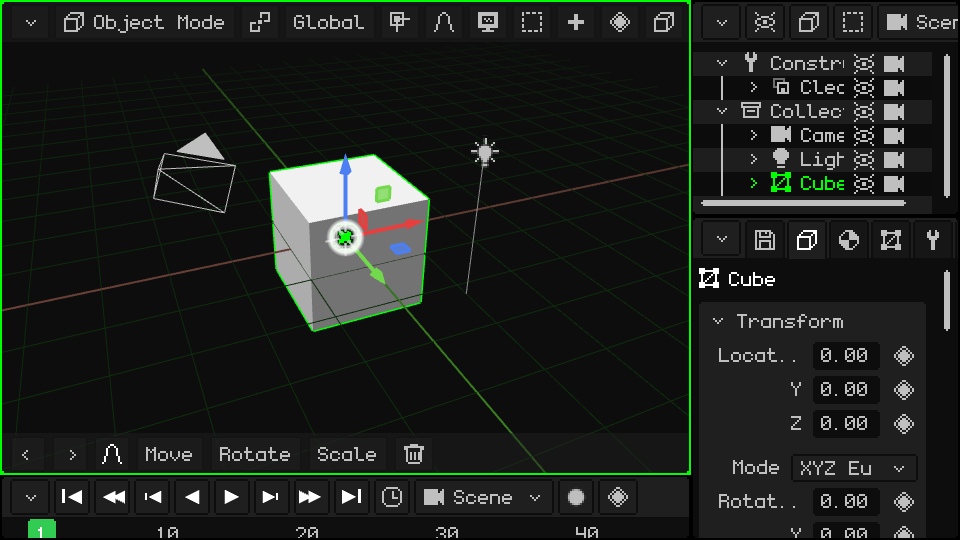

## The active viewport

The viewport under the mouse is the **active viewport**, and it's marked with a green border. It's the one that receives keyboard commands, game controllers and any other peripheral. As you move the mouse from one viewport to another, the green border follows it:

 **On a Nokia N95:** each press of the **green call key**  moves to the next viewport. Two fit on the N95's screen: the 3D Viewport on the left and Properties on the right.

## The menu bar and the corner button

Every viewport has a **menu bar** at the top (green in the image) with that editor's menus and buttons. The **corner button** (orange) is always at the top left: you use it to change or modify the viewport.

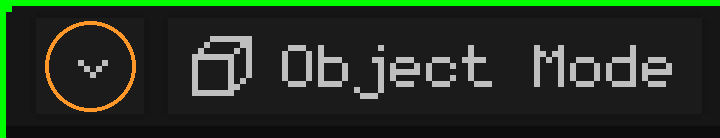

It's the same in every viewport, and it's the only button they all have.

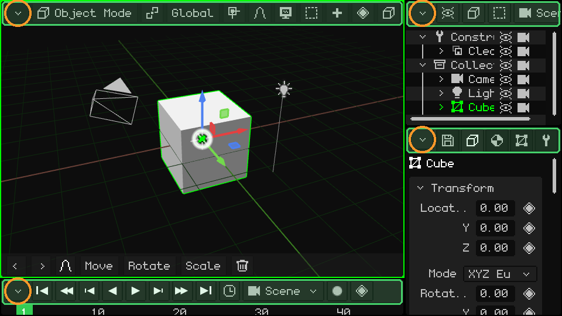

## Resize

  **Press and hold** the corner button (with your finger or the mouse) and drag it to resize: that moves the left and top borders of that viewport, and the ones next to it adjust. A **single tap**, without dragging, opens the drop-down menu with the viewport's options. Here, the bottom-right one is dragged in circles and all three change size:

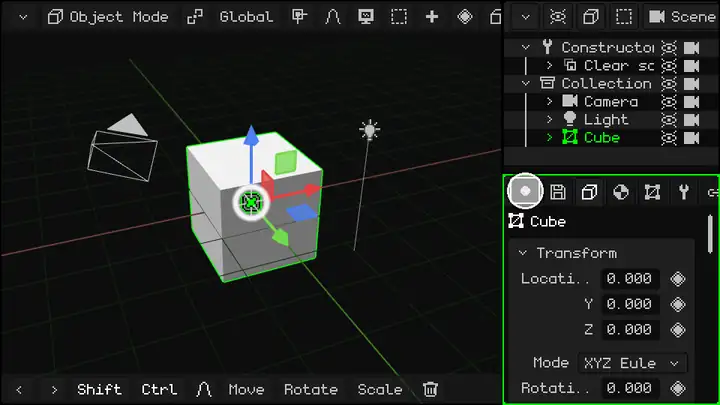

 **On a Nokia:** hold down the **green call key**  and press an arrow: the border of the active viewport (the one with the green frame) moves that way, so it grows or shrinks. The green key on its own, without arrows, moves to the next viewport.

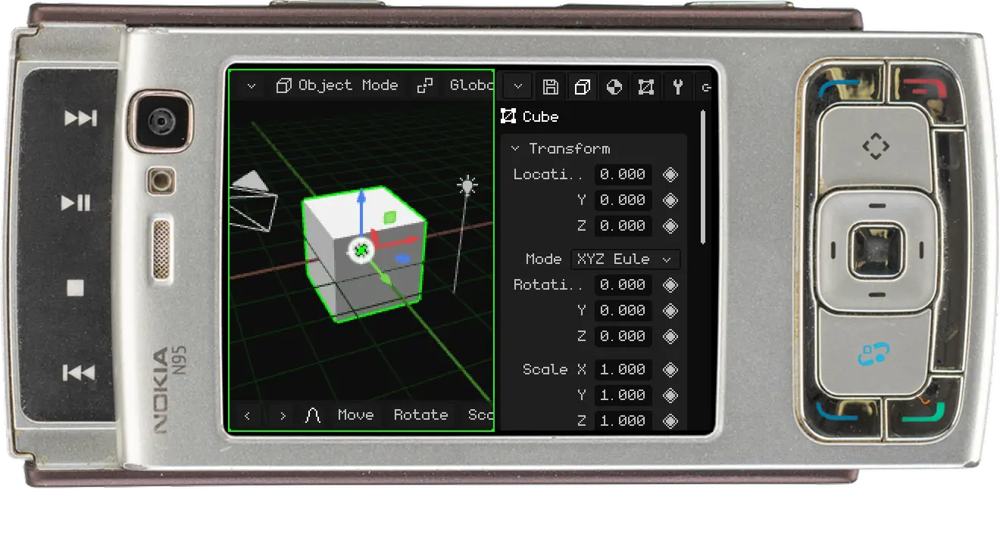

## The viewport options

A tap on the corner button opens this menu:

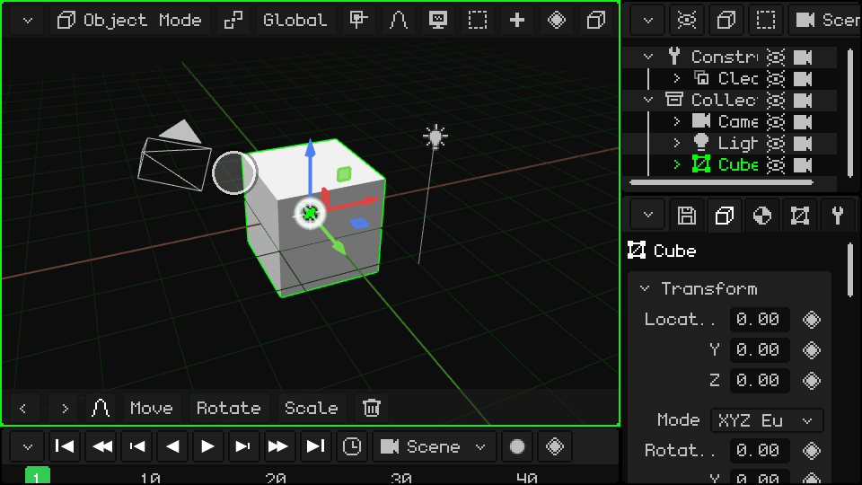

At the top are the **viewport types**: choosing one turns the viewport into that editor. Below the line is what you can do with it:

| Option | What it does |
|---|---|
| Expand | The viewport takes the space of the one next to it, which closes (if the one next to it is split, that whole group closes). |
| Split in Columns | Splits it in two, side by side. |
| Split in Rows | Splits it in two, one above the other. |
| Maximize | Enlarges it to fill the whole window. While it's maximized, the menu only has **Minimize**, which puts it back in its place. |

### Change the type

The 3D Viewport turned into a UV Editor:

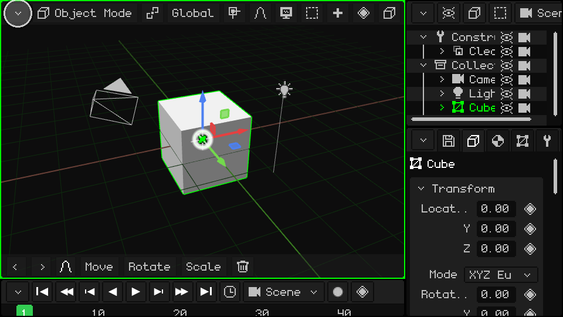

### Split in Columns and Split in Rows

### Expand

The Outliner takes the space of Properties:

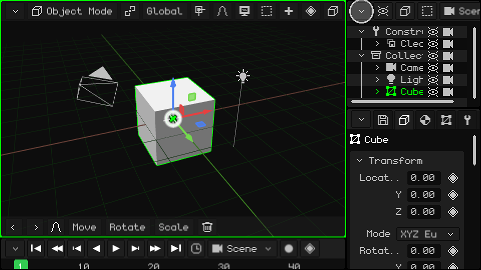

### Maximize and Minimize

## When you can't see all the menu bar options

If the viewport is narrow, its menu bar doesn't fit entirely. The same happens with the toolbar at the bottom of the 3D Viewport. To see the rest:

-  **With your finger:** drag it sideways.
-  **With the mouse:** hold down the mouse button on the bar and drag, or turn the **wheel** over it.
-   **With the keyboard:** <kbd>M</kbd> on PC, or the **left soft key** on the Nokia, enters the bar of the active viewport. Go through it with the left and right arrows; each menu opens when you reach it. Move through the menu with up and down, and choose with OK (<kbd>Enter</kbd> on PC). The bar scrolls by itself to show where you are.

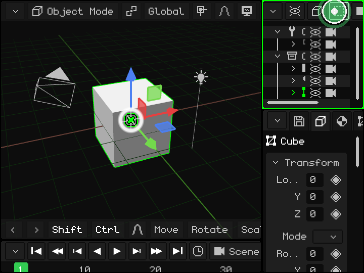

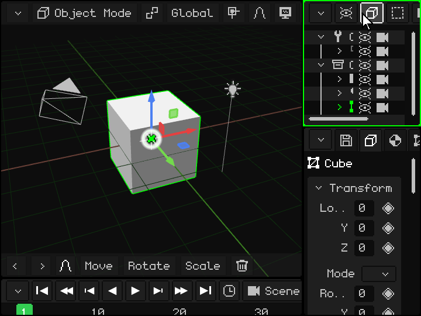

 On a Nokia N95: the left soft key enters the bar and the arrows go through it.

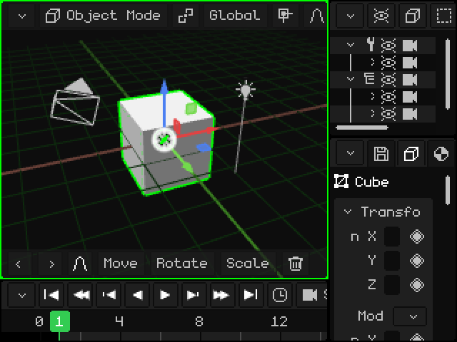

## Viewport types

| Viewport | What it's for |
|---|---|
| [3D Viewport](vista-3d.md) | Where you see and edit the scene: model, move objects, paint, pose and animate. |
| [Outliner](outliner.md) | The list of everything in the scene. |
| [Library](outliner.md#library-view) | The project's resources: meshes, materials, textures, animations, sounds, scripts and more. |
| [Properties](propiedades.md) | The data of the active object, in tabs. |
| [UV Editor](editor-uv.md) | How the texture sits on the mesh. |
| [Timeline](linea-de-tiempo.md) | The animation: keyframes and curves. |
| [2D Editor](editor-2d.md) | Game interfaces, HUDs and 2D games. |
| [Console](consola.md) | The engine log: errors, warnings and information. |
| [IDE](editor-de-scripts.md) | The editor for Lua scripts and shaders. |

Whisk3D keeps growing: over time new viewports will be added and the current ones may change. They will all work the same way, with the menu bar at the top and the button in the corner.

## More of the interface

| Function | Description | How to use it |
|---|---|---|
| Keyboard menu bar | Opens the active viewport's menu bar so you can go through it with the arrows. | <kbd>M</kbd> (in Edit Mode, <kbd>M</kbd> is Merge). |
| Undo / Redo | Steps the last action back or forward. | <kbd>Ctrl+Z</kbd> / <kbd>Ctrl+Y</kbd> or <kbd>Ctrl+Shift+Z</kbd>; arrows in the toolbar. |
| Save project | Saves the open .w3d (if it's new, it asks for a name). | <kbd>Ctrl+S</kbd>, or Properties → File/Render tab → File card (see [The project](proyecto.md)). |
| Fullscreen | Enters and leaves fullscreen. | <kbd>F11</kbd>. On Android it's automatic if the phone has no notch. |
| Play / Pause | Plays the animation (or the game) from any panel. | <kbd>Space</kbd> or the Play button in the timeline. |

 **On Android**: in portrait the layout is the 3D Viewport on top and Properties below; in landscape the timeline is added. When the on-screen keyboard opens (for example in the script editor), the active viewport is maximized in the visible area and goes back to its place when the keyboard closes.
