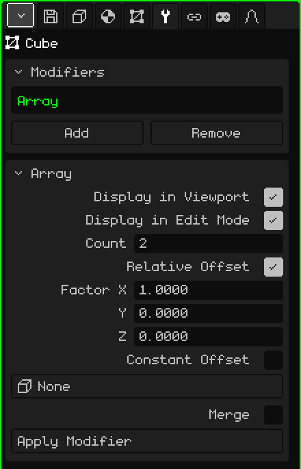

# Array

The **Array** modifier makes copies of the mesh in a row, each one shifted from the previous one. It's useful for anything that repeats: the posts of a fence, the steps of a staircase, the columns of a corridor or the links of a chain. You model a single piece and the Array builds the rest; if you change the piece, all the copies change.

## How to add it

1. Select the mesh.
2. In Properties, open the **Modifiers** tab (the wrench icon).
3. Tap **Add** and choose **Array**.

It appears in the list as **Array**, and its card with the parameters opens below. Like all modifiers, it doesn't destroy the mesh: you can turn it off, move it with **Move Up** and **Move Down**, take it off with **Remove** or bake it with **Apply Modifier**.

## Parameters

| Parameter | What it does |
|---|---|
| Display in Viewport | When off, the copies aren't calculated: neither in the view nor when rendering. |
| Display in Edit Mode | When off, only the original piece is shown while you edit. |
| Count | How many pieces there are in total, counting the original (2 by default). With 1, only the original is left. |
| Relative Offset | Shifts each copy according to the **size** of the piece. It's on by default, with Factor X at 1: each copy sits right against the previous one, with no gap and no overlap. |
| Factor X / Y / Z | How many times its own size each copy is shifted on that axis: 1 = touching, 2 = with a gap the size of one piece, 0.5 = overlapping by half. Y is depth and Z is height, as in the Object tab. They only show up with Relative Offset on. |
| Constant Offset | Shifts each copy a fixed distance, regardless of the size of the piece. It's off by default. If both offsets are on, they add up. |
| Distance X / Y / Z | The meters each copy is shifted on each axis. They only show up with Constant Offset on. |
| Object Offset | An object in the scene (an Empty is the most convenient) that shifts, rotates and scales each copy a bit more than the previous one. See below. At **None**, it isn't used. |
| Merge | Welds the vertices that touch between one copy and the next, so they form a single surface: a continuous railing instead of separate sections. It's off by default. |
| Merge Distance | How close two vertices have to be to get welded (0.001 m by default). It only shows up with Merge on. |
| Apply Modifier | Bakes the copies into the mesh. See the note below. |

## Examples

- **A fence:** a post (a narrow, tall Cube), Count at 10 and Factor X at 3: ten posts with a gap of two posts between each one.
- **A staircase:** a step (a flat Cube), Factor X at 0, Factor Y at 1 and Factor Z at 1: each step ends up one step further back and one step higher.

## The Object Offset

With an object chosen, each copy repeats how that object is **shifted, rotated and scaled relative to the mesh**, and keeps accumulating it: the second copy does it once, the third twice, and so on.

- If the Empty is in the same place as the mesh and rotated 30° around the vertical, each copy rotates 30° more than the previous one: with 12 copies it goes all the way around.
- If it's also a bit higher, each copy rises a bit more: a spiral staircase.
- If it's scaled to 0.9, each copy is a bit smaller than the previous one: a spiral that closes in.

With the Empty in the same place as the mesh, the copies rotate around the mesh's origin. To make them form a circle instead of spinning in place, move the piece away from the origin in Edit Mode and turn off Relative Offset. When you move or rotate the object, the copies update instantly.

## Order matters

Relative Offset measures the mesh **as it comes** from the modifier above: if there's a [Mirror](modificador-espejo.md) above, it measures the already mirrored object. With a [Subdivision Surface](modificador-subdivision.md) below, the copies welded with Merge are smoothed as a single piece; without Merge, each copy is smoothed separately.

> [!NOTE]
> Apply Modifier on an Array bakes **all** the modifiers in the list that are on, not just the Array (with the viewport values), and leaves the list empty: the ones that were off and the ones that don't generate geometry, like an [Armature](modificador-esqueleto.md), go away too. It can be undone.

Back to [3D Mesh](objeto-malla.md)
