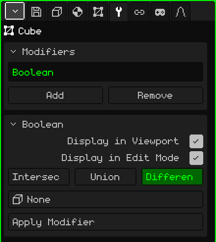

# Boolean

The **Boolean** modifier combines the mesh with another one: it subtracts the other one's volume, adds it, or keeps what they have in common. It's useful for things that would take a lot of work to model by hand: a window hole in a wall, the hollow of a cup, a slot, or two pieces fused into one.

## How to add it

1. Select the mesh that will change (for example, the wall).
2. In Properties, open the **Modifiers** tab (the wrench icon).
3. Tap **Add** and choose **Boolean**.

It appears in the list as **Boolean** (its internal name), and its card with the parameters opens below. Like all modifiers, it doesn't destroy the mesh: the wall is still whole underneath, and if you take the modifier off, the hole disappears. You can turn it off, move it with **Move Up** and **Move Down**, take it off with **Remove** or bake it with **Apply Modifier**.

## Parameters

| Parameter | What it does |
|---|---|
| Display in Viewport | When off, the operation isn't done: you see the original mesh, both in the view and when rendering. |
| Display in Edit Mode | When off, you see the mesh without the operation while you edit. |
| Intersect | Keeps only the part that is inside both meshes at the same time. |
| Union | Joins the two into a single surface and removes the faces that ended up inside. |
| Difference | Subtracts the other mesh's volume from this one: it's the one that makes holes. It's selected by default. |
| Object | The other mesh, the **cutter**. At **None** it does nothing. The list shows all the objects in the scene, but only a mesh works. |
| Apply Modifier | Bakes the result into the mesh. See the note below. |

The chosen operation is shown in green.

## Example: a window in a wall

1. Add a **Cube** and scale it into a wall: wide, tall and thin.
2. Add another **Cube** (or a **Cylinder**, for a round window) and put it where the window goes, going through the wall from side to side.
3. Select the wall, add a **Boolean** to it, leave **Difference** and in **Object** choose the cutter.
4. Hide the cutter (Hide / Show in [Object Mode](modo-objeto.md), or uncheck **Visible** in the Object tab). The hole remains.

The hidden cutter keeps cutting. To move it, show it again or select it in the Outliner.

## Good to know

- Both meshes have to be **closed**, with no holes in the surface: otherwise the Boolean can't tell what's inside and what's outside.
- Moving, rotating, scaling or editing the cutter updates the cut instantly. That way you can position the window while looking at the result.
- The faces the cut doesn't touch stay as they were: a quad is still a quad. The ones that get cut become polygons with several sides, not triangles, so the mesh stays comfortable to edit after applying it.
- The faces the cutter adds (for example, the inner edge of the window) take the mesh's first material.
- UVs and vertex colors are kept; where it cuts, they're interpolated.
- Parts that lie on the same plane aren't joined: the union of two boxes resting against each other leaves the top split into several pieces.

 On the Nokia N95 the cut is recalculated every time you move or edit the cutter. With large meshes, position it, apply the modifier and keep working with the already cut mesh.

> [!NOTE]
> Apply Modifier on the Boolean bakes **all** the modifiers in the list that are on, not just this one, and leaves the list empty: the ones that were off and the ones that don't generate geometry, like an [Armature](modificador-esqueleto.md), go away too. It can be undone. The cutter isn't deleted: it stays as just another object.

Back to [3D Mesh](objeto-malla.md)
