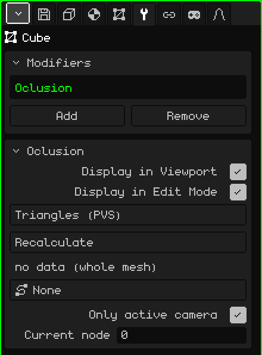

# Culling

The **Culling** modifier draws only the mesh triangles that can be seen from the zone where the camera is. It uses visibility lists calculated in advance, one per zone, the way PlayStation 1 games did (a **PVS**, *potentially visible set*). It's useful for large levels: out of a whole level, only what can be seen from the corridor you're in gets drawn.

 It's designed for the Nokia N95, where every triangle that isn't drawn is speed gained. Switching zones costs almost nothing: the lists are built only once and, when you go from one zone to another, only which one is used changes. There's no calculation per frame.



## How to add it

1. Select the level's mesh.
2. In Properties, open the **Modifiers** tab (the wrench icon).
3. Tap **Add** and choose **Culling**.

It appears in the list under its internal name, **Oclusion**, and its card with the parameters opens below. It doesn't touch the mesh: it only chooses which triangles to draw, so the mesh stays whole and editable. That's why it has no Apply Modifier.

Don't confuse it with the **Culling** object in the 3D Viewport's Add menu, which works with whole objects and not with the triangles of a mesh.

## Where the data comes from

The modifier doesn't calculate what can be seen: it reads it from a file that comes with the model. For a mesh imported from `nivel.obj`, it looks for `nivel.pvs.json` in the same folder:

```json
{ "sectores": 2, "tris": [[0, 1], [2, 3]] }
```

`sectores` is how many zones there are, and `tris` holds, for each zone, the triangles that get drawn, numbered from 0 in the order of the faces in the `.obj`. Normally it comes from the original game or from a separate tool. Each zone is a **node**: node 1 is the first list, and node 0 draws the whole mesh.

## Parameters

| Parameter | What it does |
|---|---|
| Display in Viewport | When off, the whole mesh is drawn. |
| Display in Edit Mode | It doesn't change anything: in Edit Mode the mesh is always drawn whole. |
| Method | **Triangles (PVS)** uses the lists from the `.pvs.json`. **BSP (pending)** appears grayed out: it can't be chosen yet. |
| Recalculate | Reads the `.pvs.json` again, for example after regenerating it. It shows "PVS recalculated" or, if it can't find it, "PVS: <model>.pvs.json is missing next to the source .obj". |
| (status line) | Below Recalculate: "4 nodes \| active node: 2", "no data (whole mesh)" if there's no file, or "sidecar not loaded (Recalculate)". |
| Path | A path in the scene (**Add → Path**), for example the rail the camera travels along. Each node of the path is a zone, and the engine picks the node closest to the eye by itself. At **None**, the zone is set by hand or from a script. |
| Only active camera | When on (the default), the active camera is in charge while the scene plays; when paused, nothing is chosen automatically and the node is set by hand. When off, the viewport's view is in charge: you can fly freely through the level and watch the triangles appear and disappear. |
| Branches | It only appears if the path has more than one branch, for example the main route and a bonus one. It chooses which branches count when looking for the closest node; each branch that's on is shown in green. The button says, for example, "Branches: 3 (all)" or "Branches: 2/3". |
| Current node | The zone being drawn; 0 = the whole mesh. You can change it by hand to check each zone. When the Path picks the node by itself, the engine overrides it. |

From a script, `setSector(objeto, n)` changes the active node (0 = the whole mesh). See [Particles, fog and visibility](../lua/api-particulas-niebla.md).

## Good to know

- While the mesh is in Edit Mode it's drawn whole, so you can edit everything.
- If there's another modifier in the list that's on and generates geometry ([Mirror](modificador-espejo.md), [Array](modificador-array.md), [Subdivision Surface](modificador-subdivision.md)…), Culling isn't used and everything is drawn: the triangle numbers in the `.pvs.json` are those of the original mesh.
- The lists name the triangles by their number. If you edit the mesh and add or delete faces, the numbers change and the lists may end up pointing at other triangles: Culling is for finished levels, not for ones still being modeled.

Back to [3D Mesh](objeto-malla.md)
