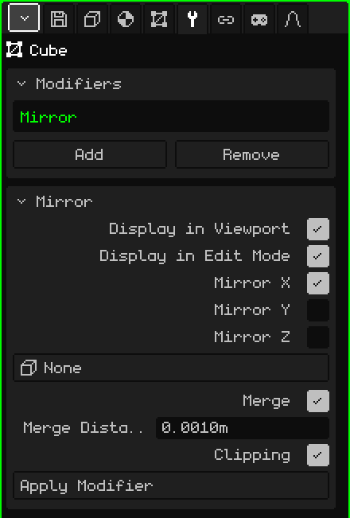

# Mirror

The **Mirror** modifier reflects the mesh to the other side of a plane. It's useful for anything symmetrical: you model half of a character, a face or a car, and the other half appears on its own, mirrored. Whatever you change on one side is repeated on the other while you work.

## How to add it

1. Select the mesh.
2. In Properties, open the **Modifiers** tab (the wrench icon). It only appears when the active object is a mesh.
3. Tap **Add** and choose **Mirror**.

It appears in the list on the Modifiers card as **Mirror** (its internal name), and a card with its parameters opens below.

A modifier doesn't destroy the mesh: the original stays intact and you keep editing it, and what you see is the result. You can turn it off at any time, move it in the list with **Move Up** and **Move Down** (they appear when there are two or more), take it off with **Remove** or bake it into the mesh with **Apply Modifier**.

## Parameters

| Parameter | What it does |
|---|---|
| Display in Viewport | When off, the reflection isn't calculated: neither in the view nor when rendering. It's useful for comparing with and without. |
| Display in Edit Mode | When off, only the original half is shown while you edit the mesh; when you go back to Object Mode, the reflection appears. |
| Mirror X | Reflects from left to right. It's on by default: it's the one you need for a character or a car. |
| Mirror Y | Reflects from front to back. |
| Mirror Z | Reflects from top to bottom. |
| Mirror Object | At **None**, the mirror plane goes through the mesh's origin. If you choose another object (for example an Empty), the plane goes through that object's origin and rotates with it; its scale doesn't count. When you move or rotate it, the reflection updates instantly. |
| Merge | Welds the seam: the vertices that are almost on the plane snap to it and are shared by both halves. That way there's no line down the middle and smooth shading flows from one side to the other without breaks: half a sphere looks like a whole sphere. It's on by default. |
| Merge Distance | How close to the plane a vertex has to be to get welded (0.001 m by default). If the seam stays open, raise it a little; if vertices you didn't want get stuck together, lower it. It's also the margin for Clipping. |
| Clipping | While you move vertices in Edit Mode, it doesn't let them cross to the other side of the plane: a vertex that reaches the plane stays stuck to it and only slides along it. The vertices in the center don't come loose, so the seam doesn't open by accident. It's on by default. |
| Apply Modifier | Bakes the reflection into the mesh: both halves become real vertices and the modifier leaves the list. Four-sided faces stay four-sided. It can be undone. |

If you turn on more than one axis, each reflection is done on the result of the previous one. With X and Y on, you model a quarter of the object and you get all four parts.

## Order matters

Modifiers are applied from top to bottom: each one works on what the previous one left. Mirror almost always goes first:

- **Mirror above [Subdivision Surface](modificador-subdivision.md):** first the whole model is put together and then it's all smoothed at once, with no mark in the center. The other way around, each half is smoothed separately and a crease is left where they join.
- **Mirror above [Array](modificador-array.md):** the Array copies the already complete object, and its Relative Offset uses the size of the whole object.

Apply Modifier on the Mirror bakes only the Mirror, no matter where it is in the list: the other modifiers stay there.

## Tips

- Work with the mesh's origin at the center of the model, because the mirror plane goes through there. Leave the vertices that go in the middle exactly on the plane.
- To model comfortably, look from the front in orthographic (see [Navigating the 3D Viewport](../tutoriales/navegacion.md#front-side-and-top-views)): the Mirror X plane shows up as a vertical line in the middle.
- When the model is finished, apply the Mirror if you want to touch up each half separately, for example so a character isn't perfectly symmetrical.

Back to [3D Mesh](objeto-malla.md)
