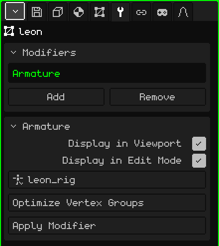

# Armature

The **Armature** modifier makes the mesh follow the bones of an armature: when you pose or animate the armature, the mesh bends with it. It's what turns a static model into a character that walks, jumps or waves.

## How to add it

1. Select the mesh.
2. In Properties, open the **Modifiers** tab (the wrench icon).
3. Tap **Add** and choose **Armature**.

It appears in the list as **Armature** (its internal name), and its card with the parameters opens below. Like all modifiers, it doesn't destroy the mesh: the rest pose stays intact. You can turn it off, take it off with **Remove** or bake it with **Apply Modifier**.

When you import an FBX or a glTF with an armature, the modifier is already set up and pointing to its armature.

## Parameters

| Parameter | What it does |
|---|---|
| Display in Viewport | When off, the mesh isn't deformed: it stays in its rest pose. |
| Display in Edit Mode | When off, the mesh stays at rest, undeformed, while you edit the vertices. |
| Target | The armature that moves it. The list shows only the armatures in the scene. At **None**, it isn't deformed. |
| Optimize Vertex Groups | Leaves each vertex with a single bone, the one that moved it most, with full weight. It asks for confirmation because the in-between weights are lost. |
| Apply Modifier | Bakes the pose of the current frame into the mesh and removes the modifier: the mesh stays frozen in that pose. The armature isn't touched. It can be undone. |

## How the mesh knows which bone moves it

With **vertex groups**. Each group has **the same name as a bone** and says which vertices that bone moves and how much: the **weight**, from 0 (nothing) to 1 (fully). A vertex can be in several groups; at an elbow, half in the upper arm and half in the forearm, so it bends smoothly.

The groups are in the **3D Mesh** tab, **Vertex Groups** card:

| Button | What it does |
|---|---|
| Add Vertex Group / Rename | Creates a group and names it. The name has to match the bone's, letter for letter. |
| Assign / Remove | In Edit Mode, puts the selected vertices into the group (with weight 1) or takes them out. |
| Select / Deselect | Shows which vertices the group has. |

For fine weights, like the transitions at shoulders and knees, use [Weight Paint](pintura.md#weight-paint): it paints the weight of the chosen group, from blue (nothing) to red (fully).

## Step by step

1. Build the armature (**Add → Armature**) and place the bones inside the model (see [Armatures](esqueletos.md)).
2. Add the **Armature** modifier to the mesh and in **Target** choose the armature.
3. Create one group per bone, with the same name, and assign or paint the weights.
4. Select the armature, switch to **Pose Mode** and move a bone: the mesh follows it.

## Good to know

- The Armature's place in the list doesn't change anything: it isn't calculated together with the others, but deforms the mesh on every frame, when it's drawn.
- It deforms the original mesh. If there are other modifiers on that generate geometry ([Mirror](modificador-espejo.md), [Array](modificador-array.md), [Subdivision Surface](modificador-subdivision.md), [Screw](modificador-screw.md), [Boolean](modificador-booleano.md)), what you see is the generated mesh, which doesn't follow the bones. Apply them before animating.
- Applying one of those modifiers (except Mirror) empties the whole list, and the Armature goes too. The vertex groups remain: add the Armature again and choose the Target again.

 On the Nokia N95, deforming the mesh on every frame is costly, and more so the more bones influence each vertex. **Optimize Vertex Groups** leaves a single one per vertex and skinning gets much faster; in exchange, the joints bend more stiffly. Do it at the end, when the weights are ready.

Back to [3D Mesh](objeto-malla.md)
