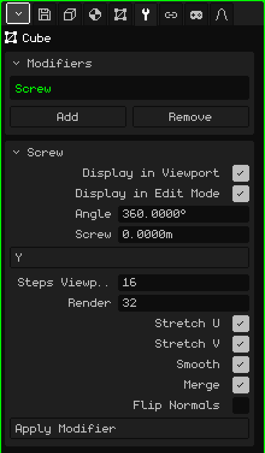

# Screw

The **Screw** modifier spins a profile around an axis and builds the surface it sweeps as it turns, like a lathe. You draw half the silhouette of a vase, a goblet or a bottle, and the Screw turns it into the whole object. If the profile also rises while it turns, you get a thread or a spring.

## How to add it

1. Select the mesh with the profile.
2. In Properties, open the **Modifiers** tab (the wrench icon).
3. Tap **Add** and choose **Screw**.

It appears in the list as **Screw** (its internal name), and its card with the parameters opens below. Like all modifiers, it doesn't destroy the mesh: the profile is still there and you can edit it while you watch the result. You can turn it off, move it with **Move Up** and **Move Down**, take it off with **Remove** or bake it with **Apply Modifier**.

## The profile

The profile is a line: vertices joined by edges, with no faces. The spin axis goes through the mesh's **origin**, so each vertex's distance to the origin is the object's radius at that height. One way to draw it:

1. **Add → Mesh → Vertex** creates a loose vertex at the origin and goes straight into Edit Mode.
2. Look from the front (see [Navigating the 3D Viewport](../tutoriales/navegacion.md#front-side-and-top-views)).
3. With **Extrude Vertices** (Mesh → Vertex menu), pull the next vertex out to the side to make the bottom, and then upward for the wall, point by point.

The vertices that lie on the axis close the object: the first one, at the origin, is the center of the vase's bottom.

## Parameters

| Parameter | What it does |
|---|---|
| Display in Viewport | When off, it doesn't spin: only the profile is shown, both in the view and when rendering. |
| Display in Edit Mode | When off, only the line is shown while you edit the profile. |
| Angle | How many degrees the profile turns, from the first step to the last (360 by default, a full turn). With 180 you get half an object. A negative value turns the other way. It can go past 360: with 1080 it makes three turns. |
| Screw | How many meters the profile rises along the axis, from the start to the end of the turn. At 0 it's a lathe (vase, goblet, bottle); with any other value, a thread or a spring. |
| Axis | Which axis it turns around: X, Y or Z. By default it's **Z**, the vertical: a profile drawn in the front view comes out standing up, like a vase on a table. |
| Steps Viewport | How many copies of the profile are made along the turn in the view, from 2 to 512 (16 by default). More steps, rounder and heavier. |
| Render | The steps used for **Render Image** or **Render Animation** (32 by default). |
| Stretch U | Builds UV coordinates around the turn, so a texture wraps around the object like a label. |
| Stretch V | Builds UV coordinates along the profile, from top to bottom. With both off there are no UVs. |
| Smooth | Smooth shading on the generated surface: it looks round, not faceted. It's on by default. |
| Merge | Welds the vertices that end up in the same place: the profile's vertices that touch the axis (the bottom, the mouth of a closed bottle) and the seam where the turn closes. It's on by default. |
| Flip Normals | Flips the direction the faces point in. Use it if the object looks inside out, dark, or as if seen from the inside. |
| Apply Modifier | Bakes the result into the mesh with the **Steps Viewport**. See the note below. |

The turn closes by itself, with no seam, only with Angle at 360 and Screw at 0. With any other angle, or with the profile rising, the start and the end stay open.

## Examples

- **A vase:** the half-silhouette profile, Angle 360, Screw 0 and between 16 and 32 steps.
- **A thread:** a short profile away from the axis, Angle 1080 and Screw at 3: three turns rising one meter each. Raise the steps so the spiral doesn't look jagged.

 On the Nokia N95 each step is one more copy of the profile to draw. Use few Steps Viewport while you model and leave the high values for Render.

> [!NOTE]
> Apply Modifier on the Screw bakes **all** the modifiers in the list that are on, not just this one, and leaves the list empty: the ones that were off and the ones that don't generate geometry, like an [Armature](modificador-esqueleto.md), go away too. It can be undone.

Back to [3D Mesh](objeto-malla.md)
