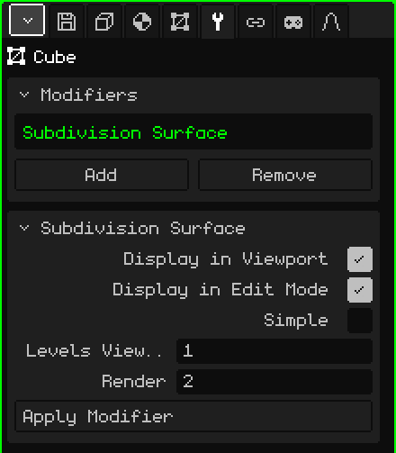

# Subdivision Surface

The **Subdivision Surface** modifier splits each face into smaller faces and, by default, rounds the shape. It lets you model with few polygons, which is quick to edit and light, and see a smooth result: a cube becomes something like a sphere, and a low-poly character becomes one with rounded shapes.

## How to add it

1. Select the mesh.
2. In Properties, open the **Modifiers** tab (the wrench icon).
3. Tap **Add** and choose **Subdivision Surface**.

It appears in the list as **Subdivision Surface** (its internal name), and its card with the parameters opens below. Like all modifiers, it doesn't destroy the mesh: you can turn it off, move it with **Move Up** and **Move Down**, take it off with **Remove** or bake it with **Apply Modifier**.

## Parameters

| Parameter | What it does |
|---|---|
| Display in Viewport | When off, it doesn't subdivide: neither in the view nor when rendering. |
| Display in Edit Mode | When off, you see the mesh unsubdivided while you edit and editing is faster; when you go back to Object Mode it looks smooth again. |
| Simple | When off (the default), each level smooths the shape and rounds the corners. When on, it only splits the faces without moving the vertices: the shape stays the same but with more vertices, for example to paint vertex colors in more detail. |
| Levels Viewport | How many times it subdivides in the view, from 0 to 6 (1 by default). Each level multiplies the faces by 4: a 6-face cube goes to 24 with 1 level, 96 with 2 and 384 with 3. At 0 it doesn't subdivide. |
| Render | The levels used for **Render Image** or **Render Animation** (2 by default). That way the view stays light and the final image comes out smoother. |
| Apply Modifier | Bakes the subdivision into the mesh with the **Levels Viewport** (not the Render ones). See the note below. |

## How to work with subdivision

- It works best with four-sided faces. A triangle is split into 3 quads, and a five-sided face into 5.
- Subdividing doesn't change the shading: a flat mesh still looks faceted. To make it look smooth, in Edit Mode select the faces and use the Face → **Shade Smooth** menu.
- To make an edge sharper, add a cut near it with **Loop Cut and Slide** (see [Edit Mode](modo-edicion.md)): the closer to the edge, the harder it gets.
- Open edges, on a mesh that isn't closed, are smoothed following the edge.

## Order matters

Modifiers are applied from top to bottom. Put the [Mirror](modificador-espejo.md) **above** the Subdivision: that way the whole model is smoothed at once. If the Mirror goes below, each half is smoothed separately and a crease is left in the middle. The same happens with an [Array](modificador-array.md): the copies welded with Merge are smoothed together.

 On the Nokia N95 each level is heavy: with 1 level there are already four times as many faces to draw, and with 2, sixteen times as many. Leave the Levels Viewport at 0 or 1, turn off Display in Edit Mode while you model, and save the high levels for Render.

> [!NOTE]
> Apply Modifier on the Subdivision bakes **all** the modifiers in the list that are on, not just this one, and leaves the list empty: the ones that were off and the ones that don't generate geometry, like an [Armature](modificador-esqueleto.md), go away too. It can be undone.

Back to [3D Mesh](objeto-malla.md)
