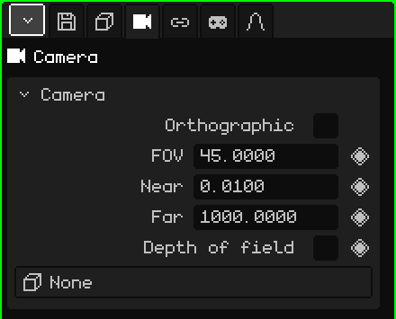

# Camera

A **camera** is a point of view placed in the scene. The **active camera** is the one used for the game and for renders: what it sees is what you see when playing and what comes out in the image or the video. This article is the reference for its properties; how objects are added and moved is covered in the [Object Mode](../tutoriales/modo-objeto.md) tutorial.

## The tabs

| Tab | What it has |
|---|---|
| Object | Location, rotation, name and visibility, the same as for every object: see [3D Mesh](objeto-malla.md#the-object-tab). |
| Camera | The camera's lens: the card below. |
| Constraints | See [Constraints](restricciones.md). |
| Scripts | The object's Lua scripts. See [Lua in Whisk3D](../lua/README.md). |

## The Camera card

| Property | What it does |
|---|---|
| Orthographic | No perspective: distant things don't get smaller and parallel lines don't converge. See [Perspective and orthographic](../tutoriales/navegacion.md#perspective-and-orthographic). |
| FOV ◆ | The field of view, in degrees (from top to bottom). Smaller is like a telephoto lens: less fits in and things look closer. Larger is a wide angle: more fits in and the perspective is exaggerated. It starts at 45. |
| Near ◆ | The minimum drawing distance: whatever is closer to the camera isn't drawn. It starts at 0.01. |
| Far ◆ | The maximum drawing distance: whatever is farther away isn't drawn. It starts at 1000. |
| Depth of field | Turns on blur: whatever is at the focus distance comes out sharp and the rest blurry. Ray tracing draws it; Post Processing can also use the same focus. |
| F-stop | How much it blurs, as in a real camera: a smaller number blurs more. |
| Focus distance ◆ | How many meters away it focuses. The line and the cross drawn on the camera mark where. |
| Focus object | An object the focus follows by itself, wherever it is. With an object chosen, Focus distance disappears. **None** goes back to the manual distance. |
| Target | An object the active camera always looks at: if the object moves, the camera turns to follow it. **None** leaves it looking wherever you rotated it. |

F-stop, Focus distance and Focus object appear with Depth of field checked.

### When to adjust Near and Far

If a wall or a character very close to the camera looks cut off, lower **Near**. If the background of a large level disappears, raise **Far**. It's best not to stretch the range more than necessary: with a lot of distance between Near and Far, faces that are very close together can flicker, especially on the Nokia N95.

Near and Far can be animated: it's useful, for example, for pushing the drawing limit back when the camera rises and shows more of the level.

### A camera that follows a character

There are two ways, depending on the shot:

- **The camera stays in place and turns:** put the character in **Target**. The active camera keeps the character in the center of the shot even while running, like someone watching them go by.
- **The camera travels with the character:** leave Target at None and add a **Child Of** constraint with the character as the source and only **Location** checked. It goes along at the same distance and with the same angle, without turning when the character turns (see [Child Of](restricciones.md#child-of)).

## Choosing the active camera

The scene can have several cameras, but only one active. To change it:

| | How to choose it |
|---|---|
|  PC | Select the camera and <kbd>Ctrl</kbd> + <kbd>Num 0</kbd> |
| Menu | View → Cameras → Set Active Object as Camera |
| Properties | Animation tab → **Active camera** card |

In the Active camera card, the diamond sets up **camera cuts**: switching from one camera to another on a frame. See [Timeline](linea-de-tiempo.md).

To look through the active camera and adjust the shot by navigating, see [The active camera](../tutoriales/navegacion.md#the-active-camera) in the navigation tutorial.
