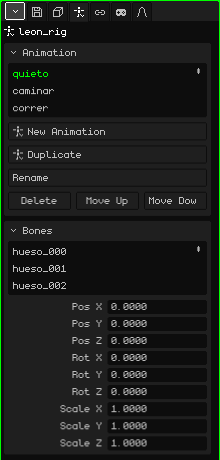

# Armature

An **armature** is an object made of **bones** that's used to animate characters and things that bend. The bones move and the mesh follows them, deforming: you animate an arm by rotating a couple of bones instead of moving hundreds of vertices. This article is the reference for its properties; how objects are added and moved is covered in the [Object Mode](../tutoriales/modo-objeto.md) tutorial.

Add → Armature creates one with a single bone, ready for you to add more. In the 3D Viewport each bone is drawn as a blue line on top of everything, so you can see it even when it's inside the mesh.

## Rest and pose

Each bone has two states:

- **Rest:** where it was placed when the armature was built. It's the posture in which the mesh is undeformed (a character with arms spread out, for example).
- **Pose:** how it is on a frame of the animation: the arm raised, the head turned. Posing doesn't change the rest: you can always go back to it.

## The modes

An armature has three modes, chosen in the 3D Viewport's **Mode** menu:

| Mode | What it's for |
|---|---|
| Object Mode | Move, rotate and scale the whole armature, like any object. |
| Edit Mode | Build the armature: create bones from the tips, move them, parent them. It changes the rest. |
| Pose Mode | Pose and animate: rotate the bones and store keyframes. |

 <kbd>Tab</kbd> switches between Object Mode and Pose Mode (and from Edit Mode it goes to Pose Mode).

The tools and shortcuts for each mode are in [Armatures](esqueletos.md), in the manual.

## The tabs

| Tab | What it has |
|---|---|
| Object | Location, rotation, scale, name and visibility of the whole armature, the same as for every object: see [3D Mesh](objeto-malla.md#the-object-tab). |
| Armature | The animations and the bones: the two cards below. |
| Constraints | See [Constraints](restricciones.md). |
| Scripts | The object's Lua scripts. See [Lua in Whisk3D](../lua/README.md). |

## The Armature tab

### Animation

The armature's animations (the **clips**): walk, run, jump. Each clip stores the poses of the bones over time.

| Property | What it does |
|---|---|
| The list | The armature's clips. The chosen one is the one that gets edited and played. |
| New Animation | Creates an empty clip, with the bones at rest. |
| Duplicate | Copies the chosen clip, to make a variant without touching the original (it appears if there are clips). |
| Rename | Renames the clip. The name can't be repeated within the same armature. |
| Delete / Move Up / Move Down | Deletes the clip or moves it in the list. |

How to animate: [Timeline](linea-de-tiempo.md).

### Bones

The list of the armature's bones. When you choose one, the card shows its data:

| Property | What it does |
|---|---|
| Name | The bone's name. Changing it also renames its vertex group in the armature's meshes, so the mesh still follows it. |
| Parent | Which bone it hangs from (**None** if it's the root). Moving the parent moves its children. The menu doesn't offer the bone itself or the ones that hang from it, so no loop is formed. |
| Connected | Only if it has a parent. When checked, the start of the bone is welded to the tip of the parent: moving one moves the other. Checking it with the bone separated moves it to attach it. When unchecked, it's still a child but with its tip loose (a dotted line is shown). |
| Pos X, Y, Z | Where the bone is in the current pose, measured from its parent. |
| Rot X, Y, Z | How much it's rotated in the current pose, in degrees. |
| Scale X, Y, Z | Its size in the current pose: 1 is the original. |

Pos, Rot and Scale edit the **pose** and show up instantly, but they aren't stored in the animation until you insert a keyframe (Insert Keyframe, in Pose Mode).

## Making a mesh follow the armature

For a mesh to deform with the bones, two things are needed:

1. **The Armature modifier** on the mesh (Properties → Modifiers tab → Add → Armature), with the armature chosen in **Target**. See [Armature (modifier)](modificador-esqueleto.md).
2. **Vertex groups** with the bones' names (Properties → 3D Mesh tab → [Vertex Groups](objeto-malla.md#vertex-groups)). Each group says which vertices its bone moves and how much; the weights are painted with [Weight Paint](pintura.md#weight-paint).

For a rigid object, like a sword in the hand or a hat, none of that is needed: a [Child Of](restricciones.md#child-of) constraint with the armature as the source and the hand or head bone is enough. It's much lighter than deforming a mesh, and on the Nokia N95 you can tell.

## Importing a character

Add → Imports → glTF or GLB brings in a rigged character in one go. For example, Leon:

- the **mesh**, as a child of the armature;
- the **armature**, with the file's name and `_rig` at the end;
- the **vertex groups**, one for each bone that moves the mesh, with the weights the file had;
- the **animations**, as clips in the Animation card;
- and, if it has animations, the **Armature modifier** already set up on the mesh, pointing to its armature.

Choose a clip from the list, press Play in the Timeline and the character moves.
