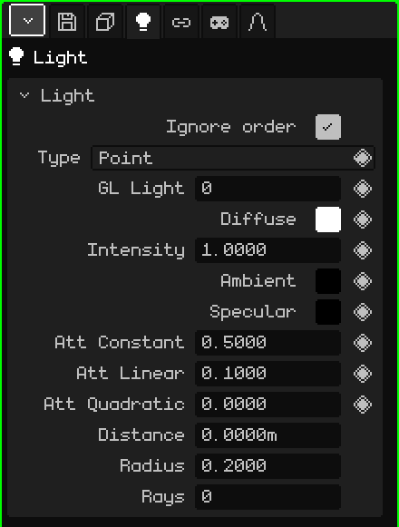

# Light

A **light** illuminates the scene: materials with Lighting on look brighter or darker depending on the lights that reach them. This article is the reference for its properties; how objects are added and moved is covered in the [Object Mode](../tutoriales/modo-objeto.md) tutorial.

## The three types

| Type | How it shines | What for |
|---|---|---|
| **Point** | From a point, in every direction, like a light bulb. | Lamps, candles, campfires, the glow of an object. |
| **Sun** | With parallel rays that all come from the same side. What matters is where it points, not where it is. | Daylight outdoors. |
| **Spot** | In a cone, like a flashlight. | Flashlights, car headlights, stage spotlights. |

Add → Light creates a Point light; Add → Sun and Add → Spot create the other two directly. The type can be changed later in the **Type** property.

The sun and the spot are aimed by rotating the object. The sun always draws a line down to the floor, toward where it shines; with the light selected, the spot shows its cone and the point light a sphere the size of its **Distance**.

## The tabs

| Tab | What it has |
|---|---|
| Object | Location, rotation, name and visibility, the same as for every object: see [3D Mesh](objeto-malla.md#the-object-tab). |
| Light | The card below. |
| Constraints | See [Constraints](restricciones.md). |
| Scripts | The object's Lua scripts. See [Lua in Whisk3D](../lua/README.md). |

## The Light card

| Property | What it does |
|---|---|
| Ignore order | When checked (the default), the light illuminates the whole scene, wherever it is in the Outliner. When unchecked, it only illuminates what's drawn **after** it in the Outliner: it's useful for lighting certain things with certain lights. |
| Type | Point, Sun or Spot. |
| GL Light ◆ | Which of the 8 OpenGL lights it uses (from 0 to 7). See [More than 8 lights](#more-than-8-lights). |
| Diffuse ◆ | The color of the light. |
| Intensity ◆ | How strongly it shines. 1 is the color as is; more is stronger. |
| Ambient ◆ | An even light that reaches everywhere, including the faces that don't face the light. It starts at black (no ambient). Raise it a little so the shadows aren't black. |
| Specular ◆ | The color of the highlight the light leaves on materials. It starts at black (no highlight). |
| Att Constant, Att Linear, Att Quadratic ◆ | The **attenuation**: how the light fades with distance. Constant weakens it evenly everywhere; Linear fades it gradually as you move away; Quadratic fades it much faster far away. They don't appear for the Sun. |
| Spot Cutoff ◆ | Spot only: how wide the cone is, in degrees, from the center to the edge. With 45 the cone opens 90° in total. |
| Spot Exponent ◆ | Spot only: how the light is spread in the cone. 0 shines evenly; higher concentrates it in the center and darkens the edges. |
| Distance | How far a Point light or a Spot reaches in ray tracing, in meters; it's also the length of the cone that's drawn. 0 means no limit. It doesn't appear for the Sun. |
| Radius | For ray tracing: the size of the lamp. 0 gives hard shadows, with sharp edges; larger gives soft-edged shadows. For the Sun it's in degrees. |
| Rays | For ray tracing: how many shadow rays this light casts. More rays give cleaner but slower soft shadows. 0 uses the ones from the File / Render tab. |

### Distance and attenuation

Both change how far a light can be noticed, but not in the same way:

- **Attenuation** always applies, in the 3D Viewport, in the game and in ray tracing: the light fades with distance, but never cuts off completely.
- **Distance** is a cutoff for ray tracing: the light fades smoothly until it reaches zero right there, and beyond that it doesn't illuminate. In OpenGL it doesn't cut off: there, attenuation is in charge. It also works as a guide, because the sphere or the cone shows where it ends.

## More than 8 lights

OpenGL draws up to **8 lights at once**, numbered from 0 to 7: that's the **GL Light** property. The scene can have many more; past 8, the new ones share a number with one of the previous ones. Ray tracing, on the other hand, uses all of them.

With **Ignore order** unchecked you can reuse a number on purpose: a light with GL Light 0 illuminates what's drawn after it in the Outliner, and another light further down with the same GL Light 0 replaces it for what follows. That way a long level can have different lights in each zone without going over 8.

## Examples

| Scene | How to set it up |
|---|---|
| A daytime exterior | A Sun, with a slightly yellow Diffuse, and some light blue Ambient so the shadows aren't black. |
| A room with a lamp | A Point light at the lamp, with Att Linear a bit higher so it fades toward the walls. For ray tracing, a Distance the size of the room. |
| A flashlight | A Spot with a small Spot Cutoff and a high Spot Exponent, attached to the character's hand with a [Child Of](restricciones.md#child-of) constraint. |
| A flickering light | Keyframes on Intensity (◆), with values that go up and down. |
