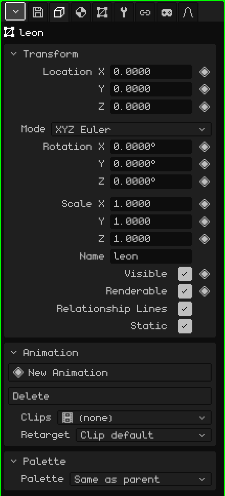
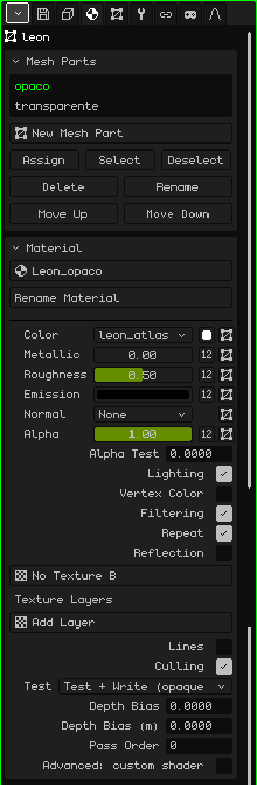
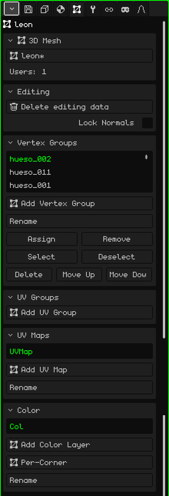
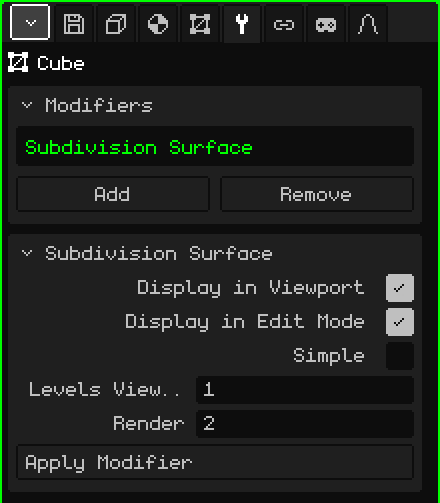

# 3D Mesh

A **3D mesh** is the object that has a shape: it's made of vertices, edges and faces, and it's what you model, paint and animate. A cube, a character or a whole level are meshes. This article is the reference for its properties; how objects are created, moved and parented is covered in the [Object Mode](../tutoriales/modo-objeto.md) tutorial.

## The tabs

With a mesh selected, Properties shows these tabs, in addition to File / Render and Animation, which are always there:

| Tab | What it has |
|---|---|
| Object | What all objects have in common: location, rotation, scale, name and visibility. |
| Material | The mesh's parts and the material of each one. |
| 3D Mesh | The mesh data: which mesh it uses, its vertex groups, its UV maps and its color layers. |
| Modifiers | The modifiers, which change the shape without destroying it. |
| Transform | Edit Mode only: the center of the selection, to type it in with numbers. |
| Constraints | See [Constraints](restricciones.md). |
| Scripts | The object's Lua scripts. See [Lua in Whisk3D](../lua/README.md). |

## The Object tab

It's the same for every object type: cameras, lights, armatures and sounds have it too.

### Transform

| Property | What it does |
|---|---|
| Location X, Y, Z ◆ | Where the object is, in meters. Z is the height. |
| Mode | How the rotation is written: **XYZ Euler** (three angles in degrees, the easiest to read), **Quaternion (WXYZ)** or **Axis Angle**. With the last two, **Rotation W** appears. Changing the mode doesn't rotate the object: it only changes how the numbers are shown. |
| Rotation X, Y, Z ◆ | The rotation around each axis. |
| Scale X, Y, Z ◆ | The size on each axis: 1 is the original size, 2 is double and 0.5 is half. |
| Name | The object's name, the same one the Outliner shows. It can't be repeated: if it already exists, a number is added (`.001`). |
| Visible ◆ | Whether the object can be seen. It's the same eye as in the Outliner. |
| Renderable ◆ | Whether it shows up in renders. Unchecked, it can still be seen in the 3D Viewport but it doesn't appear in the image or the video. |
| Relationship Lines | The line that connects the object to its parent. It's useful to turn it off when an object has many children and the lines clutter the view. |
| Static | Marks the object as never moving. It only matters inside a Culling object with the grid method: a static object is placed in its cell only once, instead of being measured every frame. |

### Animation and Palette

- **Animation:** the object's own animations, like a vertex animation, and their clips. See [Timeline](linea-de-tiempo.md).
- **Palette:** which color palette the object uses. With **Same as parent** (the default) it inherits it; choosing a palette from the project repaints the object and everything that hangs from it.

## The Material tab

### Mesh Parts

A mesh can be divided into **parts**, and each part has its own material. A house, for example, can have the walls in one part and the window glass in another.

| Property | What it does |
|---|---|
| The list | The mesh's parts. The chosen one is the one the Material card below shows. |
| New Mesh Part | Creates an empty part. |
| Assign | Moves the faces selected in Edit Mode into the chosen part. |
| Select / Deselect | Selects or deselects the faces of that part. If needed, Select switches to Edit Mode to show them. |
| Delete / Rename | Deletes the part (its faces go to the previous one) or renames it. Delete appears if there's more than one. |
| Move Up / Move Down | Change the order. The parts are drawn in that order: it's best to leave transparent things at the end. |

### Material

The material decides how the part looks: its color, its texture and how light hits it. The default material can't be edited: to change something, first create one with the selector at the top (**New Material**), which is also used to choose another material from the project. The most used options:

| Property | What it does |
|---|---|
| Rename Material | Renames the material. |
| Color | The part's texture, the **Base Color** swatch and the UV map the texture uses. |
| Metallic, Roughness, Emission, Normal, Alpha | Each one can be a number or a texture (the **Number / Texture** button). Alpha is transparency: below 1, or with an alpha texture, the material becomes transparent. |
| Alpha Test | Cuts out whatever has low alpha, without blending: for railings, wire fences or leaves. 0 turns it off. |
| Transmission, IOR | Glass and refraction. Only with **Ray Tracing** on (File / Render tab). |
| Lighting | Whether the scene's lights affect it. When off, the color looks flat, always the same. If the graphics backend has shaders, **Shading** appears: Per vertex or Per pixel. |
| Vertex Color | Uses the colors painted on the mesh (see [Vertex Paint](pintura.md#vertex-paint)) instead of the base color. |
| Filtering / Repeat | Smooths the texture up close (unchecked, you see the pixels) / repeats it like a tile. |
| Reflection | A reflection of the surroundings, like chrome. |
| Texture Layers | Up to four more textures on top of the first one, each with its own UV map and blending. |
| Lines / Line Width | Draws the part's edges, with the width in pixels. |
| Culling | Doesn't draw back faces. |
| Test, Depth Bias, Pass Order | Advanced depth options, for decals and things that rest on top of others. |
| Advanced: custom shader | A file that draws the material in a custom way: see [Hand-written shaders](shaders.md). |

If the object has physics (Add → Physics), its **Physics** card also appears in this tab.

## The 3D Mesh tab

### 3D Mesh

The object's shape is a project resource, and several objects can **share** the same mesh (that's what Duplicate Linked does): editing one edits them all.

| Property | What it does |
|---|---|
| The selector | The mesh the object uses (with a `*` if it has unsaved changes). From there you choose another mesh from the project or **New Copy**. |
| Users | How many objects in the scene use this mesh. |
| Make Single User | It appears if the mesh is shared: it gives the object its own copy, so you can edit it without touching the others. |

If the mesh comes from a library, the message "It belongs to a library (read-only): open the library to edit it" appears, and whatever would change it disappears from the panel.

### Editing

**Delete editing data** is for a level that won't be modeled any further: it removes the data Edit Mode uses from the mesh, so it loads faster and takes up less memory (this matters on the Nokia N95). Meanwhile you can't enter Edit Mode. **Convert to editable mesh** calculates it again.

The **Lock Normals** checkbox makes this mesh's normals not get recalculated when you move vertices in Edit Mode. That way the ones that came with an imported model, or the ones fixed by hand, are kept. It's off by default, and each mesh has its own.

### Vertex Groups

A **vertex group** is a list of vertices, each with a weight. It's what an [armature](objeto-esqueleto.md) uses to know which vertices each bone moves: the group has the same name as the bone. The weights are painted with [Weight Paint](pintura.md#weight-paint).

| Property | What it does |
|---|---|
| Add Vertex Group / Rename | Creates a group or renames it. |
| Assign / Remove | Puts the vertices selected in Edit Mode into the group (with weight 1) or takes them out. |
| Select / Deselect | Selects or deselects the group's vertices, to see what it covers. |
| Delete / Move Up / Move Down | Deletes the group or moves it in the list. |

**UV Groups** works the same way, but its weights are for the 2D armatures of the [UV Editor](editor-uv.md).

### UV Maps

A **UV map** says how the texture lies on the mesh. A mesh can have several: for example, one for the color texture and another for a texture layer that repeats differently. Each texture in the material chooses which one it uses.

**Add UV Map** creates one, **Rename** renames it, and Delete, Move Up and Move Down appear when there's more than one.

### Color

**Color layers** store the colors painted on the mesh with Vertex Paint. **Add Color Layer** creates one; **Color Mode** switches between **Per-Vertex** (faces that share a vertex share its color) and **Per-Corner** (each face can have its own, for hard edges). Rename, Delete, Move Up and Move Down, as with UV maps.

## The Modifiers tab

A **modifier** changes the mesh without destroying it: you can turn it off, reorder it or delete it whenever you want, and the original mesh is still there.

The **Modifiers** card has the list (they're applied in order, from top to bottom), **Add** (the menu with the types), **Remove** and **Move Up / Move Down**. Below it, the card of the chosen modifier (with its name as the title) has **Display in Viewport** (when off, it isn't calculated), **Display in Edit Mode** (when off, editing is faster and it's recalculated when you leave), its properties and **Apply Modifier**, which bakes it into the mesh and removes it from the list.

Each modifier has its own article:

| Modifier | What it's for |
|---|---|
| [Screw](modificador-screw.md) | Spins a profile around an axis: screws, vases, springs. |
| [Mirror](modificador-espejo.md) | Reflects the mesh: you model one half and the other appears on its own. |
| [Array](modificador-array.md) | Copies in a row: stairs, fences, chains. |
| [Subdivision Surface](modificador-subdivision.md) | Smooths the mesh by subdividing it. |
| [Boolean](modificador-booleano.md) | Joins, intersects or subtracts another object. |
| [Culling](modificador-culling.md) | Optimization: doesn't draw what can't be seen from the camera. |
| [Armature](modificador-esqueleto.md) | Deforms the mesh with an armature. |
