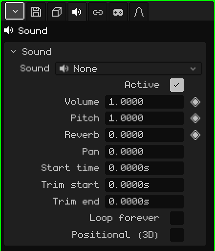

# Sound

A **Sound** object is audio placed in the scene: a piece of music, a sound effect, the noise of a machine. In the 3D Viewport it shows up as a speaker. It can sound the same everywhere, like music, or from where it is, louder the closer you are. This article is the reference for its properties; how objects are added and moved is covered in the [Object Mode](../tutoriales/modo-objeto.md) tutorial.

A new Sound object starts without audio: **None**. The file is chosen in the Sound card.

## With the sound already chosen

-  Dragging a sound from the [Library](outliner.md#library-view) onto the 3D Viewport creates a Sound object where it lands, with that sound.
-  Dropping a sound file (for example a `.wav`) onto the 3D Viewport adds it to the project and creates the object there.

## The tabs

| Tab | What it has |
|---|---|
| Object | Location, name and visibility, the same as for every object: see [3D Mesh](objeto-malla.md#the-object-tab). A hidden sound doesn't play, and hiding a collection silences the sounds inside it. |
| Sound | The card below. |
| Constraints | See [Constraints](restricciones.md). |
| Scripts | The object's Lua scripts, which can make it play or silence it in a game. See [Lua in Whisk3D](../lua/README.md). |

## The Sound card

| Property | What it does |
|---|---|
| Sound | The file that plays, with its duration. The menu lists the project's sounds, **None** and **Load sound from the file browser...**, which brings one from the disk into the project. |
| Active | When unchecked, it doesn't play. It's useful for turning it off without deleting it. |
| Volume ◆ | How loud it plays: 1 is the file's volume, 0 is mute and 2 is double. |
| Pitch ◆ | Higher or lower. 1 is the original; 2 sounds an octave higher and twice as fast, 0.5 an octave lower and at half speed. That's why changing the pitch also changes how long it lasts. |
| Reverb ◆ | How much of this sound goes to the reverb echo: 0 none, 1 all. It gives a feeling of a cave, a church or a corridor. |
| Pan | Which side it plays from: -1 left, 0 center, 1 right. Only without Positional (3D): with it, where it is decides the side. |
| Start time | The second of the scene at which it starts. |
| Trim start | How many seconds are cut from the start of the file. |
| Trim end | How many seconds are cut from the end of the file. |
| Loop forever | The stretch between the two trims repeats endlessly, with no gaps. For background music and continuous noises. |
| Positional (3D) | It plays from where the object is. See below. |
| Full volume radius | Only with Positional (3D): up to this distance, in meters, it plays at full volume. |
| Audible range | Only with Positional (3D): beyond this distance, in meters, it can no longer be heard. |

## Times are in seconds

Sound times are measured in **seconds**, not frames. That way, if the scene goes from 30 to 60 frames per second, the sounds stay locked to the same moment and you don't have to rearrange anything.

In the [Timeline](linea-de-tiempo.md#sounds), each selected sound has its **strip**: where it starts and how long it lasts. Dragging the strip changes **Start time**, and grabbing one of its ends changes the trims. It plays with the timeline's Play and goes silent when it stops.

In a game, the sound starts when it appears (for example, the one for an explosion that's part of a prefab), plus whatever **Start time** says.

## Positional (3D)

Unchecked, the sound is heard the same wherever it is, like music. Checked, it's heard **from where it is**, relative to the listener:

- The closer, the louder: up to the **Full volume radius** it plays at full volume, and from there it drops until it fades out at the **Audible range**.
- If it's on the right, it plays on the right; if it's on the left, on the left.
- If it's behind, it sounds quieter and more centered.

The listener is the active camera in the game and the active 3D Viewport in the editor (or the camera, if you're looking through it). With the sound selected, the 3D Viewport draws two spheres: the full volume radius one and the audible range one.

## Examples

| Sound | How to set it up |
|---|---|
| Background music | Without Positional (3D), with Loop forever. |
| A waterfall | Positional (3D) and Loop forever, with a small Full volume radius and a large Audible range: you start hearing it from far away and it grows as you get closer. |
| A thud 4 seconds into an animation | Start time at 4, or the strip moved there in the Timeline. At 30 FPS that's frame 121: frame 1 is second 0. |
| Music that fades out at the end | Keyframes on Volume (◆): 1 a little before the end and 0 at the end. |
