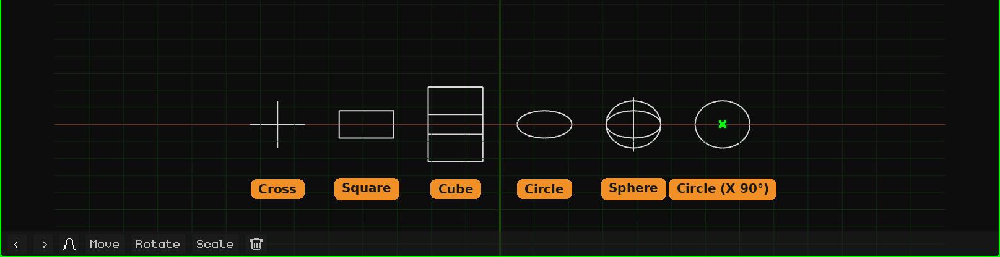

# Empty

An **Empty** is an object without a mesh: it isn't seen when rendering or in the game. It's used as a reference point: a pivot for rotating or scaling other objects that hang from it, a place to aim a camera or a constraint, a control for animating. It's added with **Add → Empty**, at the 3D cursor. How objects are added and moved is covered in the [Object Mode](../tutoriales/modo-objeto.md) tutorial.

In the 3D Viewport it's drawn with lines. A new Empty is a **circle lying on the floor**, easy to see and to grab. The shape, size and rotation of the drawing are changed in its card. It's **only how it looks**: it doesn't change the object, its transform or its children.

## The tabs

| Tab | What it has |
|---|---|
| Object | Location, rotation, scale, name and visibility, the same as for every object: see [3D Mesh](objeto-malla.md#the-object-tab). Scaling the Empty also scales its children. |
| Empty (the cross) | The card below. |
| Constraints | See [Constraints](restricciones.md). |
| Scripts | The object's Lua scripts. See [Lua in Whisk3D](../lua/README.md). |

## The Empty card

| Property | What it does |
|---|---|
| Shape | How it's drawn, each with its own icon: **Cross** (the three axes), **Square**, **Cube**, **Circle** or **Sphere** (three circles, one per axis). The square and the circle start out lying on the floor. On small screens (the Nokia N95, the PSP, the 3DS and the Dreamcast) the circle and the sphere are drawn with half the lines: there you can't tell the difference and the device draws less. |
| Size | How big the drawing is, in meters, from end to end. 1 is one meter. |
| Rotation X, Y, Z | Rotates the drawing, in degrees. For example, the circle with **X** at 90 stands up. |

None of this moves or rotates the object: the Empty stays in the same place and its children aren't affected. It's saved with the project.

## What it's for

- **A pivot:** an object that's a child of an Empty rotates and scales from the Empty. For example, a ball parented to an Empty placed at its bottom point squashes against the floor when you scale the Empty.
- **Organizing the scene:** several objects hanging from an Empty move together by moving just the Empty.
- **A target:** [constraints](restricciones.md) can point at an Empty, for example so a camera keeps looking at it.
