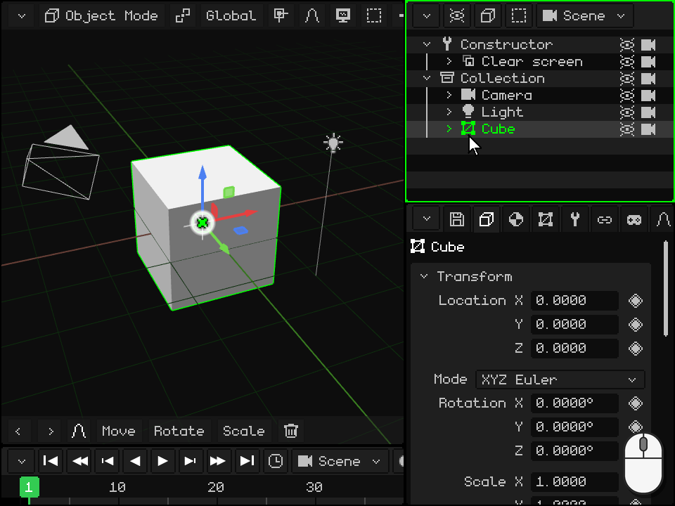
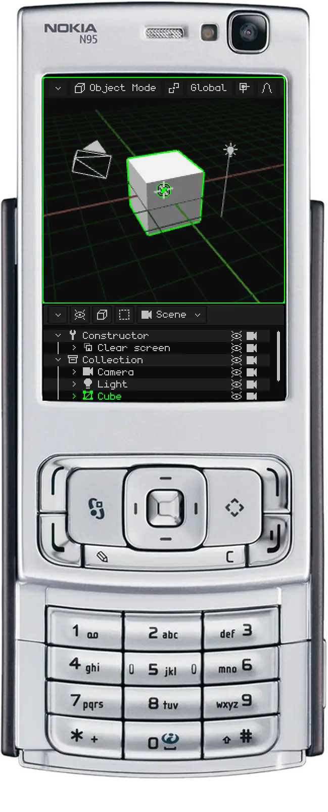
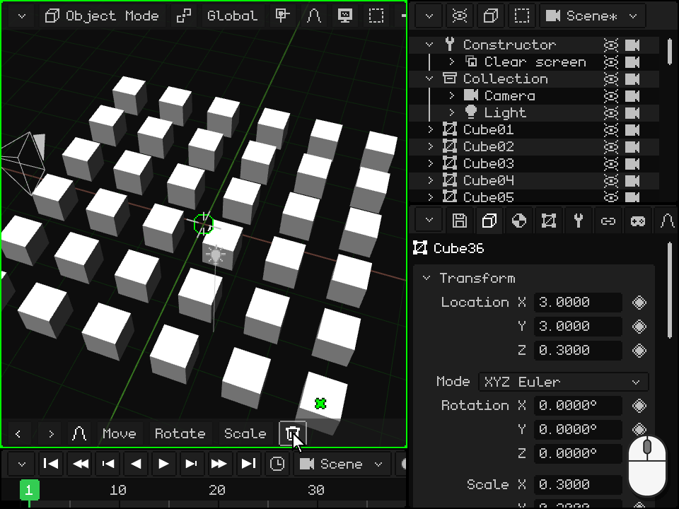

# The Outliner

> [!NOTE]
>  The Nokia N95 supports a mouse and keyboard (over Bluetooth). The Nokia parts of this page explain how to use it without a mouse or keyboard, with just the phone's keys.

The **Outliner** is the list of everything in the scene: objects, cameras, lights and collections. It's one of the viewports covered in [Viewports](interfaz.md); on PC it's at the top right. From here you select objects, hide them, sort them, put some inside others and rename them.

Whatever you select in the Outliner is also selected in the 3D Viewport, and vice versa. The last one you selected is the **active object**: the one Properties shows.

 **On Android** the Outliner isn't on the screen: the space is left for the 3D Viewport and Properties. To use it, turn a viewport into an Outliner (or split one) with the corner button, as in [Change the type](interfaz.md#change-the-type). You can also work without the Outliner: you select objects by tapping them in the 3D Viewport, and Properties has the name and the **Visible** and **Renderable** checkboxes.

 **On the Nokia N95** the Outliner isn't on the screen: only two viewports fit. While you organize the scene, turn Properties into an Outliner: the **left soft key** takes you into its tabs and the left arrow gets you to the corner button's menu; choose Outliner there. To go back, the left soft key in the Outliner opens that menu directly. The **green call key**  makes it the active viewport: everything about the N95 below is done with the green border on the Outliner.

## What each row shows

Each row is an object. The **arrow** collapses or expands what's inside it; the **icon** tells its type (mesh, camera, light, collection...); then comes the **name**, in green if it's the active object and in a darker green if it's selected; and on the right, the **eye** and the **camera**. An object that's inside another appears further to the right, hanging from it, and a faded row is a hidden object.

In a new project, at the top is the **Constructor**, a routine that prepares the screen, and below it the **Collection** with the camera, the light and the cube. A collection is a folder for keeping things organized.

## Select

| | How to select |
|---|---|
|  PC | A click on the row selects only that object. <kbd>Shift</kbd> + click selects all the rows from the active one to that one. <kbd>Ctrl</kbd> + click adds or removes one. With the mouse over the Outliner, the up and down arrows go to the previous or the next row. |
|  Touch screen | A tap on the row. With **Shift** or **Ctrl** turned on in the 3D Viewport's toolbar, the tap does the same as with the keyboard. Dragging your finger scrolls the list. |
|  Nokia N95 | The up and down arrows go to the previous or the next row, and the list scrolls by itself to follow it. |
| Menu | Select → Select All, Deselect All or Invert Selection |

## Collapse and expand

When an object has others inside, its arrow shows or hides them. Collapsing what you're not using keeps the list short.

| | How to collapse and expand |
|---|---|
|  PC | A click on the arrow. With the mouse over the Outliner, the keyboard's right arrow expands the active object and the left arrow collapses it; if it was already collapsed, left goes up to the one outside it and collapses that. |
|  Touch screen | A tap on the arrow. |
|  Nokia N95 | Right expands the active object and left collapses it; if it was already collapsed, left goes up to the one outside it and collapses that. |

## Hide: the eye and the camera

- The **eye** shows or hides the object in the 3D Viewport. A hidden object doesn't appear in the render either. If it has others inside, they're hidden along with it and their rows look faded.
- The **camera** decides whether it appears in the **render**. When it's off, the object is still visible while you work, but it doesn't appear in the images or videos you render.

Using them doesn't change the selection.

| | The eye | The camera |
|---|---|---|
|  PC | A click on the eye, or <kbd>H</kbd> (with the mouse over the Outliner) for the active object | A click on the camera |
|  Touch screen | A tap on the eye | A tap on the camera |
|  Nokia N95 | <kbd>2</kbd>, the active object's | <kbd>3</kbd>, the active object's |
| Menu | Element → Hide/Show (the active object's) | — |

Both are also in Properties, in the Transform card: **Visible** and **Renderable**. They have their diamond, so they can be animated: for example, to make something appear at a certain moment of the video.

## Sort, and put one object inside another

You can change the order of the list, and put an object **inside** another: it becomes its **child**, and when the parent moves, rotates or scales, the child goes along with it. This is what [Object Mode](../tutoriales/modo-objeto.md#the-outliner-the-objects-in-the-scene) calls **parenting**. The object doesn't move from its place in the scene: only the list changes.

 **With the mouse:** grab the row and drag it. Over the top or bottom edge of another row a **green line** appears: when you drop it, the object ends up before or after that row, at the same level. Over the middle of another row, that row is highlighted: when you drop it, the object ends up **inside** it. Dropped below the last row, it comes out of everything that contained it. Near the top or bottom edge, the list scrolls by itself, so you can reach any row of a long list.

 **With your finger:** hold your finger still on the row for a second, until the phone vibrates: the row is now grabbed. Then drag it and drop it just like with the mouse. If you release it without moving it, the object's menu opens. Without that wait, dragging your finger scrolls the list.

 **On the Nokia N95:** select the row with the arrows and press <kbd>1</kbd>. The row turns green, and now the arrows move it:

-  **Up** and **down** move it up or down among the rows at its same level.
-  **Right** puts it inside the row above it at its same level.
-  **Left** takes it out of the one that contains it: it ends up after it, at its level.
-  <kbd>1</kbd> again (or <kbd>OK</kbd>) leaves it there. <kbd>C</kbd> cancels and puts it back where it was.

 The whole move is undone in one go, with <kbd>C</kbd> + left. It's useful, for example, for putting a light before the objects it lights.

## Find the active object and frame it

In a large scene the list is long, and selecting something in the 3D Viewport doesn't scroll it: its row may end up out of sight. To find it in the list, or to see the object in the 3D Viewport (**frame it**, as in [Frame the selection](../tutoriales/navegacion.md#frame-the-selection)):

| | In the Outliner | In the 3D Viewport |
|---|---|---|
|  PC | <kbd>Num .</kbd> with the mouse over the Outliner (**Show active**): the list scrolls until the selection is in the middle. If it's inside something collapsed, it has no row: expand that first. | <kbd>Num .</kbd> with the mouse over the 3D Viewport |
|  Touch screen | Drag the list with your finger | Double tap with two fingers on the 3D Viewport |
|  Nokia N95 | The list follows the row you select with the arrows by itself | A quick press of <kbd>0</kbd>, even if the active viewport is the Outliner |
| Menu | — | View → Frame Selected, in the 3D Viewport's menu bar |

## Rename

| | How to rename |
|---|---|
|  PC | Double-click the name, or <kbd>F2</kbd> for the active object: the row becomes a text field. Type the new name and confirm with <kbd>Enter</kbd> or with a click outside; <kbd>Esc</kbd> leaves it as it was. |
|  Touch screen | Double tap the name: the on-screen keyboard opens. |
|  Nokia N95 | The left soft key takes you into the bar and the right arrow gets you to Element → Rename. Type with T9 and confirm with <kbd>OK</kbd>. |
| Menu | Element → Rename |

Two objects in the same scene can't have the same name: if the name is already taken, Whisk3D adds a number to it and lets you know. If a script referred to the object by its name, it's updated automatically.

## Duplicate and delete

| | Duplicate | Delete |
|---|---|---|
|  PC | <kbd>Shift</kbd> + <kbd>D</kbd>; <kbd>Alt</kbd> + <kbd>D</kbd> for Duplicate Linked | <kbd>X</kbd> or <kbd>Delete</kbd> |
|  Nokia N95 | Element → Duplicate | <kbd>C</kbd> |
| Menu | Element → Duplicate or Duplicate Linked | Element → Delete |

From the Outliner, the copy lands right on top of the original, without following the mouse as in the 3D Viewport: move it afterwards. Deleting asks for confirmation, and both can be undone.

## The Outliner menu bar

| Button | What it has |
|---|---|
| **View options** (the eye) | What's shown: the Constructor, the other routines, and the eye and camera columns (**Visibility icons** and **Render icons**). |
| **Element** (the cube) | Delete, Rename, Move, Hide/Show, Duplicate, Duplicate Linked, Create Prefab and Unpack Prefab. |
| **Select** | Select All, Deselect All and Invert Selection. |
| The scene | Which scene, game or prefab of the project is being edited ([Scenes, games and prefabs](outliner.md#scenes-games-and-prefabs)). |

 A right click on a row selects it and opens the same menu right there, at the pointer.

 With your finger, hold the row until it vibrates and release it without moving it: the same menu opens.

## The Library

The project's **resources** (meshes, materials, textures, animations, sounds, scripts, prefabs...) aren't in the Outliner: they have their own viewport, the **Library**, which you choose with the corner button. It shows thumbnails in folders, tells you which resources are in use and which aren't, and you can drag a resource onto the 3D Viewport: a mesh creates an object, and a material is applied to whatever is underneath. It's explained in [Library view](outliner.md#library-view); the rest of the Outliner, in its [manual](outliner.md) and in [Keyboard Shortcuts](atajos.md#outliner).

## Library view

| Function | Description |
|---|---|
| Resources | Meshes, materials, textures, animations, prefabs, scenes, sounds, scripts, [shaders](shaders.md), fonts and videos, in folders. A material or a shader dragged onto a mesh in the 3D Viewport shows on the part under the pointer before you drop it. Green check mark = in use; red cross = orphan; `*` = unsaved. |
| Filter / List or grid | Show only one type; view thumbnails. |
| Drag a resource | Onto a folder (moves it), onto the 3D Viewport (mesh = new object, material or texture = assigned to what you drop it on, prefab = instance) or onto a Properties drop-down. |
| New Folder / Move to Folder | Organize (folders are only for sorting). |
| Duplicate Resource / Select Users / Purge Orphans | Copy, find out who uses it, delete what nobody uses. |
| Inside the .w3d / External | From Properties (Resource card): moves the resource into or out of the project. |

## Scenes, games and prefabs

The button with the scene's name (in the Outliner and in the 3D Viewport) lists the project's scenes, games and prefabs. From there you create new ones, choose the start scene and turn a scene into a game (or the other way around).
