# Properties

> [!NOTE]
>  The Nokia N95 supports a mouse and keyboard (over Bluetooth). The Nokia parts of this page explain how to use it without a mouse or keyboard, with just the phone's keys.

**Properties** is the viewport with the data of the **active object**, the last one you selected: its location, its name, its material, the color of a light, the modifiers of a mesh. It's organized in **tabs**, and each tab has **cards** with rows of values. Almost everything you change here shows up right away in the 3D Viewport.

As explained in [Viewports](interfaz.md#the-active-viewport), keys go to the active viewport, the one with the green border.

 On the Nokia N95, Properties is to the right of the 3D Viewport: the **green call key**  makes it the active viewport. When you come back, it's still on the row where you left it.

## The tabs

The tabs are the icons on the Properties menu bar. Each one shows a group of cards.

The tabs **change with the active object**: each type of object shows only the ones that are useful for it. A mesh has Material, 3D Mesh and Modifiers; a light has the Light tab in place of the material; a camera, the Camera tab.

| Tab | When it appears |
|---|---|
| File / Render (the floppy disk) | Always, even when nothing is selected. |
| Object | With any 3D object: location, rotation, scale, name and visibility. |
| The object type's tab | Material on a mesh, Light on a light, Camera on a camera, and so on with each type. Its icon changes with the type. |
| 3D Mesh and Modifiers | Only with a mesh. |
| Transform | Only with a mesh in Edit Mode. |
| Constraints | With any 3D object. |
| Scripts | With any object. |
| Animation | Always. |

The type's tab stays in its place: if you were on a mesh's material and you select a light, you go to the Light tab. If the tab you were on doesn't exist for the new object (Modifiers, when you select a light), Properties goes back to the Object tab.

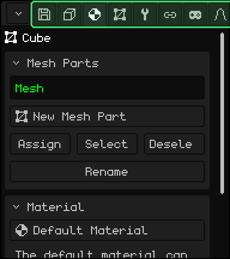

| | How to switch tabs |
|---|---|
|  PC | A click on the tab. If they don't all fit, turn the wheel over the bar. |
|  Touch screen | A tap on the tab. If they don't all fit, drag the bar sideways. |
|  Nokia N95 | Go up with the **up** arrow to the title of the first card and press it once more: the current tab turns green. **Left** and **right** switch tabs, and **down** goes back to the cards. On the first tab, left opens the corner button's menu. |

## The cards

The **cards** are the boxes in each tab: a title and its rows. The arrow on the title tells you whether the card is open or collapsed. Collapsing the ones you don't use keeps the ones you do within reach.

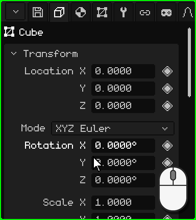

| | How to collapse and expand |
|---|---|
|  PC | A click on the title. |
|  Touch screen | A tap on the title. |
|  Nokia N95 | <kbd>OK</kbd> on the title. The **left** arrow collapses the card from any of its rows, and **right**, on the title, expands it. |

If the cards don't fit in the viewport, the panel scrolls: with the mouse wheel on PC, or by dragging your finger up or down on a touch screen. On the Nokia, the panel follows the selected row by itself.

### Moving around with the keys

 On the Nokia N95 there's a **selected row**: its name is shown in green and its value with a white border. **Up** and **down** go from one row to another and from one card to the next, and <kbd>OK</kbd> uses the row: it edits the number, checks the checkbox, opens the drop-down. While you're editing, the border turns green.

 On PC, with the mouse over Properties, the arrows and <kbd>Enter</kbd> do the same, and <kbd>Esc</kbd> cancels what you're editing.

## Numbers

Most rows are **numbers**: the name on the left and the value on the right, like the Location, Rotation and Scale in the Transform card. You can **type** a number or **drag** it. Each one has its own pace, and some have a limit: a light's GL Light goes from 0 to 7.

### Type a number

 A click on the number, without moving the mouse: the value is highlighted and whatever you type replaces it. <kbd>Enter</kbd> applies it and <kbd>Esc</kbd> leaves it as it was. A click anywhere else also applies it.

 A tap on the number opens Whisk3D's **numeric keypad** at the bottom, with the row's name and its value. It has the numbers, the point, **DEL** to delete and the arrows to move the cursor. **OK** applies the value and **X** cancels it; tapping outside the keypad also applies it.

 The numeric keypad also does **math**: with <kbd>+</kbd>, <kbd>-</kbd>, <kbd>\*</kbd>, <kbd>/</kbd> and parentheses you can write `2*3` or `1.5+0.25`, and when you tap OK the result is kept. <kbd>-</kbd> also lets you write a negative number.

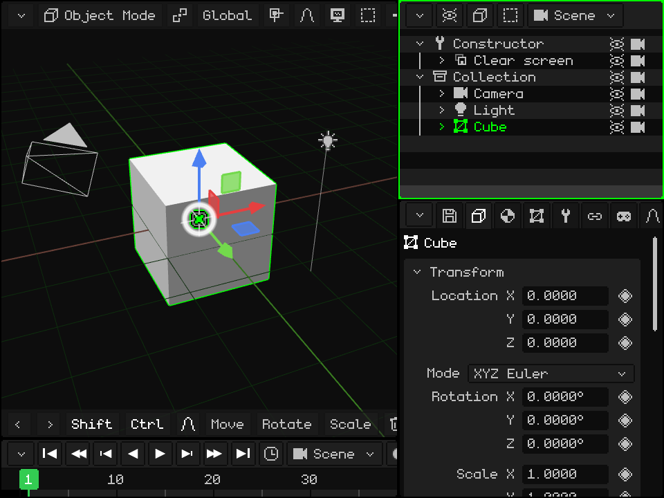

 Get to the row with the arrows and press <kbd>OK</kbd>: the value is highlighted and the phone's keys type numbers (the Properties bar shows **123**). The first number you type replaces the one that was there. <kbd>\*</kbd> is the decimal point, <kbd>C</kbd> deletes, **left** and **right** move the cursor, <kbd>OK</kbd> applies it and the **left soft key** cancels it.

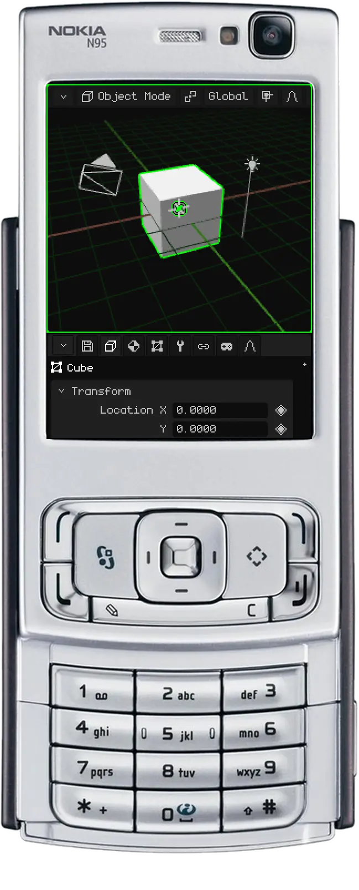

### Drag a number

 Hold down the mouse button on the number and move the mouse sideways: to the right the value goes up and to the left it goes down. If the pointer reaches the edge of the viewport, it reappears on the other side and you can keep dragging. When you let go, the value stays.

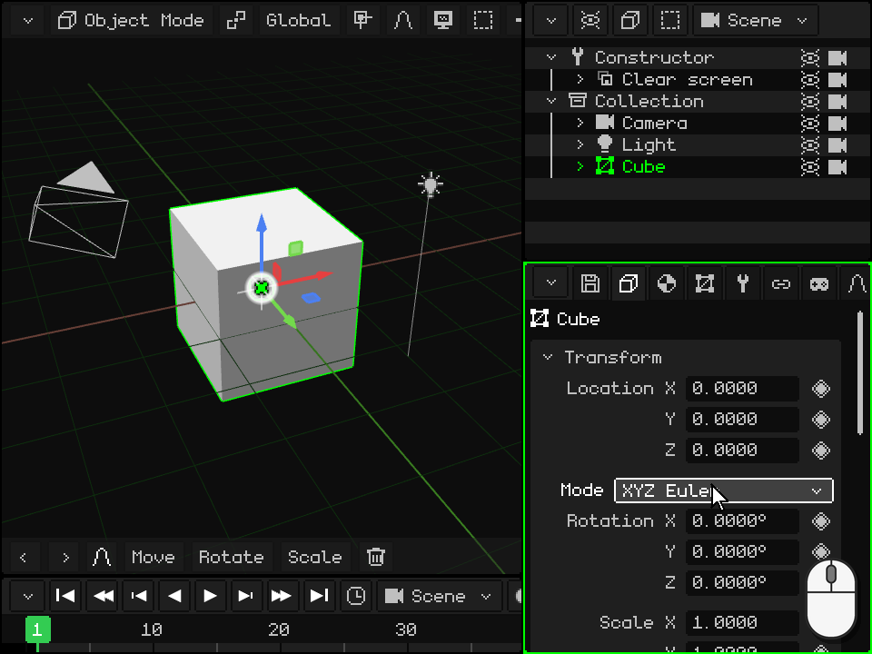

 Put your finger on the number (not on its name) and drag it sideways. If you drag it up or down, the panel scrolls instead of the value changing.

## Drop-downs

A **drop-down** is a button that shows the chosen option, like a light's **Type** (Point, Sun or Spot) or the rotation **Mode**. When you activate it, the list of options opens, with the current one in green; when you choose another, the list closes.

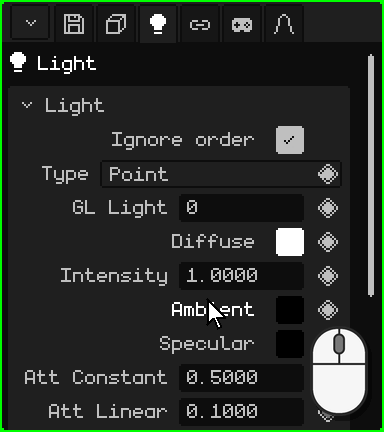

| | How to open it and choose |
|---|---|
|  PC | A click on the button and another on the option. |
|  Touch screen | A tap on the button and another on the option. |
|  Nokia N95 | <kbd>OK</kbd> opens it, **up** and **down** go through the options and <kbd>OK</kbd> chooses. <kbd>C</kbd> closes it without changing anything. |

## Checkboxes

A **checkbox** is turned on or off: checked means yes and empty means no. It sits on the right of the row, like **Lighting** in the material: when it's off, the object doesn't receive the lights and shows its own color, flat. A click or a tap on the row (on the checkbox or on its name) toggles it, and on the Nokia, <kbd>OK</kbd>.

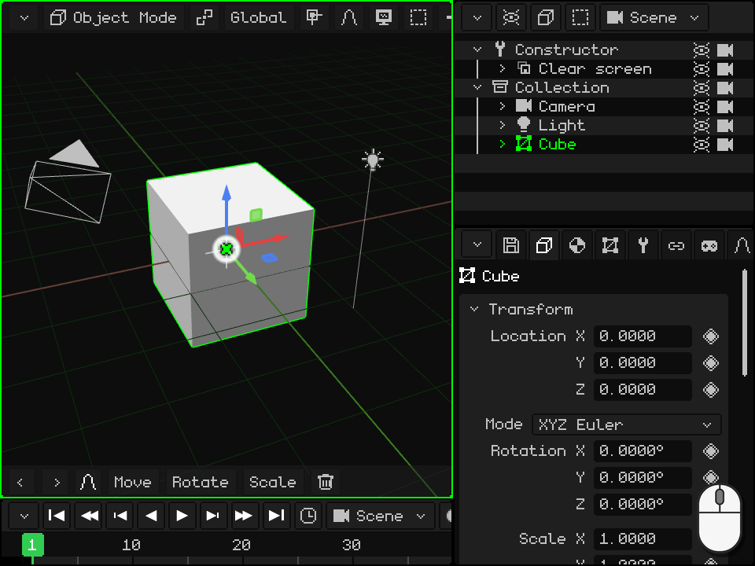

## Text

A **text field** holds a name or a path, like the object's **Name**, at the end of the Transform card. When you activate it, the cursor appears at the end of the text. The new name also shows up in the Outliner.

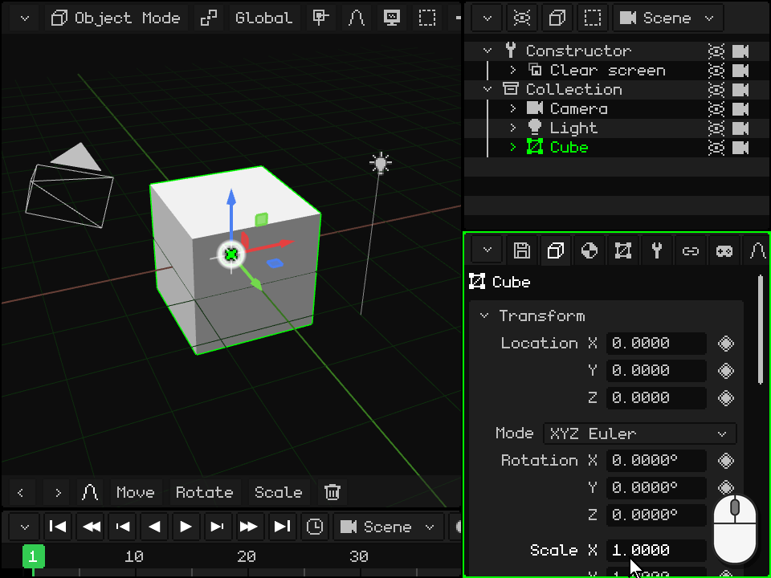

-  **On PC:** a click on the field, and type. <kbd>Enter</kbd> (or a click somewhere else) confirms it and <kbd>Esc</kbd> goes back to the previous text.
-  **On a touch screen:** a tap opens Whisk3D's keyboard, which includes ñ. **Aa** switches to capitals, **123** to numbers and symbols, **DEL** deletes and **OK** confirms. In the web version, the phone's keyboard opens.
-  **On the Nokia N95:** <kbd>OK</kbd>, and you type with the phone's keypad, like a text message: each key gives its letters when you press it several times. <kbd>#</kbd> switches between Abc, abc and ABC, and held down it switches to 123 (the Properties bar shows the mode). <kbd>0</kbd> is the space, <kbd>1</kbd> the punctuation marks and <kbd>\*</kbd> opens more symbols. <kbd>C</kbd> deletes, **left** and **right** move the cursor, <kbd>OK</kbd> confirms and the **left soft key** cancels.

## Colors

A **color** row shows a small square with the color, on the right, like **Diffuse**, **Ambient** and **Specular** in a light's card. When you activate it, the **color picker** opens:

- the **circle** chooses the hue and the saturation, and the bar next to it, the value (how light it is);
- the **RGB**, **HSV** and **Hex** tabs show the color as numbers: Red, Green and Blue; Hue, Saturation and Value; or the hexadecimal code (`#FF8800`), with Copy and Paste;
- **Alpha** is the transparency;
- **OK** keeps the color and **Cancel** goes back to the previous one.

The color changes as you move it, so you see it in the scene before you confirm it. A click or a tap outside the picker also closes it and keeps the color.

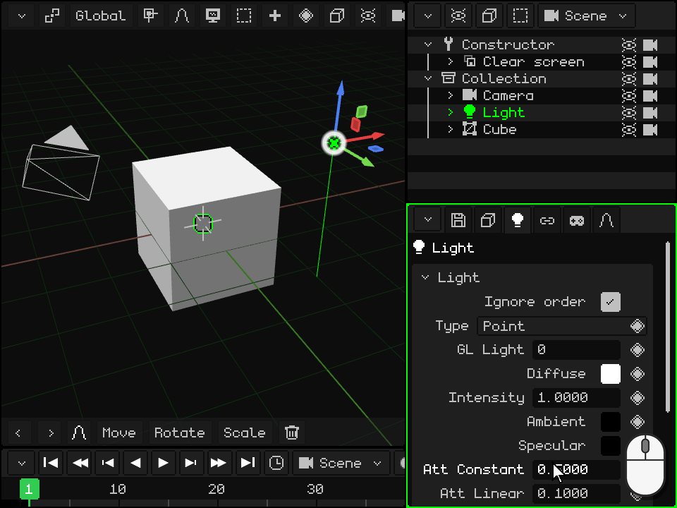

  With the mouse or your finger, you drag inside the circle and the bar, and the numbers are dragged sideways, as in Properties.

 On the Nokia N95, **up** and **down** go through the circle, the bar, the tabs, the rows of numbers and OK / Cancel. On a row of numbers, **left** and **right** change it (held down, faster and faster). On the circle, <kbd>OK</kbd> starts editing it: **left** and **right** turn the hue, **up** and **down** change the saturation, and <kbd>OK</kbd> exits. The bar is edited the same way, with up and down. <kbd>C</kbd> closes the picker and goes back to the previous color.

## Lists

Some cards have a **list**: a mesh's modifiers, its parts, its UV maps. The chosen item is highlighted, and what's below it shows its data or acts on it. Below the list there are rows of **buttons**.

**Move Up** and **Move Down** change the position of the chosen item. The order matters: modifiers are applied from top to bottom, and a mesh's parts are drawn in that order. These two buttons appear when the list has two or more items.

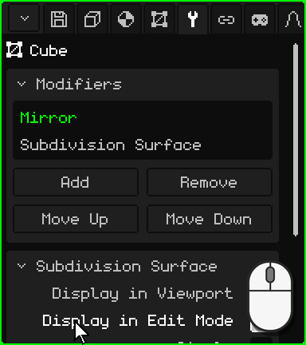

| | How to use the list |
|---|---|
|  PC | A click chooses. If they don't all fit, turn the wheel over the list. |
|  Touch screen | A tap chooses. If they don't all fit, drag your finger up or down over the list. |
|  Nokia N95 | <kbd>OK</kbd> on the list, **up** and **down** choose and <kbd>OK</kbd> exits. On a row of buttons, **left** and **right** go from one button to another (the border shows which one) and <kbd>OK</kbd> presses it. |

## The diamond: animating a property

To the right of the properties that can be animated there's a **diamond**; the ones without it can't be animated. A click or a tap on the diamond sets a **keyframe**: it stores the value of that property at the current frame of the Timeline. With keyframes at different frames, the property changes by itself when the animation plays.

The diamond's color tells you the state of the property **at the current frame**:

| Diamond | What it means | What a click does |
|---|---|---|
| Gray | The property isn't animated. | Sets the first keyframe, with the current value. |
| Faded green | It's animated, but it has no keyframe at this frame. | Sets a keyframe with the current value. |
| Green | It has a keyframe at this frame. | Removes it. |

Changing a value doesn't change the diamond's color: the new value isn't part of the animation until you set the keyframe, and if you change frames first, the property goes back to what the animation says. At a frame that already has a keyframe (green diamond), a new value is stored with two clicks: the first removes the keyframe and the second sets it again with the current value.

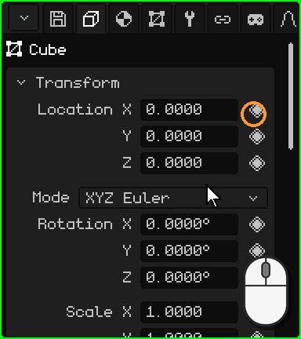

 On the Nokia N95, on the row, the **right** arrow moves to the diamond (a white border marks it), <kbd>OK</kbd> sets or removes the keyframe and **left** goes back to the value.

In the Animation tab, the **Active camera** card chooses which camera is in charge at each moment of the animation: the cuts of a scene. Its diamond has one more color, a **lighter green**: the chosen camera isn't the one the animation says at this frame, a change that hasn't been stored yet. A click stores the cut at the current frame.

Animation has its own tutorial later on.

All the tabs and their cards are in the manual: [Properties](propiedades.md). Back to [Viewports](interfaz.md).

## What each tab has

| Tab | What it has |
|---|---|
| File / Render (floppy disk) | **File**: open, save, save as, save version, extract assets. **Render**: path, size, extra passes, background, **Ray Tracing** (rays, samples, passes), Render Image and Render Animation. **Game**: platform (Windows, Symbian, Linux .deb, AppImage, WebGL, Android, Android 2.3), window, orientation, icon, physics, sound, volume, **resolution** (the percentage of the screen the game draws at: on Android 2.3 the system stretches it, and on those phones drawing fewer pixels gives more frames per second) and Build game (with a phone connected over adb, it installs and opens it). **Export**: OBJ, glTF, GLB, STL (triangles only, for 3D printing or for moving to a CAD program). **Settings**: language, antialiasing, graphics, skin, logs, scale, **Keyboard Shortcuts...** and Save Changes. |
| Object | Location, rotation (Euler, quaternion or axis-angle), scale, name, visible, renderable; the object's animations and palette. |
| Contextual | Depends on the type: mesh parts and **material** (texture, lighting, vertex color, transparency, reflections, normal map, blending, depth, texture layers, **Advanced: custom shader** — see [Hand-written shaders](shaders.md); Roughness, Metallic, Transmission and IOR with ray tracing), light, camera, fog, particles, physics, hitbox, armature and bones, 2D elements, prefabs, routines. |
| 3D Mesh | The mesh in use (and how many objects share it), UV maps, color layers, vertex groups, UV groups. With a resource chosen in the Library: its data and its location (inside or outside the .w3d). |
| Modifiers | See [Modifiers](objeto-malla.md#the-modifiers-tab). |
| Transform | Edit Mode only: center of the selection and of its UVs, editable. |
| Armature 2D | The mesh's 2D armatures and bones. |
| Constraints | Copy Location, Copy Rotation, Billboard (look at the camera), Child Of. |
| Scripts | The object's Lua scripts and their properties (see the [Lua document](../lua/README.md)). |
| Animation | The active animation, blend layers (Mix), exact values of the chosen keyframe and camera cuts. |

## Routines

A routine is a list of drawing steps (translate, rotate, bind texture, draw a mesh, call another routine, Call Lua…) that you build in Properties. It's the fastest way to draw on the N95.

| Function | Description | Shortcut |
|---|---|---|
| Add / Remove step | Adds steps grouped by topic, or removes the chosen one. | Buttons; <kbd>X</kbd> or <kbd>Delete</kbd> removes |
| Grab step | Reorders the step with the arrows; <kbd>Enter</kbd> confirms. | <kbd>G</kbd> |
| Insert Keyframe | Animates the step's values at the current frame. | <kbd>I</kbd> |
| Repeat | How many times in a row the list runs (routine loop). 1 = normal routine. | Repeat field |
| Render mode / Use | A different list per shading mode, or the same one for all of them. | Drop-downs |
