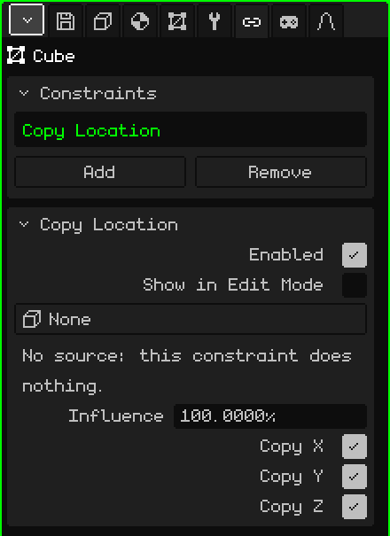
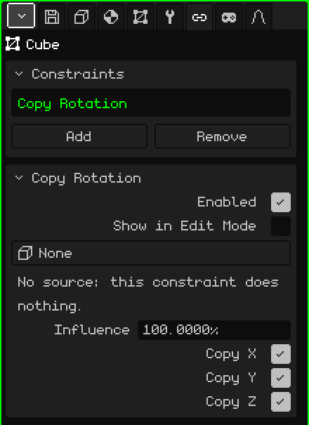
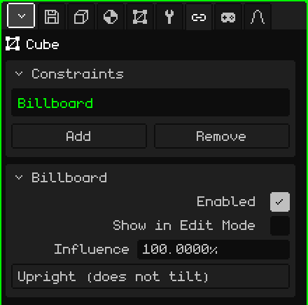
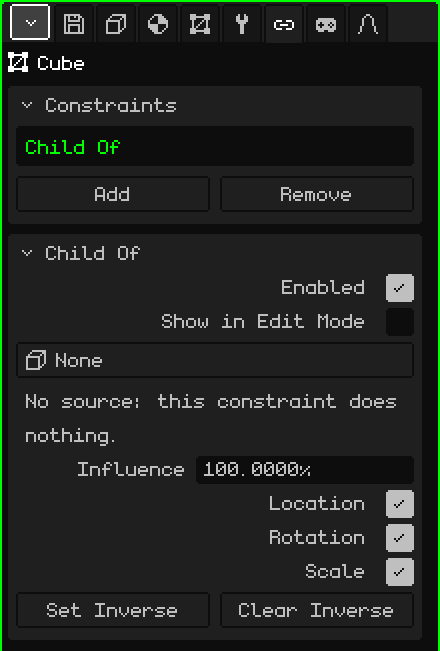

# Constraints

A **constraint** makes an object take something from another one: its location, its rotation, always facing the camera, or following it as if it were its child. It lets things position themselves on their own, without animating them by hand: a shadow that stays under the character, a flat tree that always faces you, a sword stuck to the hand. This article explains each one and all their parameters; how objects are added and moved is covered in the [Object Mode](../tutoriales/modo-objeto.md) tutorial.

## Where they are

In Properties → **Constraints** tab. Every 3D object has it: meshes, cameras, lights, armatures, sounds, empties. The 2D elements of an interface don't have it.

Before looking at each one, three things that apply to all of them:

- **They don't change the object's numbers.** The constraint is applied on top when drawing. The Transform card in the Object tab still shows the object's own location and rotation, and if the constraint is turned off or deleted, the object goes back exactly there.
- **They're calculated for each view.** The ones that depend on the camera (Billboard, or a **View** source) use the camera that's drawing: with two 3D Viewports open, each one sees the result from its own point of view. In the game, the active camera.
- **They work the same everywhere:** in the editor, in the compiled game, on Android and on the Nokia N95.

## The Constraints card

| Property | What it does |
|---|---|
| The list | The object's constraints. The chosen one is the one the card below shows. |
| Add | The menu with the four types: **Copy Location**, **Copy Rotation**, **Billboard** and **Child Of**. |
| Remove | Deletes the chosen constraint. |
| Move Up / Move Down | Change the order (they appear when there are two or more). |

**Order** matters: they're applied from top to bottom, and each one works on what the ones above left. If two affect the same thing, the lower one wins.

## What they all have in common

Below appears the card of the chosen constraint, with its name as the title. These three rows are in every type:

| Property | What it does |
|---|---|
| Enabled | Turns the constraint on or off without deleting it. It's useful for comparing how it looks with and without it. |
| Show in Edit Mode | When off (the default), the constraint isn't applied while you edit the object's vertices: the mesh is shown and edited where it really is. When on, it's also applied in Edit Mode. |
| Influence | How much it weighs, from 0 to 100 %. At 100 it's applied fully; at 0 it does nothing; in between, the object ends up between where it would be on its own and where the constraint takes it (at 50, halfway). |

**Show in Edit Mode** is off on purpose: editing a tree that turns to follow the camera, or a mesh that runs off somewhere else, is very awkward.

## Copy Location

**Copies the location** of another object: the object goes exactly where the source is, on the axes you choose.

| Property | What it does |
|---|---|
| Source | Where it copies from. **None**, **View** (the camera that's drawing) or any object in the scene except itself and the ones that hang from it. |
| Copy X, Copy Y, Copy Z | Which axes it copies. The axes are the same as in the Transform card: Z is the height. An unchecked axis keeps the object's own value. |

It copies the location as is, without leaving any distance: with all three axes, the object ends up on top of the source. To keep it offset, uncheck the axis it shouldn't follow, or shift the mesh in Edit Mode (see [Child Of](#child-of) to follow something while keeping the distance).

Messages on the card:

- "No source: this constraint does nothing." It appears with the source at None, and also if the source object is deleted: the button switches to None by itself.
- "No axes: this constraint does nothing." It appears with all three axes unchecked.

**Examples:**

- **A round shadow under the character:** a plane with a dark blotch, with Copy X and Copy Y checked and Copy Z unchecked. It stays under the character all over the floor, and when the character jumps, the shadow stays on the ground.
- **A sky you can never reach:** a big sphere with the sky painted on it and the source set to **View**. The sky is always centered on the camera, so no matter how far you walk you never reach the edge.
- **A light that goes along with the character:** a light with the character as the source and only Copy X and Copy Y. It follows from above, at the light's own height.

## Copy Rotation

**Copies the rotation** of another object: the object turns the same as the source, without moving from its place.

| Property | What it does |
|---|---|
| Source | Where it copies from: **None**, **View** (the camera that's drawing) or an object in the scene except itself and the ones that hang from it. |
| Copy X, Copy Y, Copy Z | Which rotations it copies, with the same axes as the rotation in the Transform card. With all three, the object ends up with exactly the same orientation as the source; with one or two, it copies only those angles and the others stay its own. |

It has the same messages as Copy Location ("No source…" and "No axes…"). With an in-between influence the rotation always takes the shortest path.

**Examples:**

- **The ceiling fans of a bar:** you animate the spinning blades of just one, and the blades of the others copy its rotation. Since they all hang straight, having all three axes checked is enough. To change the speed of all of them, you change the animation of one.
- **Something stuck to the screen in first person** (the hands and weapon in a game, the cockpit of a ship): two constraints on the same object, Copy Location and Copy Rotation, both with the source set to **View**. The object goes wherever the camera goes and turns with it. The mesh is shifted in Edit Mode so it sits in front, down and to the right.

## Billboard

It makes the object **face the camera**: it turns by itself to face the screen. It has no source: it's always the camera that's drawing.

| Property | What it does |
|---|---|
| Mode | **Upright (does not tilt)**: it only turns sideways, like a person turning around, and always stays upright. **Face the camera**: it also tilts to look at the camera when it's above or below. |

The billboard aligns with the screen's **plane**, not with the point where the camera is: all the billboards in the view end up parallel to the screen.

At influence 100, the billboard decides the rotation and the one in the Transform card doesn't count. If the plane ends up edge-on, rotate it in Edit Mode (since Show in Edit Mode is off by default, there you see it without the constraint).

Message on the card: "With influence between 0 and 100 the billboard can flip 180 degrees when it crosses the camera. Use 100% to avoid it." That's because of how it blends with an orientation that keeps turning: if that flip bothers you, use 100 %.

**Examples:**

- **Cheap trees:** a plane with a photo of a tree (with transparency) and the Upright (does not tilt) mode. From any side it looks like a whole tree, and it's a single plane: ideal for filling a forest on the Nokia N95.
- **Smoke, sparks, the glow of a lamp, a sun in the background:** a plane with the texture and the Face the camera mode, so it's seen head-on even from above.
- **A sign with a character's name or a health bar** above their head: Face the camera, and parented to the character so it follows them.

## Child Of

It makes the object behave as a **child** of another object, or of a **bone** of an armature, even if it hangs from somewhere else in the Outliner. It follows it when it moves, rotates or scales, as if it were stuck to it.

| Property | What it does |
|---|---|
| Source | The object that acts as the parent: **None** or an object in the scene except itself and the ones that hang from it. The View option isn't here. |
| Bone | Only if the source is an armature: the bone it hangs from. **None** follows the whole armature. |
| Location | Whether it follows the source's movements. |
| Rotation | Whether it turns when the source turns. |
| Scale | Whether it grows or shrinks with the source. |
| Set Inverse | Leaves the object where it was before the constraint and, from that moment on, makes it follow the source. |
| Clear Inverse | Measures the object's location from the source again: with Location 0, 0, 0 it ends up right on the source (or at the base of the bone). |

If the source is deleted, the message "No source: this constraint does nothing." appears, the same as in the others.

### Set or clear the inverse

When you choose the source, the object jumps: its location is now measured from the source. There are two ways to work:

- **Place it first and set:** put the object where it has to go (the sword in the hand, for example), choose the source and the bone, and tap **Set Inverse**: it goes back to where you put it and from there it follows the source.
- **Clear and type:** with **Clear Inverse**, the object's Transform card becomes the distance to the source. It's useful when you know the exact number: Location 0, 0, 0 puts it right on the bone.

The constraint comes with the inverse cleared, which is why it jumps when you choose the source.

### Influence in Child Of

At 0 the object's real parent (the one in the Outliner) is in charge, and at 100 the source is. That's why a sword can be a child of the character in the Outliner (so it moves with the character when you take it somewhere else) and also have Child Of to the hand: it follows it without moving twice.

**Examples:**

- **A weapon in Leon's hand:** Child Of with Leon's armature as the source and the right hand bone in Bone; you place the weapon in the hand and tap Set Inverse. For a rigid object it's much lighter than deforming a mesh with the armature, and on the Nokia N95 you can tell.
- **A hat or a pair of glasses:** the same, with the head bone.
- **A camera that goes along without turning:** only Location checked. The camera goes with the character at the same distance, but doesn't spin around when the character turns.
- **An object on a moving platform:** Child Of to the platform, with Location and Rotation, so it travels with it without changing its place in the Outliner.

## When to use each one

| To make the object… | Constraint |
|---|---|
| go where another object, or the camera, is | Copy Location |
| turn the same as another object, or the camera | Copy Rotation |
| always face the camera | Billboard |
| follow another object or a bone, keeping the distance | Child Of |

If two objects copy each other (A copies from B and B copies from A), Whisk3D breaks the loop so it doesn't hang and reports it in the [Console](consola.md): one of the two keeps its own location. The fix is to remove one of the two constraints.
