# The 3D Viewport menu bar

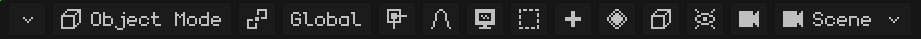

If the menu bar doesn't fit completely, you can scroll it: see [When you can't see all the menu bar options](interfaz.md#when-you-cant-see-all-the-menu-bar-options).

## The mode

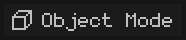 It shows the mode you're working in, and tapping it lets you choose another one. The modes that appear depend on the active object: a mesh has Edit Mode and the three paint modes; an armature, Edit Mode and Pose Mode. With other object types (a light, a camera) the button doesn't appear, because the only mode is Object Mode. Each mode is explained in [The modes](vista-3d.md#the-modes).

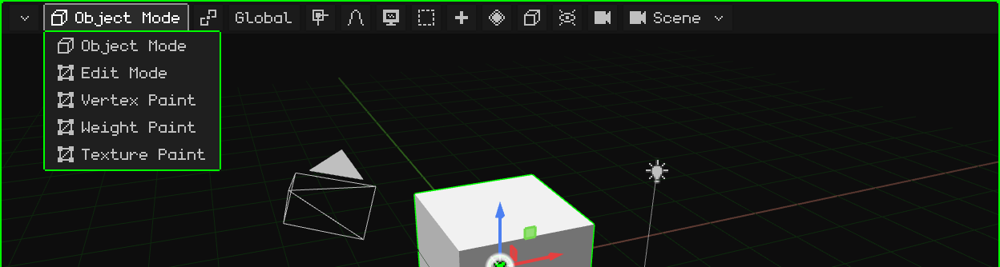

 <kbd>Tab</kbd> switches from Object Mode to Edit Mode and back.  On the N95, <kbd>OK</kbd>.

In a mesh's **Edit Mode**, the **Vertex / Edge / Face** button appears next to it: what a click selects (see [Edit Mode](modo-edicion.md)).

## The pivot

 The **pivot point** is the place the transform happens from: what the selection rotates around and scales from. The button's icon changes according to the chosen pivot, so you can see at a glance which one is set.

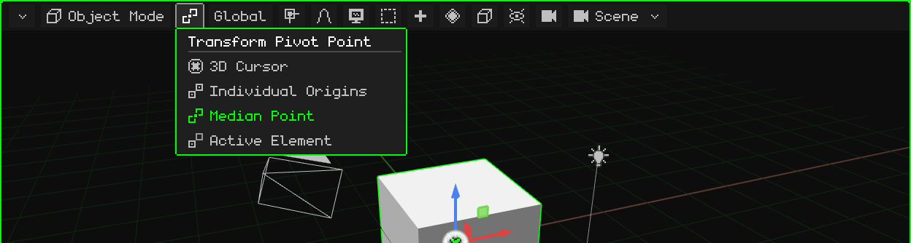

| Pivot | What it rotates and scales from |
|---|---|
|  **3D Cursor** | From the 3D cursor. It's useful for rotating things around any point: put the cursor there (with the [Snap menu](#snap)) and rotate. |
|  **Individual Origins** | Each object from its own origin: they all rotate at once, each one in its place. |
|  **Median Point** | From the center of everything selected. It's the default. |
|  **Active Element** | From the origin of the active object (the last one selected): the others rotate around it. |

An example of each one, on video, is in the [Object Mode](../tutoriales/modo-objeto.md#the-pivot-point) tutorial.

## The orientation

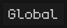 The axes used when moving, rotating or scaling along an axis (with <kbd>X</kbd>, <kbd>Y</kbd>, <kbd>Z</kbd>, with the gizmo or with the N95 keys). The button shows the chosen orientation.

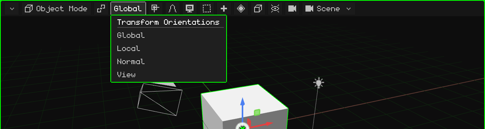

| Orientation | The axes |
|---|---|
| **Global** | The world's: always the same, with Z pointing up. It's the default. |
| **Local** | The object's own: they rotate with it. A rotated car moves forward along its Local axis. |
| **Normal** | In Edit Mode: the direction the selected face is facing (it's the one Extrude uses). |
| **View** | The screen's: X to the side, Y up. |

 During a transform, pressing the axis letter a second time switches from Global to Local: <kbd>G</kbd> <kbd>Y</kbd> <kbd>Y</kbd>.

## Snap

 With **Snap** on, whatever you move sticks to something: to the vertices, edges or faces of other objects, or to their centers. The button turns green when it's on.

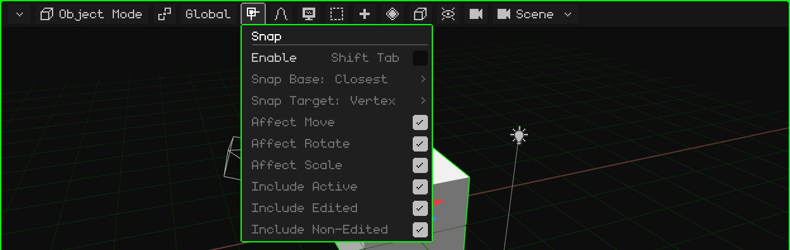

| Option | What it does | Shortcut |
|---|---|---|
| Enable | Turns snapping on or off. | <kbd>Shift+Tab</kbd> |
| Snap Base | Which point of what's being moved sticks: the closest, the center, the median or the active one. | Menu |
| Snap Target | What it sticks to: vertex, edge, face, their centers. With Face Project / Face Nearest, the vertices rest on another surface (for retopology). | Menu |
| Affect Move / Rotate / Scale | Which operations it acts on. | Menu |
| Include Active / Edited / Non-Edited | Which objects it can stick to. | Menu |

The **3D cursor** is moved with another menu, the cursor snap menu: <kbd>Shift</kbd> + <kbd>S</kbd> or Object menu → Snap (Cursor to Selected, Selection to Cursor...). It's explained in [Object Mode](../tutoriales/modo-objeto.md#the-3d-cursor).

## Proportional editing

 With **proportional editing**, when you move, rotate or scale something, whatever is nearby follows smoothly: the closer it is, the more it follows. It's useful for modeling organic shapes (terrain, a face) without moving vertex by vertex. It turns green when it's on.

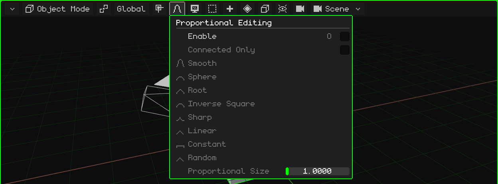

| Option | What it does | Shortcut |
|---|---|---|
| Enable | Turns proportional editing on or off. | <kbd>O</kbd> |
| Connected Only | Measures distance along the edges: it doesn't drag loose pieces that happen to be nearby. | Menu |
| The falloff | How the influence is spread with distance: Smooth, Sphere, Root, Inverse Square, Sharp, Linear, Constant or Random. | Menu |
| Proportional Size | The influence radius. During the transform it's changed with the wheel or with <kbd>PageUp</kbd> / <kbd>PageDown</kbd>. | Menu / wheel |

## View

 Everything about **navigating**: where you look at the scene from. Each option, with its video, is in the [Navigating the 3D Viewport](../tutoriales/navegacion.md) tutorial.

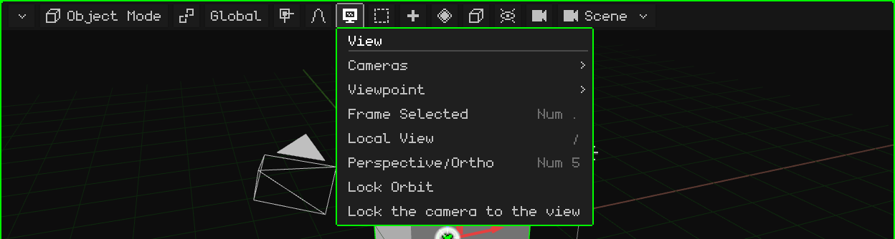

| Option | What it does |  Shortcut |
|---|---|---|
| Cameras | Look through the active camera, or make the selected object the active camera. | <kbd>Num 0</kbd> / <kbd>Ctrl+Num 0</kbd> |
| Viewpoint | Front, Back, Right, Left, Top, Bottom. | <kbd>Num 1</kbd>, <kbd>Num 3</kbd>, <kbd>Num 7</kbd> (with <kbd>Ctrl</kbd>, the opposite one) |
| Frame Selected | Centers the view on the selection and zooms in so it fits exactly. | <kbd>Num .</kbd> |
| Local View | Leaves only the selection in view, and back. | <kbd>/</kbd> |
| Perspective/Ortho | Switches from perspective to orthographic and back. | <kbd>Num 5</kbd> |
| Lock Orbit | What used to orbit now pans the view. | — |
| Lock the camera to the view | While looking through the camera: navigating moves the camera. | — |

## Select

 Select everything at once, nothing, the opposite of what's selected, or whatever ends up inside a box.

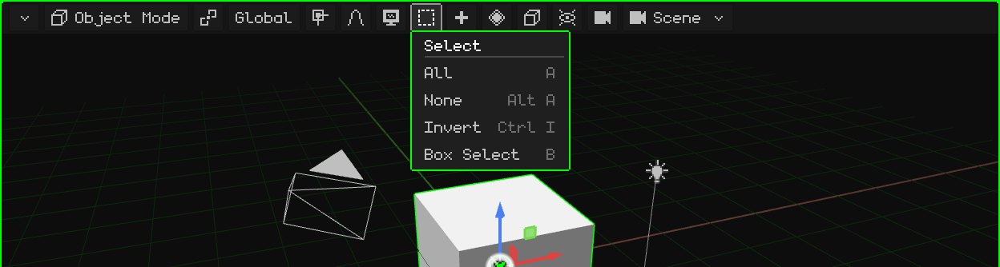

| Option | What it does | Shortcut |
|---|---|---|
| All | Selects everything. | <kbd>A</kbd> |
| None | Leaves nothing selected. | <kbd>Alt+A</kbd> |
| Invert | What was selected gets deselected, and vice versa. | <kbd>Ctrl+I</kbd> |
| Box Select | A box you drag: from left to right (green) it only selects what ends up completely inside; from right to left (blue) just touching is enough. <kbd>Shift</kbd> adds. | <kbd>B</kbd>, or drag on the background |

In Edit Mode it adds Select Linked, loops and paths (see [Edit Mode](modo-edicion.md)).

## Add

 Creates new objects, which appear at the 3D cursor and stay selected. It's only in Object Mode.

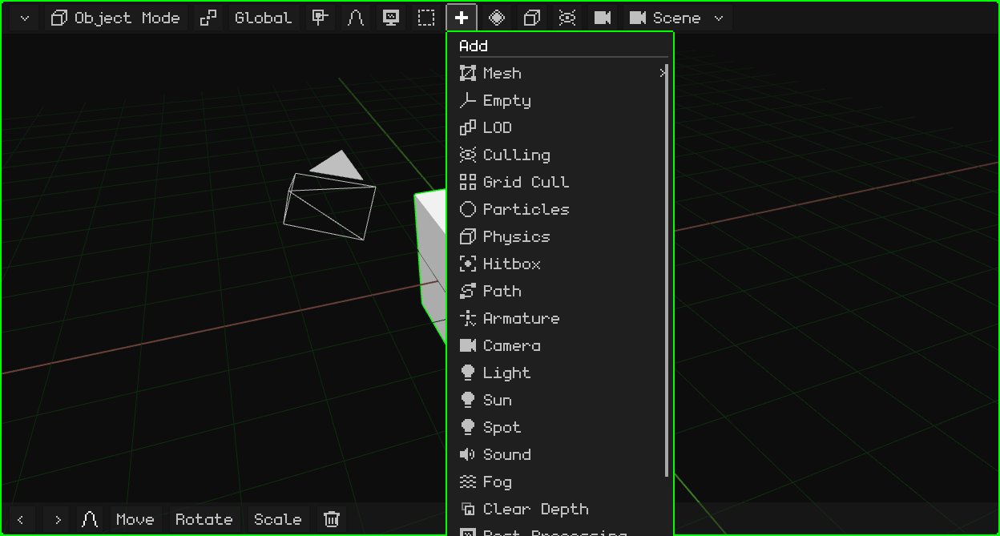

Each type is in [Object Mode → Add menu](modo-objeto.md#add-menu).  <kbd>Shift</kbd> + <kbd>A</kbd> opens it where the mouse is.

In Edit Mode, **Mesh** (the modeling operations, see [Edit Mode](modo-edicion.md)) and **UV** (unwrapping and projecting UVs, see [UV Editor](editor-uv.md)) appear in its place. In Texture Paint a **floppy disk** appears, which saves the painted texture; it turns green when there's unsaved paint.

## Animation

 The **keyframes** of the selection: storing the value of the location, rotation or scale at the current frame, so the animation goes from one keyframe to the next. It appears when something is selected, in Object Mode and in Pose Mode, and its options depend on what's selected.

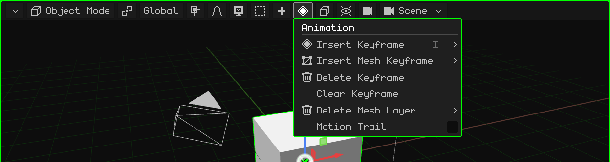

| Option | What it does | Shortcut |
|---|---|---|
| Insert Keyframe | A menu to choose what gets stored: location, rotation, scale or all of them. | <kbd>I</kbd> (<kbd>Shift+I</kbd>: everything without asking) |
| Insert Mesh Keyframe | Only with a 3D mesh: chooses what gets stored from the mesh animation, the vertices, the normals or the UVs. | Menu |
| Delete Keyframe | Deletes the keyframe at the current frame. | Menu |
| Clear Keyframe | Deletes the whole animation of the selection. | Menu |
| Delete Mesh Layer | Only with a 3D mesh: deletes a whole layer of the mesh animation, the **vertices** one, the **normals** one (for example, on a model without lighting) or the **UVs** one. At least one keyframe always remains. | Menu |
| Motion Trail | Draws in the view the path the animated objects follow. | Menu |

### In Pose Mode

While posing an armature, the menu works with the keyframes of the selected bones (and the active one):

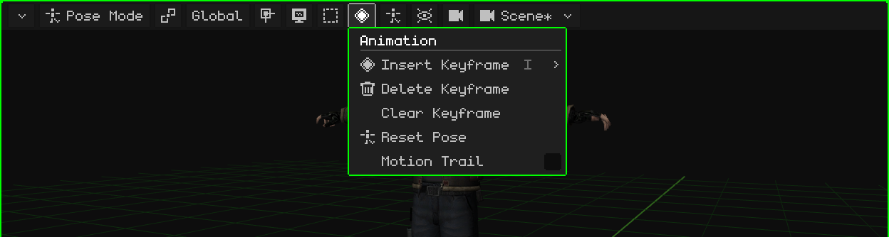

| Option | What it does | Shortcut |
|---|---|---|
| Insert Keyframe | Stores the pose of the selected bones at the current frame: location, rotation, scale or all of them. | <kbd>I</kbd> |
| Delete Keyframe | Deletes those bones' keyframe at the current frame. It's undone with <kbd>Ctrl+Z</kbd>. | Menu |
| Clear Keyframe | Deletes all the keyframes of those bones in the active animation. It's undone with <kbd>Ctrl+Z</kbd>. | Menu |
| Reset Pose | The selected bones (or all of them, if none is selected) go back to the location, rotation and scale they have in Edit Mode. It's undone with <kbd>Ctrl+Z</kbd>. | Menu |
| Motion Trail | Draws in the view the path the animated objects follow. | Menu |

Animation has its own tutorial and its own chapter, [Timeline](linea-de-tiempo.md).

## Object

 What you can do to the selection. It's the same menu that opens with a right click in the view (or, on a touch screen, by holding a finger still). It appears when something is selected.

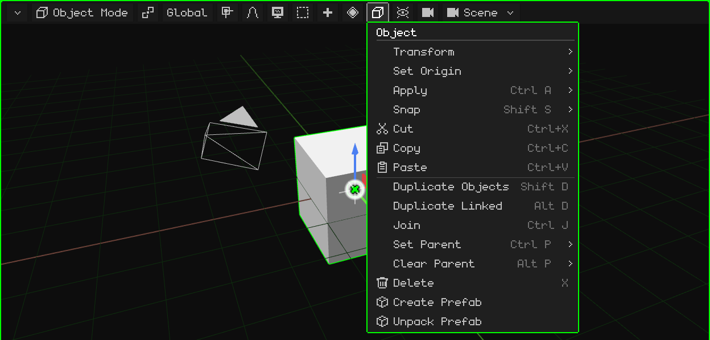

Each option is in [Object Mode](modo-objeto.md). In Edit Mode, this button becomes the menu for what you select (Vertex, Edge or Face); in Pose Mode, the Pose menu; when editing an armature, the Armature menu.

## Overlays

 **Overlays** are the helpers drawn on top of the scene for working, which don't show up in the render: the floor, the axes, the gizmo, the 3D cursor. This is where you turn them on and off, all together or one by one.

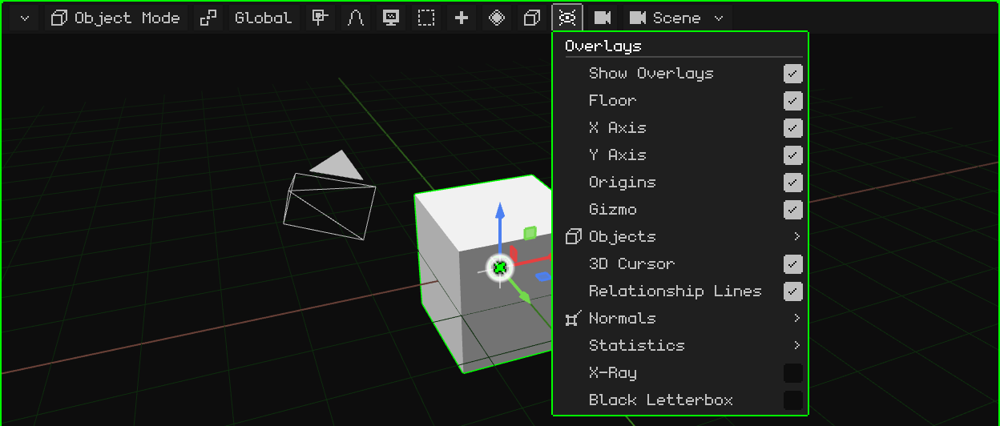

| Option | What it does | Shortcut |
|---|---|---|
| Show Overlays | Turns all the helpers on or off at once. | <kbd>K</kbd> |
| Floor, X Axis, Y Axis, Origins, 3D Cursor, Relationship Lines | Each helper separately. Relationship lines connect each child to its parent. | Menu |
| Gizmo | The move, rotate and scale gizmo. On the Nokia N95 it's off by default. | Menu |
| Objects | Which object types are drawn: armatures, lights, cameras, empties, particles, curves, hitboxes. | Menu |
| Normals | Draws the vertex or face normals, with their size. | Menu |
| Statistics | Frames per second, vertices, faces, draw calls and timings. | Menu |
| X-Ray | In Edit Mode, the mesh looks semi-transparent and you can select the elements behind. | Menu |
| Black Letterbox | When looking through a camera with a different aspect ratio than the screen, it covers whatever is outside the shot. | Menu |

## Render

 The **shading mode**: how the scene is drawn in the view. It doesn't change the project, only how it looks while you work.

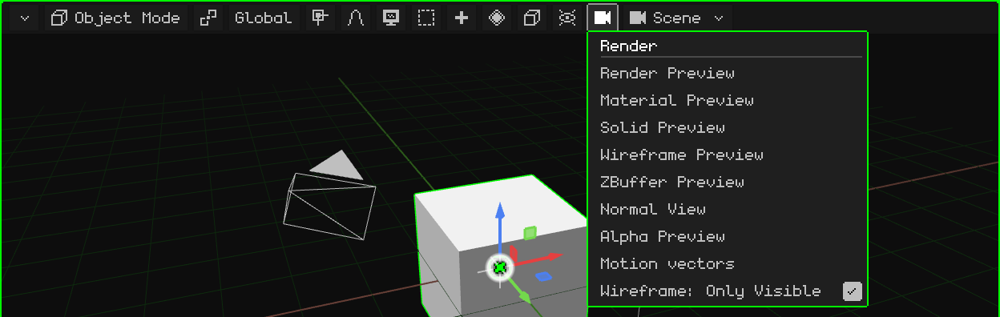

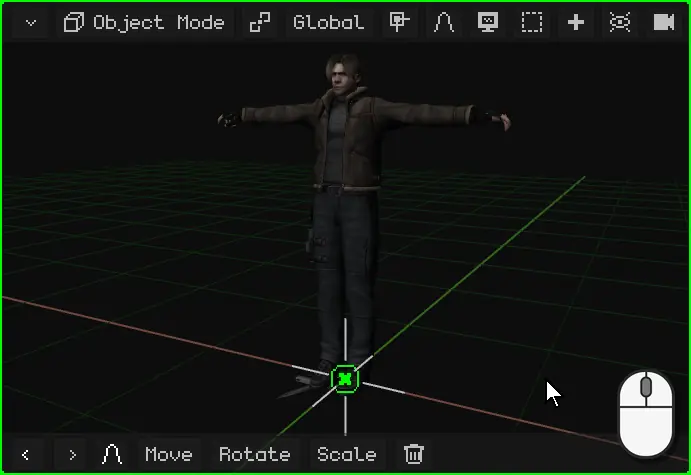

| Mode | How it looks |
|---|---|
| Render Preview | With the scene's lights. With ray tracing on, it shows the traced image little by little. |
| Material Preview | The default: the materials and textures with a neutral light from the view, independent of the scene's lights. |
| Solid Preview | Everything gray, to see the shape. |
| Wireframe Preview | Only the edges. With **Wireframe: Only Visible**, only those of what's facing the view. |
| ZBuffer Preview | The depth: light up close, dark far away. |
| Normal View | The normals, in colors. |
| Alpha Preview | Transparency, in black and white. |
| Motion vectors | How far each pixel moved since the previous frame (red = X, green = Y). It's the same image as the `_vectores` pass of the render. |

 <kbd>Z</kbd> switches to the next mode.  On the N95, <kbd>6</kbd>.

## The scene

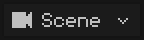 The name of what's being edited: a **scene**, a **game** or a **prefab** of the project. Tapping it lets you choose another one, create a new one or convert the scene into a game.

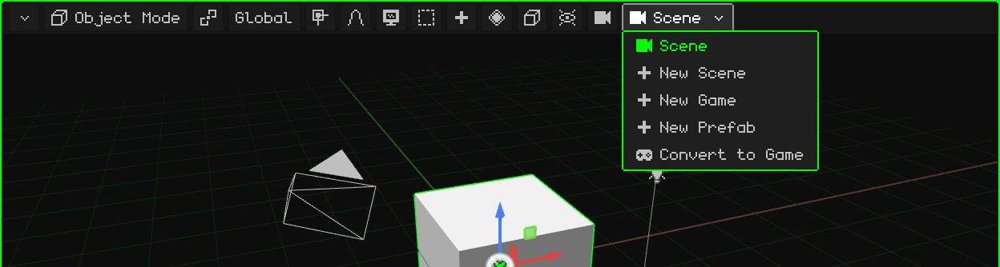

Scenes, games and prefabs are covered in [The project](proyecto.md).
