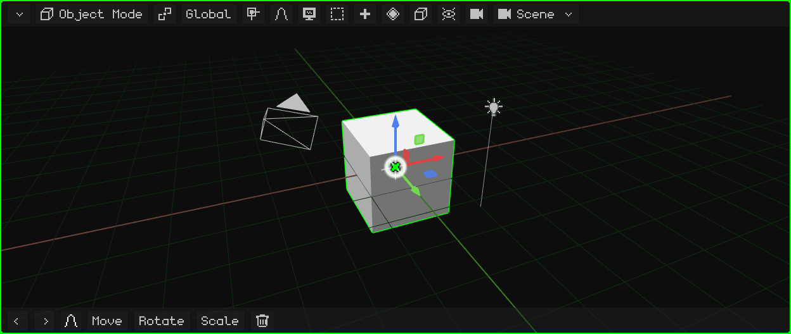
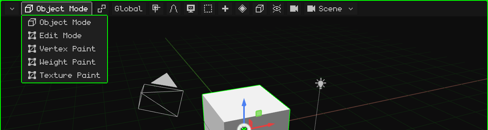
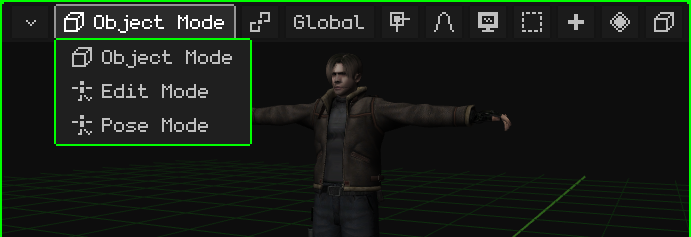
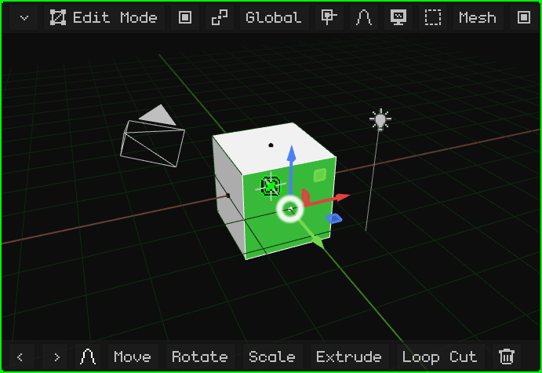
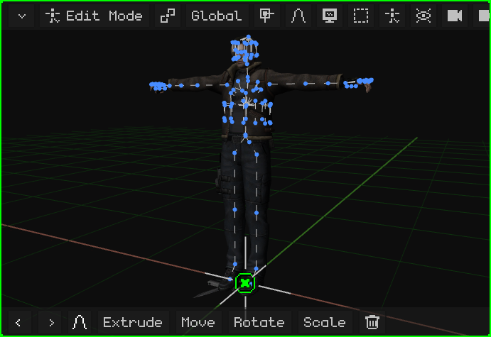
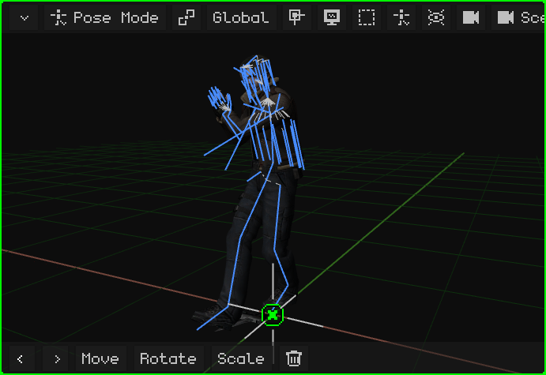
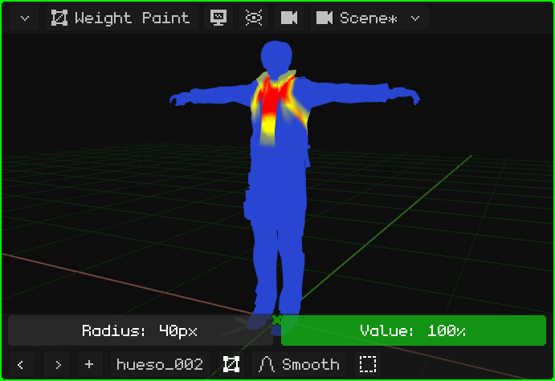
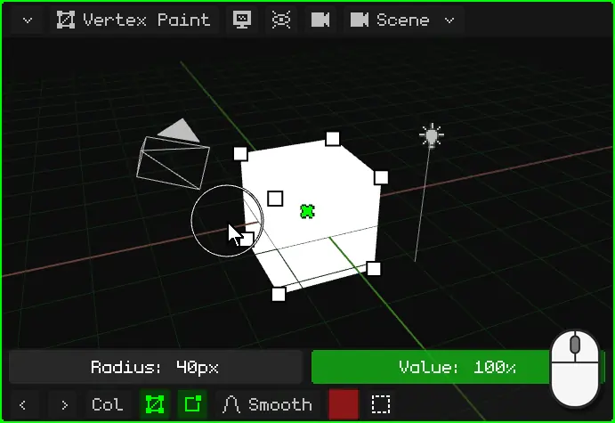
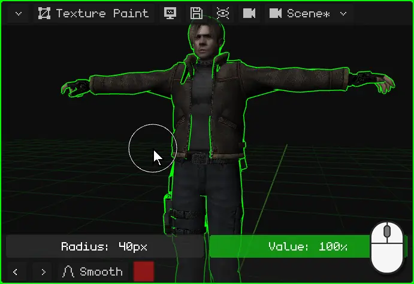
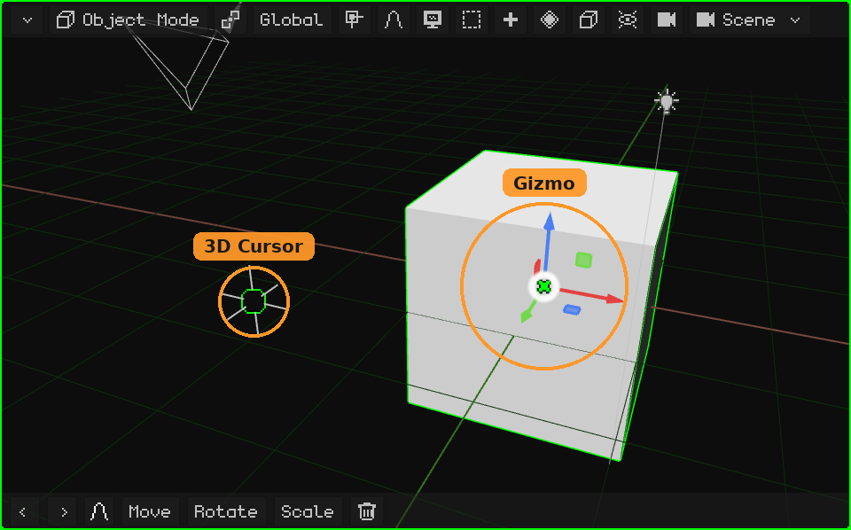

# 3D Viewport

The **3D Viewport** is the viewport where you see and edit the scene: it's where you model, move objects, paint, pose and animate. Like every viewport, it has its **menu bar** at the top and its **toolbar** at the bottom.

- **The menu bar**, button by button, with its menus: [The 3D Viewport menu bar](vista-3d-barra.md).
- **Navigating** (orbit, pan, zoom, the views, the camera): [Navigating the 3D Viewport](navegacion.md) and the tutorial [Navigating the 3D Viewport](../tutoriales/navegacion.md).
- **Moving, rotating and scaling**, the gizmo, the pivot and the orientation: [Move, rotate and scale](transformar.md).

## The modes

The 3D Viewport works in different **modes**: what clicks, keys and menus do depends on the current mode. The mode is chosen with the first button of the menu bar, which shows the current mode, or with <kbd>Tab</kbd> (Object ↔ Edit; on the Nokia N95, <kbd>OK</kbd>).

The modes you can choose depend on the **active object**. Every object has **Object Mode**. A 3D mesh adds Edit Mode and the three paint modes; an armature, Edit Mode and Pose Mode. With any other object (a light, a camera, a sound) the only mode is Object Mode, and the button doesn't appear.

| Mode | For which objects | What it's for |
|---|---|---|
| [Object Mode](modo-objeto.md) | All | Work with whole objects: create, move, rotate, scale, duplicate, parent and delete them. |
| [Edit Mode](modo-edicion.md) | 3D meshes and curves | Modeling: move, add and delete the mesh's vertices, edges and faces. |
| [Edit Mode](esqueletos.md#armature-edit-mode) | Armatures | Build the armature: create bones and arrange them in their rest position. |
| [Pose Mode](esqueletos.md#pose-mode) | Armatures | Pose the bones and save the poses: that's how a character is animated. |
| [Weight Paint](pintura.md#weight-paint) | 3D meshes | Paint how much each bone moves each vertex. |
| [Vertex Paint](pintura.md#vertex-paint) | 3D meshes | Paint colors directly on the vertices. |
| [Texture Paint](pintura.md#texture-paint) | 3D meshes | Paint on the texture, directly on top of the object. |

### Object Mode

It's the mode Whisk3D starts in, and the only one every object has. You work with whole objects: you select, move, rotate, scale, add and delete them. See [Object Mode](modo-objeto.md) and the tutorial [Object Mode](../tutoriales/modo-objeto.md).

### Edit Mode of a mesh

You model the mesh's **shape**: its vertices, edges and faces. The menu bar shows the **Vertex / Edge / Face** button (what a click selects) and the **Mesh** and **UV** menus. The rest of the scene stays visible, but you can't touch it.

### Edit Mode of an armature

You build the **armature**: you create bones (extruding them from the tip of another one), move them and parent them. This is its **rest** position, the one it has when it isn't animated.

### Pose Mode

You **pose** the armature: the bones are rotated and moved without changing the armature itself, and the mesh follows them. The poses saved on different frames are the character's animation.

### Weight Paint

You paint **how much each bone moves each part of the mesh**: red is what the selected bone moves fully, blue is what it doesn't move. This is what makes the arm bend, and not the waist, when you bend the arm.

### Vertex Paint

You paint **colors on the mesh's vertices**, without a texture. It's useful to give color to simple models, for hand-painted shadows and for effects in shaders.

### Texture Paint

You paint **directly on the texture**, on top of the object, as if on a doll. What you paint is saved with the floppy disk that appears in the menu bar.

In the paint modes, the brush row (**Radius** and **Value**) appears above the toolbar. See [Paint modes](pintura.md).

## The toolbar

At the bottom of the 3D Viewport are **Undo** and **Redo** (the arrows), the **last commands used** (at first, Move, Rotate, Scale and Delete; whatever you use moves to the front) and **proportional editing**. While you move, rotate or scale, the toolbar changes: the green check mark confirms, the red cross cancels, the orientation, and **X**, **Y** and **Z** keep the movement on those axes. See [Move, rotate and scale](transformar.md#toolbar).

 On a touch screen it adds **Shift** and **Ctrl**, which stay on (in green) and act as those keys, and the **View** button (the monitor), so that in Edit Mode and in the paint modes your finger navigates instead of selecting or painting.

 On the Nokia N95 it's hidden, to leave the screen to the scene, and it appears when needed: in the paint modes the brush row shows up (**Radius** and **Value**), and while you move, rotate or scale with proportional editing on, the bar for its radius. Its buttons are used with the **virtual mouse**: you turn it on with the right selection key, the arrows move it and <kbd>OK</kbd> clicks.

## The gizmo and the 3D cursor

- The **gizmo** is the colored arrows on the selection: you grab them to move, rotate and scale. A click on the gizmo switches from one mode to the next. See [The gizmo](transformar.md#the-gizmo).
- The **3D cursor** is the circle with a cross: it's where whatever you add with Add appears, and it can be the pivot point. See [The 3D cursor](../tutoriales/modo-objeto.md#the-3d-cursor).

 On the Nokia N95 the gizmo is off, because the screen is small and there you move with the keys. You turn it on in **Overlays → Gizmo**, and grab it with the virtual mouse.
