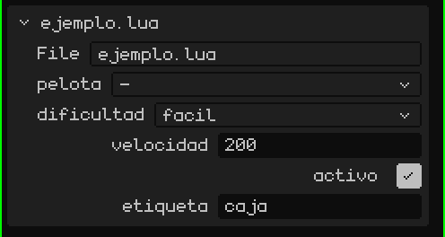
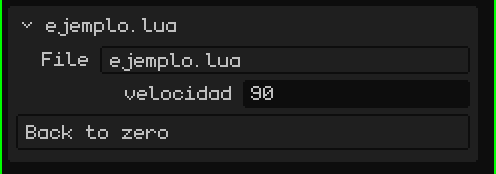

# A script is a component of an object

In Whisk3D a script always belongs to an **object** in the scene (a mesh, an empty, a 2D button…). An object can have several scripts; each one runs separately, with its own variables, in the order they appear.

From the script, `yo()` returns the object that owns it. To use *other* objects, the script declares a global table called `propiedades`. The editor reads it and shows a field for each entry in the script's card, in the Properties panel:

```lua
propiedades = {
  pelota     = "objeto",                          -- a field to pick an object from the scene
  dificultad = { "facil", "normal", "dificil" },  -- a drop-down list (the first one is the default)
  velocidad  = 200,                               -- a number of its own for each object that uses the script
  activo     = true,                              -- a yes/no
  etiqueta   = "caja",                            -- a text
}

function inicio()
  local p   = objeto("pelota")         -- the object picked in the "pelota" field
  local dif = opcion("dificultad")     -- "facil", "normal" or "dificil"
  local v   = propiedad("velocidad")   -- 200, or whatever was set on that object
end
```

> [!NOTE]
> To read `propiedades`, the editor **runs the file** even when the game isn't running. That's why, outside the functions, you should only put declarations (tables, constants, `local`), never code that does things.

This is how it looks in the script's card, in Properties: one field for each property, in the same order as in the code.



That way, the same script works for many objects with different values: one enemy's `velocidad` field can be 200 and another's 350.

## Change the properties in real time

`propiedad("velocidad")` reads the value at that moment. If you change it in Properties while the game is running, the script sees it on the next frame, but only if it reads it again with `propiedad()`. If you saved it in a variable (`local v = propiedad("velocidad")` in `inicio()`), the variable keeps the value from the start.

```lua
function actualizar(dt)
  -- read every frame: it sees what you change in Properties while the game is running
  mover(yo(), propiedad("velocidad") * dt, 0, 0)
end
```

Reading `propiedad()` every frame is slower than using a variable. It's not a good idea to work like this throughout the game: use it while you're tweaking the values, and once they're right, save them in variables in `inicio()`.

## Buttons

If a property is a **function**, a **button** appears in the card: pressing it calls that function. To make the button say something other than the name, put the text and the function in a table:

```lua
propiedades = {
  velocidad = 90,
  cero = { "Back to zero", function()
    setRotacion(yo(), 0, 0, 0)
  end },
}
```



While the game is running, the function runs in the script that's playing. Without the game, the script is loaded just for that call: that way, a button works as an **editor add-on** that does something to the scene. For example, with `seleccionados()`, the objects selected in the editor:

```lua
propiedades = {
  subir = { "Raise the selection", function()
    for _, o in ipairs(seleccionados()) do
      mover(o, 0, 0, 1)   -- one meter up
    end
  end },
}
```

> [!NOTE]
> What a button does while the game is stopped stays in the scene, as if you had done it by hand, and it can be undone the same way: <kbd>Ctrl</kbd> + <kbd>Z</kbd> undoes everything the button did in one step. While the game is running nothing goes into the history: when you press **Stop**, everything goes back to how it was.

Scripts don't share variables with each other. To pass data around (the score, whether the player won…) they use a shared space: `setCompartido("puntos", 10)` writes and `compartido("puntos")` reads. It stores numbers, yes/no values and strings, and it's emptied when the game stops.
