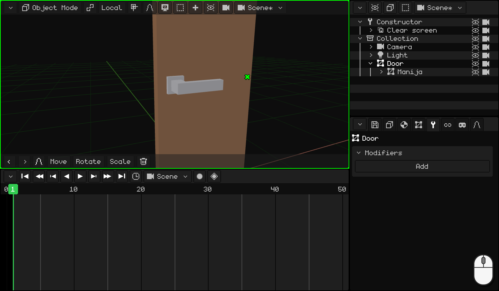
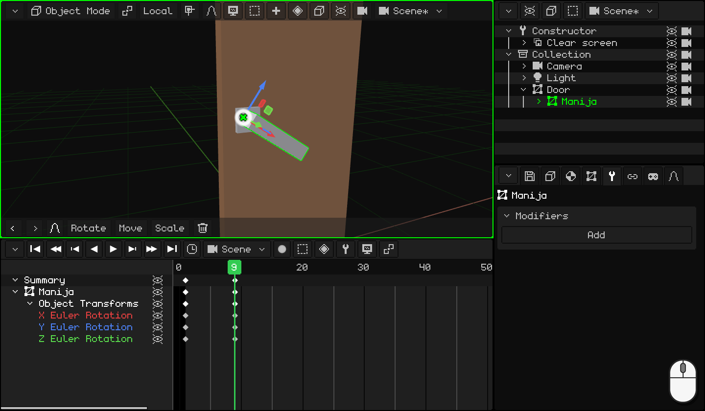
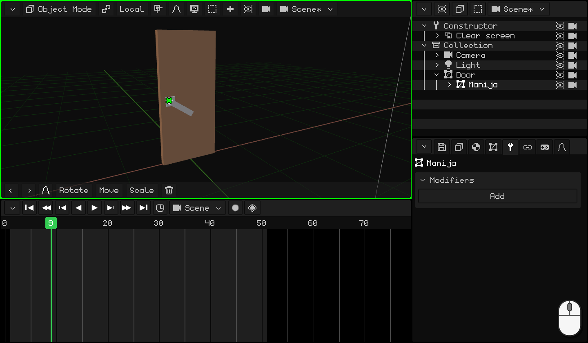
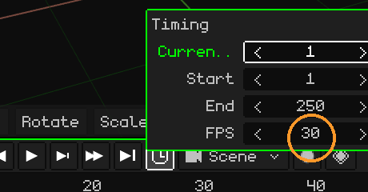
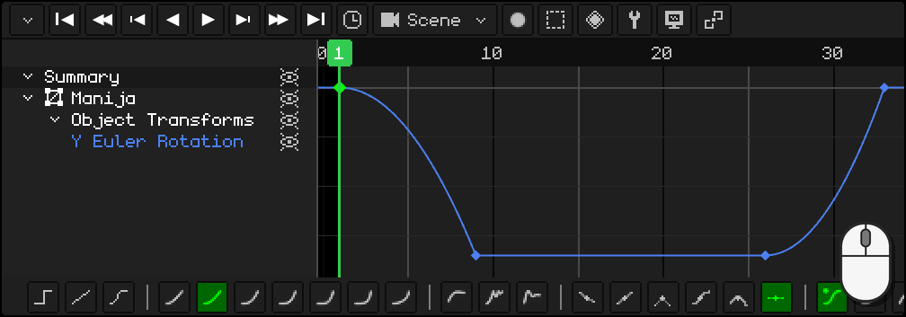

# Animating the door

We start from the door with its handle from the previous tutorial, [Modeling the door handle](modelar-picaporte.md): the door has its origin on the hinge, and the lever has its own where it turns and is a child of the door. Now we're going to animate it like a real door: first the handle goes down, only when it's down does the door start to open, and at the end the handle goes back to its place.

Along the way you'll learn to:

- set **keyframes**: an object's pose at a frame;
- **duplicate** keyframes that are already the way you want them;
- adjust the animation's **timing** and choose its **frames per second**;
- use the **curve editor**: what a curve is and how to change it with a click and the toolbar.

## 1. The handle

A **keyframe** stores how an object is at a frame: its location, its rotation or its scale. With two keyframes, the program calculates all the frames in between: that's the animation.

1. Click on the **lever** to select it. In the **Timeline**, go to frame **1**: the handle is up.
2. With the mouse over the 3D Viewport, press <kbd>I</kbd> and choose **Rotation Only**: a diamond appears at frame 1 in the Timeline.
3. Go to frame **9** (a click on the Timeline's numbers) and lower the handle: <kbd>R</kbd> <kbd>Y</kbd> `-34` <kbd>Enter</kbd>. It turns around its origin, the one we gave it in the previous tutorial.
4. Again <kbd>I</kbd> → **Rotation Only**: another diamond, at 9.

 On a touch screen: you set the keyframe with the diamond button on the 3D Viewport's menu bar, **Animation → Insert Keyframe → Rotation Only**, and you change the frame with a tap on the Timeline's numbers. You lower the handle with **Rotate** **Y** `-34` on the toolbar, with the numbers on the top bar's keypad.

 On the Nokia N95: <kbd>2</kbd> (rotate), <kbd>2</kbd> (the Y axis), the pencil key + `-34` and <kbd>OK</kbd>. The keyframe, with **Animation → Insert Keyframe → Rotation Only**.

## 2. Duplicate keyframes

The handle has to stay down while the door opens and, at the end, go back up. You already have those two poses: there's no need to turn it again.

1. In the Timeline, click on the diamond at frame **9** (down), <kbd>Shift</kbd> + <kbd>D</kbd>, take the copy to frame **26** and click. From 9 to 26 the handle stays down.
2. Click on the diamond at frame **1** (up), <kbd>Shift</kbd> + <kbd>D</kbd> and the copy to **33**: the handle goes back up.

Watch the copy's diamond, not the pointer: it sits one frame to the right of the mouse. While the copy passes over another keyframe nothing happens to it: it only **replaces** it if you drop it right on top.

  On touch screens and on the N95 (with the virtual mouse), instead of duplicating you copy and paste: a tap on the keyframe at frame 9 and, in the Timeline's **Key** menu (the diamond button), **Copy**; a tap on the numbers to go to frame 26 and **Key → Paste**. The same with the one from 1 to 33.

## 3. The door

1. Click on the **door**, to select it alone. Go to frame **11** and <kbd>I</kbd> → **Rotation Only**: up to here the door is closed. Only at 11 does it start to open, when the handle is already down.
2. Go to frame **26**, open it: <kbd>R</kbd> <kbd>Z</kbd> `-80` <kbd>Enter</kbd>, and again <kbd>I</kbd> → **Rotation Only**.

Press **Play** (<kbd>Space</kbd>, or the ▶ button on the Timeline): the handle goes down, the door opens and the handle goes back up. Meanwhile it goes along with the door, because it's its child.

 On a touch screen: **Rotate** **Z** `-80` and **Animation → Insert Keyframe → Rotation Only**.

 On the Nokia N95: <kbd>2</kbd>, <kbd>3</kbd> (the Z axis), the pencil key + `-80` and <kbd>OK</kbd>; and **Animation → Insert Keyframe → Rotation Only**.

## 4. Timing

Does everything happen too fast, or too slow? You have to move the keyframes:

- <kbd>G</kbd> moves the selected keyframes in time (for example, the handle going back, from 33 to 36).
- <kbd>S</kbd> scales them: with all of them selected, `2` makes the animation last twice as long.

The animation ends at frame **50**: in the Timeline's **clock**, **End** `50` <kbd>Enter</kbd>.

### Frames per second

An animation's time is counted in **frames**, and how many frames fit in one second is set by the **FPS** (*frames per second*). You change them in the same **clock**, in **FPS**. Each animation has its own: the scene's and each clip can run at different FPS.

Whisk3D starts at **30**: the door's 50 frames last a good second and a half.

| FPS | What for |
|---|---|
| **24** | Film. It gives the animation a more cinematic style and, if you're going to render it, it's far fewer frames: one minute at 24 is 1440 frames; at 30, 1800. |
| **30** or **60** | TV series and video games. |

There's no need to animate at 60. In the game, the engine calculates the in-between frames by itself: an animation made at 30 looks smooth on a screen running at 60 and takes up less memory.

Choose the FPS **before** animating. Keyframes stay on their frame: if you raise the FPS later, the animation goes faster, and if you lower them, slower.

## 5. Curves

Switch the Timeline to the **curve editor** (**View → Curves**). There, each animated value is a **curve**: it tells you what location, rotation or scale the object has at each moment. Left to right is **time**; up and down, the **value**.

**Rotation Only** stores all three axes, but the handle and the door turn on just one: the other two curves are flat lines that do nothing. Delete them: select those rows and <kbd>X</kbd>. Only the curves that change are left, and it's more comfortable to work.

### The shape of the curve

If the curve is a **straight line**, the object always moves at the same speed: it starts and stops abruptly. It feels **robotic**. Sometimes that's exactly what we want, but almost nothing moves like that in real life: things **speed up** when they start and **slow down** when they arrive.

Look at six balls going from left to right in the **same time**, each one with a different curve. Next to each one is its curve, with a dot that moves along with it:

| Curve | How it moves | What for |
|---|---|---|
| **Linear** | Always at the same speed. | A machine, a conveyor belt, something robotic. |
| **Speeds up and slows down** (ease in and out) | Starts slowly, goes fast in the middle and arrives slowly. | Almost everything: a person walking, a door, a camera. |
| **Speeds up and stops dead** (ease in) | Starts slowly and arrives at full speed. | Something that falls and hits, a door handle that reaches its stop. |
| **Starts fast and slows down** (ease out) | Starts at full speed and slows down little by little. | Something thrown, a drawer that closes by itself. |
| **Bounce** | Arrives, bounces against the end a few times and stays. | Something that falls and bounces, a lid that closes. |
| **Elastic** | Overshoots, comes back and wobbles like a spring until it settles. | A spring, an antenna, something that appears on screen with flair. |

Curves make the animation look **natural**.

### The toolbar

With a keyframe or a segment selected, the Timeline's toolbar changes its curve with a click:

- **Interpolation Mode:** **Constant**, **Linear** and **Bezier**; then the calculated ones, from the smoothest to the sharpest (**Sinusoidal**, **Quadratic**, **Cubic**, **Quartic**, **Quintic**, **Exponential** and **Circular**), and the effect ones (**Back (overshoot)**, **Bounce** and **Elastic**).
- **Handle Type:** how the handles of a **Bezier** curve are built.
- **Easing Type:** for the calculated ones, where the effect goes: **Automatic**, **Ease In**, **Ease Out** or **Ease In and Out**.

With the keyboard: <kbd>E</kbd> opens the **Interpolation Mode** and <kbd>Ctrl</kbd> + <kbd>E</kbd>, the **Easing Type**.

### The handle: THUNK!

You push down a real door handle, it picks up speed and stops dead against the stop: THUNK! When you let go, the spring pushes it up and it stops dead again at the top. Both times it **speeds up and stops dead**.

1. With the **lever** selected, in the curve editor, click on the row of the remaining curve: the Timeline frames it whole.
2. Click on the segment of the curve that goes down, between frame 1 and 9: a click on the line selects that segment.
3. On the toolbar, **Quadratic**. Its **Automatic** easing is **Ease In**: it speeds up and stops dead.
4. The same with the segment that goes back, between 26 and 33.

  On touch screens and on the N95: a tap (or the virtual mouse) on the segment and another on **Quadratic**: the toolbar is the same.

### The door

The door looks right with the usual curve, **Bezier**: it **speeds up and slows down**. You push it, it picks up speed and slows down until it's open. There's nothing to change.

In the next tutorial, [Making a ball bounce](pelota.md), we'll use curves to give a ball weight, together with another principle of animation: squash and stretch.
