# Modeling the door handle

We start from the door in the previous tutorial, [Changing the origin: a door](puerta.md): it measures 0.90 × 0.10 × 2 meters and has its origin on the hinge. We're going to give it a door handle in two parts: a **plate** stuck to the door and a **lever** that turns.

Along the way you'll learn to:

- duplicate a face and build a new piece from it;
- **separate** part of a mesh into another object (<kbd>P</kbd>) and **join** it back (<kbd>Ctrl</kbd> + <kbd>J</kbd>);
- give each part of a mesh a different **material**;
- use the **Mirror** modifier to have the handle on both sides of the door;
- see the faces that are never visible with **X-Ray**, and delete them;
- put the **origin** where the lever will turn, with the 3D cursor;
- **parent** the lever to the door, so they move together.

## 1. The plate

1. With the door selected, enter **Edit Mode** (<kbd>Tab</kbd>) and, with the **Vertex / Edge / Face** button, choose **Face**.
2. Click on the large front face of the door.
3. **Duplicate it:** <kbd>Shift</kbd> + <kbd>D</kbd>. The copy comes out stuck to the mouse; a right click (or <kbd>Esc</kbd>) leaves it where it was, right on top of the original.
4. **Shrink it** until it's a small square. By eye: <kbd>S</kbd> and move the mouse; then <kbd>S</kbd> <kbd>Z</kbd> to adjust only the height. With numbers: <kbd>S</kbd> `0.15` <kbd>Enter</kbd> and <kbd>S</kbd> <kbd>Z</kbd> `0.45` <kbd>Enter</kbd> leave a 13.5 cm square.
5. **Move it** to the side opposite the hinge, where the handle goes: <kbd>G</kbd> <kbd>X</kbd> `-0.31` <kbd>Enter</kbd>.
6. **Extrude it** a little, so it has some thickness: <kbd>E</kbd> `0.03` <kbd>Enter</kbd> (3 cm).

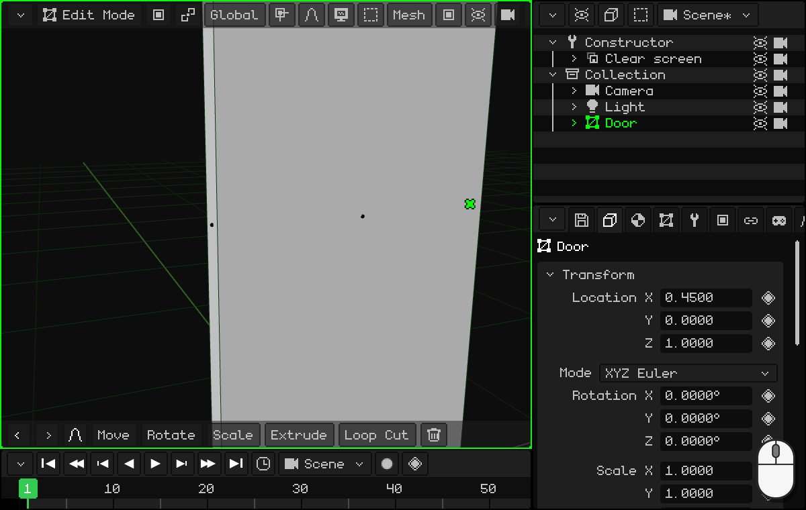

 On a touch screen: a tap on the face and **Mesh → Duplicate** (the copy stays on top). Then **Scale**, **Move** and **Extrude** on the toolbar, with the numbers on the top bar's keypad, and the check mark.

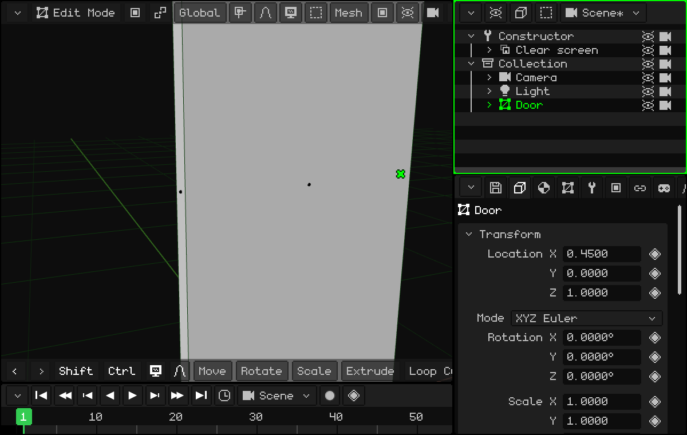

 On the Nokia N95: **Mesh → Duplicate** with the left soft key; then <kbd>3</kbd> (scale), <kbd>1</kbd> (move) and <kbd>7</kbd> (extrude), with the pencil key held down for the numbers and <kbd>OK</kbd>.

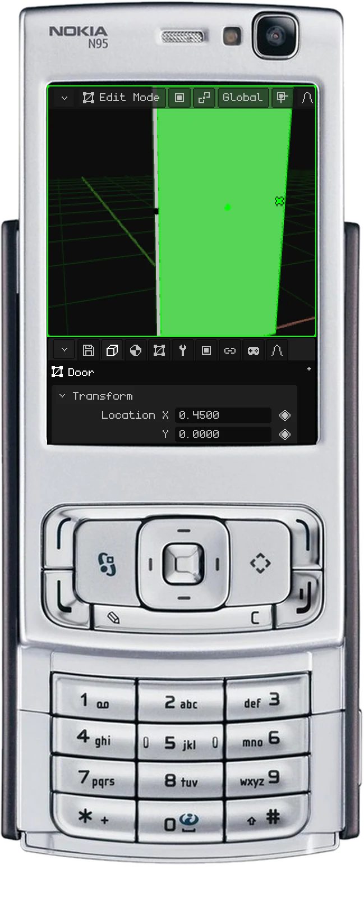

## 2. Separate the plate

The plate is still part of the door's mesh. We turn it into an object of its own:

1. With the plate selected, <kbd>L</kbd> (**Select Linked**) selects the whole piece: the 6 faces of the plate, without the door.
2. <kbd>P</kbd> (**Separate**): the plate becomes a new object, **Door.001**. You can see it in the Outliner.

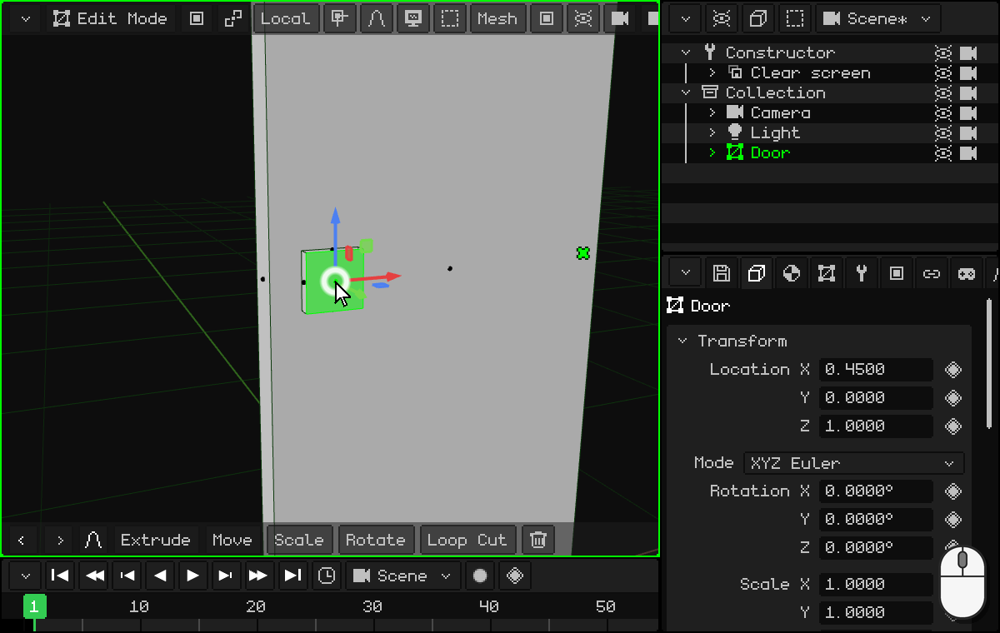

  On touch screens and on the N95: **Select → Select Linked** and a tap on the plate; then **Mesh → Separate**.

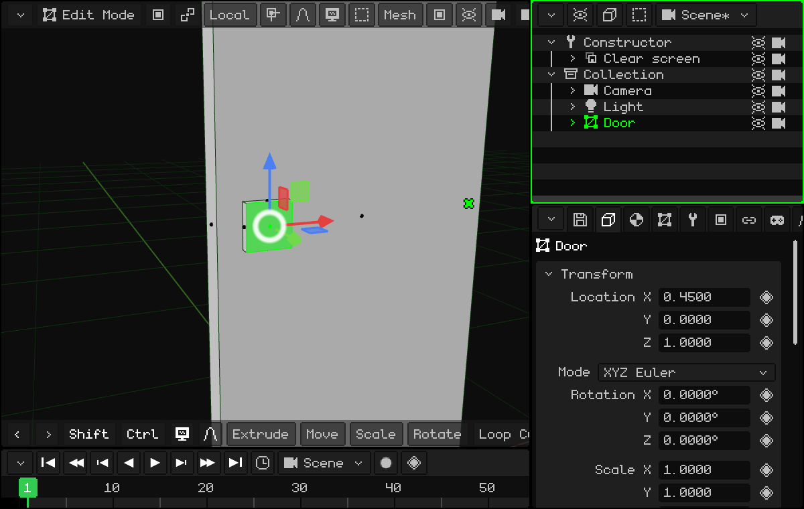

When you separate it, nothing of the plate is left in the door: neither its faces nor its lines.

## 3. The materials: wood and metal

Now each part can have its own material. In **Properties**, in the **Material** tab:

1. Select the door. In **Rename Material** type `Wood`, and in **Color** choose a brown.
2. Select the plate (Door.001). Since it came from the door, it also has the Wood material: tap **New Material**, name it `Metal` and give it a gray.

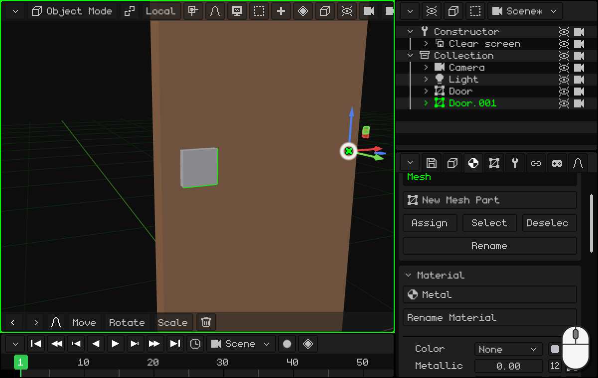

## 4. On the other side of the door: the Mirror

A door handle goes on both sides. Instead of making another plate, we use the **Mirror** modifier:

1. With the plate selected, in **Properties → Modifiers**, add **Mirror**.
2. Turn off **Mirror X** and turn on **Mirror Y**: the other plate appears, on the other side of the door.

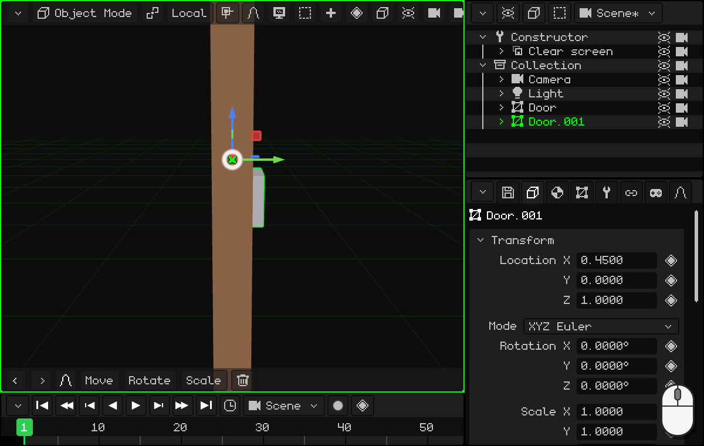

The mirror is made across the object's **origin**. The plate came from the door, so it has the same origin: the hinge, right in the middle of the door's thickness. That's why the copy ends up exactly on the other side. See [Mirror](../editor/modificador-espejo.md).

## 5. The lever

The lever comes out of the plate, with the same trick:

1. With the plate selected, press <kbd>/</kbd> on the numeric keypad (**Local View**): only the plate is shown, easier to work on. Enter **Edit Mode**.
2. Select the front face of the plate, **duplicate it** (<kbd>Shift</kbd> + <kbd>D</kbd> and right click) and shrink it: <kbd>S</kbd> `0.6` <kbd>Enter</kbd>.
3. **Extrude it** outward: <kbd>E</kbd> `0.08` <kbd>Enter</kbd>. This is the lever's shaft.

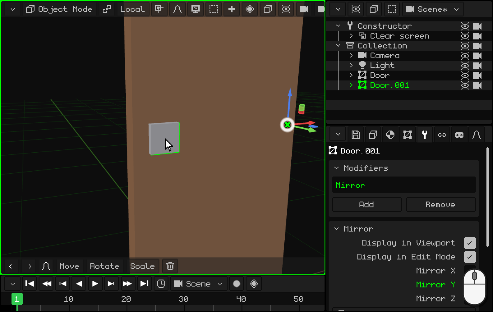
4. Switch to **Edge** and select the outer edge on the side of the door's edge. Move it outward: <kbd>G</kbd> <kbd>Y</kbd> `0.05` <kbd>Enter</kbd>. The front face ends up slanted.
5. Switch to **Face** and select that slanted face. Extrude it **on X**, not along its normal: <kbd>E</kbd>, <kbd>X</kbd>, `0.34` and <kbd>Enter</kbd>. The lever's arm comes out.
6. The tip ended up slanted. To make it straight, scale it to zero on X: <kbd>S</kbd> <kbd>X</kbd> `0` <kbd>Enter</kbd>. All its vertices end up at the same X: the tip is flat.

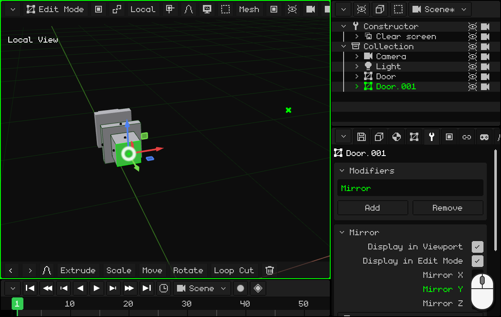
7. <kbd>L</kbd> selects the whole lever and <kbd>P</kbd> separates it: it ends up in **Door.002**. Give it a name: double click in the Outliner and type `Lever`.

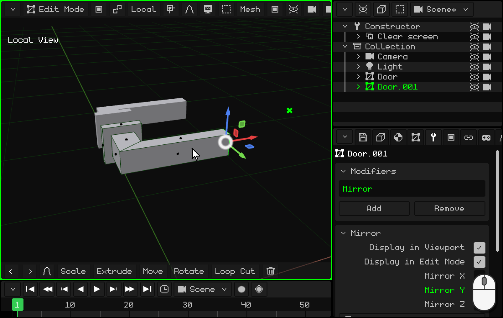

 On a touch screen: a tap on the face, **Mesh → Duplicate**, **Scale** `0.6` and **Extrude** `0.08`; **Edge**, a tap on the outer one and **Move** **Y** `0.05`; **Face**, a tap on the slanted one, **Extrude** **X** `0.34` and **Scale** **X** `0`. To separate it, **Select → Select Linked** and **Mesh → Separate**.

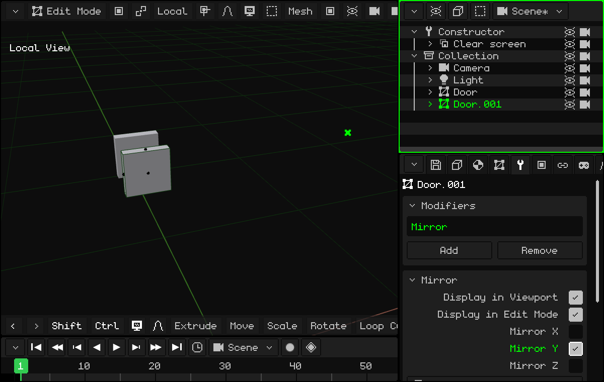

 On the Nokia N95: <kbd>3</kbd> and `0.6`, <kbd>7</kbd> and `0.08`; the edge (with the virtual mouse), <kbd>1</kbd>, <kbd>2</kbd> (the Y axis) and `0.05`; the slanted face, <kbd>7</kbd>, <kbd>1</kbd> (the X axis) and `0.34`; <kbd>3</kbd>, <kbd>1</kbd> and `0`.

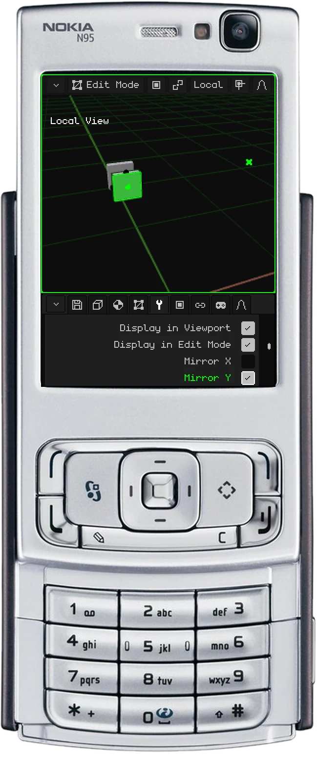

The lever came out of the plate, so it brings along its material (Metal) and its Mirror modifier.

## 6. Join the plate to the door

The plate doesn't move on its own: it's part of the door. We join them back together:

1. Select the plate and, in **Modifiers**, tap **Apply Modifier**: the mirror becomes real geometry.
2. Select the plate, then the door with <kbd>Shift</kbd> + click (the door becomes the active object) and <kbd>Ctrl</kbd> + <kbd>J</kbd> (**Join**). Now they're a single mesh, with both materials.

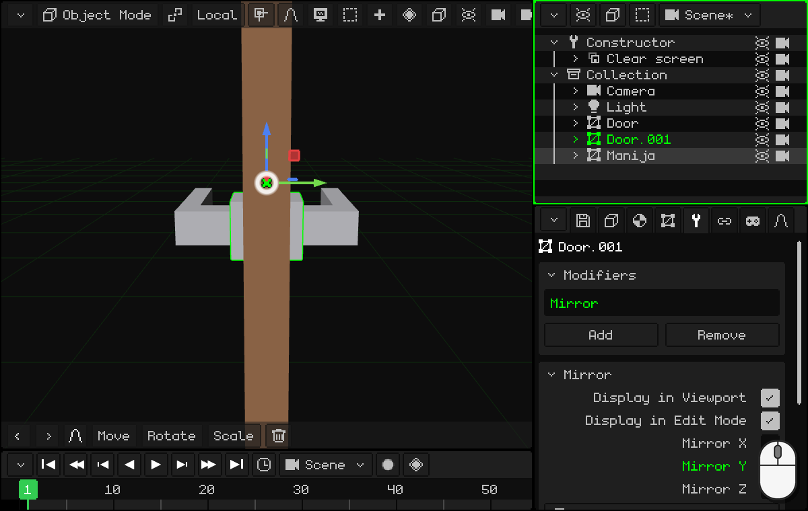

  On touch screens and on the N95: **Object → Join**.

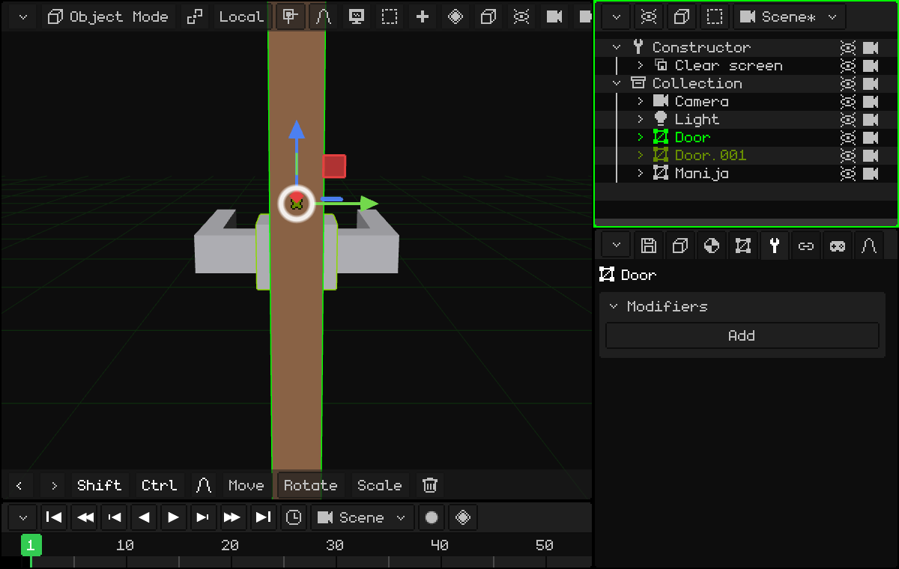

That's how you separate and join parts of a mesh: <kbd>P</kbd> to separate, <kbd>Ctrl</kbd> + <kbd>J</kbd> to join.

## 7. The faces that are never seen

The plate rests against the door. The back face of each plate is covered: it will never be seen, but the program draws it anyway. To see it:

1. Select the door and enter **Edit Mode**.
2. In **Overlays**, turn on **X-Ray**: the mesh becomes transparent and you can see the back faces.
3. Select the back face of each plate (the one touching the door) and delete them: <kbd>X</kbd> → **Faces**.

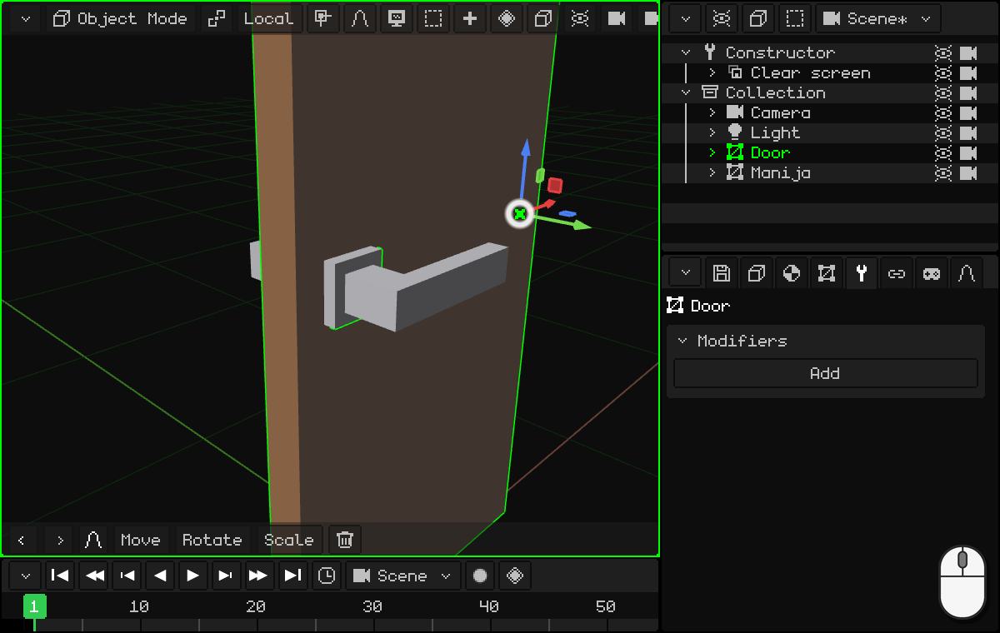

It's a good idea to delete geometry that can't be seen: those are faces drawn for nothing. In a small model you won't notice, but in a large scene, or on a phone, it's performance you gain.

## 8. Where the lever turns: the origin

The lever has to turn around its shaft, not around the door's hinge.

1. Select the lever and apply its Mirror (**Modifiers → Apply Modifier**).
2. Enter **Edit Mode**, with **X-Ray**. Select the lever's two back faces, the ones touching the plates (one on each side).
3. <kbd>Shift</kbd> + <kbd>S</kbd> → **Cursor to Selected**: the 3D cursor ends up halfway between the two, right on the lever's shaft.
4. Those two faces can't be seen either: delete them (<kbd>X</kbd> → **Faces**).
5. Go back to **Object Mode** and move the origin to the cursor: <kbd>W</kbd> (or right click) → **Set Origin → Origin to 3D Cursor**.

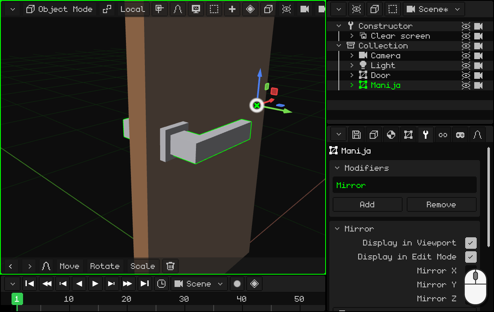

It's the same thing we did with the hinge in [Changing the origin: a door](puerta.md#move-the-origin-to-the-hinge).

## 9. Make the lever go along with the door

Try turning the door: the lever stays floating in the air. They're two separate objects. Undo the turn (<kbd>Ctrl</kbd> + <kbd>Z</kbd>).

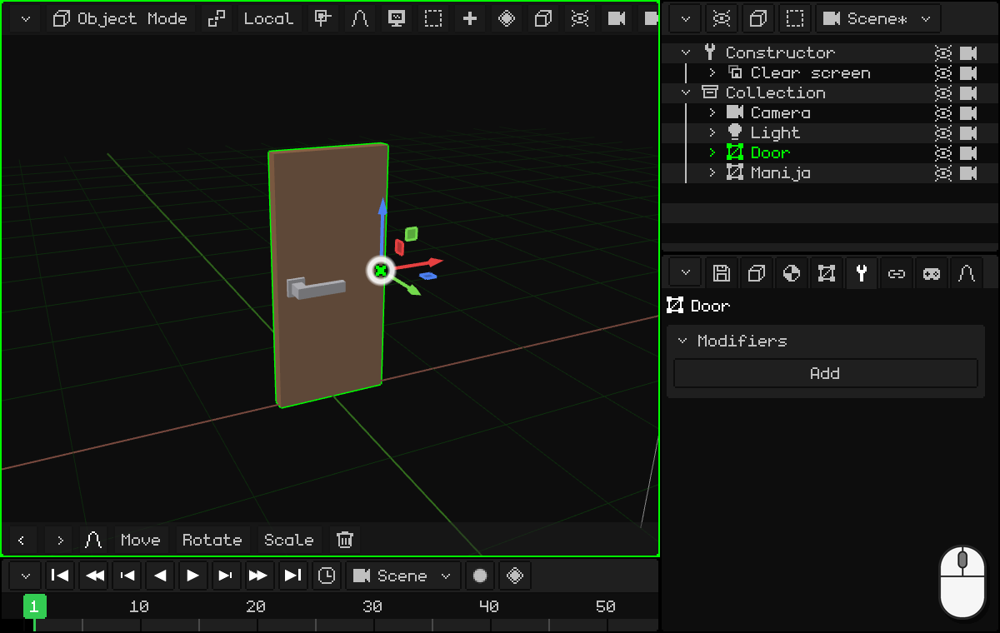

For the lever to move with the door, you have to **parent** it: the lever becomes a **child** of the door.

1. Select the lever and then the door with <kbd>Shift</kbd> + click (the door, the parent, becomes the active object).
2. <kbd>Ctrl</kbd> + <kbd>P</kbd> → **Object (Keep Transform)**. In the Outliner, the lever ends up inside the door.

Select only the door (a click on it) and turn it again: now the lever goes along with it. And the lever still turns around its own shaft, like a real door handle. If both are selected, only the door turns, and the lever follows it because it's its child.

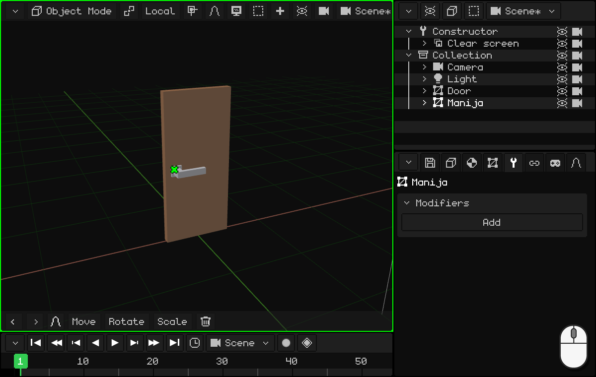

  On touch screens and on the N95: **Object → Set Parent → Object (Keep Transform)**.

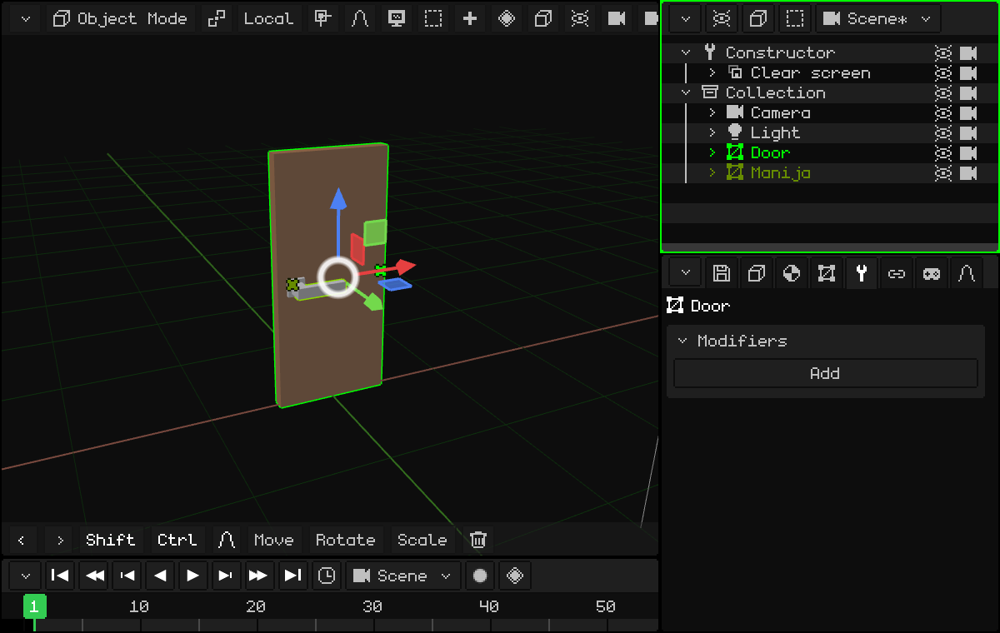

In the next tutorial we'll animate the door: [Animating the door](animar-puerta.md).
