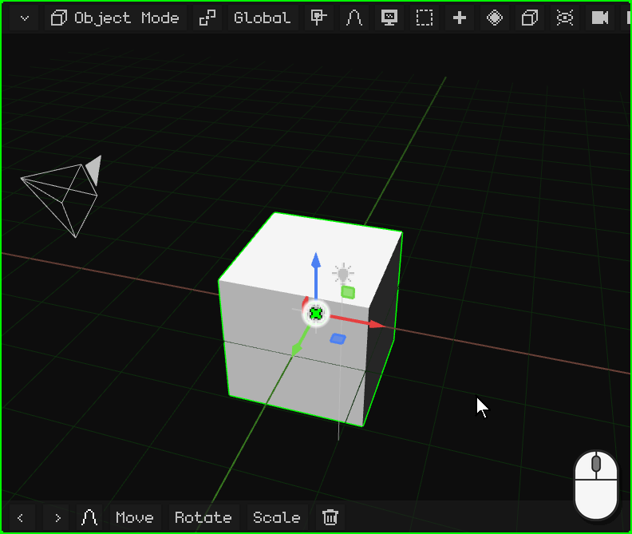
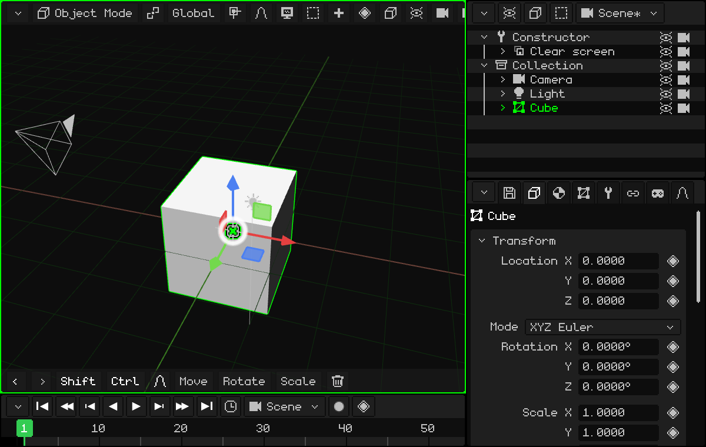
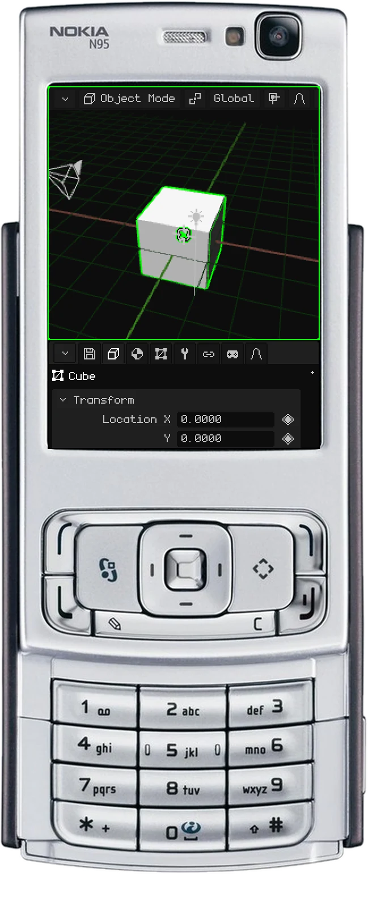
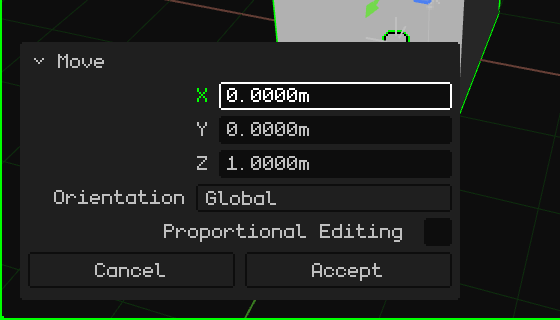
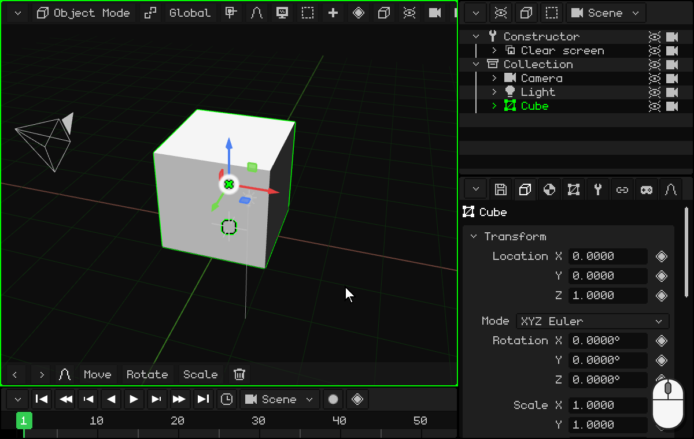
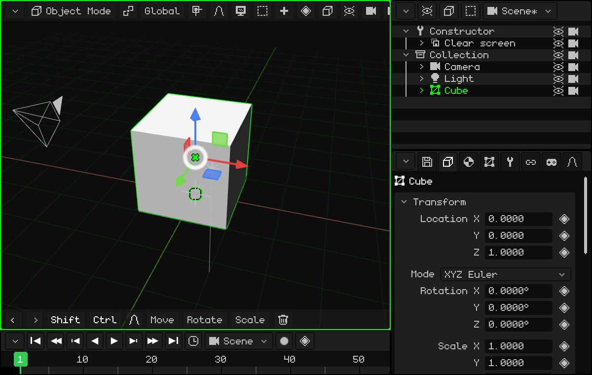
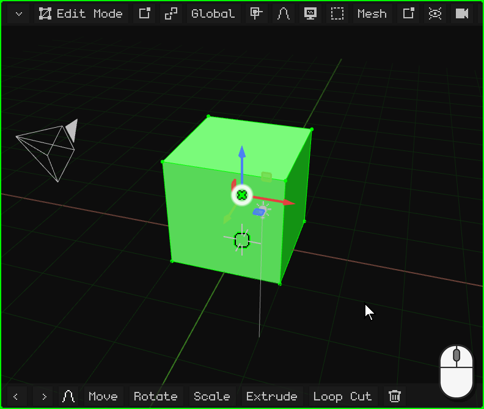
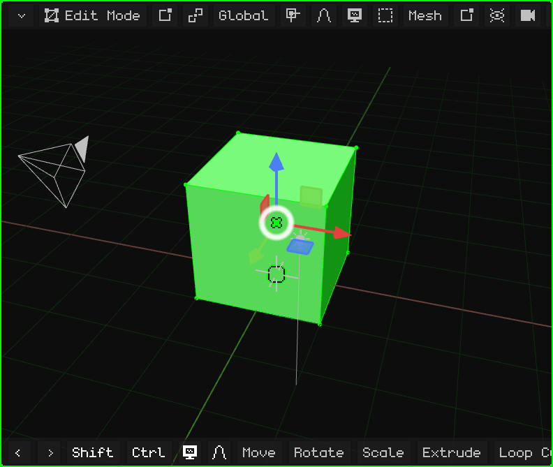
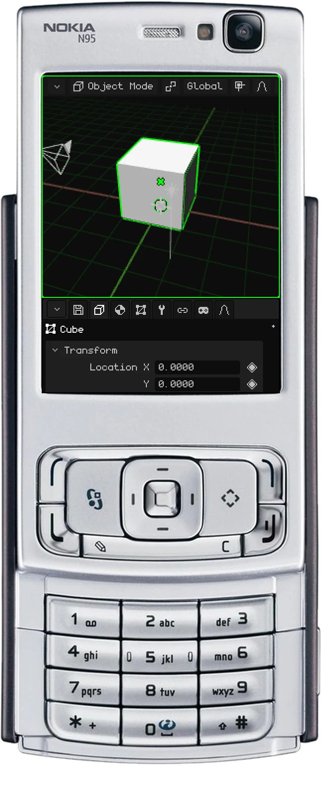
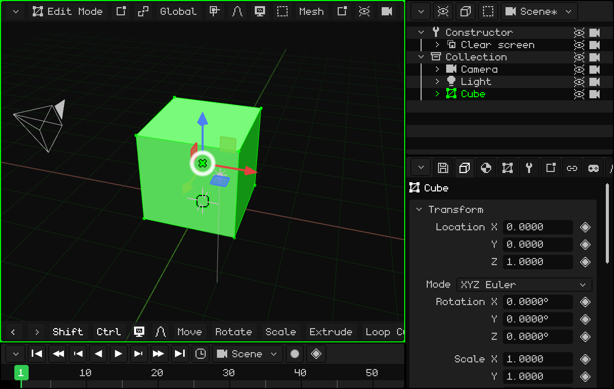

# Modeling a door

Let's make our first simple model: a door! To start, we can use the cube that comes in the scene, which measures 2 × 2 × 2 meters.

I (Dante) use doors a lot to create spaces: it's something I learned studying construction. Doors are almost always 2 meters tall, and a person is (usually) shorter than a door. With a door in the scene, you immediately have the scale of everything else.

## Rest it on the floor

The cube has its center on the floor, so half of it is below. We raise it 1 meter on the Z axis so it rests on the floor. With the cube selected:

 Press <kbd>G</kbd>: the cube follows the mouse. Then <kbd>Z</kbd>: it's locked to the Z axis (the blue line appears). Type `1` and press <kbd>Enter</kbd>.

 Tap **Move** on the toolbar, then **Z**, tap the top bar for the numeric keypad, `1`, **OK** and the green check mark.

 <kbd>1</kbd> (move), <kbd>3</kbd> (the Z axis), the **pencil** key held down and <kbd>1</kbd>, and <kbd>OK</kbd>.

How to type numbers on each device is explained in [With exact numbers](modo-objeto.md#with-exact-numbers).

### Fix the last operation

After moving, rotating or scaling, a small panel, **Adjust the last operation**, appears at the bottom left in place of the toolbar. Collapsed, it only says what you did (for example, **Move**); a tap or a click on its title expands it:

Each value can be corrected: if you wanted 1.2 instead of 1 meter, tap Z, type `1.2` and the operation is redone with the new value. **Accept** closes it and brings back the toolbar; **Cancel** undoes the operation.

## Shape it

There are two ways to model the door.

### The easiest, which I don't recommend: scaling the object

In Object Mode, scale the cube on the X axis and on the Y axis until it has the shape of the door. For example, <kbd>S</kbd> <kbd>X</kbd> `0.45` <kbd>Enter</kbd> (90 cm wide) and <kbd>S</kbd> <kbd>Y</kbd> `0.05` <kbd>Enter</kbd> (10 cm thick).

I don't recommend it because the object ends up with a different scale on each axis (0.45, 0.05 and 1), and ideally it should have a scale of **1** on all three axes (see [Keep the scale at 1](modo-objeto.md#keep-the-scale-at-1)). If you do it this way, **always apply the transformation**: <kbd>Ctrl</kbd> + <kbd>A</kbd> → **Scale** (or Object → Apply → Scale). The shape doesn't change and the scale goes back to 1.

 On a touch screen: **Scale**, **X**, the top bar, `0.45` and OK, and the same with **Y** and `0.05`. Then, **Object → Apply → Scale**.

### The one I recommend: Edit Mode

With the cube selected, enter Edit Mode: press <kbd>Tab</kbd> or choose **Edit Mode** with the mode button of the 3D Viewport. When you enter, all the vertices are selected.

In Edit Mode you select **vertices**, **edges** and **faces**: that's the basics. And, just like in Object Mode, you can move, rotate and scale them (see [Edit Mode](../editor/modo-edicion.md)).

With everything selected, shrink it on X and on Y until you have the door the way you want it. There's no need on Z, because it's already 2 meters tall! Since what changes is the mesh and not the object, the scale stays at 1.

**By eye, with the gizmo:** a click (or a tap) on the center of the gizmo switches it to Rotate, and another to **Scale**. Grab the red tip (X) and drag it toward the center to the width you want; then the green one (Y), until it's thin like a door.

**With numbers:** <kbd>S</kbd>, <kbd>X</kbd>, `0.45`, <kbd>Enter</kbd> and <kbd>S</kbd>, <kbd>Y</kbd>, `0.05`, <kbd>Enter</kbd>.

 On a touch screen: the mode button → **Edit Mode**; then **Scale**, **X**, a tap on the top bar, `0.45`, **OK** and the check mark, and the same with **Y** and `0.05`.

 On the Nokia N95: <kbd>OK</kbd> switches to Edit Mode. <kbd>3</kbd> (scale), <kbd>1</kbd> (the X axis), the pencil key held down and `0` <kbd>*</kbd> `45` (the <kbd>*</kbd> is the decimal point), and <kbd>OK</kbd>. The same with <kbd>2</kbd> (the Y axis) and `0.05`.

## With exact measurements

If instead of doing it by eye you want, for example, a door exactly **90 cm wide**: with the **Vertex / Edge / Face** button choose **Face** and click on one of the sides. We know the cube is 2 meters wide, so we have to take away the extra to leave it at 0.9: that side has to move **1.1 meters**. <kbd>G</kbd> <kbd>X</kbd> `-1.1` <kbd>Enter</kbd>.

When moving, the **X** axis locks the movement to a single axis, so the cube doesn't get distorted:

-  With the <kbd>X</kbd> key.
-  With a tap on **X** on the toolbar. The `-1.1` is typed with the numeric keypad, by tapping the top bar.
-  With <kbd>1</kbd> while moving. The number is typed with the pencil key held down: <kbd>#</kbd> changes its sign and <kbd>*</kbd> is the decimal point. The face is selected with the virtual mouse (the right selection key, the arrows and <kbd>OK</kbd>).

For the thickness, with everything selected, <kbd>S</kbd> <kbd>Y</kbd> `0.05` <kbd>Enter</kbd>, as before.

And we have our first 3D model! Congratulations.

In the next tutorial we'll make the door open from the hinge: [Changing the origin: a door](puerta.md).
