# Object Mode

In **Object Mode** you work with whole objects: you select them, move them, rotate them, scale them, add them, delete them and put some inside others. It's the mode Whisk3D starts in, and the button at the top left of the 3D Viewport says so. To change the shape of a mesh (its vertices, edges and faces) there's Edit Mode, which has its own tutorial.

## What an object is

Everything in the scene is an **object**: the cube a project starts with, the camera, the light, a character. Each object has:

- a **name**, which you see in the Outliner;
- its **transformation**: where it is (location), how it's turned (rotation) and how big it is (scale);
- **properties**, which depend on its type: a light has color and intensity, a camera has its lens, a mesh has its material.

There are objects of many types, but they're all selected, moved, rotated and scaled the same way.

## Select an object

| | How to select |
|---|---|
|  PC | A click on the object. <kbd>Shift</kbd> + click adds or removes another one. A click on empty space leaves nothing selected. |
|  Touch screen | A tap on the object. With **Shift** turned on in the 3D Viewport's toolbar, each tap adds or removes another one. |
|  Nokia N95 | The **pencil** key goes from one object to the next. With the pencil key and the arrows you add, remove, select everything or nothing. |

What's selected shows with an outline, and the last one you selected is the **active object**: the one Properties shows.

### Select several with a box

 Drag the mouse with the primary button over the 3D Viewport, starting on the background: a **box** is drawn and, when you let go, the objects it caught are selected. You can also start one with <kbd>B</kbd>.

 On a touch screen, dragging a finger orbits the view: you ask for the box in the **Select → Box Select** menu, and then drag your finger.

The direction you drag changes what gets selected, and the box tells you with its color:

| Drag | Box color | What it selects |
|---|---|---|
| From left to right | Green | Only what ends up **completely inside** the box. |
| From right to left | Blue | Everything the box **touches**, even just barely. |

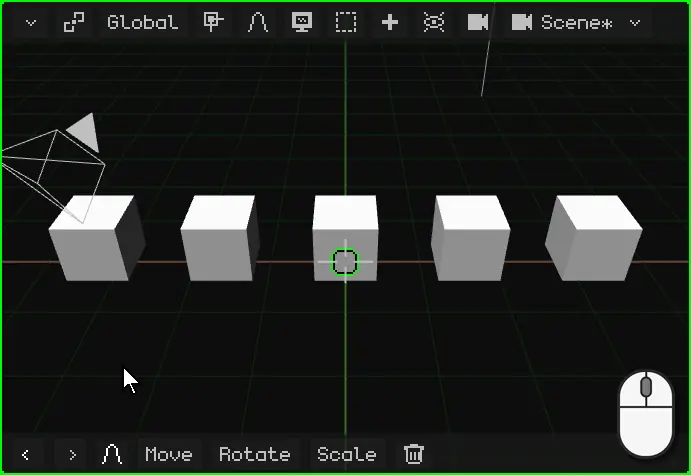

## The context menu

As in any program, the **context menu** has what you can do with the selection at hand. In Object Mode it's the **Object** menu, which opens where the pointer is:

| | How to open it |
|---|---|
|  PC | Right click on the 3D Viewport |
|  Touch screen | Hold a finger still on the 3D Viewport, for half a second |
|  Nokia N95 | The left soft key opens the menu bar; there, the Object menu |

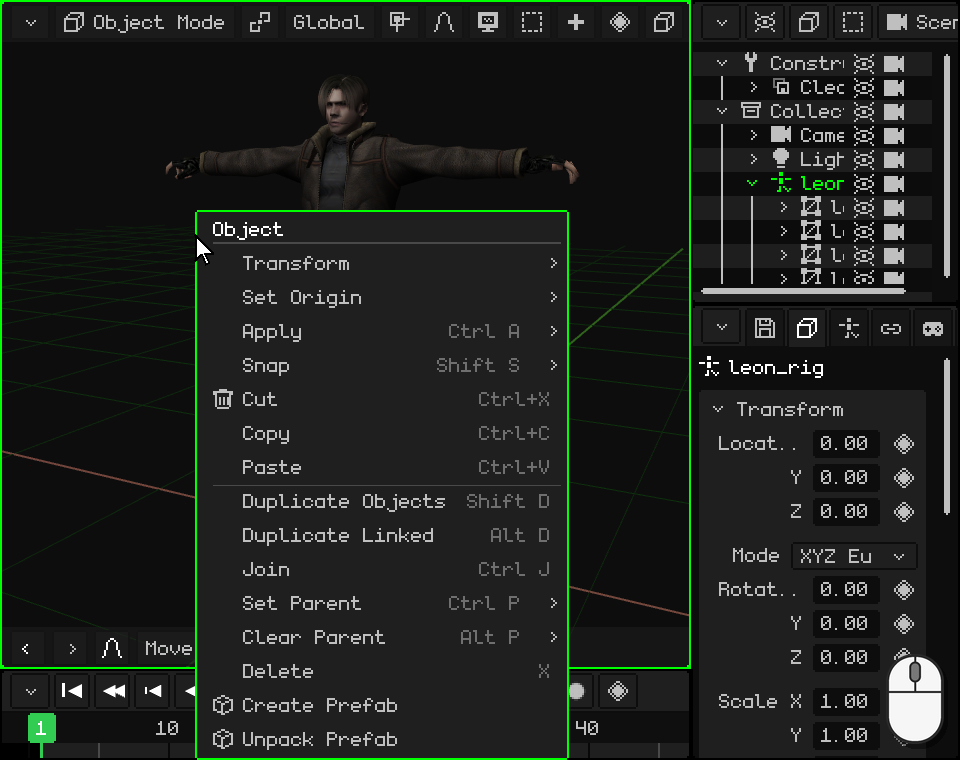

 With Leon selected, a finger held still on the 3D Viewport: after half a second the phone vibrates and the menu opens. When you lift your finger nothing is chosen: you tap the option afterwards.

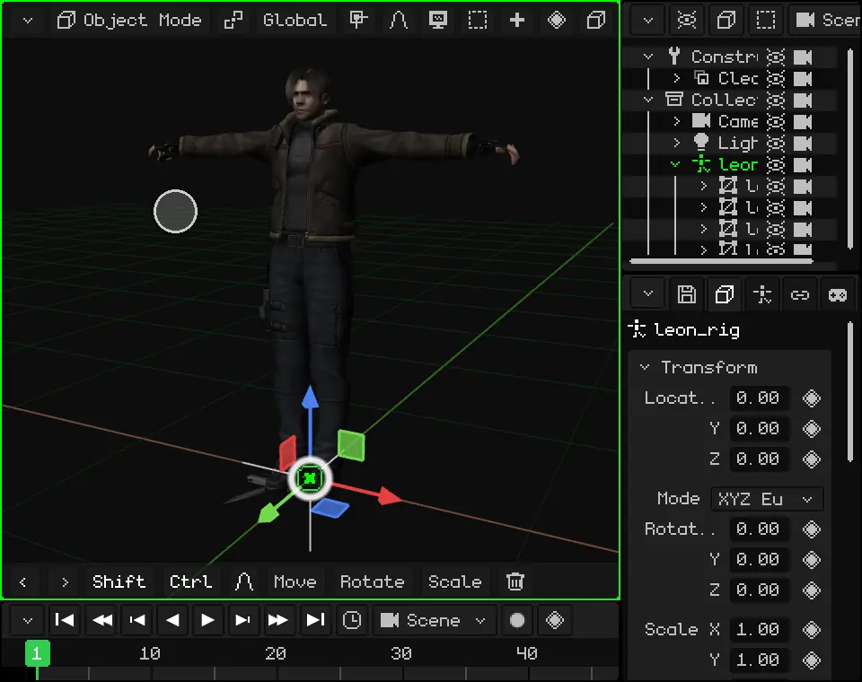

| Option | What it does |  Shortcut |
|---|---|---|
| **Cut** | Stores the selection to paste it later and removes it from the scene. | <kbd>Ctrl</kbd> + <kbd>X</kbd> |
| **Copy** | Stores a copy of the selection, with its children, to paste it later: in this scene, in another project or in another open Whisk3D window. | <kbd>Ctrl</kbd> + <kbd>C</kbd> |
| **Paste** | Puts the last thing you copied or cut into the scene, in the same place, and leaves it selected. | <kbd>Ctrl</kbd> + <kbd>V</kbd> |
| **Duplicate Objects** | Makes a copy of the selection, independent of the original, and leaves it grabbed so you can move it: a click (or <kbd>OK</kbd>) leaves it where it is. | <kbd>Shift</kbd> + <kbd>D</kbd> |
| **Duplicate Linked** | Like Duplicate, but the copy **shares the mesh** with the original: if you change the shape of one, both change. The location, rotation and scale belong to each one. It's useful for many identical things, like the trees in a forest or the chairs in a hall: they're all edited at once and take up less memory. | <kbd>Alt</kbd> + <kbd>D</kbd> |
| **Delete** | Deletes the selection. It asks for confirmation. | <kbd>X</kbd> or <kbd>Delete</kbd> |

The other options in the menu are covered in this same tutorial: Transform (move, rotate and scale), [Set Origin and Snap](#where-you-move-rotate-and-scale-from), [Apply](#keep-the-scale-at-1), [Set Parent and Clear Parent](#the-outliner-the-objects-in-the-scene). **Join** merges several meshes into one, and **prefabs** (objects built to be reused) have their own tutorial.

## Move, rotate and scale

The three basic operations on an object are **moving**, **rotating** and **scaling**. Each one can be done with the gizmo, with the keyboard or, on a touch screen, with the commands on the toolbar. If something goes wrong, **Undo** (<kbd>Ctrl</kbd> + <kbd>Z</kbd> on PC) takes it back.

### The gizmo

The **gizmo** is the colored arrows that appear on the selected object. Each color is an axis: **red** is X, **green** is Y and **blue** is Z, the one pointing up.

The gizmo has three modes, one for each operation. **A click on the gizmo, without dragging, switches to the next one**: from Move to Rotate, from Rotate to Scale and from Scale back to Move.

 A mouse click on the gizmo changes the mode.

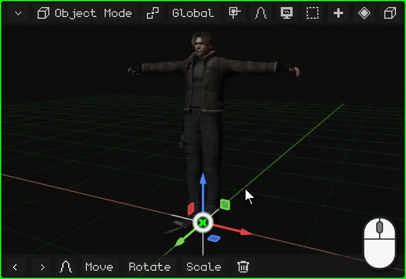

 A tap on the gizmo changes the mode.

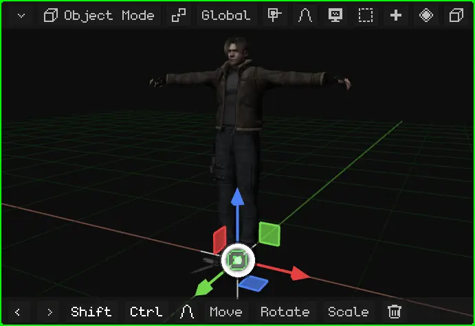

To use it, you grab a part of the gizmo and drag it. When you let go, it's done.

| Mode | What you grab | What it does |
|---|---|---|
| Move | An arrow | Moves only along that axis. |
| Move | A small square | Moves on a plane: the blue square moves on X and Y, without changing the height. |
| Move | The circle in the center | Moves freely, following the pointer. |
| Rotate | A colored semicircle | Turns around that axis. |
| Rotate | The white ring | Turns facing the view. |
| Scale | A square tip | Stretches or shrinks along that axis. |
| Scale | The circle in the center | Enlarges or shrinks evenly, on all three axes. |

 With the mouse: click on a part of the gizmo and drag.

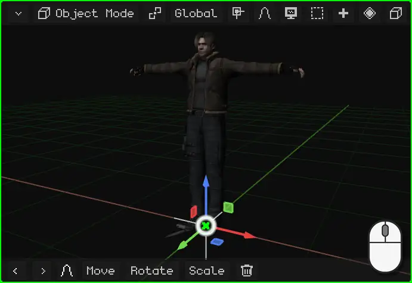

 With your finger: rest it on a part of the gizmo and drag. If you rest it on the background, you orbit the view.

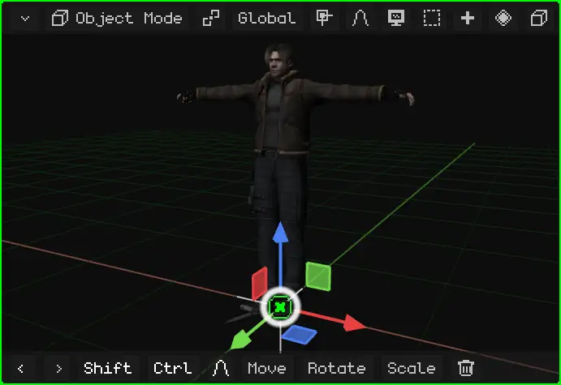

 On the Nokia N95 the gizmo is off: you move, rotate and scale with the keys, as explained below. You can turn it on in Overlays → Gizmo, to use it with a Bluetooth mouse.

### With the keyboard or the commands

With the keyboard you don't have to aim at anything: you press the key and the object follows the mouse (or the arrows, on the phone) until you confirm.

| | Move | Rotate | Scale | Only on one axis | Confirm | Cancel |
|---|---|---|---|---|---|---|
|  PC | <kbd>G</kbd> | <kbd>R</kbd> | <kbd>S</kbd> | <kbd>X</kbd> / <kbd>Y</kbd> / <kbd>Z</kbd> | Click or <kbd>Enter</kbd> | <kbd>Esc</kbd> or right click |
|  Nokia N95 | <kbd>1</kbd> | <kbd>2</kbd> | <kbd>3</kbd> | <kbd>1</kbd> / <kbd>2</kbd> / <kbd>3</kbd> | <kbd>OK</kbd> (the center of the D-pad) | <kbd>C</kbd> |

 You press <kbd>G</kbd> and move the mouse: the object follows it. If you press <kbd>X</kbd>, it only moves on X; another <kbd>X</kbd> switches from Global to Local. The same when rotating: <kbd>R</kbd> and then <kbd>Z</kbd> turns it around the Z axis, the vertical one; without an axis, it turns facing the view. You can also type a number: <kbd>G</kbd>, <kbd>X</kbd>, <kbd>2</kbd> and <kbd>Enter</kbd> move it 2 meters on X.

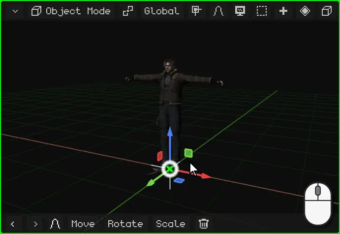

 On the Nokia N95: <kbd>1</kbd> to move, <kbd>2</kbd> to rotate and <kbd>3</kbd> to scale, and the **arrows** do the movement. While it lasts, <kbd>1</kbd>, <kbd>2</kbd> and <kbd>3</kbd> no longer change the operation: they choose the X, Y or Z axis. For example, <kbd>2</kbd> and then <kbd>3</kbd> turns it around the Z axis, the vertical one. <kbd>OK</kbd> confirms and <kbd>C</kbd> cancels.

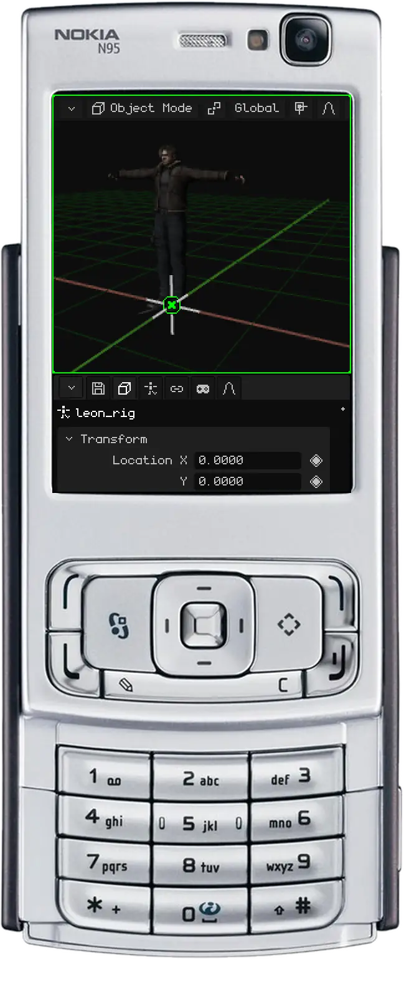

 **On a touch screen**, without a keyboard, you can use the gizmo, as seen above, or the **commands** on the 3D Viewport's toolbar. You tap **Move**, **Rotate** or **Scale** and drag your finger anywhere on the view: the object follows your finger. The bar changes: the **green check mark** confirms, the **red cross** cancels, and the **X**, **Y** and **Z** buttons keep the movement on those axes.

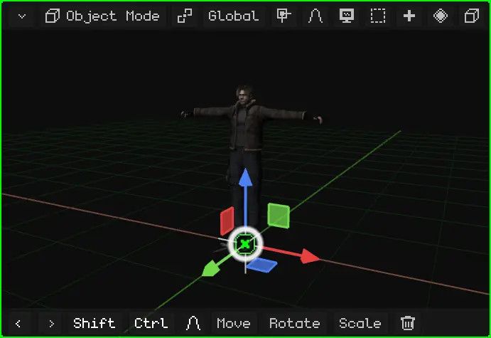

### With exact numbers

To work precisely, you type the movement as a number: turn something exactly 90°, scale it to half with `0.5` or to exactly twice its size with `2`, or move it 1.5 meters. **One Whisk3D unit is one meter.**

While the operation lasts, the 3D Viewport's menu bar shows what's being done and the value.

 **With the keyboard:** after <kbd>G</kbd>, <kbd>R</kbd> or <kbd>S</kbd>, type the number and press <kbd>Enter</kbd>. <kbd>R</kbd> <kbd>Z</kbd> <kbd>9</kbd> <kbd>0</kbd> <kbd>Enter</kbd> turns it 90° around the vertical axis; <kbd>S</kbd> <kbd>0</kbd> <kbd>.</kbd> <kbd>5</kbd> <kbd>Enter</kbd> makes it half the size and <kbd>S</kbd> <kbd>2</kbd> <kbd>Enter</kbd>, twice the size; <kbd>G</kbd> <kbd>X</kbd> <kbd>1</kbd> <kbd>.</kbd> <kbd>5</kbd> <kbd>Enter</kbd> moves it 1.5 meters on X.

 **On a touch screen:** start the operation with **Move**, **Rotate** or **Scale** on the toolbar and tap the top bar, the one showing the value: Whisk3D's numeric keypad opens. Type the number and tap **OK**; the green check mark finishes it. The keypad also does math, like `90/2`.

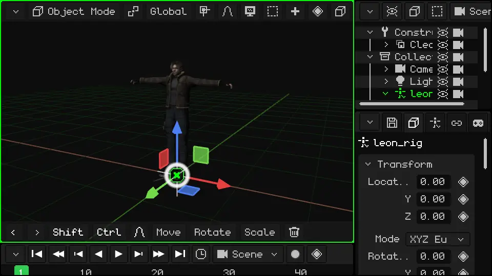

All the Object Mode shortcuts are in the manual: [Move, rotate and scale](../editor/transformar.md) and [Object Mode](../editor/modo-objeto.md).

### The toolbar: the latest commands

  On the 3D Viewport's **toolbar** (the one at the bottom) there are Undo and Redo (the arrows), and then **the latest commands you used**, with the last one first. At the start they're Move, Rotate, Scale and Delete. If you scale an object, Scale moves to the front: what you use most is always within reach.

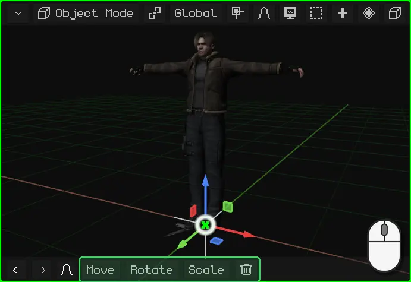

 On the Nokia N95 the toolbar is hidden, to leave the screen for the scene: moving, rotating and scaling are done with the phone's keys. When it appears (for example, the proportional editing one during a transform), its buttons are used with the **virtual mouse**: you turn it on with the right selection key, the arrows move it and <kbd>OK</kbd> clicks.

## Where you move, rotate and scale from

### The origin

Each object has an **origin**: the point the gizmo comes out of. It's the point the object is transformed from: the object turns around its origin and grows or shrinks from it. The **location** Properties shows is that of its origin.

In primitives, the origin is in the center. In an imported model it's wherever the program it was made in left it: in Leon, at his feet.

### The 3D cursor

The **3D cursor** is the circle with a cross in the 3D Viewport. At the start it's at the center of the world.

 It's used for two things:

- everything you add with **Add** appears there;
- it can be the center you rotate and scale from, as shown in [The pivot point](#the-pivot-point).

The 3D cursor is moved with the **Snap** menu, which also takes objects to the cursor:

| | How to open the Snap menu |
|---|---|
|  PC | <kbd>Shift</kbd> + <kbd>S</kbd> |
| Menu | Object → Snap (in Edit Mode, Mesh → Snap) |

| Option | What it does |
|---|---|
| Cursor to Selected | Moves the 3D cursor to the center of the selection. In Edit Mode, to the center of the selected vertices, edges or faces. |
| Cursor to Active | Moves the 3D cursor to the origin of the active object. |
| Cursor to World Origin | Puts it back at the center of the world. |
| Cursor to Grid | Moves it to the nearest grid point. |
| Selection to Cursor | Moves the selection to the 3D cursor. |
| Selection to Cursor (Keep Offset) | The same, but with several objects it keeps the distance between them: the group arrives in one piece. |
| Selection to Active | Moves the selection to the active object. |
| Selection to Grid | Snaps each selected object to the nearest grid point. |

For example, to put a box in someone's hand, or an object exactly where another one is: you select the destination one, **Cursor to Selected**; then you select the one you want to move and **Selection to Cursor**.

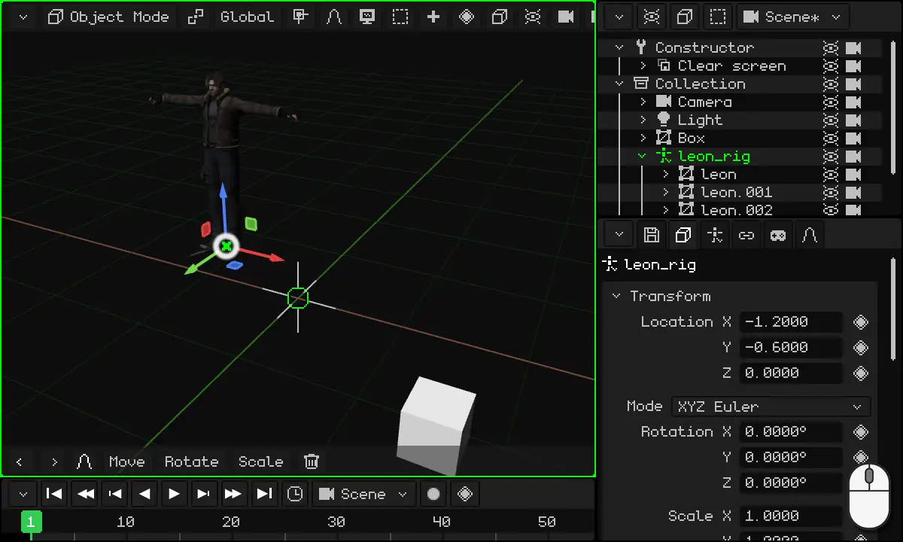

### The pivot point

The **pivot point** is the center the selection is rotated and scaled from. You choose it with the pivot button on the 3D Viewport's bar, to the left of **Global** (its icon changes depending on the chosen pivot):

| Pivot | What it rotates and scales from |
|---|---|
| **Median Point** | From the center of the whole selection. It's the default. With a single object, it's its origin. |
| **Active Element** | From the origin of the active object (the last one you selected): the others turn around it. |
| **Individual Origins** | Each object from its own origin: they all turn at once, each one in its place. |
| **3D Cursor** | From the 3D cursor. |

With **3D Cursor** you can rotate anything around any point: you put the cursor there (with the Snap menu) and rotate. It's useful for arranging chairs around a table, the hands of a clock or anything that has to turn around something.

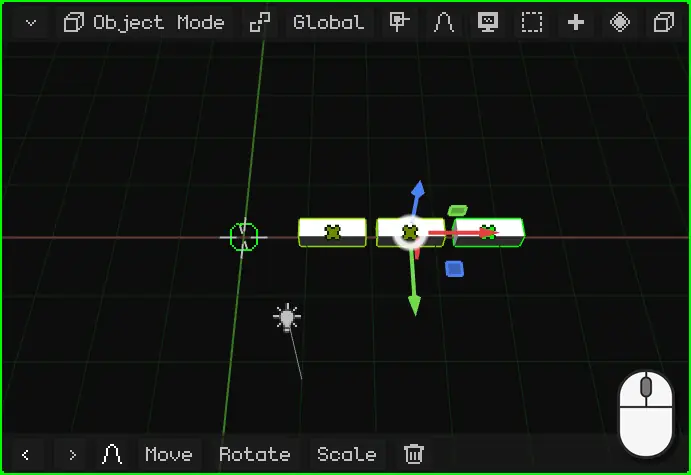

### Global and Local

When you move, rotate or scale along an axis, that axis can be the **world's** or the **object's**. You choose it with the **Global** button on the 3D Viewport's bar:

| Orientation | The axes |
|---|---|
| **Global** | The world's: always the same, with Z pointing up. It's the default. |
| **Local** | The object's own, which turn with it. |
| **View** | The screen's: X to the side, Y up. |
| **Normal** | In Edit Mode, the direction the selected face is facing. |

The difference shows when the object is turned. For example, Leon rotated 40°: in **Global**, his Y axis is the world's and he moves diagonally relative to where he's facing; in **Local**, the Y axis turns with him and he walks straight ahead. The same with a car that turned a corner: to make it go forward, you move it on its Local axis.

 With the keyboard, pressing the axis letter a second time switches from Global to Local: <kbd>G</kbd> <kbd>Y</kbd> moves on the world's Y and <kbd>G</kbd> <kbd>Y</kbd> <kbd>Y</kbd>, on the object's Y. On the Nokia N95, the same with <kbd>2</kbd> <kbd>2</kbd> while moving.

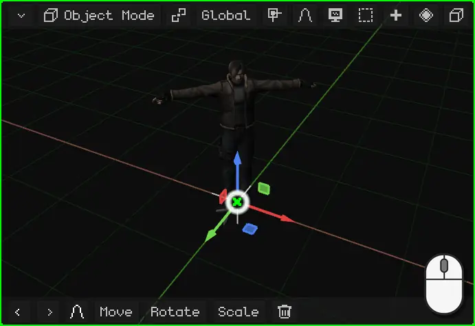

### Change the origin

The origin of a 3D mesh can be moved without moving the mesh, with **Object → Set Origin**. How to do it, with the example of a door that has to open from the hinge, is in the tutorial [Changing the origin: a door](puerta.md).

## Properties

The **properties** of the active object are in the Properties viewport. The **Object** tab (the cube one) is the same for all objects: at the top is the **Transform** card, with the location, rotation and scale. You can type the numbers by hand: a click (or a tap) on the number and type. Moving the object in the 3D Viewport changes these numbers, and changing the numbers moves it.

The other tabs depend on the type of object: a light has the light tab, a mesh has the material and modifiers tabs.

### The diamond: what can be animated

Next to many properties there's a **diamond**. The diamond means that property **can be animated**: a click on the diamond stores its value at the current frame (a *keyframe*), and another click on the green diamond removes it. With several keyframes, the property changes by itself over time.

The diamond's color tells you how the property is: **gray**, it isn't animated yet; bright **green**, it's already animated and has a keyframe at this frame; **faded green**, it's animated, but it has no keyframe at this frame.

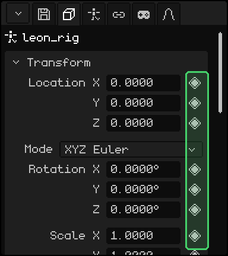

Animation has its own tutorial later on.

### Keep the scale at 1

A tip: **leave your objects' scale at 1**. Enlarging or shrinking an object with Scale is convenient, but a scaled object can cause problems later: children inherit the scale and get distorted when rotated, and physics, collisions and some modifiers can calculate wrong.

If you scaled an object, **apply the scale**: the size it has becomes its real size and the scale goes back to 1, without changing what you see.

| | How to apply the scale |
|---|---|
|  PC | <kbd>Ctrl</kbd> + <kbd>A</kbd> → Scale |
| Menu | Object → Apply → Scale |

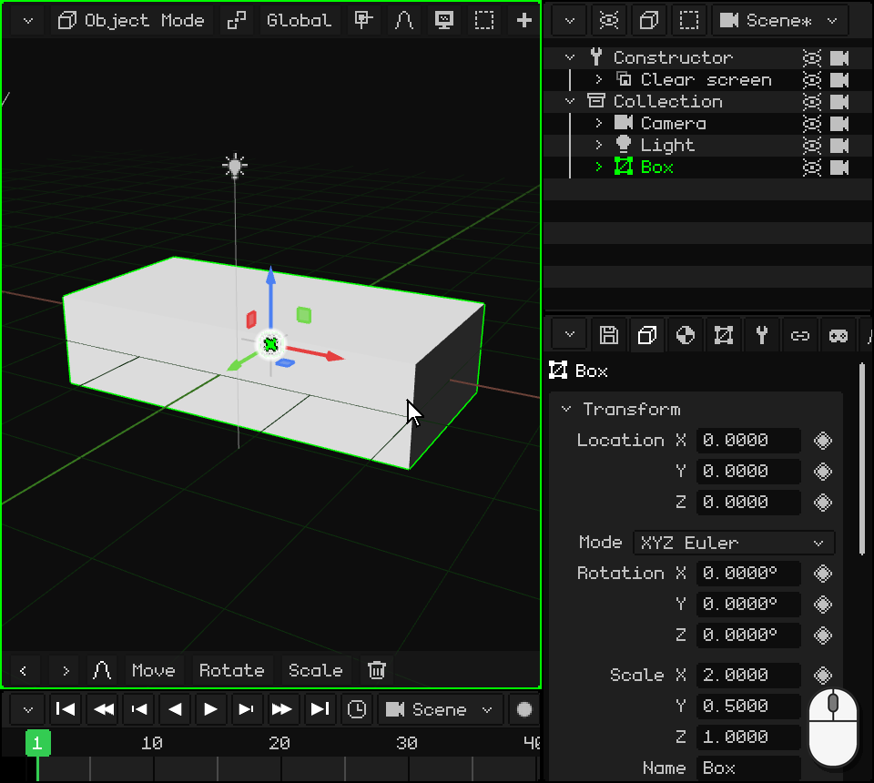

In the same menu, **Location** and **Rotation** do the same with the location and the rotation, and **All Transforms** applies all three.

## The Outliner: the objects in the scene

The **Outliner** is the list of all the objects in the scene. A click (or a tap) on a row selects that object, just like in the 3D Viewport. On PC it's at the top right.

An object can be **inside another one**: it shows shifted further to the right, hanging from it. The outer one is the **parent** and the inner one is the **child**. The child **inherits the transformations** of the parent: if you move, rotate or scale the parent, the child goes along with it. The child can still be moved on its own, but always relative to the parent.

Leon is an example: his meshes, the four parts you can see, are children of his armature, `leon_rig`. Moving the armature moves the whole of Leon.

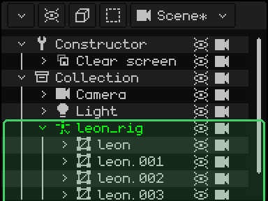

Putting an object inside another one is called **parenting**:

| | How to parent |
|---|---|
|  PC | In the Outliner, drag the child's row and drop it on the parent's. Or select the child, then the parent (with <kbd>Shift</kbd>) and <kbd>Ctrl</kbd> + <kbd>P</kbd>. |
|  Touch screen | Select the child; turn on **Shift** on the toolbar and tap the parent; then, Object menu → Set Parent. |
|  Nokia N95 | With the Outliner active and the child selected: <kbd>1</kbd>, the **right** arrow puts it inside the one above and the **left** one takes it out; <kbd>1</kbd> again confirms. |
| Menu | Object → Set Parent; to take it out, Object → Clear Parent |

 In the video, a box is dragged in the Outliner onto `leon_rig`: it becomes its child, and when Leon is moved the box goes along with him.

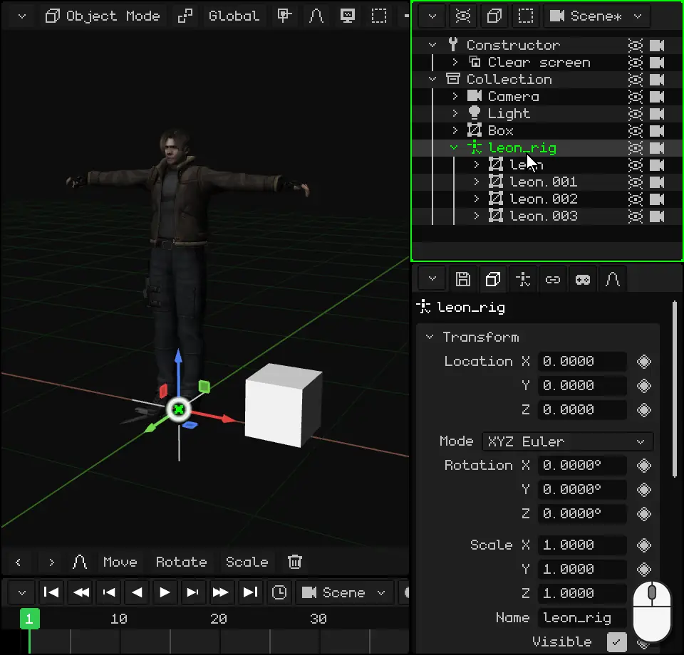

## Object types

All objects are added from the **Add** menu (the **+** button on the 3D Viewport's bar, or <kbd>Shift</kbd> + <kbd>A</kbd> on PC). The new object appears at the 3D cursor and stays selected.

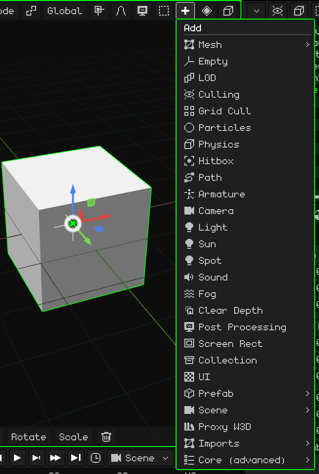

These are the basic ones:

| Object | What it is |
|---|---|
| [3D Mesh](../editor/objeto-malla.md) | A 3D model: a character, a house, a rock. It's made of vertices, edges and faces, and it's shown with its material and its textures. The primitives in Add → Mesh (cube, sphere, cylinder...) are meshes to start modeling from. |
| [Camera](../editor/objeto-camara.md) | The point of view of the game and of renders. What the active camera sees is what you see when you play and what comes out in an image or a video. |
| [Light](../editor/objeto-luz.md) | Lights the scene. There are three types: Point (a light bulb), Sun (daylight, with parallel rays) and Spot (a cone, like a flashlight). |
| [Armature](../editor/objeto-esqueleto.md) | A chain of bones that moves a mesh, for animating characters. Leon has one: when the armature walks, the mesh follows it. |
| [Sound](../editor/objeto-sonido.md) | A sound placed in the scene. It can play in the background, like music, or from where the object is. |
| Empty | An object without a shape: a point in the scene. It's used as a parent to group others or as a reference. |
| Collection | A folder for organizing objects in the Outliner. |

There are more: paths, fog, particles, hitboxes for collisions, 2D interfaces for games and objects for optimization. And many more will be added in the future. This tutorial is about objects in general; each one has its own article, where its properties are explained one by one.

## What all objects have

Besides their transformation and their properties, any object can have:

- Lua **scripts**, which give it behavior in the game: moving by itself, responding to keys, colliding. They're covered later on.
- **Animations**: any property with a diamond can be animated. They have their own tutorial.
- **Constraints**: rules that tie it to another object, like copying its location or always looking at the camera. They're explained in [Constraints](../editor/restricciones.md).

Some types also have things of their own. 3D meshes, for example, have **modifiers**, which change the shape without destroying it: mirroring it, repeating it, smoothing it. They're in [3D Mesh](../editor/objeto-malla.md).

## Import 3D models

Besides modeling in Whisk3D, you can bring in models made in other programs. The formats it accepts are:

| Format | What it brings |
|---|---|
| **GLB** and **glTF** | The mesh, the materials and the textures, the armature and the animations. It's the most complete format: Leon comes in a .glb. |
| **OBJ** | The mesh, the materials and the textures (with its .mtl). No armature or animations. |
| **FBX** | The mesh, the materials, the armature and the animations. |
| **STL** | Only the shape: the triangles, without materials or colors. It's the format of 3D printing and CAD programs. |

You import them from **Add → Imports**, choosing the format and then the file.

 On PC you can also drag the file from the folder and drop it on the 3D Viewport.

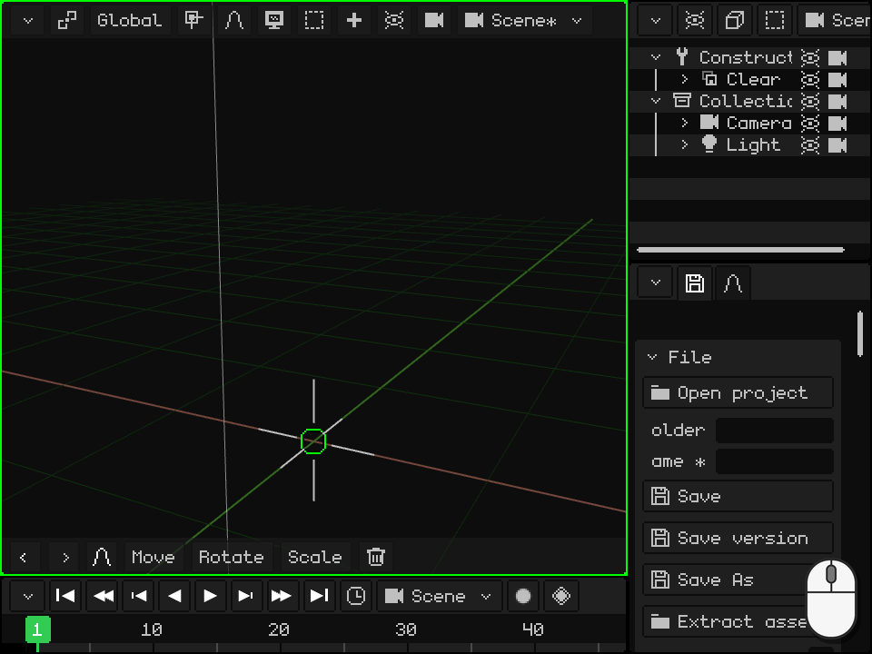

A model with an armature comes in as an **armature with the meshes inside**: the armature is the parent and the meshes, its children, as seen in the [Outliner](#the-outliner-the-objects-in-the-scene). The animations are stored in the armature, ready to use.

To take a model to another program or to a 3D printer there's the reverse path: Properties → the floppy disk tab → **Export**, with OBJ, glTF, GLB or STL.
