# Navigating the 3D Viewport

> [!NOTE]
>  The Nokia N95 supports a mouse and keyboard (over Bluetooth). The Nokia parts of this tutorial explain how to use it without a mouse or keyboard, with just the phone's keys.

This tutorial explains how to navigate in the 3D Viewport. Navigating means moving your point of view: turning around the scene, shifting to one side and moving closer or farther away.

Knowing how to navigate is important: to make 3D models and animations comfortably and quickly, you need to know how to move around the scene and put yourself in a comfortable position to work.

As explained in the [Viewports](viewports.md#the-active-viewport) tutorial, to use the commands that follow, the 3D Viewport has to be the active viewport, the one with the green border.

The three things you'll use most are **orbiting**, **panning** and **zooming**. You can do each one with the mouse, with your fingers on a touch screen or with the Nokia N95 keypad. In the PC videos, the mouse at the bottom right shows the button being pressed in green.

## Orbit

Orbiting turns the view around the scene, as if you were walking around a table to see what's on it from every side.

 **With the mouse:** hold down the **middle button** (you press it by pushing the wheel down) and drag. On a trackpad, or with a mouse without a middle button, hold <kbd>Alt</kbd> and drag with the **primary button** (the left one).

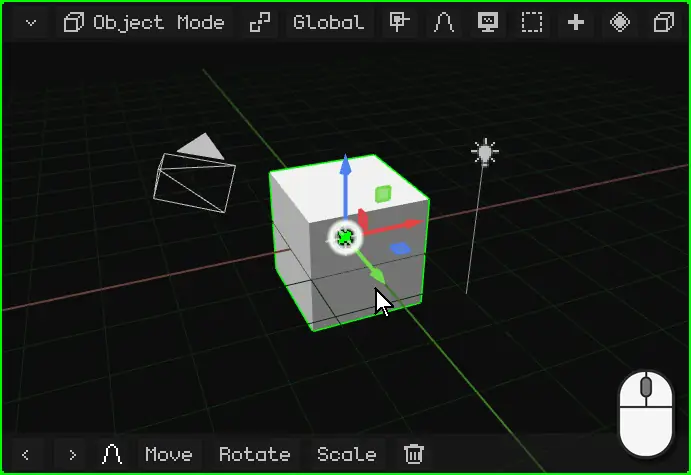

 **With your finger:** drag one finger across the 3D Viewport. Start on the background: if your finger lands on the gizmo (the object's colored arrows), you'll move the gizmo instead.

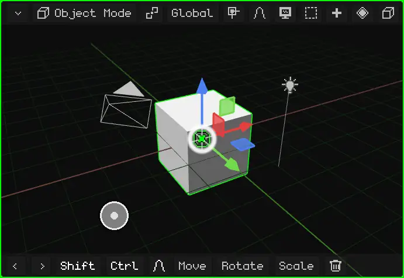

 **On the Nokia N95:** hold down an **arrow** on the D-pad. The view turns that way for as long as you hold it.

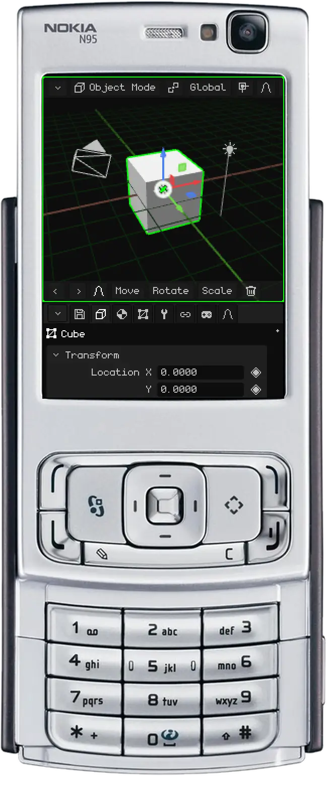

## Pan

Panning, or *sliding* the view, moves it sideways, up or down, without turning it.

 **With the mouse:** hold <kbd>Shift</kbd> and drag with the **middle button**. On a trackpad: <kbd>Alt</kbd> + <kbd>Shift</kbd> and drag with the primary button.

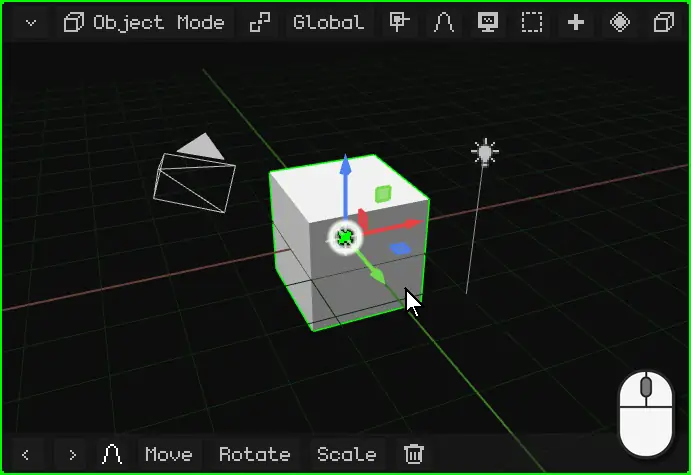

 **With your fingers:** put **two fingers** down and move them together in the same direction.

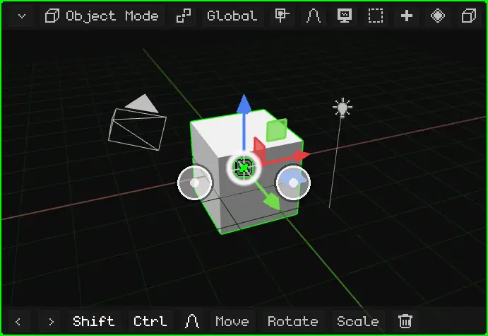

 **On the Nokia N95:** hold down the <kbd>\*</kbd> key and use the arrows.

## Zoom

Zooming takes you closer or farther away. The step adapts to the distance: close to something small it moves slowly, and from far away it moves fast. So it works just as well for looking at the whole scene as at a single vertex.

 **With the mouse:** turn the **wheel**. Forward zooms in and backward zooms out. On a trackpad, slide two fingers up or down.

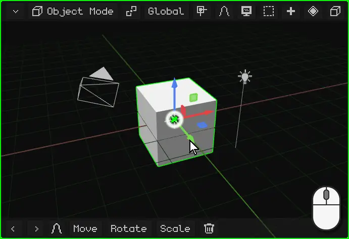

 **With your fingers:** pinch. Spreading your fingers zooms in and bringing them together zooms out.

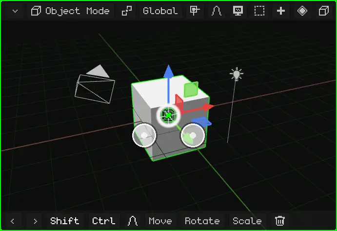

 **On the Nokia N95:** hold down <kbd>0</kbd> and use the **up** arrow to zoom in or the **down** arrow to zoom out.

## Frame the selection

If you get lost, or you want to work on something in particular, **frame it**: the view centers on what's selected and adjusts the zoom so it fits exactly. From there, orbiting turns around it.

| | How to frame |
|---|---|
|  PC | <kbd>Num .</kbd> (the period on the numeric keypad) |
|  Nokia N95 | A quick press of <kbd>0</kbd>, with no arrows (held down with an arrow, it zooms) |
|  Touch screen | Double tap with two fingers |
| Menu | View → Frame Selected |

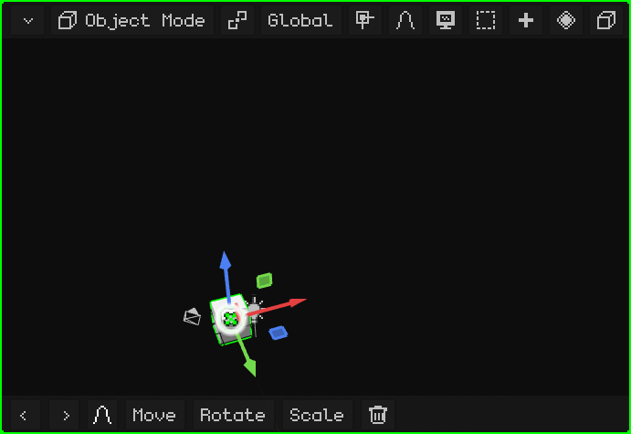

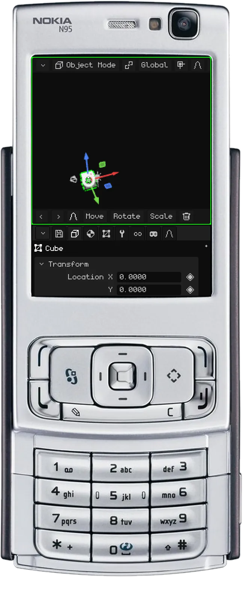

### In Edit Mode

In [Edit Mode](../editor/modo-edicion.md), what gets framed is the selected part of the mesh: the vertices, edges or faces you picked, not the whole object. This is handy for working on a detail of a large model: select it, frame it and orbit around it.

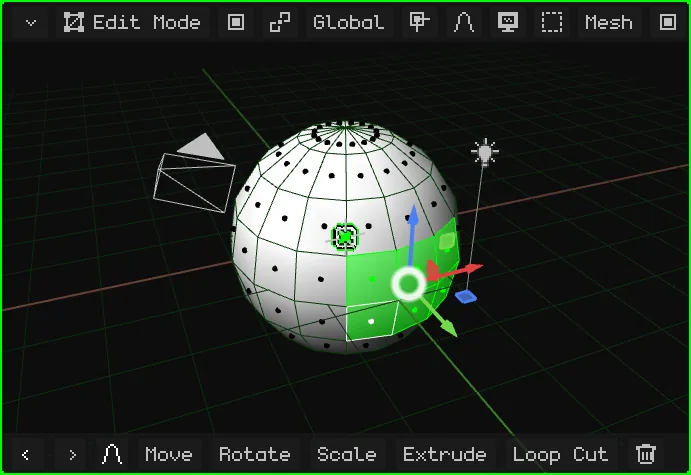

## Local View

When the scene has lots of things in it, working on one of them is awkward: the ones in front block your view, and when you orbit they get in the way. **Local View** shows only what's selected (one or more objects) and frames it. The rest isn't deleted or hidden in the scene: it just stops showing in this viewport. The label "Local View" appears at the top left.

To go back, do the same thing again: everything reappears and the view returns to how you had it before.

| | How to enter and leave |
|---|---|
|  PC | <kbd>/</kbd> |
|   Nokia N95 and touch screen | View menu → Local View |

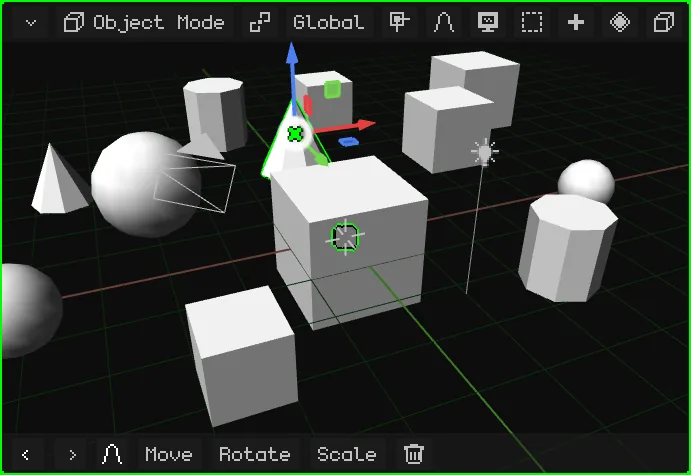

## Front, side and top views

To look at the scene straight on from one side, without lining up the orbit by hand:

| View |  PC | Menu |
|---|---|---|
| Front / Back | <kbd>Num 1</kbd> / <kbd>Ctrl</kbd> + <kbd>Num 1</kbd> | View → Viewpoint → Front / Back |
| Right / Left | <kbd>Num 3</kbd> / <kbd>Ctrl</kbd> + <kbd>Num 3</kbd> | View → Viewpoint → Right / Left |
| Top / Bottom | <kbd>Num 7</kbd> / <kbd>Ctrl</kbd> + <kbd>Num 7</kbd> | View → Viewpoint → Top / Bottom |

 With <kbd>Ctrl</kbd>, each key gives the opposite view.

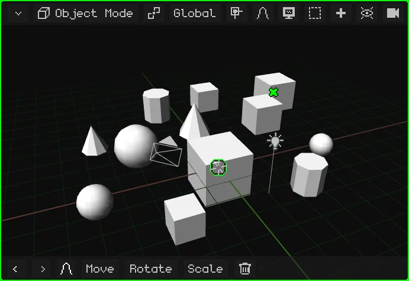

 **On the Nokia N95:** hold down the <kbd>#</kbd> key and press an arrow. Left and right turn the view around the scene 90° at a time. Up switches to the top view; down goes back to the side view, and down again goes to the bottom view. If you were orbiting freely, the first arrow only straightens the view to the nearest one.

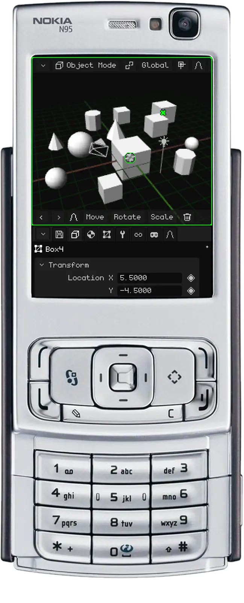

## Perspective and orthographic

The 3D Viewport has two ways of showing the scene:

- **Perspective:** the way the eye or a camera sees it. Things far away look smaller, and parallel lines (the edges of a street, the rows of boxes in the video) meet at a point on the horizon: the **vanishing point**. This is how things really look, with depth.
- **Orthographic:** no perspective. Everything keeps its size, near or far, and parallel lines never meet. It's like an architectural plan or a technical drawing.

Orthographic is useful for modeling precisely: aligning things, comparing sizes and measuring without distance fooling you. Combined with the front, side and top views, it's like working on a blueprint. Perspective is useful for seeing how the result will look.

| | How to switch |
|---|---|
|  PC | <kbd>Num 5</kbd> |
|  Nokia N95 | A quick press of <kbd>#</kbd>, with no arrows |
| Menu | View → Perspective/Ortho |

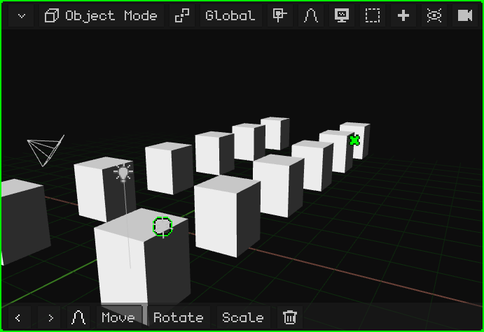

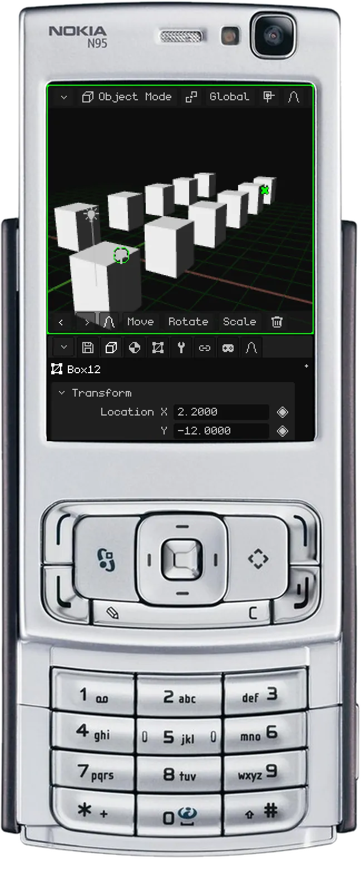

## Lock the orbit

With the **orbit locked**, the view stops turning: what used to orbit now pans it, as if you were sliding a sheet of paper across a table. It's ideal for working comfortably on models that are drawn like a 2D plan, such as a house floor plan or a mechanical part: looking from the top in orthographic, you move over the whole plan without it ever tilting.

| | How to lock and unlock it |
|---|---|
|  PC | View menu → Lock Orbit |
|  Touch screen | View menu → Lock Orbit |
|  Nokia N95 | <kbd>9</kbd> |

A notice appears when you lock or unlock it, and while it's locked, Lock Orbit shows in green in the menu.

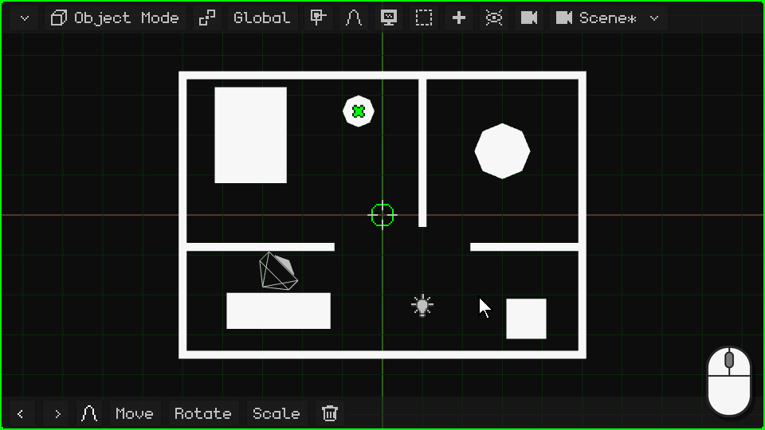

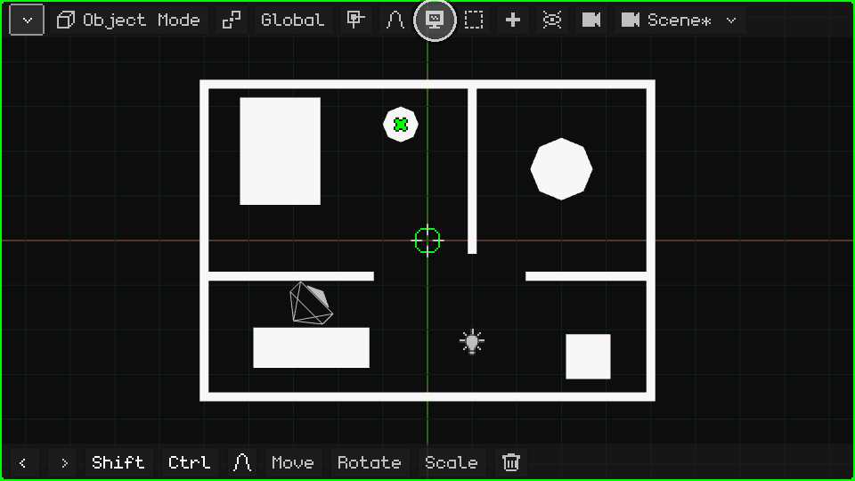

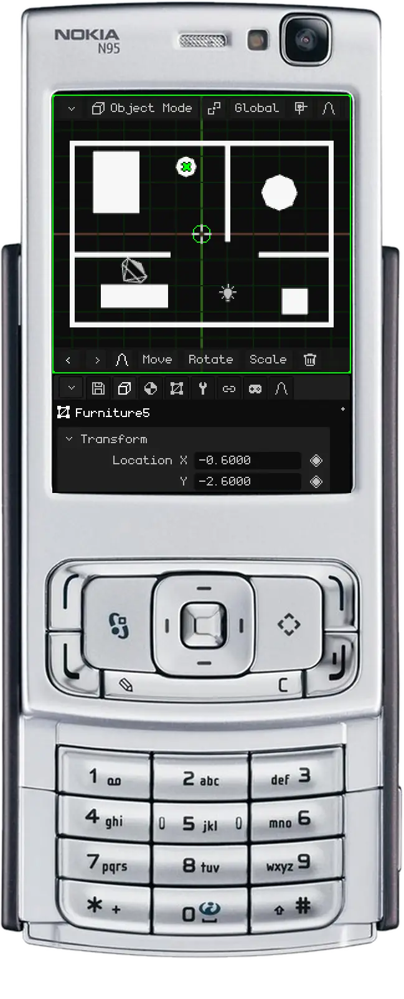

## The active camera

The scene can have several cameras, but only one is the **active camera**: the one used for the game and for renders. What that camera sees is what you see when you play, and what comes out when you render an image or a video. The view you navigate with is only for working: it doesn't show up in the game or in renders.

To look through the active camera:

| | How to enter and leave |
|---|---|
|  PC | <kbd>Num 0</kbd> |
|  Nokia N95 | <kbd>8</kbd> (outside Edit Mode: there, 8 is Loop Cut) |
| Menu | View → Cameras → Active Camera |

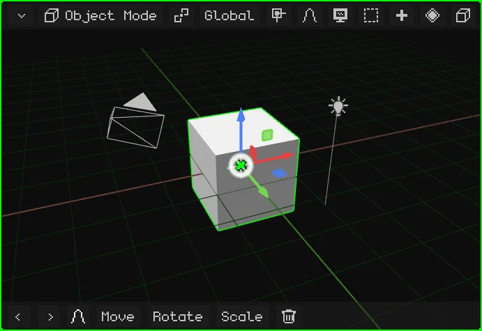

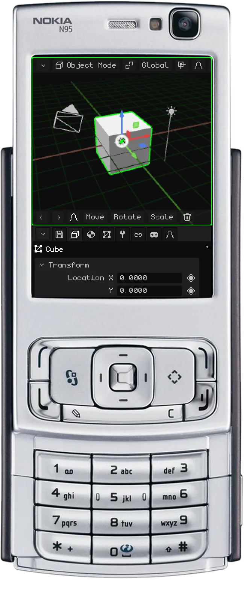

The rectangle is the framing: whatever is inside it is what comes out. At the bottom center there's a **padlock**:

- **Open** (how it starts): zooming and panning only bring you closer to check the framing, without touching the camera. Orbiting takes you out of the camera view, and you keep navigating from where the camera was.
- **Closed:** orbiting, panning and zooming move the **camera**. This is how you set up the shot.

### Lock the camera to the view

With the padlock closed, the active camera is locked to the view: you orbit, pan and zoom just like in normal navigation, and the camera moves with you. It's the most comfortable way to place a camera exactly where you want it: look through it, lock it and navigate until you get the shot you're after.

| | How to lock and unlock it |
|---|---|
|  PC | A click on the padlock |
|  Touch screen | A tap on the padlock |
|  Nokia N95 | The left soft key opens the menu bar (as in the [Viewports](viewports.md#when-you-cant-see-all-the-menu-bar-options) tutorial); there, View → Lock the camera to the view |
| Menu | View → Lock the camera to the view |

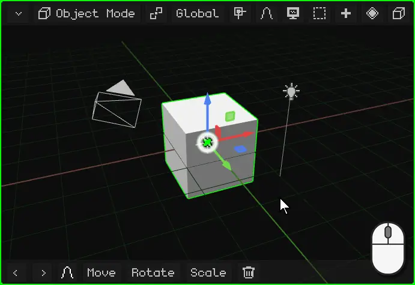

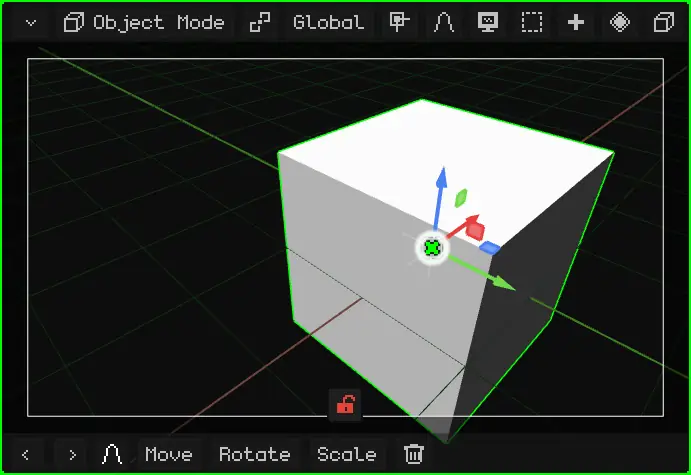

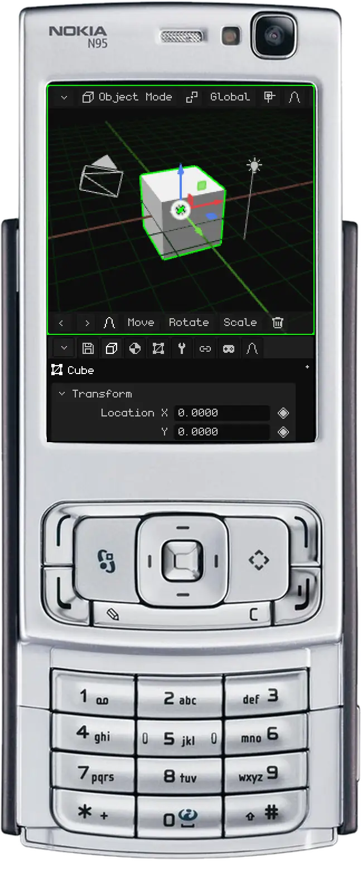

To make another camera the active one: select it and press <kbd>Ctrl</kbd> + <kbd>Num 0</kbd> (or View → Cameras → Set Active Object as Camera).

## More view options

| Option | What it does |  PC |  Nokia N95 | Menu |
|---|---|---|---|---|
| Roll the view | Rotates it 15° around its own axis, like tilting your head. | <kbd>Num 4</kbd> / <kbd>Num 6</kbd> | — | — |

All the editor's shortcuts are in [Keyboard Shortcuts](../editor/atajos.md), and the manual's [Navigation](../editor/navegacion.md) page sums them up in tables.
