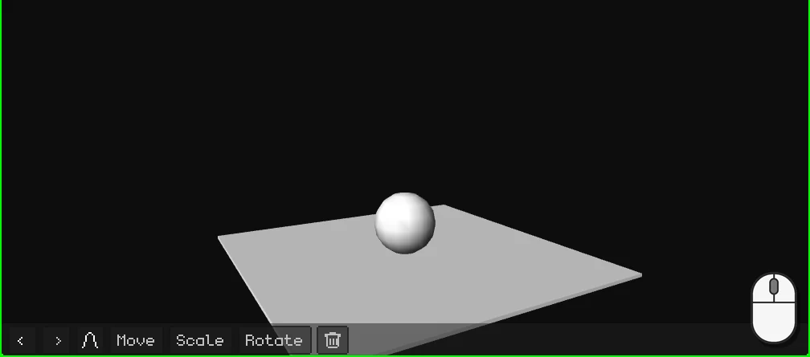
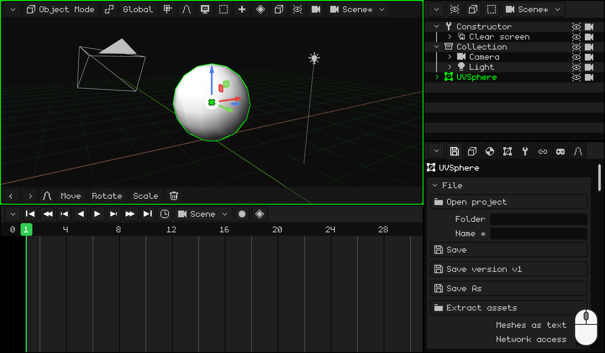
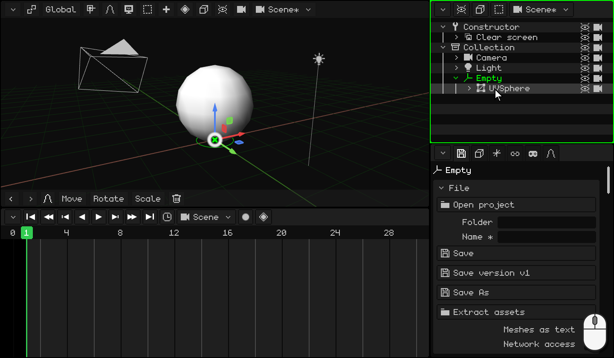
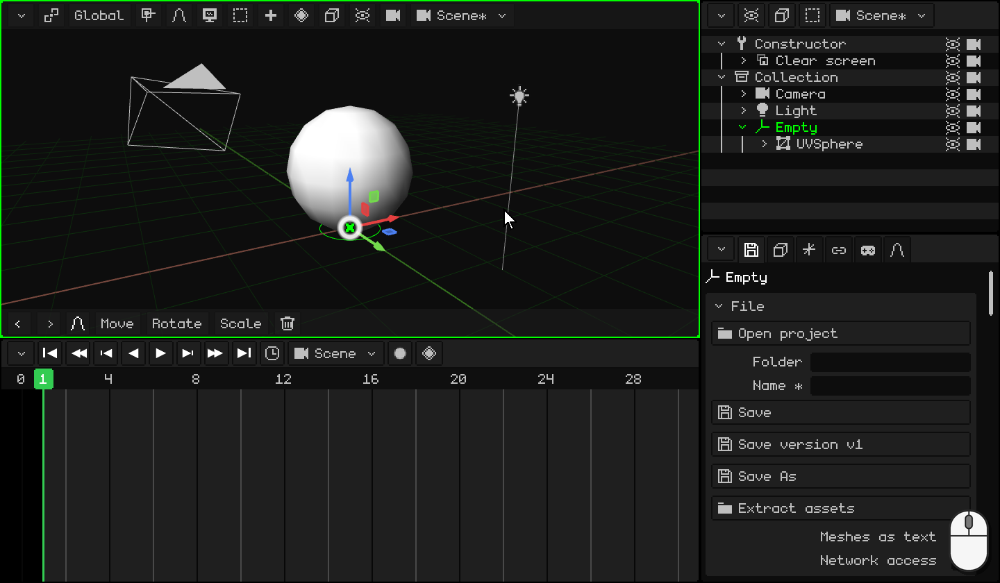
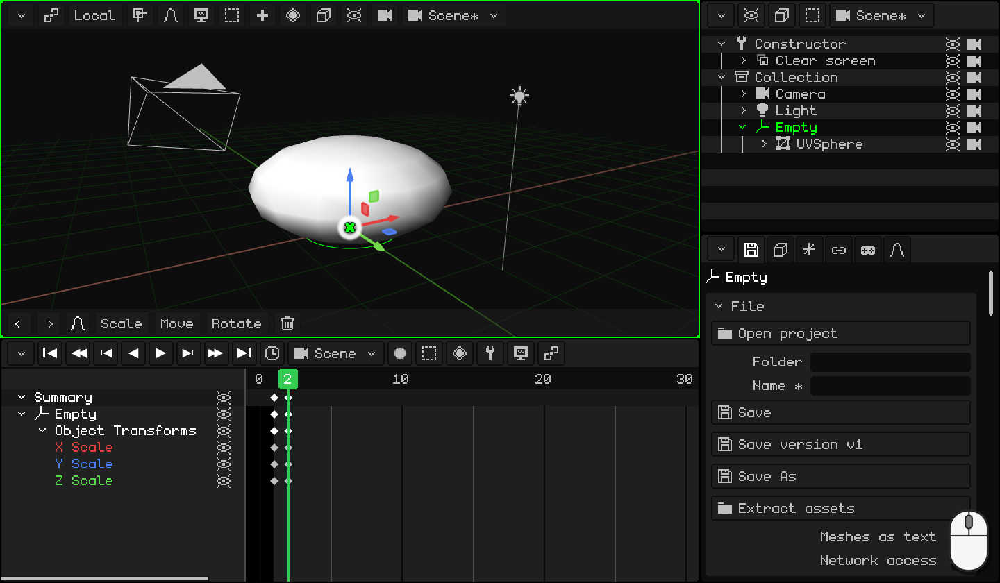
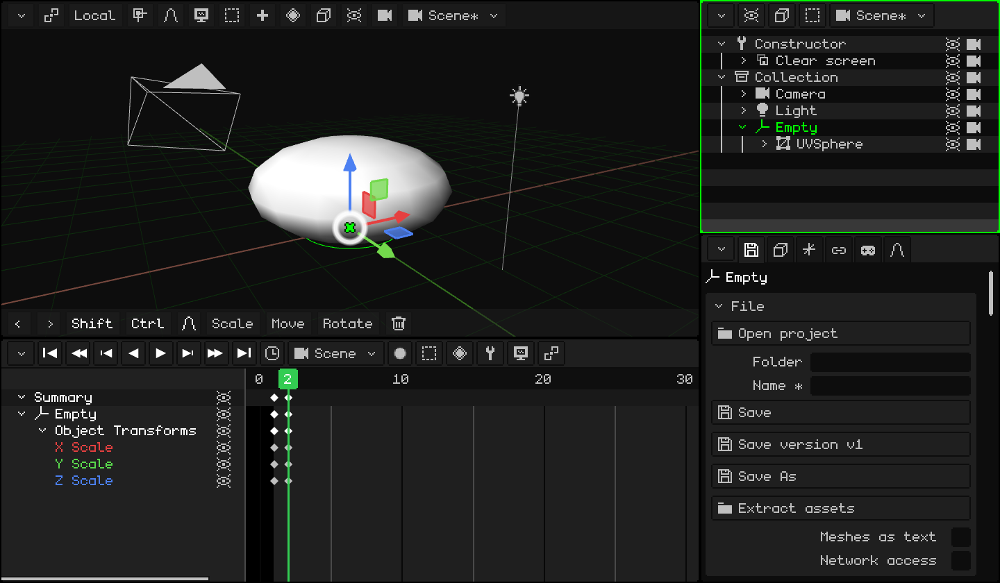
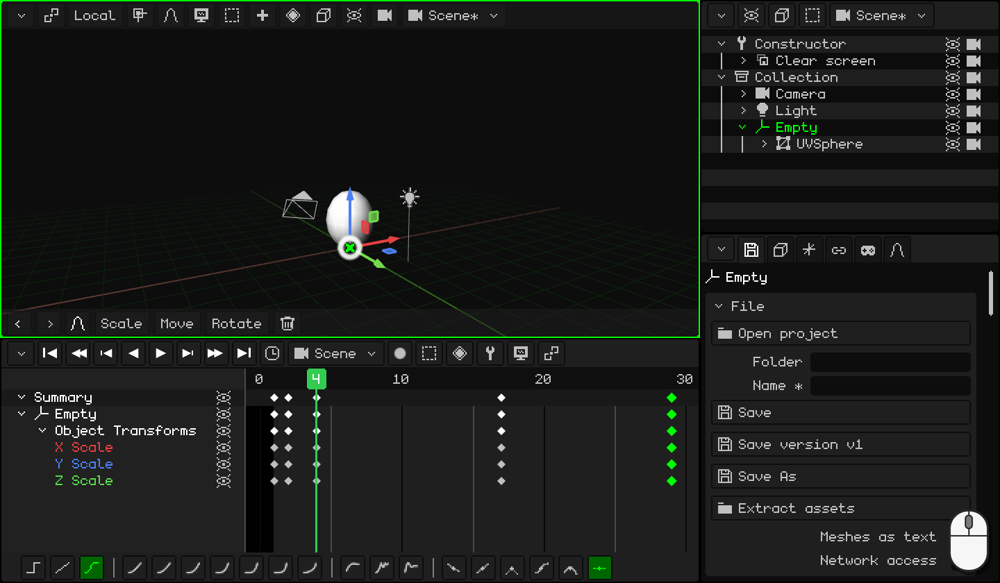
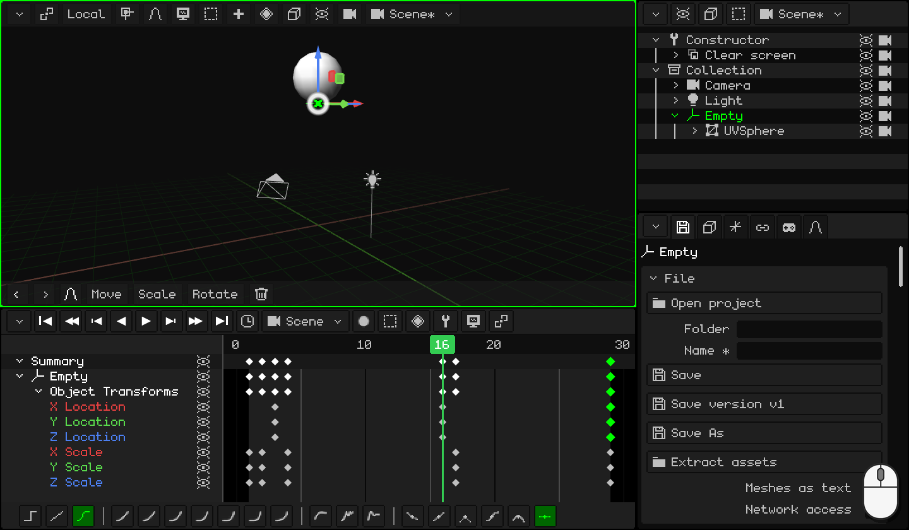

# Making a ball bounce

A ball that bounces and bounces, forever: it's the exercise every animator starts with. It looks easy, but for it to look good you need two of the most important principles of animation:

- **squash and stretch**: the ball squashes against the floor and stretches as it leaves it. That gives it weight and elasticity;
- **speeding up and slowing down**: it rises more and more slowly and falls faster and faster, as with gravity.

Along the way you'll learn to:

- put an **Empty** on the floor to squash the ball against the floor and not toward its center;
- **duplicate** keyframes to go back to a pose you already have;
- make a **loop**: an animation that repeats without the cut being noticeable;
- use **curves** so the ball has weight.

If you haven't animated anything yet, start with [Animating the door](animar-puerta.md): keyframes, the Timeline and curves are explained there.

## 1. The ball and its Empty

1. Delete the cube and add a sphere: <kbd>Shift</kbd> + <kbd>A</kbd> → **Mesh → UV Sphere**. It's 2 meters tall and is created with its center on the floor: raise it so it rests on the floor, <kbd>G</kbd> <kbd>Z</kbd> `1` <kbd>Enter</kbd>.
2. Enter **Edit Mode** (<kbd>Tab</kbd>) and choose **Vertex** with the **Vertex / Edge / Face** button. The very bottom vertex is hidden by the sphere: turn on **Overlays → X-Ray** to see it through the sphere and click on it.
3. <kbd>Shift</kbd> + <kbd>S</kbd> → **Cursor to Selected**: the 3D cursor goes to the bottom point of the ball, on the floor.
4. Go back to **Object Mode** (<kbd>Tab</kbd>) and turn off **X-Ray**.
5. <kbd>Shift</kbd> + <kbd>A</kbd> → **Empty**. It's created where the 3D cursor is: on the floor, right under the ball.
6. **Parent** the ball to the Empty. In the **Outliner**, click on **UVSphere** and <kbd>Ctrl</kbd> + click on **Empty** (the last one you select is the parent). With the mouse over the 3D Viewport, <kbd>Ctrl</kbd> + <kbd>P</kbd> → **Object (Keep Transform)**. In the Outliner, the sphere ends up inside the Empty.

### Why the Empty?

Scaling shrinks or enlarges from the **origin**. The sphere's origin is at its center: if you squash it, it shrinks toward the center and ends up floating. The Empty is on the floor: if you squash the Empty, the ball squashes **against the floor**, like when it bounces.

From now on you animate **the Empty**, never the sphere.

  On touch screens and on the N95: the vertex, with a tap (or with the virtual mouse); the cursor, with **Mesh → Snap → Cursor to Selected**; the Empty, with **Add → Empty**; and to parent, with the sphere and the Empty selected (the Empty active), **Object → Set Parent → Object (Keep Transform)**.

## 2. Squash

When the ball touches the floor it **squashes**: it gets lower and wider. So it doesn't look like it's shrinking, what it loses in height it gains in width.

1. Select the **Empty**. At frame **1**, the ball is round and touching the floor: <kbd>I</kbd> → **Scale Only**.
2. <kbd>→</kbd> (the right arrow) goes to frame **2**. Squash it: <kbd>S</kbd> <kbd>Z</kbd> `0.75` <kbd>Enter</kbd> makes it lower, and <kbd>S</kbd> <kbd>Shift</kbd> + <kbd>Z</kbd> `1.6` <kbd>Enter</kbd>, wider. <kbd>Shift</kbd> + <kbd>Z</kbd> means *every axis except Z*: X and Y together.
3. <kbd>I</kbd> → **Scale Only**.

 On a touch screen: you set the keyframe with the diamond button on the 3D Viewport's menu bar, **Animation → Insert Keyframe → Scale Only**; you change the frame with a tap on the Timeline's numbers. To squash it, **Scale** **Z** `0.75`, **Scale** **X** `1.6` and **Scale** **Y** `1.6`, with the numbers on the top bar's keypad.

 On the Nokia N95: <kbd>3</kbd>, <kbd>3</kbd> (the Z axis), the pencil key + `0.75` and <kbd>OK</kbd>; then <kbd>3</kbd>, <kbd>1</kbd> (X) and `1.6`, and <kbd>3</kbd>, <kbd>2</kbd> (Y) and `1.6`. The keyframe, with **Animation → Insert Keyframe → Scale Only**.

## 3. Stretch

As it leaves the floor, the ball **stretches** in the direction it's going: taller and thinner. And when it reaches the top it's round again.

1. You already have the round ball, in the keyframe at frame 1: duplicate it. In the Timeline, click on the diamond at frame **1**, <kbd>Shift</kbd> + <kbd>D</kbd>, take the copy to frame **4** and click. Watch the copy's diamond, not the pointer: it sits one frame to the right of the mouse.
2. Do the same for frames **17** and **29**: there the ball is round again.
3. Go to frame **4** (a click on the Timeline's numbers). Stretch it: <kbd>S</kbd> <kbd>Z</kbd> `1.1` <kbd>Enter</kbd> and <kbd>S</kbd> <kbd>Shift</kbd> + <kbd>Z</kbd> `0.9` <kbd>Enter</kbd>.
4. <kbd>I</kbd> → **Scale Only**.

  On touch screens and on the N95 (with the virtual mouse), instead of duplicating you copy and paste: a tap on the keyframe at frame 1 and, in the Timeline's **Key** menu (the diamond button), **Copy**; a tap on the numbers to go to frame 4 and **Key → Paste**. The same for 17 and 29. To stretch it, **Scale** **Z** `1.1`, **Scale** **X** `0.9` and **Scale** **Y** `0.9`.

## 4. The jump

1. Go to frame **3**: the ball is still on the floor, it's the moment it takes off. <kbd>I</kbd> → **Location Only**.
2. Go to frame **16** and raise it: <kbd>G</kbd> <kbd>Z</kbd> `5` <kbd>Enter</kbd> (5 meters). <kbd>I</kbd> → **Location Only**.
3. To make it come back to the floor, duplicate the keyframe at frame **3** to **29**.

Press **Play** (<kbd>Space</kbd>): the ball bounces. But something isn't right: it slows down before touching the floor, as if it were floating. Curves fix that, in part 6.

 On a touch screen: **Move** **Z** `5` and **Animation → Insert Keyframe → Location Only**. The keyframe at 3 is taken to 29 with **Key → Copy** and **Key → Paste**, as in part 3.

 On the Nokia N95: <kbd>1</kbd>, <kbd>3</kbd> (the Z axis), the pencil key + `5` and <kbd>OK</kbd>; and **Animation → Insert Keyframe → Location Only**.

## 5. The loop

Frame **29** is the same as frame **1**: the round ball, touching the floor. If the animation went up to 29, you'd see two identical frames in a row and the ball would stand still for an instant: the cut would be noticeable. That's why it ends at **28**: after 28 comes 1, which is the same as 29.

Click on the Timeline's **clock** and, in **End**, type `28` <kbd>Enter</kbd>.

The same clock has this animation's **FPS**. The ball runs at 30: each bounce lasts 28 frames, almost a second. If you want it with a film style, set it to 24, but **before** animating: with the same frames, at 24 it would go slower. Which FPS suits each case is explained in [Animating the door](animar-puerta.md), in the part about timing.

## 6. Curves: gravity

**Location Only** stored all three axes, but the ball only moves on Z: the **X Location** and **Y Location** rows are flat lines. Delete them: click on each one and <kbd>X</kbd>.

Now switch to the curve editor (**View → Curves**). The Z curve is the jump: it goes up and down. Think of a real ball:

- **Going up**, it leaves the floor at full speed and slows down until it's still at the top: **it starts fast and slows down**. Select the keyframe at frame **3** and, on the Timeline's toolbar, **Cubic** and **Ease Out**.
- **Coming down**, it starts slowly and falls faster and faster, until it hits the floor: **it speeds up and stops dead**. Select the keyframe at frame **16**: **Cubic** and **Ease In**.

(With the keyboard: <kbd>E</kbd> for the **Interpolation Mode** and <kbd>Ctrl</kbd> + <kbd>E</kbd> for the **Easing Type**.)

The curve ends up like the arcs of a real ball: rounded at the top and pointed at the bottom, where it hits the floor. Press **Play**: now it has weight.

Do you want it to bounce higher or lower? In the curve editor, grab the top keyframe (the one at frame 16) and move it.

## 7. Watch it

To see it without the grid or the Empty, turn off **Overlays → Show Overlays** and press **Play**.

The three balls below bounce in the same time. The first one has linear curves: it goes up and down always at the same speed, like a machine. The second one has the gravity curves: it slows down at the top and hits the floor. The third one also stretches and squashes: it's the one from this tutorial.

