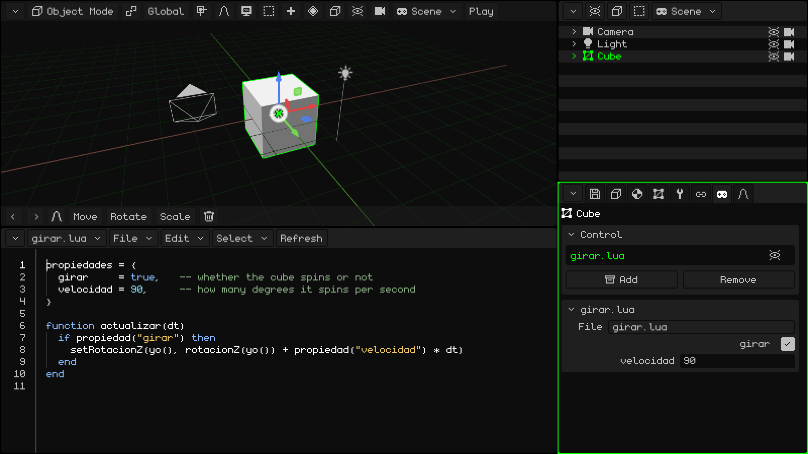
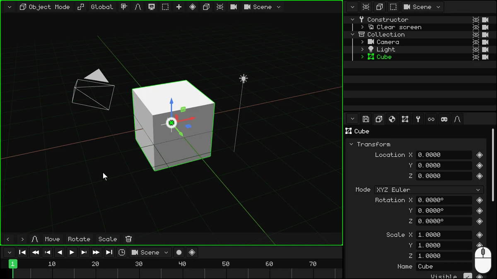
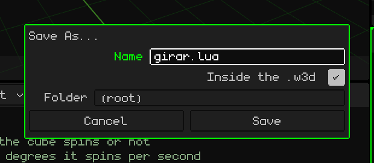
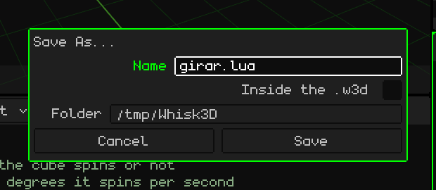
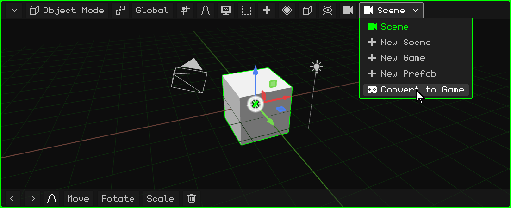
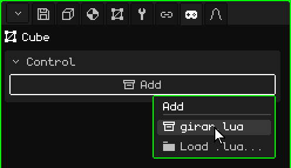
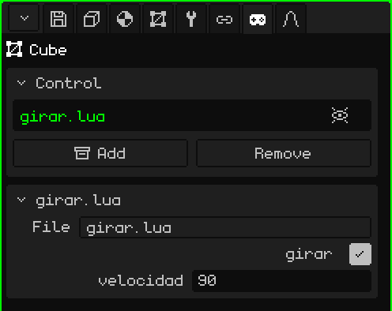
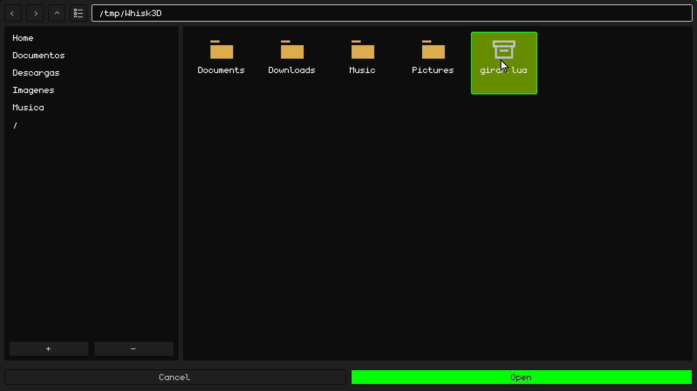
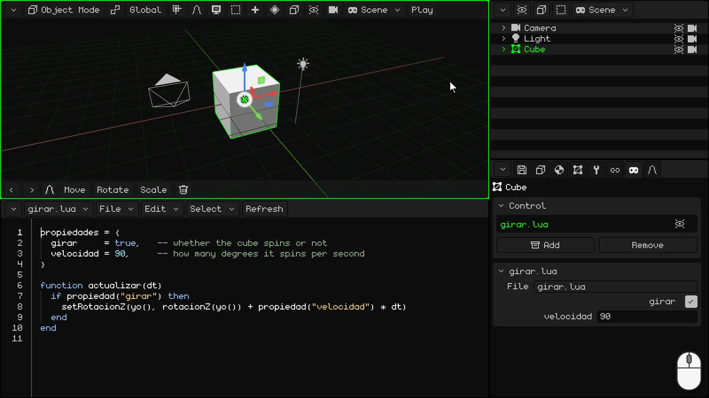

# Your first script: a spinning cube

In this tutorial you'll write your first **Lua** script: one that makes the cube spin.



## 1. The IDE

In this tutorial you won't use the Timeline: turn it into the IDE, the script editor. Tap the Timeline's corner button (at the top left) and choose **IDE**.

The IDE starts out empty. To write more comfortably, make it bigger: drag the same corner button upward.



> [!NOTE]
> You can also use other external editors or IDEs and load the scripts. Scripts can be outside or inside W3D projects.

## 2. Write the script

The script has two parts: at the top, the **properties**, and below, the **function** that makes the cube spin.

### The properties

```lua
propiedades = {
  girar     = true,   -- whether the cube spins or not
  velocidad = 90,     -- how many degrees it spins per second
}
```

- **`propiedades`** are the script's values that can be changed from the Properties panel, one per line. `girar = true` is a **boolean** value (true or false: `true` or `false`), and in the panel it shows up as a checkbox. `velocidad = 90` is a number, and it shows up as a number field. What you write here is the **default** value: each object that uses the script can have its own.
- What comes after `--` is a **comment**: Lua doesn't read it, it's for you.

### The function

```lua
function actualizar(dt)
  if propiedad("girar") then
    setRotacionZ(yo(), rotacionZ(yo()) + propiedad("velocidad") * dt)
  end
end
```

A **function** is a block of code with a name: it starts with `function name()` and ends with `end`. What's inside it isn't done when you write it, but every time someone **calls** the function.

Whisk3D has **reserved functions**: if your script has a function with one of those names, the engine calls it by itself, at the right moment. For example:

- **`inicio()`**: just once, when you press Play. It's for getting things ready.
- **`actualizar(dt)`**: on **every frame**, while the game is running.

There are more, like the ones that tell you when an object collides with another. They're all in the Lua manual: [When the engine calls your script](../lua/ciclo-del-script.md).

`actualizar` is ideal for a video game. A game draws the screen many times per second, and each of those images is a **frame**: everything that moves, moves a tiny bit on each frame. Here, on each frame the cube spins a little more.

- It runs while the object is **visible**: if you hide it, its script stops running until it's visible again.
- `dt` is the number of seconds since the previous frame. Multiplying the speed by `dt` makes the cube spin 90 degrees **per second**, whether the game runs at 30 or at 60 frames per second.

What it does inside:

**`if propiedad("girar") then` … `end`** is a **condition**. An `if` does just what it says: it runs the code inside it only if what goes between `if` and `then` is true. It can have an `elseif` ("if that isn't true, do this if…"), which tests another condition, and an `else` ("otherwise"), which runs when none of them was met; both are optional. It always ends with `end`. For example:

```lua
if puntos >= 100 then
  premio = "gold"
elseif puntos >= 50 then
  premio = "silver"
else
  premio = "nothing"
end
```

With 120 points the prize is gold; with 70, silver; and with 10, nothing. Only the first part that's met is done. (In Lua, `elseif` is written as one word.)

In the script, the `if` has no `elseif` or `else`: if **girar** is true (the checkbox is ticked), the cube spins; if it's false, nothing happens and the function ends. `propiedad("girar")` reads the value that object has in the panel. Since it's read on every frame, if you change it while the game is running, the script finds out right away.

- **`yo()`** is the object that has the script: the cube. **`rotacionZ(yo())`** gives its rotation in degrees around Z (the vertical axis, the same Z you see in the Properties panel), and **`setRotacionZ`** gives it a new one: the same one, plus a little more. That way the cube spins like a top.

`propiedad`, `yo`, `rotacionZ` and `setRotacionZ` are functions too, but the other way around: Whisk3D provides them and you call them. They're in the [Lua manual](../lua/README.md).

### The complete script

Tap inside the IDE and write it all out:

```lua
propiedades = {
  girar     = true,   -- whether the cube spins or not
  velocidad = 90,     -- how many degrees it spins per second
}

function actualizar(dt)
  if propiedad("girar") then
    setRotacionZ(yo(), rotacionZ(yo()) + propiedad("velocidad") * dt)
  end
end
```

## 3. Save it

First save the project, if you haven't saved it yet: the script can only be saved inside the project if the project is already saved. In Properties, on the **floppy disk** tab (the **File** card), type a **Name**, for example `girar-cubo`, and tap **Save**. It's saved in the **Folder** the card shows.

Then, on the IDE's menu bar, **File → Save As...**:

1. In **Name**, type `girar.lua`.
2. Tick **Inside the .w3d**: the script is saved inside the project, in the same `.w3d` file. The **Folder** becomes one inside the project: **(root)** is the main one.
3. Tap **Save**.



If you don't tick **Inside the .w3d**, the script is saved as a separate file, outside the project, in the **Folder** you choose. That's useful, for example, for editing it with another program.



## 4. Turn the scene into a game

A **scene** is for modeling and animating; scripts run in a **game**. A game has no animations of its own: animations are made in a scene or in a 3D model with an armature, and they're imported into the game to be used there. On the menu bar of the 3D Viewport (or of the Outliner), tap the scene button, the one that shows its name, and choose **Convert to Game**.



**Convert to Game** doesn't change your scene: it makes a copy, which is a game, with everything just as it looks on the Timeline's current frame. The scene's animations don't carry over into the game: that frame is recorded as the game's starting position and state. The original scene stays the same, with its animations, and you can find it again in the scene button's menu.

Now you're in the game: the scene button shows a joystick, and **Play** appears on the 3D Viewport's menu bar.

## 5. Add it to the cube

1. Select the game's **Cube** (in the Outliner or in the 3D Viewport).
2. In Properties, go to the **joystick** tab.
3. On the **Control** card, tap **Add**: a menu drops down with the project's scripts. Choose `girar.lua`.



The script appears in the Control card's list, and its own card, **girar.lua**, is added below, with the properties you wrote: the **girar** checkbox (ticked) and **velocidad** (90).

In the list, to the right of the script, there's an **eye**: tapping it turns the script off (the engine doesn't use it) without removing it from the object or hiding the object. Another tap turns it back on.



### A script from outside

If you wrote the script with another editor, or saved it outside the `.w3d`, tap **Add → Load .lua...**. The file browser opens, **Load script**: choose the file and tap **Open**.



## 6. Press Play

Tap **Play**: the cube spins. While the game is running, the 3D Viewport's menu bar shows **Stop** and **Pause**.

With the game running, try changing the properties on the **girar.lua** card:

- set **velocidad** to 360: it spins four times faster;
- untick **girar**: it stands still. Tick it again and it carries on.

To finish, tap **Stop**: the cube goes back to how it was before you pressed Play.



> [!NOTE]
> Everything that happens while the game is running is lost when you tap **Stop**: the cube goes back to its place, and **girar** and **velocidad** go back to the values they had before you pressed Play. To change them for real, change them while the game is stopped.

## Keep going

- [Lua in Whisk3D](../lua/README.md): the Lua manual, with all the functions.
- [A script is a component of an object](../lua/scripts-y-objetos.md): properties (also lists, text and objects from the scene).
- [When the engine calls your script](../lua/ciclo-del-script.md): `actualizar`, `inicio` and the rest.

## Download the example

Here's the finished project, so you can try it out or compare it with yours: **[girar-cubo.w3d](ejemplos/girar-cubo.w3d)**. Open it in Whisk3D and press **Play**. The script is inside the `.w3d` and you can see it in the IDE.
