# Changing the origin: a door

In this tutorial you'll make a door open from the hinge. To do that, you have to change its **origin**: the point the object turns around (see [The origin](modo-objeto.md#the-origin) in the Object Mode tutorial).

We start from the door in the previous tutorial, [Modeling a door](modelar-puerta.md), with the origin in the center. If you made it by moving one side, the origin ended up off-center: **Object → Set Origin → Origin to Geometry** puts it back in the center.

## The door turns the wrong way

Try turning it. The door turns around its center, like a revolving door, and not from the hinge:

 With the gizmo: a click on its center switches it to **Rotate**, and the blue ring turns it around the vertical axis.

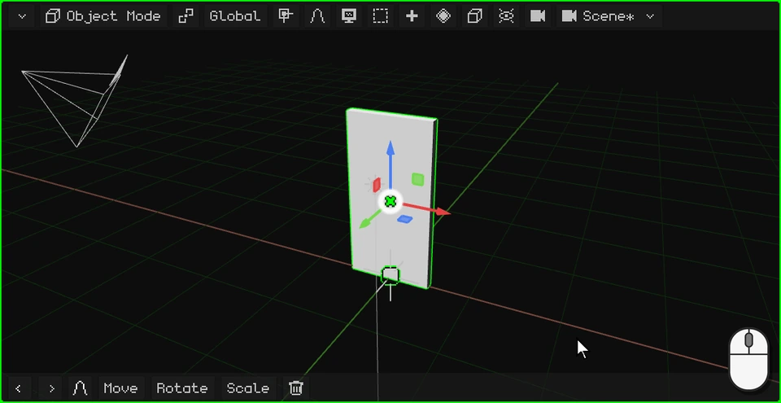

 With your finger: a tap on the center of the gizmo switches it to **Rotate**, and you drag the blue ring.

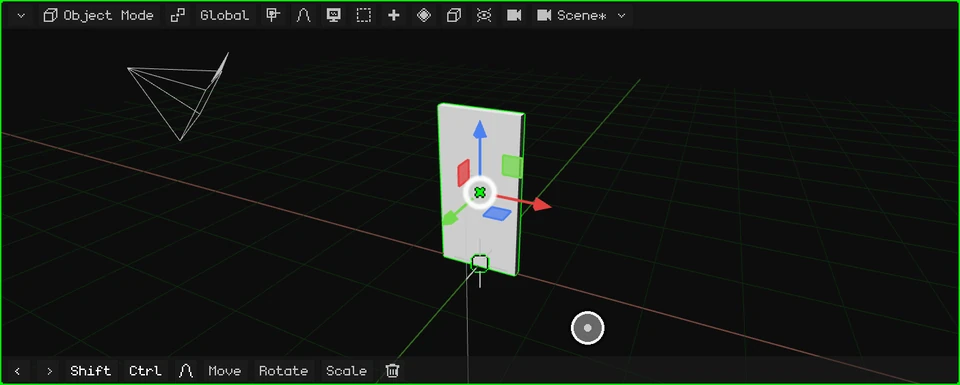

 On the Nokia N95 the gizmo is off: <kbd>2</kbd> (rotate), <kbd>3</kbd> (the Z axis, the vertical one) and the arrows; <kbd>OK</kbd> confirms.

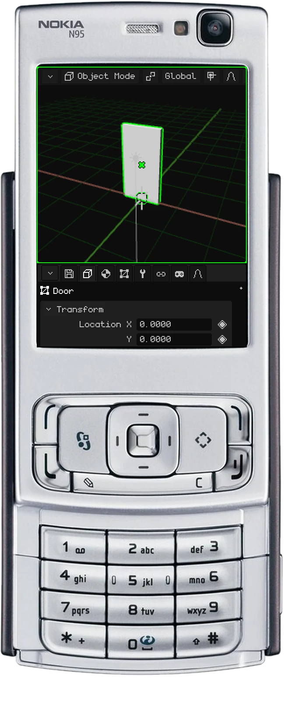

It turns the wrong way because its origin is in the center. Let's move it to the hinge.

## Move the origin to the hinge

1. **Enter Edit Mode.** A click on the mode button and another on **Edit Mode** (on PC, also with <kbd>Tab</kbd>).

   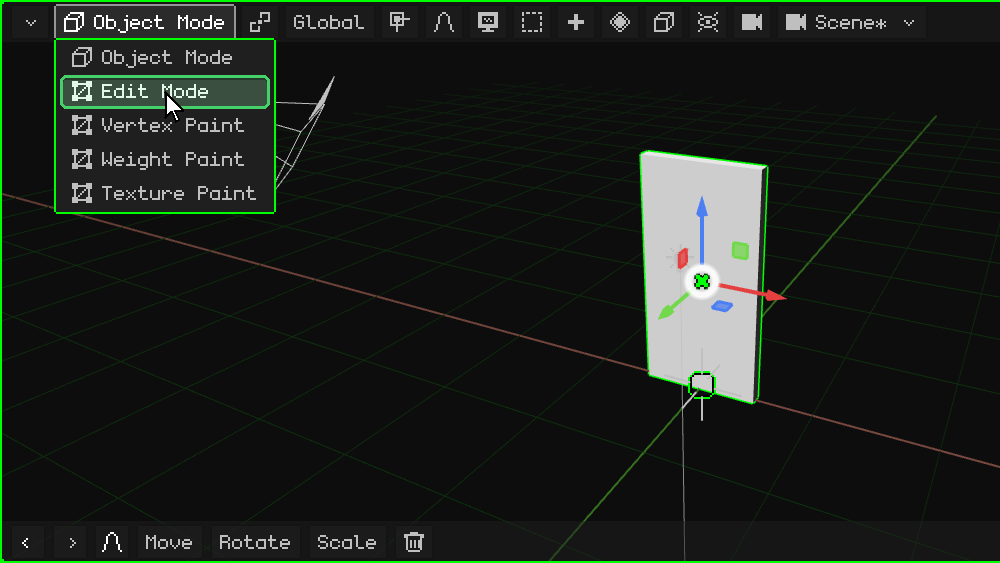

2. **Choose faces.** In Edit Mode the **Vertex / Edge / Face** button appears: click it and choose **Face**.

   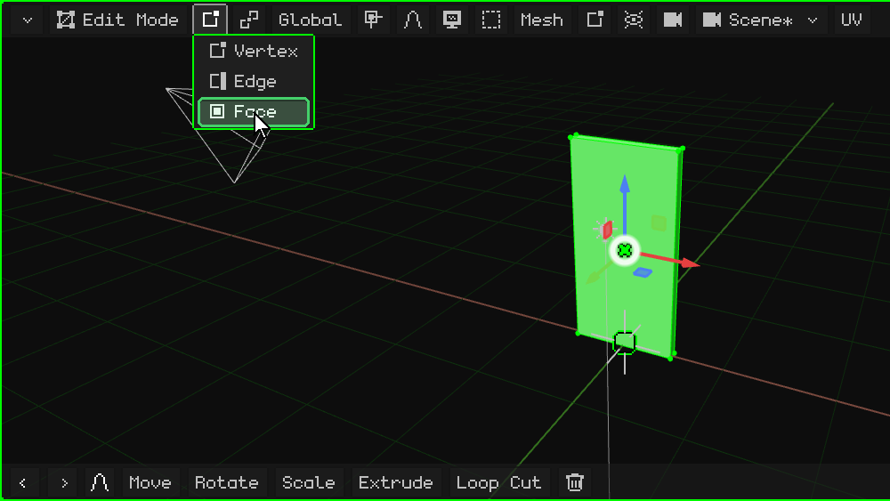

3. **Select the hinge face.** Click on the narrow face on the side of the door, on the side where the hinge goes: it turns green.

   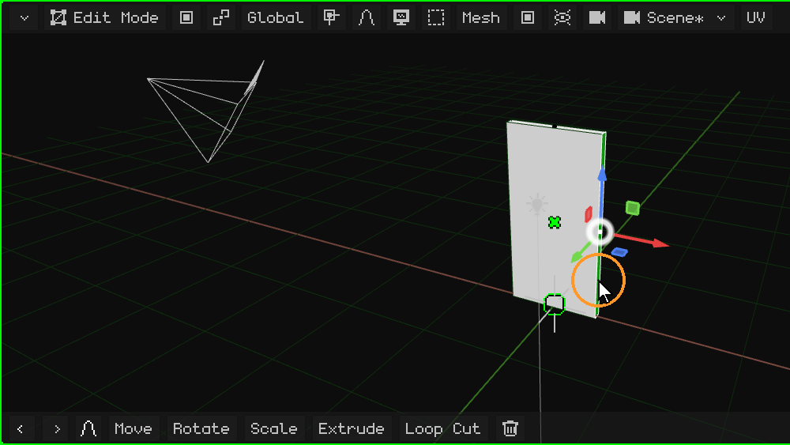

4. **Move the 3D cursor there.** In the **Mesh** menu, **Snap** → **Cursor to Selected**: the 3D cursor ends up on the hinge.

   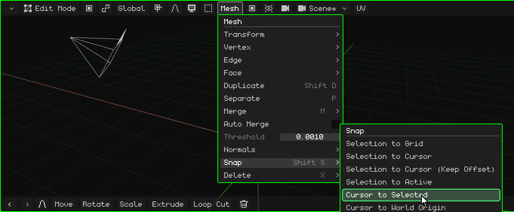

5. **Go back to Object Mode.** A click on the mode button and another on **Object Mode** (or <kbd>Tab</kbd>).

   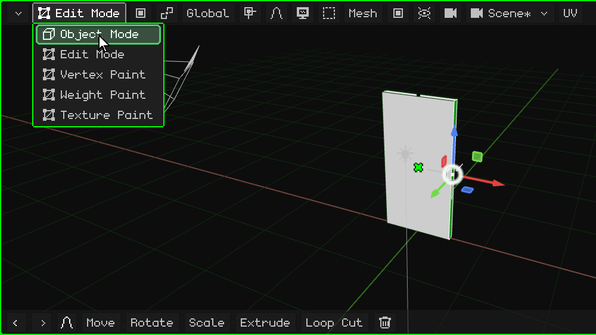

6. **Move the origin to the 3D cursor.** In the **Object** menu, **Set Origin** → **Origin to 3D Cursor**. The door doesn't move: what moves is its origin, and with it the gizmo, which ends up on the hinge.

   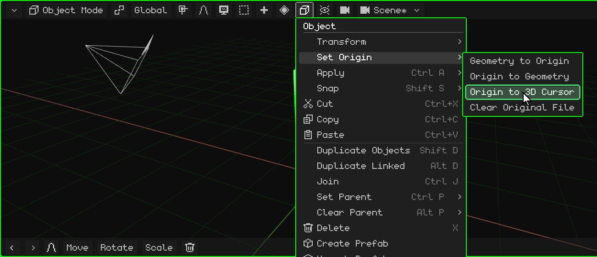

## Now it turns the right way

Turn it again with the gizmo: now it opens and closes from the hinge.

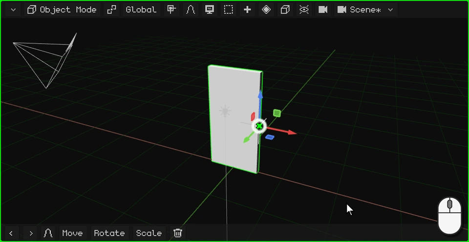

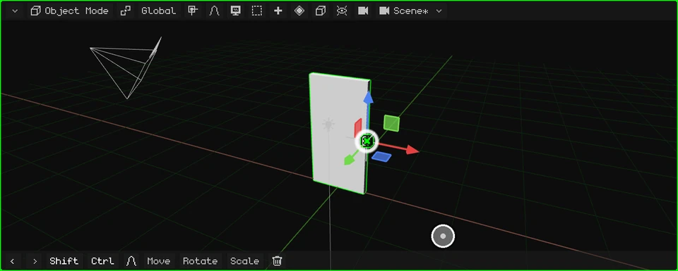

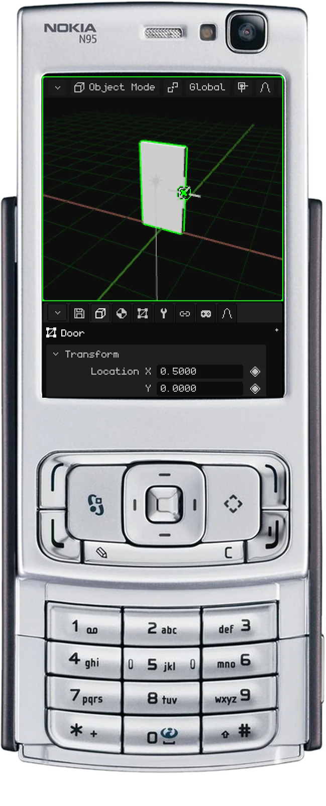

 On a touch screen, the steps above are the same, with taps: menus open and options are chosen with a tap.

 On the Nokia N95, <kbd>OK</kbd> switches from Object Mode to Edit Mode and menus open with the left soft key.

## The Set Origin options

| Option | What it does |
|---|---|
| **Origin to Geometry** | Moves the origin to the center of the mesh. |
| **Origin to 3D Cursor** | Moves the origin to where the 3D cursor is. |
| **Geometry to Origin** | The other way around: it leaves the origin and moves the mesh until its center is on it. |

In the next tutorial we'll make its handle: [Modeling the door handle](modelar-picaporte.md).
