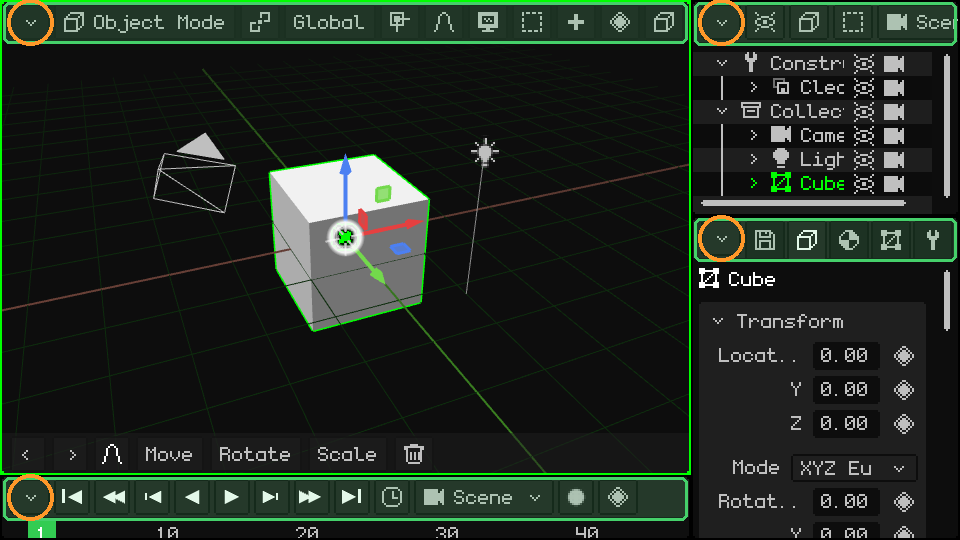
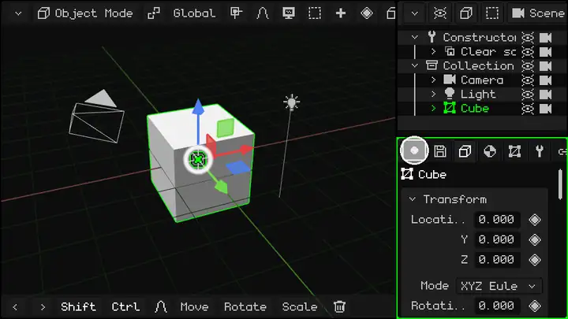
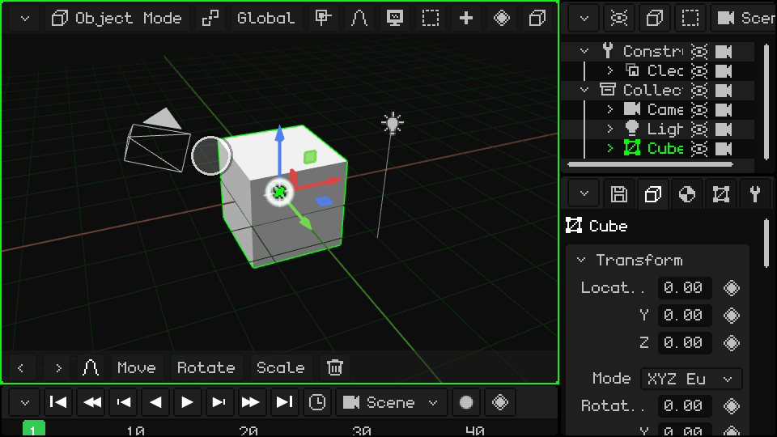
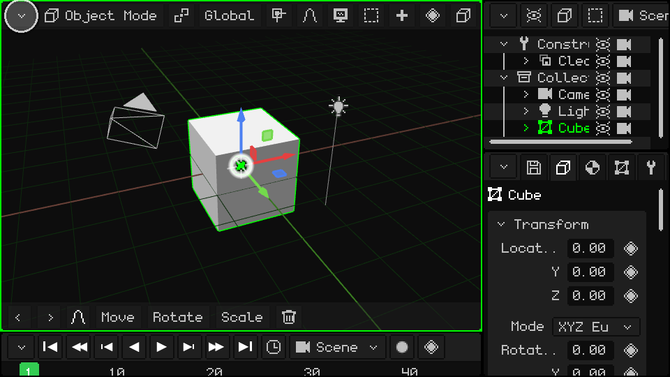
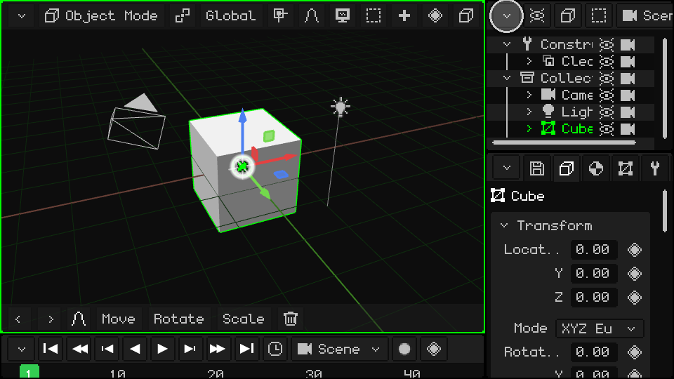
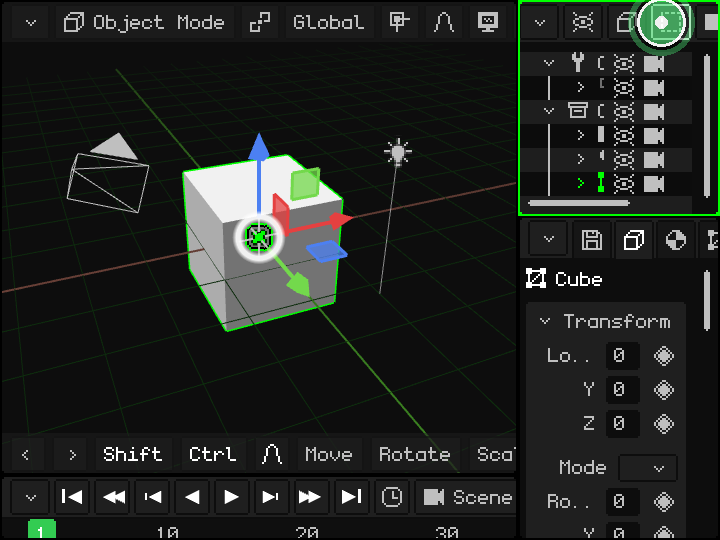
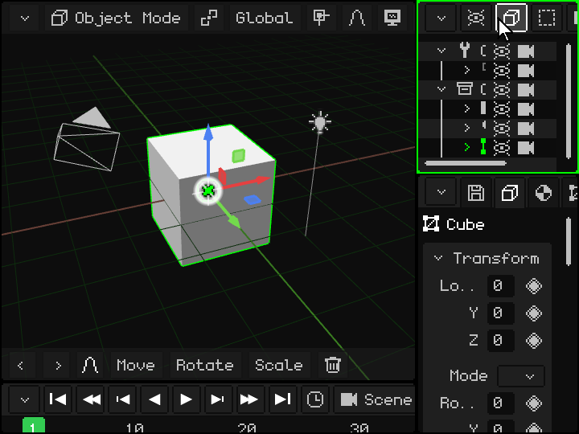
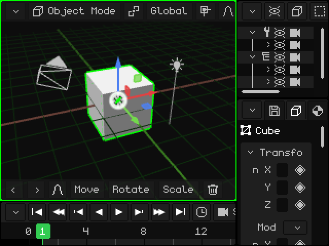

# Viewports

The Whisk3D window is divided into **viewports**: panels, each with its own editor (the 3D Viewport, the Outliner, Properties...). You can split them, resize them and choose what each one shows. It works the same with a mouse, with your finger on a touch screen and with a Nokia's keypad.

## The menu bar and the corner button

Every viewport has a **menu bar** at the top (green in the image) with that editor's menus and buttons. The **corner button** (orange) is always at the top left: you use it to change or modify the viewport.

## Resize

Put your finger (or the mouse) on the corner button and **drag it**. That moves the left and top borders of that viewport, and the ones next to it adjust. Here, the bottom-right one is dragged in circles and all three change size:

> [!TIP]
> If you tap the button and release it without dragging, its menu opens. On PC you can also drag the border between two viewports.

## The corner menu

Tapping the corner button opens this menu:

At the top are the **viewport types**: choosing one turns the viewport into that editor. Below the line is what you can do with it:

| Option | What it does |
|---|---|
| Expand | The viewport takes the space of the one next to it, which closes (if the one next to it is split, that whole group closes). |
| Split in Columns | Splits it in two, side by side. |
| Split in Rows | Splits it in two, one above the other. |
| Maximize | Enlarges it to fill the whole window. While it's maximized, the menu only has **Minimize**, which puts it back in its place. |

### Change the type

The 3D Viewport turned into a UV Editor:

### Split in Columns and Split in Rows

### Expand

The Outliner takes the space of Properties:

### Maximize and Minimize

## When the bar doesn't fit

If the viewport is narrow, its bar doesn't fit entirely. The same happens with the toolbar at the bottom of the 3D Viewport. To see the rest:

- **With your finger:** drag it sideways.
- **With the mouse:** hold down the mouse button on the bar and drag, or turn the **wheel** over it. In the 3D Viewport the wheel zooms, so drag its bar instead.
- **With the keyboard:** <kbd>M</kbd> on PC, or the **left soft key** on the Nokia, enters the bar of the active viewport. Go through it with the left and right arrows; each menu opens when you reach it. Move through the menu with up and down, and choose with OK (<kbd>Enter</kbd> on PC). The bar scrolls by itself to show where you are.

On a Nokia N95: the left soft key enters the bar and the arrows go through it.

## Viewport types

| Viewport | What it's for |
|---|---|
| [3D Viewport](../editor/vista-3d.md) | Where you see and edit the scene: model, move objects, paint, pose and animate. |
| [Outliner](../editor/outliner.md) | The list of everything in the scene. |
| [Library](../editor/outliner.md#library-view) | The project's resources: meshes, materials, textures, animations, sounds, scripts and more. |
| [Properties](../editor/propiedades.md) | The data of the active object, in tabs. |
| [UV Editor](../editor/editor-uv.md) | How the texture sits on the mesh. |
| [Timeline](../editor/linea-de-tiempo.md) | The animation: keyframes and curves. |
| [2D Editor](../editor/editor-2d.md) | Game interfaces, HUDs and 2D games. |
| [Console](../editor/consola.md) | The engine log: errors, warnings and information. |
| [IDE](../editor/editor-de-scripts.md) | The editor for Lua scripts and shaders. |

Each viewport will get its own tutorial with more detail. In the meantime, the [Whisk3D manual](../editor/README.md) explains each one.

Whisk3D keeps growing: over time new viewports will be added and the current ones may change. They will all work the same way, with the bar at the top and the button in the corner.
