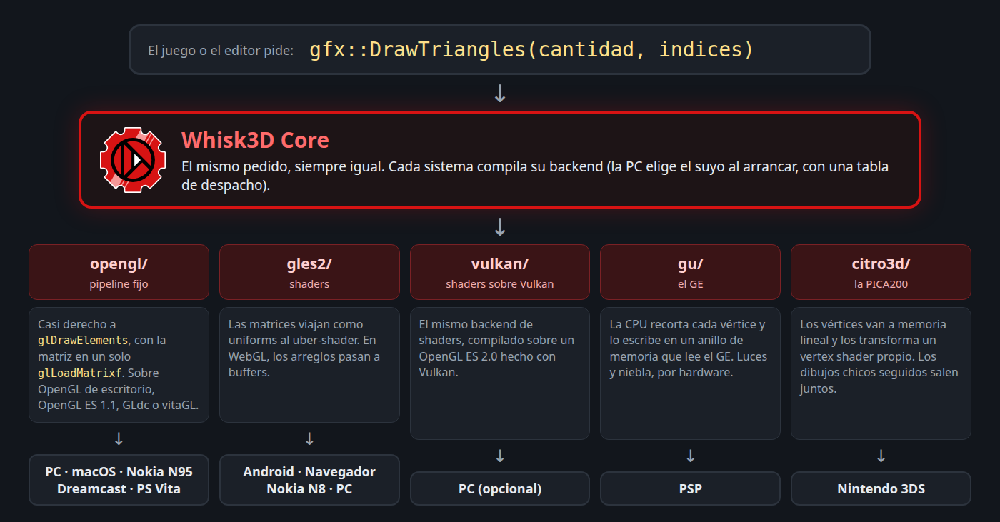

# Gráficos

## La API

Todo lo que se dibuja pasa por las funciones de `w3dEngine` (`graphics/w3dGraphics.h`): prender y apagar capacidades (`Enable`, `Disable`), matrices (`MatrixMode`, `PushMatrix`, `Translatef`, `Perspective`), arreglos de vértices (`VertexPointer3f`, `NormalPointer3b`, `TexCoordPointer2f`), buffers en la GPU (`GenBuffer`, `ArrayBufferData`), el dibujo (`DrawTriangles`, `DrawLines`, `DrawPoints`), materiales (`Material`), luces (`LightNfv`, `LightNSpot`), niebla, mezcla, recorte por rectángulo, estencil y planos de recorte.

Se parece al OpenGL clásico a propósito: es la forma de dibujar que más sistemas entienden, desde el N95 hasta la Dreamcast.

## Pipeline fijo y shaders

Hay dos familias de GPU:

- **Pipeline fijo.** La GPU trae los pasos armados de fábrica: transformar los vértices, calcular la luz por vértice, combinar la textura, poner niebla. El programa solo prende interruptores y pasa valores. Así funcionan OpenGL ES 1.1 (el N95), el OpenGL clásico de la PC, el GE de la PSP y la PVR de la Dreamcast.
- **Shaders.** La GPU no trae nada armado: cada paso es un programa chico que corre en ella. Así funcionan OpenGL ES 2.0, WebGL y Vulkan.

El Core habla el idioma del pipeline fijo. El backend de shaders lo **emula** con un "uber-shader" que hace las mismas cuentas que OpenGL ES 1.1 (luz por vértice con hasta 8 luces, atenuación, cono, niebla, la mezcla de dos texturas). Por eso el navegador y Android se ven igual que la PC y el N95.

## Los backends

| Backend | Qué es | Dónde se usa |
|---|---|---|
| `opengl/` | Pipeline fijo: OpenGL de escritorio, OpenGL ES 1.1, GLdc, vitaGL | Linux, Windows, macOS, N95 y S60, Dreamcast, PS Vita |
| `gles2/` | Shaders: OpenGL ES 2.0 y WebGL | Android, el navegador, el Nokia N8 (Symbian^3), la PC (opcional) |
| `vulkan/` | El mismo de shaders, compilado sobre un OpenGL ES 2.0 hecho con Vulkan | La PC (opcional) |
| `gu/` | El GE de la PSP | PSP |
| `citro3d/` | La GPU PICA200 de la 3DS | Nintendo 3DS |
| `pvr/` | Dibujo directo a la PVR de la Dreamcast | Módulo opcional para juegos nativos |
| `video/` | Video a textura | Opcional: FFmpeg en escritorio, `<video>` en el navegador |

## Cómo se elige

Casi siempre, **al compilar**: cada sistema compila un solo backend y las llamadas van directo, sin ningún costo extra.

La excepción es la PC (Windows y Linux). Ahí el ejecutable trae OpenGL, OpenGL ES 2.0 y Vulkan, y se elige **al arrancar**, en **Propiedades → Ajustes → Gráficos** (vale al reiniciar; ver [Otras funciones](../editor/otras-funciones.md)). Cada backend se compila en su propio namespace (`w3dEngine::gl`, `w3dEngine::es2`, `w3dEngine::vk`) y llena una **tabla de despacho** (`w3dBackendTabla.h`) con sus funciones. Cada función de `w3dEngine` llama a la del backend activo:

```cpp
// graphics/w3dDespacho.inc, generado por tools/generar_despacho.py
void Enable(Cap c) { W3D_TABLA()->Enable(c); }
void DrawTriangles(int count, const MeshIndex* indices) { W3D_TABLA()->DrawTriangles(count, indices); }
```

Si el elegido no anda en esa máquina, queda OpenGL. Vulkan necesita el driver, la GPU y el compilador de shaders `shaderc_shared` al lado del ejecutable, y viene apagado en los builds de 32 bits. En macOS el ejecutable trae solo OpenGL.

## El viaje de un `DrawTriangles`

El mismo pedido termina en lugares muy distintos:



- **OpenGL fijo (PC, N95):** casi derecho a `glDrawElements`. La matriz se manda recién antes del dibujo, en un solo `glLoadMatrixf`.
- **OpenGL ES 2.0 y WebGL:** la pila de matrices vive en la CPU y viaja como uniforms al uber-shader. WebGL no acepta arreglos en la RAM, así que el backend los pasa a buffers. En la GPU VideoCore IV de Android 2.3 arma un programa chico por combinación de estado y junta los dibujos de la interfaz: de 179 por cuadro quedan 16.
- **PSP (GE):** la CPU pasa cada vértice al espacio de recorte y recorta ahí, porque el GE no recorta contra los costados. Después los escribe intercalados en un anillo de memoria que lee el GE. La luz (hasta cuatro) y la niebla van por hardware.
- **3DS (PICA200):** los vértices se copian a memoria lineal y los transforma un vertex shader propio (`w3d.v.pica`). Los dibujos chicos seguidos con el mismo estado salen juntos: de 191 por cuadro quedan 18. Las líneas y los puntos se arman en la CPU como triángulos.
- **Dreamcast:** GLdc hace de OpenGL 1.x sobre la PVR y usa el mismo backend fijo que la PC y el N95, con parches propios. Para un juego que necesita cada ciclo está `pvr/`: GLdc gasta unos 400 ciclos del SH-4 por vértice, y el dibujo directo transforma cada uno con una sola instrucción (`FTRV`). No conviven en el mismo programa.
- **PS Vita:** vitaGL emula el pipeline fijo sobre la GPU de la consola y compila sus shaders mientras corre (por eso necesita `libshacccg.suprx`).

## Preguntarle al backend qué sabe hacer

No todas las GPU pueden lo mismo, y el Core no lo esconde: cada backend contesta qué tiene, y quien dibuja elige otro camino si falta algo.

| Pregunta | Qué pasa si dice que no |
|---|---|
| `VBOSoportado()` | Las mallas van como arreglos en la RAM (Dreamcast, Vita) |
| `EstencilBits()` | El reflejo del agua cae al recorte por planos |
| `PlanosRecorteMax()` | El reflejo se arregla sin planos (la PVR no los tiene) |
| `MezclaTexturasSoportada()` | Las capas de un material van en varias pasadas |
| `TieneTexGen()` | El reflejo esférico se calcula por software o con la matriz de textura (`TexMatrixMatcap`, que sí anda en el N95) |
| `SombreadoPorPixelSoportado()` | La luz queda por vértice y el editor ni ofrece la opción |
| `ShadersEscritos()` | El material con shader propio se dibuja como siempre (ver [Shaders escritos](../editor/shaders.md)) |

## El caché de estado

Cada cambio de estado le cuesta algo al driver. El Core recuerda lo que está puesto: prender algo que ya está prendido, o atar la textura que ya está atada, no genera ninguna llamada. `IsEnabled` y `GetMatrix` responden desde esa memoria y no le preguntan a la GPU, porque en el N95 una pregunta así obliga a esperar a que termine de dibujar.

## Texturas

`LoadTexture` tiene dos pasos. El **decode** (del archivo a píxeles RGBA) depende del sistema: stb en casi todos, el ICL en Symbian. El **upload** (de los píxeles a la GPU) es común, y cada backend convierte al formato de su chip:

- **PSP:** potencia de dos hasta 512, "swizzled", en 565 o 8888.
- **3DS:** bloques de 8x8 en orden Morton, de 8 a 1024 por lado.
- **Dreamcast:** potencia de dos de 8 a 1024, en 16 bits (565 o 4444), sin mipmaps.
- **N95:** solo potencia de dos; las demás se remuestrean antes de subir.

Un proyecto puede pedir texturas de **16 bits** (la mitad de memoria) y, solo en el N95, subirlas **a la mitad** desde cierto tamaño (`texturasMitadDesde`). El formato `.w3dt` guarda una textura ya lista para la GPU, con sus mipmaps: cargarla es leer y subir.

Un detalle honesto: la subida de texturas y las luces todavía llaman a dos o tres funciones de OpenGL directo. En las consolas sin OpenGL, el backend trae una capa chica que las implementa (`gu/w3dGLgu.cpp`, `citro3d/w3dGLc3d.cpp`).

## La pantalla y el área segura

`PantallaSetTam` y `PantallaEsVertical` guardan una sola vez si la pantalla está parada o acostada (horizontal = más ancha que alta), para que cualquier parte del motor lo pregunte. El **área segura** (`SafeAreaGet`) dice cuántos píxeles de cada borde no sirven para la interfaz: el notch, la barra de gestos, las barras del navegador del celular. El fondo se dibuja en toda la ventana y la interfaz adentro del área segura. En la PC, Symbian y las consolas los bordes valen 0; en el navegador se miden.

## Los límites del más chico

Lo que se escribe para el Core tiene que entrar en la máquina más limitada. Estos son los límites que se notan:

| Límite | Dónde | Cómo lo maneja el Core |
|---|---|---|
| Índices de 16 bits (hasta 65.535 vértices por malla) | Symbian | `MeshIndex` es de 16 bits ahí y de 32 en el resto; el importador rechaza lo que no entra |
| 8 luces a la vez | Todos (`LucesMax`) | El backend de shaders las emula con la misma cuenta; la PSP hace 4 por hardware y Android 2.3 usa hasta 4 |
| Sin shaders | Los backends fijos | Las funciones de shaders contestan que no y el material se dibuja como siempre |
| Z de 16 bits | PSP | El plano cercano se ajusta a la distancia de órbita, como en el N95 |
| 16 MB para todo | Dreamcast | Se compila con `-Os` y el linker tira lo que no se usa; las texturas van en 16 bits |
| C++03 | Symbian | Nada de `nullptr`, `auto` ni `override` en los headers (`W3D_OVERRIDE`); `tools/prueba_independencia.sh` compila cada header solo, en C++03 |
