# La interfaz

> [!NOTE]
>  El Nokia N95 soporta mouse y teclado (por Bluetooth). Las partes de esta página sobre el Nokia explican cómo se usa sin mouse ni teclado, solo con las teclas del teléfono.

La ventana de Whisk3D se divide en **viewports**: paneles, cada uno con su editor (la Vista 3D, el Outliner, Propiedades...). Los podés dividir, cambiarles el tamaño y elegir qué muestra cada uno. Funciona igual con mouse, con el dedo en una pantalla táctil y con el teclado de un Nokia.

Esto es lo que se ve cuando inicia el programa por primera vez:

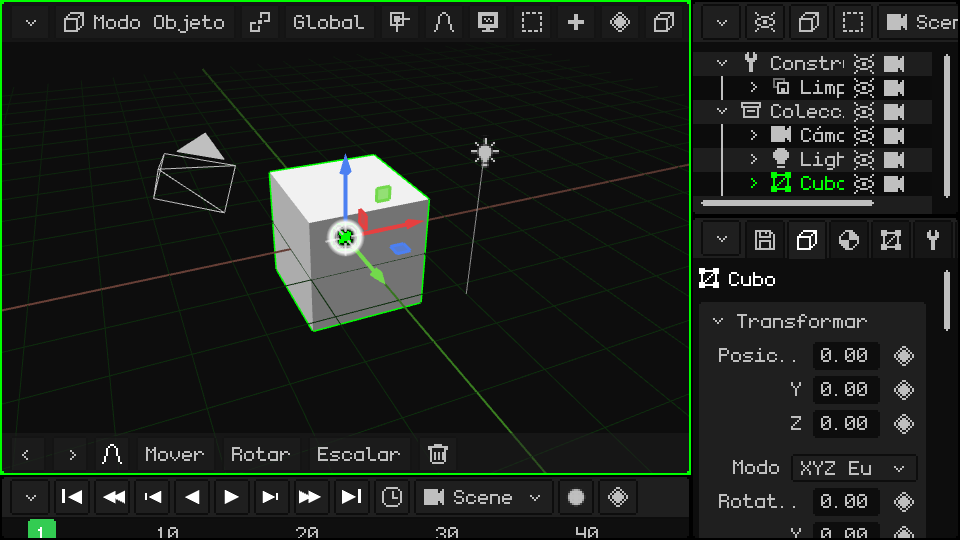

## El viewport activo

El viewport que está debajo del mouse es el **viewport activo**, y se marca con un borde verde. Es el que recibe los comandos del teclado, los controles y cualquier otro periférico. Al pasar el mouse de un viewport a otro, el borde verde lo sigue:

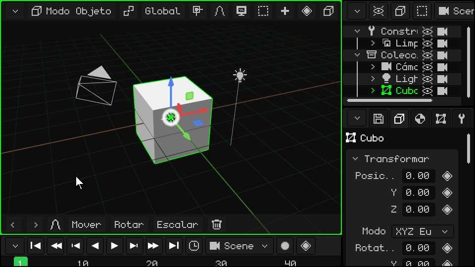

 **En el Nokia N95:** cada toque de la **tecla verde** de llamada  pasa al viewport siguiente. En la pantalla del N95 entran dos: la Vista 3D a la izquierda y Propiedades a la derecha.

## La barra de menús y el botón de la esquina

Todos los viewports tienen arriba una **barra de menús** (en verde en la imagen) con los menús y botones de ese editor. Arriba a la izquierda está siempre el **botón de la esquina** (en naranja): es el que cambia o modifica el viewport.

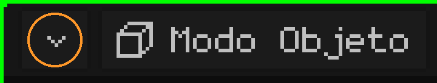

Es igual en todos los viewports, y es el único botón que tienen todos.

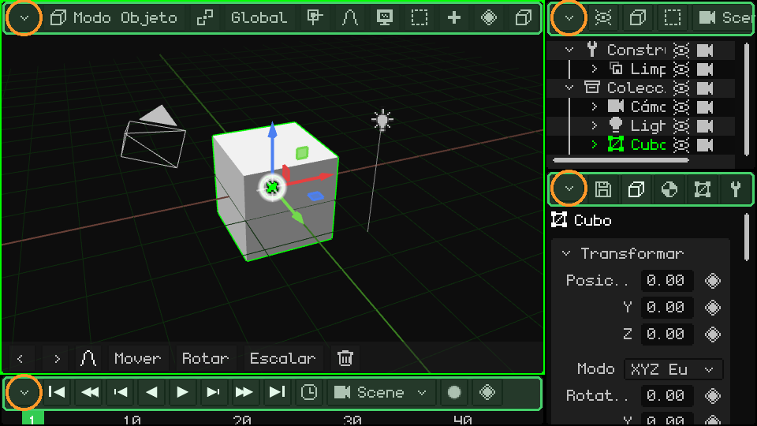

## Cambiar el tamaño

  **Mantené presionado** el botón de la esquina (con el dedo o con el mouse) y arrastralo para cambiar el tamaño: eso mueve el borde izquierdo y el de arriba de ese viewport, y los de al lado se acomodan. Un **toque simple**, sin arrastrar, abre el menú desplegable con las opciones del viewport. Acá, el de abajo a la derecha se arrastra en círculos y los tres cambian de tamaño:

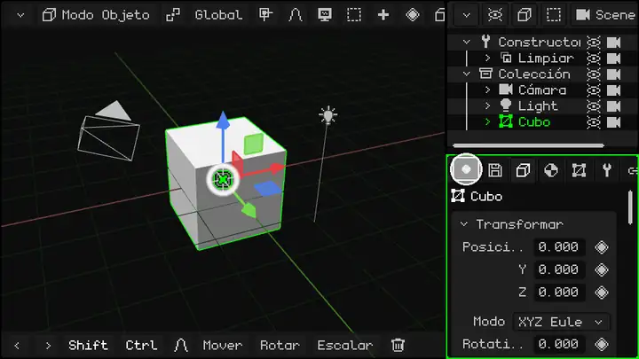

 **En el Nokia:** mantené apretada la **tecla verde** de llamada  y apretá una flecha: el borde del viewport activo (el que tiene el marco verde) se corre para ese lado, y así lo agrandás o lo achicás. La tecla verde sola, sin flechas, pasa al viewport siguiente.

## Las opciones del viewport

Un toque en el botón de la esquina despliega este menú:

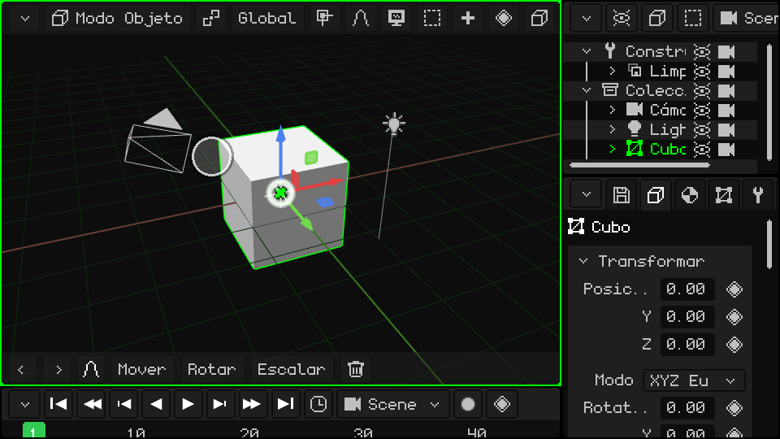

Arriba están los **tipos de viewport**: elegir uno convierte el viewport en ese editor. Debajo de la línea está lo que se le puede hacer:

| Opción | Qué hace |
|---|---|
| Expandir | El viewport se queda con el lugar del de al lado, que se cierra (si el de al lado está dividido, se cierra todo ese grupo). |
| Dividir en columnas | Lo parte en dos, uno al lado del otro. |
| Dividir en filas | Lo parte en dos, uno arriba del otro. |
| Maximizar | Lo agranda a toda la ventana. Mientras está maximizado, el menú tiene solo **Minimizar**, que lo devuelve a su lugar. |

### Cambiar el tipo

La Vista 3D convertida en Editor UV:

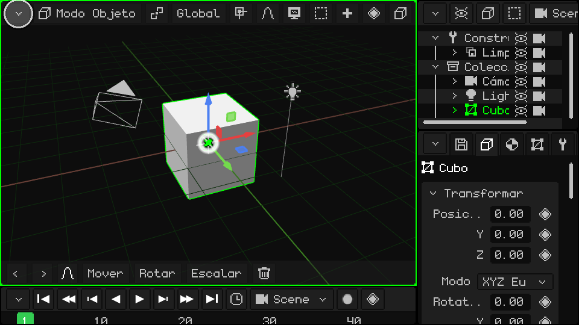

### Dividir en columnas y en filas

### Expandir

El Outliner se queda con el lugar de Propiedades:

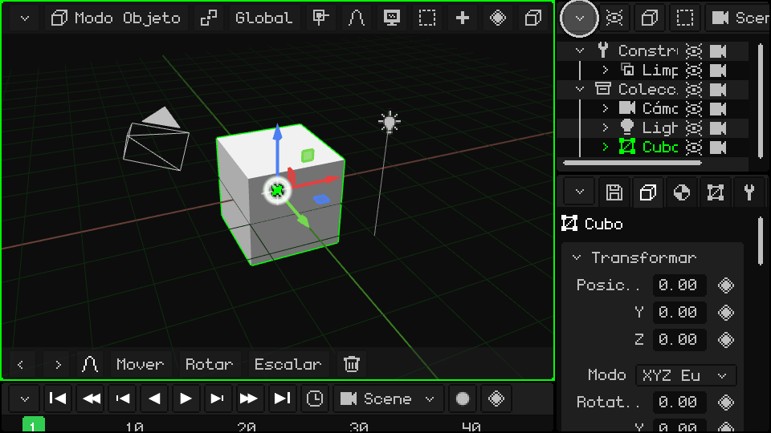

### Maximizar y minimizar

## Cuando no se ven todas las opciones de la barra de menús

Si el viewport es angosto, su barra de menús no entra entera. Lo mismo pasa con la barra de herramientas de abajo de la Vista 3D. Para ver el resto:

-  **Con el dedo:** arrastrala de costado.
-  **Con el mouse:** mantené apretado el click sobre la barra y arrastrá, o girá la **rueda** encima.
-   **Con el teclado:** <kbd>M</kbd> en la PC, o la **soft izquierda** en el Nokia, entra a la barra del viewport activo. Con las flechas izquierda y derecha la recorrés, y cada menú se abre al llegar. Con arriba y abajo te movés por el menú, y con OK (<kbd>Enter</kbd> en la PC) elegís. La barra se desplaza sola para mostrar dónde estás.

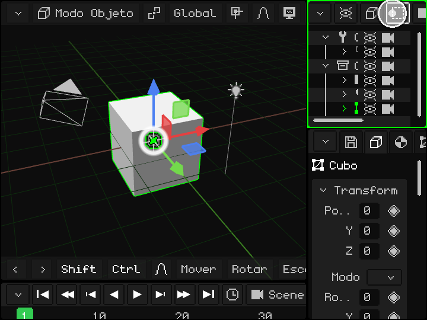

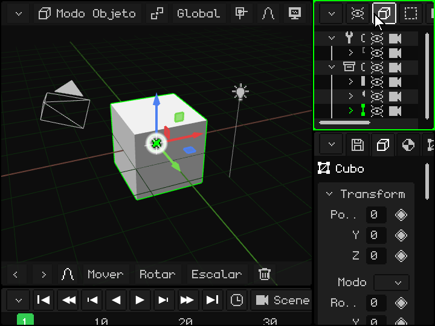

 En un Nokia N95: la soft izquierda entra a la barra y las flechas la recorren.

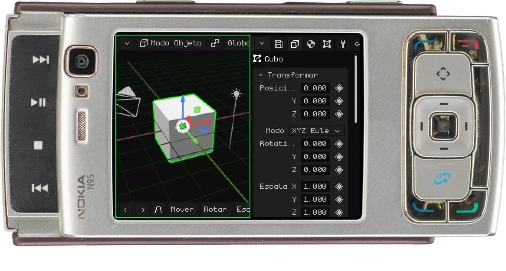

## Los tipos de viewport

| Viewport | Para qué sirve |
|---|---|
| [Vista 3D](vista-3d.md) | Donde se ve y se edita la escena: modelar, mover objetos, pintar, posar y animar. |
| [Outliner](outliner.md) | La lista de todo lo que hay en la escena. |
| [Biblioteca](outliner.md#vista-biblioteca) | Los recursos del proyecto: mallas, materiales, texturas, animaciones, sonidos, scripts y más. |
| [Propiedades](propiedades.md) | Los datos del objeto activo, en pestañas. |
| [Editor UV](editor-uv.md) | Cómo se apoya la textura sobre la malla. |
| [Línea de tiempo](linea-de-tiempo.md) | La animación: los keyframes y las curvas. |
| [Editor 2D](editor-2d.md) | Interfaces de juego, HUD y juegos 2D. |
| [Consola](consola.md) | El registro del motor: errores, avisos e información. |
| [IDE](editor-de-scripts.md) | El editor de scripts Lua y de shaders. |

Whisk3D sigue creciendo: con el tiempo se van a sumar viewports nuevos y los de ahora pueden cambiar. Todos van a funcionar igual, con la barra de menús arriba y el botón en la esquina.

## Más de la interfaz

| Función | Descripción | Cómo se usa |
|---|---|---|
| Barra de menús por teclado | Abre la barra de menús del viewport activo para recorrerla con las flechas. | <kbd>M</kbd> (en Modo Edición, <kbd>M</kbd> es Fusionar). |
| Deshacer / Rehacer | Vuelve atrás o adelante la última acción. | <kbd>Ctrl+Z</kbd> / <kbd>Ctrl+Y</kbd> o <kbd>Ctrl+Shift+Z</kbd>; flechas de la barra de herramientas. |
| Guardar proyecto | Guarda el .w3d abierto (si es nuevo, pide nombre). | <kbd>Ctrl+S</kbd>, o Propiedades → pestaña Archivo/Render → tarjeta Archivo (ver [El proyecto](proyecto.md)). |
| Pantalla completa | Entra y sale de pantalla completa. | <kbd>F11</kbd>. En Android es automática si el teléfono no tiene notch. |
| Reproducir / Pausa | Reproduce la animación (o el juego) desde cualquier panel. | <kbd>Espacio</kbd> o el botón Play de la línea de tiempo. |

 **En Android**: en vertical el layout es Vista 3D arriba y Propiedades abajo; en horizontal se suma la línea de tiempo. Cuando se abre el teclado en pantalla (por ejemplo en el editor de scripts), el viewport activo se maximiza en la parte visible y vuelve a su lugar al cerrarlo.
