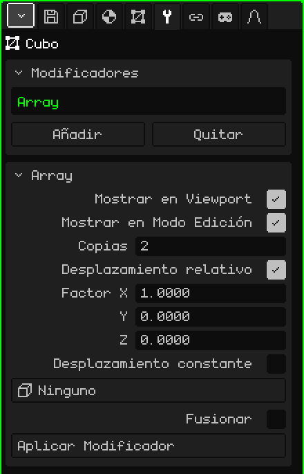

# Array

El modificador **Array** hace copias de la malla en fila, cada una corrida de la anterior. Sirve para todo lo que se repite: los postes de una cerca, los escalones de una escalera, las columnas de un pasillo o los eslabones de una cadena. Modelás una sola pieza y el Array arma el resto; si cambiás la pieza, cambian todas las copias.

## Cómo se agrega

1. Elegí la malla.
2. En Propiedades, abrí la pestaña **Modificadores** (el ícono de la llave).
3. Tocá **Añadir** y elegí **Array**.

En la lista aparece como **Array**, y debajo se abre la tarjeta con sus parámetros. Como todos los modificadores, no destruye la malla: se puede apagar, cambiar de lugar con **Subir** y **Bajar**, sacar con **Quitar** u hornear con **Aplicar Modificador**.

## Parámetros

| Parámetro | Qué hace |
|---|---|
| Mostrar en Viewport | Apagado, las copias no se calculan: ni en la vista ni al renderizar. |
| Mostrar en Modo Edición | Apagado, mientras editás se ve solo la pieza original. |
| Copias | Cuántas piezas hay en total, contando la original (por defecto 2). Con 1 queda solo la original. |
| Desplazamiento relativo | Corre cada copia según el **tamaño** de la pieza. Viene prendido, con Factor X en 1: cada copia queda pegada a la anterior, sin hueco y sin encimarse. |
| Factor X / Y / Z | Cuántas veces su propio tamaño se corre cada copia en ese eje: 1 = pegadas, 2 = con un hueco del tamaño de una pieza, 0.5 = encimadas por la mitad. Y es la profundidad y Z la altura, como en la pestaña Objeto. Solo se ven con el Desplazamiento relativo prendido. |
| Desplazamiento constante | Corre cada copia una distancia fija, sin importar el tamaño de la pieza. Viene apagado. Si los dos desplazamientos están prendidos, se suman. |
| Distancia X / Y / Z | Los metros que se corre cada copia en cada eje. Solo se ven con el Desplazamiento constante prendido. |
| Objeto de desplazamiento | Un objeto de la escena (lo más cómodo es un Vacío) que corre, gira y escala cada copia un poco más que la anterior. Ver más abajo. En **Ninguno**, no se usa. |
| Fusionar | Suelda los vértices que quedan pegados entre una copia y la siguiente, para que formen una sola superficie: una baranda continua en vez de tramos sueltos. Viene apagado. |
| Distancia de Fusión | Qué tan cerca tienen que estar dos vértices para soldarse (por defecto 0.001 m). Solo se ve con Fusionar prendido. |
| Aplicar Modificador | Hornea las copias en la malla. Ver la nota de abajo. |

## Ejemplos

- **Una cerca:** un poste (un Cubo angosto y alto), Copias en 10 y Factor X en 3: diez postes con un hueco de dos postes entre cada uno.
- **Una escalera:** un escalón (un Cubo chato), Factor X en 0, Factor Y en 1 y Factor Z en 1: cada escalón queda un paso más atrás y un paso más arriba.

## El Objeto de desplazamiento

Con un objeto elegido, cada copia repite lo que ese objeto está **corrido, girado y escalado respecto de la malla**, y lo va acumulando: la segunda copia lo hace una vez, la tercera dos veces, y así.

- Si el Vacío está en el mismo lugar que la malla y girado 30° alrededor de la vertical, cada copia gira 30° más que la anterior: con 12 copias se da la vuelta entera.
- Si además está un poco más arriba, cada copia sube un poco más: una escalera caracol.
- Si está escalado a 0.9, cada copia es un poco más chica que la anterior: una espiral que se cierra.

Con el Vacío en el mismo lugar que la malla, las copias giran alrededor del origen de la malla. Para que formen un círculo y no giren sobre sí mismas, corré la pieza lejos del origen en el Modo Edición y apagá el Desplazamiento relativo. Al mover o girar el objeto, las copias se actualizan en el momento.

## El orden importa

El Desplazamiento relativo mide la malla **tal como le llega** del modificador de arriba: si arriba hay un [Espejo](modificador-espejo.md), mide el objeto ya reflejado. Con una [Superficie de Subdivisión](modificador-subdivision.md) abajo, las copias soldadas con Fusionar se suavizan como una sola pieza; sin Fusionar, cada copia se suaviza por separado.

> [!NOTE]
> Aplicar Modificador en un Array hornea **todos** los modificadores de la lista que estén prendidos, no solo el Array (con los valores de la vista), y deja la lista vacía: también se van los que estaban apagados y los que no generan geometría, como un [Esqueleto](modificador-esqueleto.md). Se puede deshacer.

Volver a [Malla 3D](objeto-malla.md)
