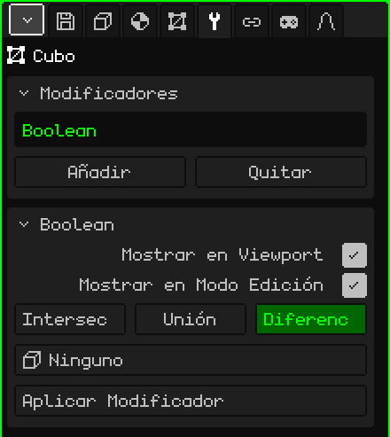

# Booleano

El modificador **Booleano** combina la malla con otra: le resta el volumen de la otra, se lo suma o se queda con lo que tienen en común. Sirve para lo que costaría mucho modelar a mano: el agujero de una ventana en una pared, el hueco de una taza, una ranura, o dos piezas fundidas en una sola.

## Cómo se agrega

1. Elegí la malla que va a cambiar (por ejemplo, la pared).
2. En Propiedades, abrí la pestaña **Modificadores** (el ícono de la llave).
3. Tocá **Añadir** y elegí **Booleano**.

En la lista aparece con su nombre interno, **Boolean**, y debajo se abre la tarjeta con sus parámetros. Como todos los modificadores, no destruye la malla: la pared sigue entera por debajo, y si sacás el modificador el agujero desaparece. Se puede apagar, cambiar de lugar con **Subir** y **Bajar**, sacar con **Quitar** u hornear con **Aplicar Modificador**.

## Parámetros

| Parámetro | Qué hace |
|---|---|
| Mostrar en Viewport | Apagado, no se hace la operación: se ve la malla original, ni en la vista ni al renderizar. |
| Mostrar en Modo Edición | Apagado, mientras editás se ve la malla sin la operación. |
| Intersección | Deja solo la parte que está adentro de las dos mallas a la vez. |
| Unión | Junta las dos en una sola superficie y saca las caras que quedaron adentro. |
| Diferencia | Le resta a esta malla el volumen de la otra: es la que hace agujeros. Viene elegida. |
| Objeto | La otra malla, el **cortador**. En **Ninguno** no hace nada. La lista muestra todos los objetos de la escena, pero solo sirve una malla. |
| Aplicar Modificador | Hornea el resultado en la malla. Ver la nota de abajo. |

La operación elegida se ve en verde.

## Ejemplo: una ventana en una pared

1. Añadí un **Cubo** y escalalo para que sea una pared: ancha, alta y finita.
2. Añadí otro **Cubo** (o un **Cilindro**, para una ventana redonda) y ponelo donde va la ventana, atravesando la pared de lado a lado.
3. Elegí la pared, agregale un **Booleano**, dejá **Diferencia** y en **Objeto** elegí el cortador.
4. Ocultá el cortador (Ocultar / Mostrar del [Modo Objeto](modo-objeto.md), o destildá **Visible** en la pestaña Objeto). Queda el agujero.

El cortador oculto sigue cortando. Para moverlo, volvé a mostrarlo o elegilo en el Outliner.

## Lo que conviene saber

- Las dos mallas tienen que estar **cerradas**, sin agujeros en la superficie: si no, el Booleano no puede saber qué queda adentro y qué afuera.
- Mover, girar, escalar o editar el cortador actualiza el corte en el momento. Así podés acomodar la ventana mirando el resultado.
- Las caras que el corte no toca quedan como estaban: un cuadrilátero sigue siendo un cuadrilátero. Las que se cortan quedan como polígonos de varios lados, no como triángulos, así la malla sigue cómoda para editar después de aplicarlo.
- Las caras que pone el cortador (por ejemplo, el borde de adentro de la ventana) toman el primer material de la malla.
- Las UV y los colores de vértice se conservan; donde se corta, se interpolan.
- Las partes que quedan en el mismo plano no se juntan: la unión de dos cajas apoyadas deja la tapa partida en varios pedazos.

 En el Nokia N95 el corte se recalcula cada vez que movés o editás el cortador. Con mallas grandes, acomodalo, aplicá el modificador y seguí trabajando con la malla ya cortada.

> [!NOTE]
> Aplicar Modificador en el Booleano hornea **todos** los modificadores de la lista que estén prendidos, no solo este, y deja la lista vacía: también se van los que estaban apagados y los que no generan geometría, como un [Esqueleto](modificador-esqueleto.md). Se puede deshacer. El cortador no se borra: queda como un objeto más.

Volver a [Malla 3D](objeto-malla.md)
