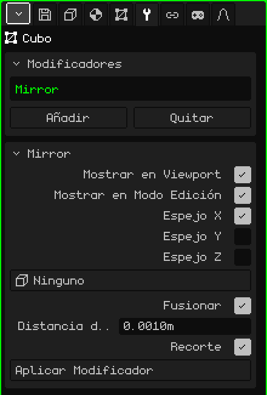

# Espejo

El modificador **Espejo** refleja la malla del otro lado de un plano. Sirve para todo lo que es simétrico: modelás la mitad de un personaje, de una cara o de un auto, y la otra mitad aparece sola, reflejada. Lo que cambiás de un lado se repite del otro mientras trabajás.

## Cómo se agrega

1. Elegí la malla.
2. En Propiedades, abrí la pestaña **Modificadores** (el ícono de la llave). Solo aparece cuando el objeto activo es una malla.
3. Tocá **Añadir** y elegí **Espejo**.

En la lista de la tarjeta Modificadores aparece con su nombre interno, **Mirror**, y debajo se abre una tarjeta con sus parámetros.

Un modificador no destruye la malla: la original queda intacta y la seguís editando, y lo que se ve es el resultado. Se puede apagar en cualquier momento, cambiar de lugar en la lista con **Subir** y **Bajar** (aparecen cuando hay dos o más), sacar con **Quitar** u hornear en la malla con **Aplicar Modificador**.

## Parámetros

| Parámetro | Qué hace |
|---|---|
| Mostrar en Viewport | Apagado, el reflejo no se calcula: ni en la vista ni al renderizar. Sirve para comparar con y sin. |
| Mostrar en Modo Edición | Apagado, mientras editás la malla se ve solo la mitad original; al volver al Modo Objeto aparece el reflejo. |
| Espejo X | Refleja de izquierda a derecha. Viene prendido: es el que sirve para un personaje o un auto. |
| Espejo Y | Refleja de adelante hacia atrás. |
| Espejo Z | Refleja de arriba abajo. |
| Objeto Espejo | En **Ninguno**, el plano del espejo pasa por el origen de la malla. Si elegís otro objeto (por ejemplo un Vacío), el plano pasa por el origen de ese objeto y gira con él; su escala no cuenta. Al moverlo o girarlo, el reflejo se actualiza en el momento. |
| Fusionar | Suelda la costura: los vértices que están casi sobre el plano se pegan a él y quedan compartidos por las dos mitades. Así no queda una raya en el medio y el sombreado suave pasa de un lado al otro sin cortes: media esfera se ve como una esfera entera. Viene prendido. |
| Distancia de Fusión | Qué tan cerca del plano tiene que estar un vértice para soldarse (por defecto 0.001 m). Si la costura queda abierta, subila un poco; si se pegan vértices que no querías, bajala. También es el margen del Recorte. |
| Recorte | Mientras movés vértices en el Modo Edición, no los deja pasar al otro lado del plano: el que llega al plano se queda pegado y solo se desliza sobre él. Los vértices del centro no se despegan, así la costura no se abre por accidente. Viene prendido. |
| Aplicar Modificador | Hornea el reflejo en la malla: las dos mitades pasan a ser vértices de verdad y el modificador sale de la lista. Las caras de cuatro lados siguen siendo de cuatro lados. Se puede deshacer. |

Si prendés más de un eje, cada reflejo se hace sobre el resultado del anterior. Con X e Y prendidos, modelás un cuarto del objeto y salen las cuatro partes.

## El orden importa

Los modificadores se aplican de arriba abajo: cada uno trabaja sobre lo que dejó el anterior. El Espejo casi siempre va primero:

- **Espejo arriba de la [Superficie de Subdivisión](modificador-subdivision.md):** primero se arma el modelo entero y después se suaviza todo junto, sin marca en el centro. Al revés, cada mitad se suaviza por separado y en la unión queda un pliegue.
- **Espejo arriba del [Array](modificador-array.md):** el Array copia el objeto ya completo, y su Desplazamiento relativo usa el tamaño del objeto entero.

Aplicar Modificador en el Espejo hornea solo el Espejo, sin importar dónde esté en la lista: los demás modificadores siguen ahí.

## Consejos

- Trabajá con el origen de la malla en el centro del modelo, porque el plano del espejo pasa por ahí. Los vértices que van en el medio dejalos justo sobre el plano.
- Para modelar cómodo, mirá desde el frente en ortográfica (ver [Navegar en la Vista 3D](../tutoriales/navegacion.md#las-vistas-de-frente-de-costado-y-de-arriba)): el plano del Espejo X queda como una línea vertical en el medio.
- Cuando el modelo esté terminado, aplicá el Espejo si querés retocar cada mitad por separado, por ejemplo para que un personaje no sea perfectamente simétrico.

Volver a [Malla 3D](objeto-malla.md)
