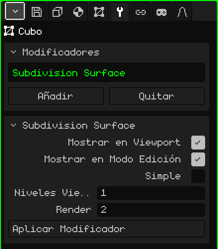

# Superficie de Subdivisión

El modificador **Superficie de Subdivisión** parte cada cara en caras más chicas y, por defecto, redondea la forma. Sirve para modelar con pocos polígonos, que es rápido de editar y liviano, y ver el resultado suave: de un cubo sale algo parecido a una esfera, y de un personaje low-poly, uno de formas redondeadas.

## Cómo se agrega

1. Elegí la malla.
2. En Propiedades, abrí la pestaña **Modificadores** (el ícono de la llave).
3. Tocá **Añadir** y elegí **Superficie de Subdivisión**.

En la lista aparece con su nombre interno, **Subdivision Surface**, y debajo se abre la tarjeta con sus parámetros. Como todos los modificadores, no destruye la malla: se puede apagar, cambiar de lugar con **Subir** y **Bajar**, sacar con **Quitar** u hornear con **Aplicar Modificador**.

## Parámetros

| Parámetro | Qué hace |
|---|---|
| Mostrar en Viewport | Apagado, no se subdivide: ni en la vista ni al renderizar. |
| Mostrar en Modo Edición | Apagado, mientras editás se ve la malla sin subdividir y la edición va más rápida; al volver al Modo Objeto se ve suave otra vez. |
| Simple | Apagado (por defecto), cada nivel suaviza la forma y redondea las esquinas. Prendido, solo parte las caras sin mover los vértices: la forma queda igual pero con más vértices, por ejemplo para pintar colores de vértice con más detalle. |
| Niveles Viewport | Cuántas veces se subdivide en la vista, de 0 a 6 (por defecto 1). Cada nivel multiplica las caras por 4: un cubo de 6 caras pasa a 24 con 1 nivel, a 96 con 2 y a 384 con 3. En 0 no se subdivide. |
| Render | Los niveles que se usan al **Renderizar Imagen** o **Renderizar Animación** (por defecto 2). Así la vista queda liviana y la imagen final sale más suave. |
| Aplicar Modificador | Hornea la subdivisión en la malla con los **Niveles Viewport** (no con los de Render). Ver la nota de abajo. |

## Cómo trabajar con la subdivisión

- Funciona mejor con caras de cuatro lados. Un triángulo se parte en 3 cuadriláteros y una cara de cinco lados, en 5.
- Subdividir no cambia el sombreado: una malla plana se sigue viendo facetada. Para verla lisa, en el Modo Edición elegí las caras y usá el menú Cara → **Sombrear Suave**.
- Para que un borde quede más marcado, agregá un corte cerca con **Loop Cut y Deslizar** (ver [Modo Edición](modo-edicion.md)): cuanto más cerca del borde, más duro queda.
- Los bordes abiertos, en una malla que no está cerrada, se suavizan siguiendo el borde.

## El orden importa

Los modificadores se aplican de arriba abajo. Poné el [Espejo](modificador-espejo.md) **arriba** de la Subdivisión: así se suaviza el modelo entero de una vez. Si el Espejo va abajo, cada mitad se suaviza por separado y en el medio queda un pliegue. Con un [Array](modificador-array.md) pasa lo mismo: las copias soldadas con Fusionar se suavizan juntas.

 En el Nokia N95 cada nivel pesa: con 1 nivel ya hay cuatro veces más caras para dibujar, y con 2, dieciséis veces más. Dejá los Niveles Viewport en 0 o 1, apagá Mostrar en Modo Edición mientras modelás, y guardá los niveles altos para Render.

> [!NOTE]
> Aplicar Modificador en la Subdivisión hornea **todos** los modificadores de la lista que estén prendidos, no solo este, y deja la lista vacía: también se van los que estaban apagados y los que no generan geometría, como un [Esqueleto](modificador-esqueleto.md). Se puede deshacer.

Volver a [Malla 3D](objeto-malla.md)
