# Navegación en la Vista 3D

> [!NOTE]
>  El Nokia N95 soporta mouse y teclado (por Bluetooth). Las partes de esta página sobre el Nokia explican cómo se usa sin mouse ni teclado, solo con las teclas del teléfono.

Esta página explica cómo navegar en la Vista 3D. Navegar es mover tu punto de vista: girar alrededor de la escena, correrte para un costado y acercarte o alejarte.

Saber navegar es importante: para hacer modelos 3D y animaciones de forma cómoda y rápida, tenés que saber moverte por la escena y colocarte en una posición cómoda para trabajar.

Para usar los comandos que siguen, la Vista 3D tiene que ser el [viewport activo](interfaz.md#el-viewport-activo), el del borde verde.

Las tres cosas que más vas a usar son **orbitar**, **desplazar** y hacer **zoom**. Cada una se puede hacer con el mouse, con los dedos en una pantalla táctil o con el teclado del Nokia N95. En los videos de la PC, el mouse de abajo a la derecha muestra en verde el botón que se está apretando.

## Orbitar

Orbitar es girar la vista alrededor de la escena, como si caminaras alrededor de una mesa para ver lo que hay arriba desde todos los lados.

 **Con el mouse:** mantené apretado el **botón del medio** (se aprieta hundiendo la rueda) y arrastrá. En un trackpad, o en un mouse sin botón del medio, mantené <kbd>Alt</kbd> y arrastrá con el **click primario** (el izquierdo).

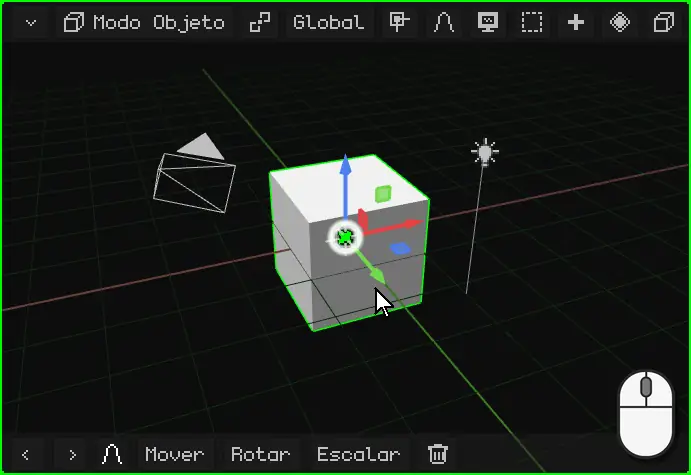

 **Con el dedo:** arrastrá un dedo sobre la Vista 3D. Empezá sobre el fondo: si lo apoyás sobre el gizmo (las flechas de colores del objeto), lo vas a mover.

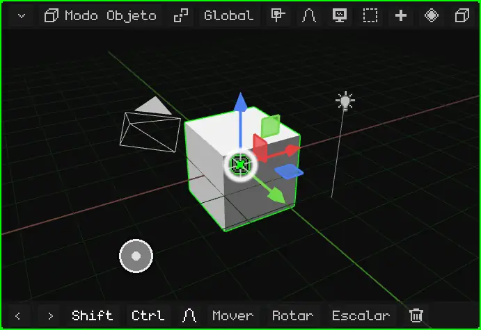

 **En el Nokia N95:** mantené apretada una **flecha** del pad. La vista gira para ese lado mientras la tengas apretada.

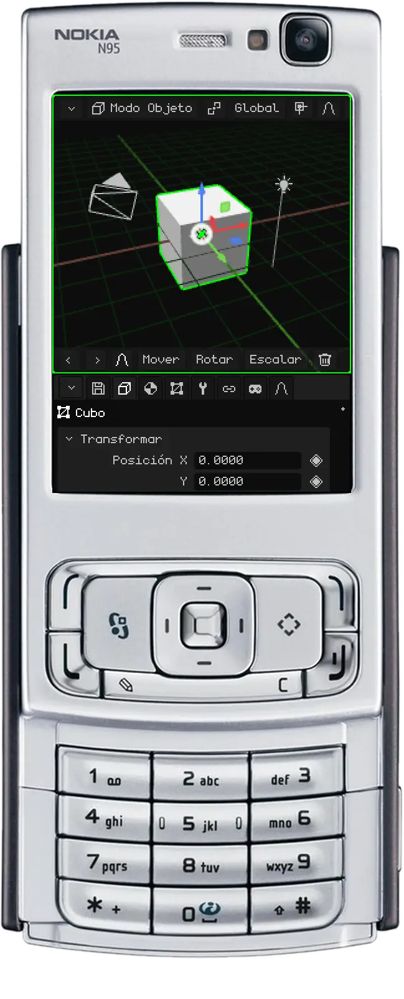

## Desplazar

Desplazar (o *panear*) corre la vista para un costado, para arriba o para abajo, sin girarla.

 **Con el mouse:** mantené <kbd>Shift</kbd> y arrastrá con el **botón del medio**. En un trackpad: <kbd>Alt</kbd> + <kbd>Shift</kbd> y arrastrá con el click primario.

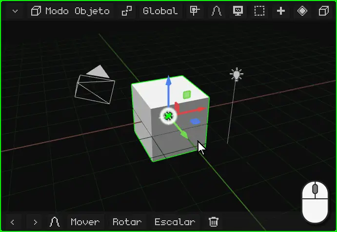

 **Con los dedos:** apoyá **dos dedos** y movelos juntos para el mismo lado.

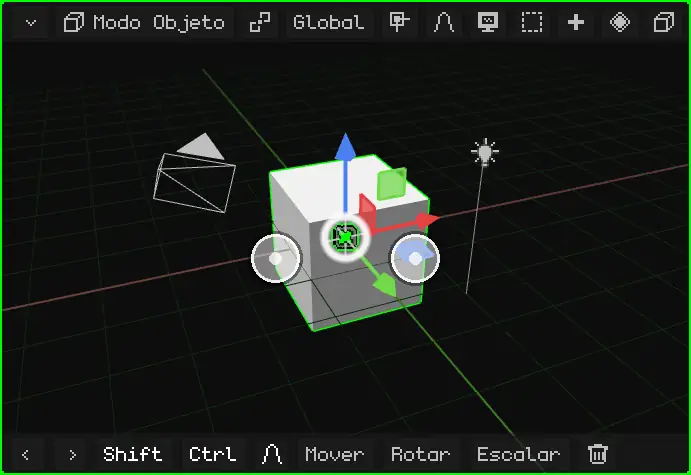

 **En el Nokia N95:** mantené apretada la tecla <kbd>\*</kbd> y usá las flechas.

## Zoom

El zoom te acerca o te aleja. El paso se adapta a la distancia: cerca de algo chico avanza despacio y de lejos avanza rápido, así que sirve igual para mirar toda la escena o un vértice.

 **Con el mouse:** girá la **rueda**. Para adelante acerca y para atrás aleja. En un trackpad, deslizá dos dedos para arriba o para abajo.

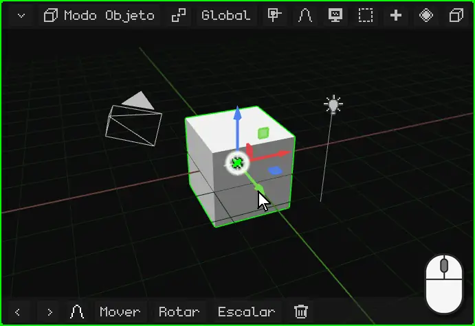

 **Con los dedos:** pellizcá. Separar los dedos acerca y juntarlos aleja.

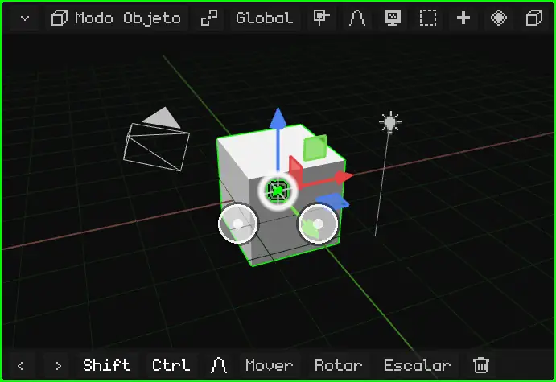

 **En el Nokia N95:** mantené apretado el <kbd>0</kbd> y usá la flecha **arriba** para acercar o la flecha **abajo** para alejar.

## Encuadrar lo seleccionado

Si te perdiste, o querés trabajar sobre algo en particular, **encuadralo**: la vista se centra en lo que está seleccionado y ajusta el zoom para que entre justo. Desde ahí, orbitar gira alrededor de eso.

| | Cómo se encuadra |
|---|---|
|  PC | <kbd>Num .</kbd> (el punto del teclado numérico) |
|  Nokia N95 | Un toque del <kbd>0</kbd>, sin flechas (mantenido con una flecha es zoom) |
|  Pantalla táctil | Doble toque con dos dedos |
| Menú | Vista → Encuadrar Selección |

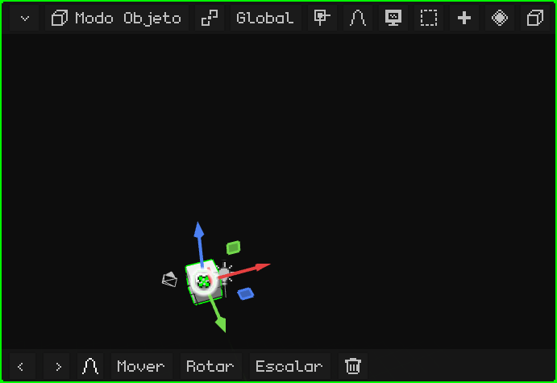

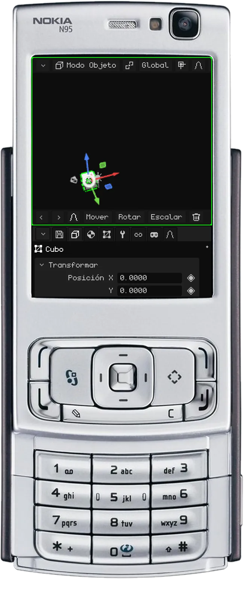

### En el Modo Edición

En el [Modo Edición](modo-edicion.md) se encuadra la parte seleccionada de la malla: los vértices, aristas o caras que elegiste, no el objeto entero. Sirve para trabajar sobre un detalle de un modelo grande: lo seleccionás, lo encuadrás y orbitás alrededor de él.

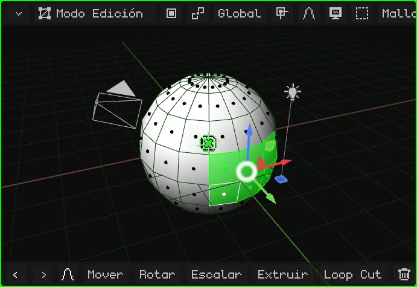

## La vista local

Cuando hay muchas cosas en la escena, trabajar sobre una es incómodo: las de adelante tapan, y al orbitar se meten en el medio. La **vista local** deja a la vista solo lo que está seleccionado (uno o varios objetos) y lo encuadra. El resto no se borra ni se oculta en la escena: solo deja de verse en este viewport. Arriba a la izquierda aparece el cartel "Vista local".

Para volver, se repite lo mismo: todo vuelve a aparecer y la vista queda como la tenías antes.

| | Cómo se entra y se sale |
|---|---|
|  PC | <kbd>/</kbd> |
|   Nokia N95 y pantalla táctil | Menú Vista → Vista local |

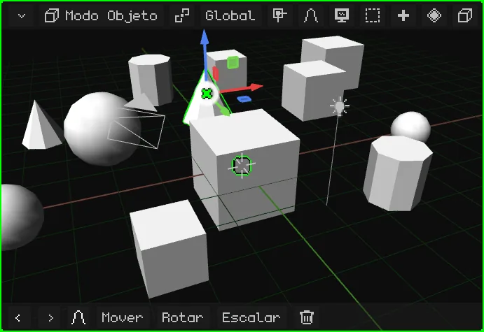

## Las vistas de frente, de costado y de arriba

Para mirar la escena derecho desde un lado, sin acomodar la órbita a mano:

| Vista |  PC | Menú |
|---|---|---|
| Frontal / Posterior | <kbd>Num 1</kbd> / <kbd>Ctrl</kbd> + <kbd>Num 1</kbd> | Vista → Punto de Vista → Frontal / Posterior |
| Derecha / Izquierda | <kbd>Num 3</kbd> / <kbd>Ctrl</kbd> + <kbd>Num 3</kbd> | Vista → Punto de Vista → Derecha / Izquierda |
| Superior / Inferior | <kbd>Num 7</kbd> / <kbd>Ctrl</kbd> + <kbd>Num 7</kbd> | Vista → Punto de Vista → Superior / Inferior |

 Con <kbd>Ctrl</kbd>, cada tecla da la vista opuesta.

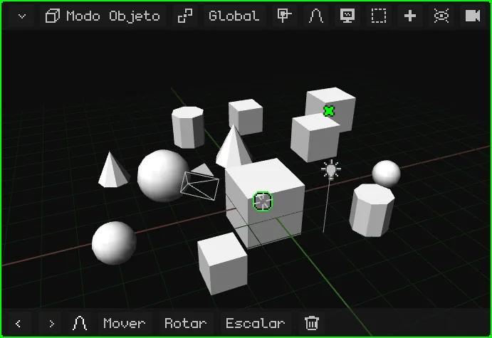

 **En el Nokia N95:** mantené apretada la tecla <kbd>#</kbd> y apretá una flecha. Izquierda y derecha giran la vista de a 90° alrededor de la escena. Arriba pasa a la vista de arriba; abajo vuelve a la de costado, y otra vez abajo va a la de abajo. Si estabas orbitando libre, la primera flecha solo endereza la vista a la más cercana.

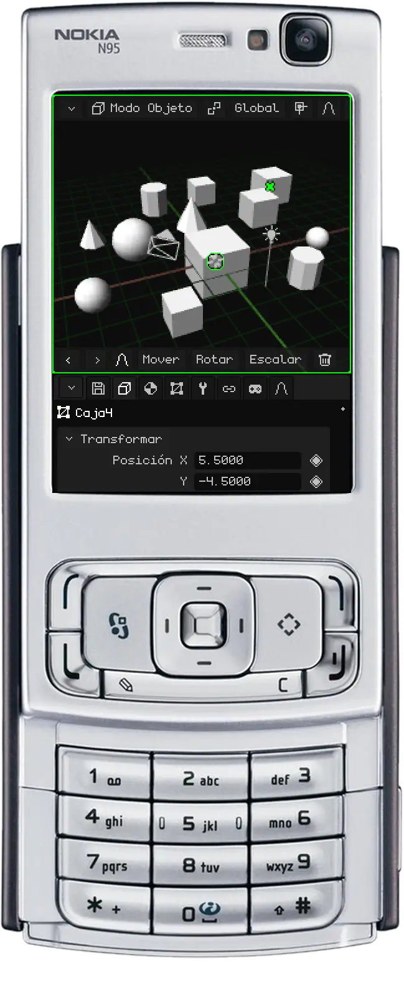

## Perspectiva y ortográfica

La Vista 3D tiene dos maneras de mostrar la escena:

- **Perspectiva:** como la ve el ojo o una cámara. Lo que está lejos se ve más chico, y las líneas paralelas (los bordes de una calle, las filas de cajas del video) se juntan en un punto del horizonte: el **punto de fuga**. Así se ve de verdad, con profundidad.
- **Ortográfica:** sin perspectiva. Todo mantiene su tamaño, esté cerca o lejos, y las líneas paralelas nunca se tocan. Es como un plano de arquitectura o un dibujo técnico.

La ortográfica sirve para modelar con precisión: alinear cosas, comparar tamaños y medir sin que la distancia engañe. Combinada con las vistas de frente, de costado y de arriba, es como trabajar sobre un plano. La perspectiva sirve para ver cómo va a quedar.

| | Cómo se cambia |
|---|---|
|  PC | <kbd>Num 5</kbd> |
|  Nokia N95 | Un toque del <kbd>#</kbd>, sin flechas |
| Menú | Vista → Perspectiva/Orto |

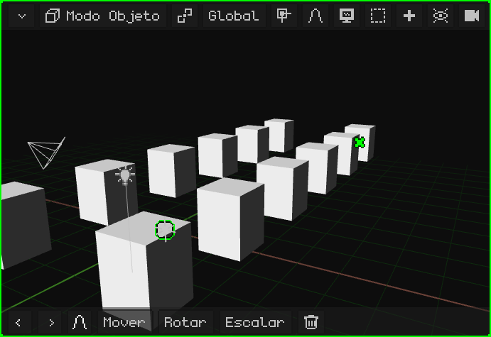

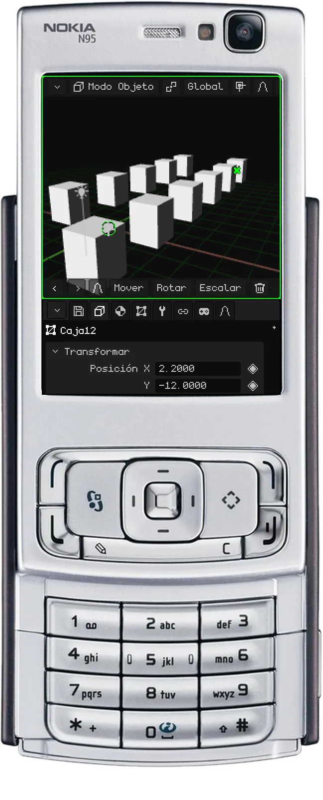

## Bloquear la órbita

Con la **órbita bloqueada**, la vista deja de girar: lo que antes orbitaba ahora la desplaza, como si movieras una hoja sobre una mesa. Es ideal para trabajar cómodo en modelos que se dibujan como un plano 2D, como el plano de una casa o una pieza mecánica: mirando de arriba y en ortográfica, te movés por todo el plano sin que se tuerza nunca.

| | Cómo se bloquea y se desbloquea |
|---|---|
|  PC | Menú Vista → Bloquear Órbita |
|  Pantalla táctil | Menú Vista → Bloquear Órbita |
|  Nokia N95 | <kbd>9</kbd> |

Al bloquearla o desbloquearla aparece un aviso, y mientras está bloqueada, Bloquear Órbita se ve en verde en el menú.

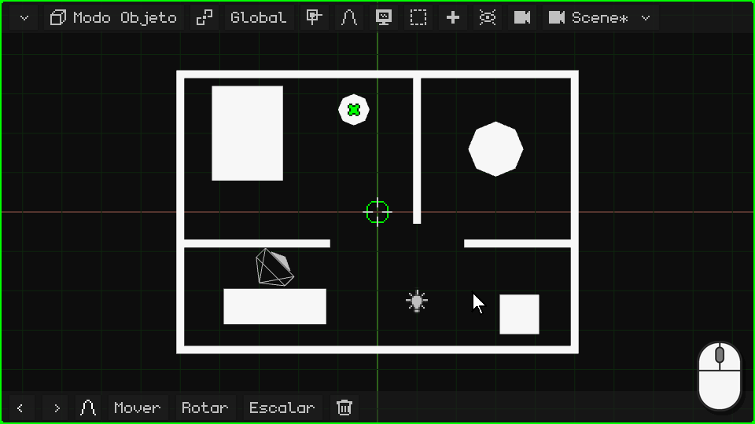

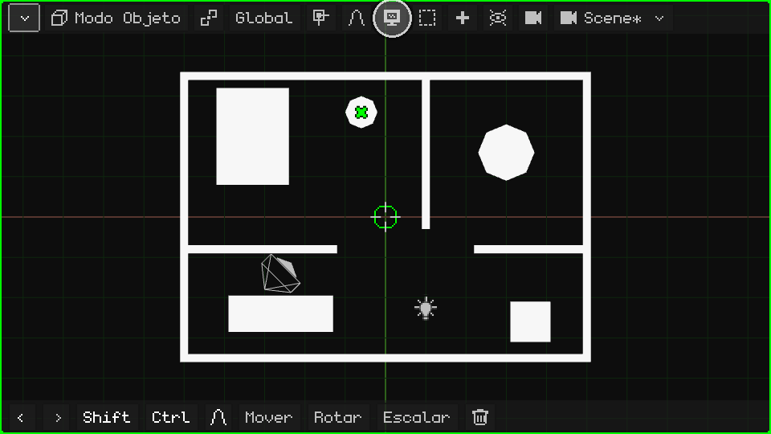

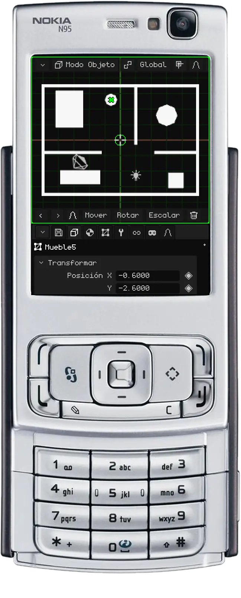

## La cámara activa

La escena puede tener varias cámaras, pero una sola es la **cámara activa**: la que sirve para el juego y para los renders. Lo que ve esa cámara es lo que se ve al jugar y lo que sale cuando hacés el render de una imagen o de un video. La vista con la que navegás es solo para trabajar: no aparece ni en el juego ni en los renders.

Para mirar por la cámara activa:

| | Cómo se entra y se sale |
|---|---|
|  PC | <kbd>Num 0</kbd> |
|  Nokia N95 | <kbd>8</kbd> (fuera del Modo Edición: ahí el 8 es Loop Cut) |
| Menú | Vista → Cámaras → Cámara Activa |

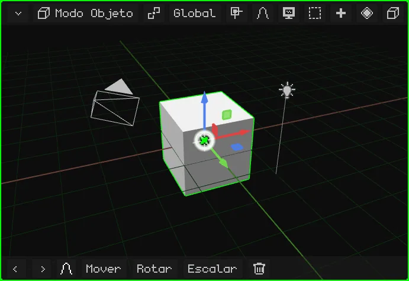

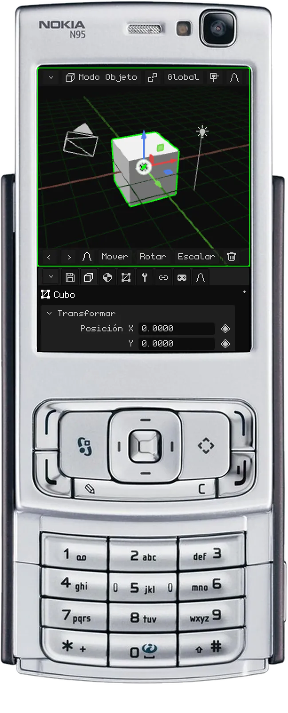

El rectángulo es el encuadre: lo que queda adentro es lo que sale. Abajo al centro hay un **candado**:

- **Abierto** (como arranca): el zoom y el desplazamiento solo te acercan para revisar el encuadre, sin tocar la cámara. Orbitar te saca de la vista de cámara y seguís navegando desde donde estaba.
- **Cerrado:** orbitar, desplazar y hacer zoom mueven la **cámara**. Así se acomoda la toma.

### Bloquear la cámara a la vista

Con el candado cerrado, la cámara activa queda bloqueada a la vista: orbitás, desplazás y hacés zoom como en la navegación normal, y la cámara se mueve con vos. Es la forma más cómoda de colocar una cámara exactamente donde querés: mirás por ella, la bloqueás y navegás hasta que la toma quede como la buscás.

| | Cómo se bloquea y se desbloquea |
|---|---|
|  PC | Un click en el candado |
|  Pantalla táctil | Un toque en el candado |
|  Nokia N95 | La soft izquierda abre la barra de menús (ver [Cuando no se ven todas las opciones de la barra de menús](interfaz.md#cuando-no-se-ven-todas-las-opciones-de-la-barra-de-menús)); ahí, Vista → Mover la cámara con la vista |
| Menú | Vista → Mover la cámara con la vista |

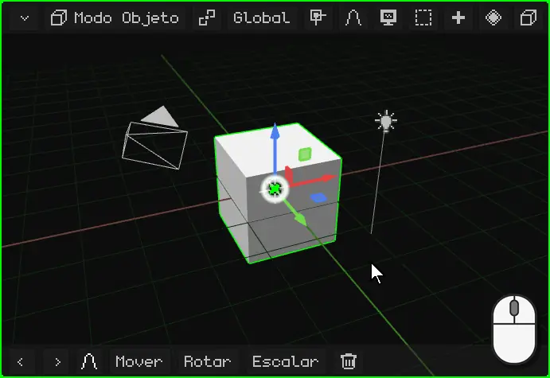

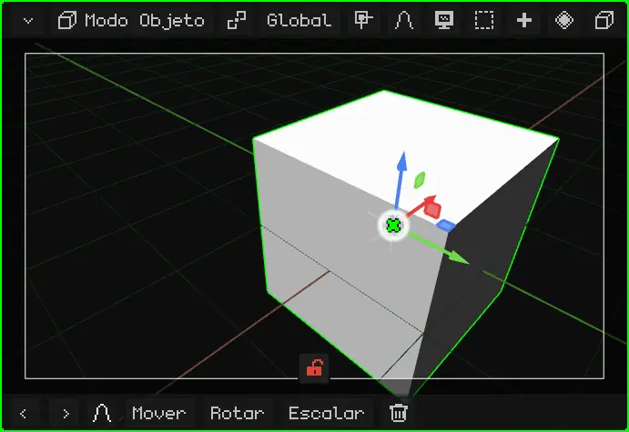

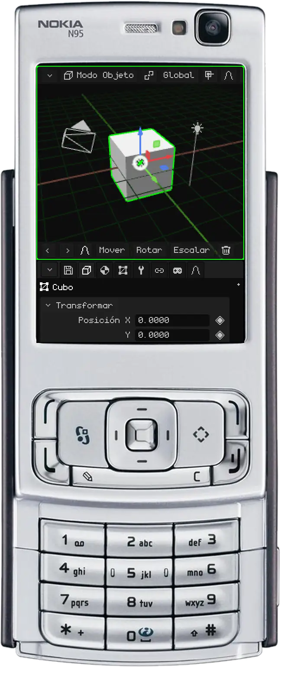

Para que otra cámara pase a ser la activa: seleccionala y apretá <kbd>Ctrl</kbd> + <kbd>Num 0</kbd> (o Vista → Cámaras → Objeto Activo como Cámara).

## Más opciones de la vista

| Opción | Qué hace |  PC |  Nokia N95 | Menú |
|---|---|---|---|---|
| Girar la vista | La gira 15° sobre su propio eje, como inclinar la cabeza. | <kbd>Num 4</kbd> / <kbd>Num 6</kbd> | — | — |

Todos los atajos del editor están en [Atajos de teclado](atajos.md).

## Todos los controles, de un vistazo

### Con mouse (PC)

| Función | Descripción | Cómo se usa |
|---|---|---|
| Orbitar | Gira la vista alrededor del punto de pivote. | Botón del medio + arrastrar, o <kbd>Alt</kbd> + botón izquierdo + arrastrar. |
| Desplazar (paneo) | Mueve la vista de costado. | <kbd>Shift</kbd> + botón del medio, o <kbd>Alt+Shift</kbd> + botón izquierdo + arrastrar. |
| Zoom | Acerca o aleja. | Rueda del mouse. |
| Seleccionar | Elige lo que está bajo el puntero (se decide al soltar). | Click izquierdo; <kbd>Shift</kbd>+click suma o quita. |
| Selección por caja | Arrastrar sobre el fondo marca un rectángulo. | Arrastrar con el botón izquierdo, o <kbd>B</kbd>. |
| Menú contextual | Abre el menú del modo en el puntero (durante un transform, lo cancela). | Click derecho. |
| Bloquear órbita | Lo que orbitaba pasa a desplazar: la vista queda como un tablero 2D. | Menú Vista → Bloquear Órbita. |
| Mover la cámara con la vista | Mirando por la cámara activa, navegar mueve la cámara: así se acomoda la toma. | Click en el candado (abajo, en la vista de cámara), o Menú Vista → Mover la cámara con la vista. |

### Con teclado

| Función | Descripción | Atajo |
|---|---|---|
| Vista frontal / trasera | Mira de frente o de atrás. | <kbd>Num1</kbd> / <kbd>Ctrl+Num1</kbd> |
| Vista derecha / izquierda | Mira de costado. | <kbd>Num3</kbd> / <kbd>Ctrl+Num3</kbd> |
| Vista superior / inferior | Mira desde arriba o desde abajo. | <kbd>Num7</kbd> / <kbd>Ctrl+Num7</kbd> |
| Perspectiva / Ortográfica | Alterna entre las dos proyecciones. | <kbd>Num5</kbd> |
| Girar la vista | Rota la vista 15° sobre su eje. | <kbd>Num4</kbd> / <kbd>Num6</kbd> |
| Vista de cámara | Mira a través de la cámara activa (otra vez: sale). | <kbd>Num0</kbd> |
| Hacer cámara activa | El objeto activo pasa a ser la cámara activa. | <kbd>Ctrl+Num0</kbd> |
| Encuadrar selección | Centra la vista en lo seleccionado y ajusta el zoom. | <kbd>Num.</kbd> (punto del teclado numérico) |
| Vista local | Muestra solo lo seleccionado y lo encuadra; otra vez restaura todo. | <kbd>/</kbd> |
| Importar modelo | Abre el explorador para importar OBJ, FBX, glTF o GLB (solo PC). | <kbd>Num9</kbd> |

### Con los dedos (Android, Web táctil)

| Función | Descripción | Gesto |
|---|---|---|
| Orbitar | Gira la vista. | Arrastrar un dedo. |
| Zoom y desplazar | Pellizcar acerca o aleja; mover los dos dedos juntos desplaza. | Dos dedos. |
| Seleccionar | Elige lo que está bajo el dedo. | Tocar y levantar sin moverse. |
| Encuadrar selección | Igual que <kbd>Num.</kbd>. | Doble toque con dos dedos. |
| Modificadores táctiles | Botones Shift y Ctrl de la barra de herramientas: quedan prendidos (verde) para sumar a la selección o elegir caminos. | Tocar Shift / Ctrl. |
| Vista (navegar) | En Modo Edición y en los modos de pintura, el dedo navega en vez de seleccionar o pintar. | Botón con forma de monitor de la barra de herramientas. |

### Con el teclado del Nokia N95

| Función | Tecla |
|---|---|
| Orbitar | Flechas (mantener) |
| Zoom / Encuadrar selección | <kbd>0</kbd> + arriba/abajo / <kbd>0</kbd> solo |
| Desplazar | <kbd>\*</kbd> + flechas |
| Vistas (frontal, costado, arriba) / Perspectiva-Ortográfica | <kbd>#</kbd> + flechas / <kbd>#</kbd> solo |
| Mover / Rotar / Escalar (durante el transform: eje X / Y / Z) | <kbd>1</kbd> / <kbd>2</kbd> / <kbd>3</kbd> |
| Confirmar / Cancelar | OK (centro) / <kbd>C</kbd> |
| Borrar (sin nada que cancelar) / Deshacer y Rehacer | <kbd>C</kbd> / <kbd>C</kbd> + izquierda o derecha |
| Cambiar el sombreado | <kbd>6</kbd> |
| Extruir (Modo Edición) | <kbd>7</kbd> |
| Loop Cut (Modo Edición) / vista de cámara (fuera de edición) | <kbd>8</kbd> |
| Bloquear órbita | <kbd>9</kbd> |
| Mover la cámara con la vista (mirando por la cámara) | Tecla de selección izquierda → menú Vista |
| Ciclar la selección / sumar, quitar, todo o nada | Lápiz / Lápiz + flechas |
| Barra de menús / cursor virtual | Tecla de selección izquierda / derecha |
| Cambiar de viewport, redimensionar, maximizar | Tecla verde (sola, + flechas, + OK) |
| Modo juego a pantalla completa | Tecla verde + <kbd>0</kbd> (otra vez: la imagen cubre toda la pantalla; otra vez: vuelve). Sin la UI, sin el borde de la cámara ni el área oscura de alrededor (solo si la cámara declara un aspecto distinto al de la pantalla quedan bandas negras, hasta la segunda vez), y las flechas no panean: se ve el juego tal cual |

El N95 también acepta mouse y teclado Bluetooth. Para escribir texto se usa T9.
