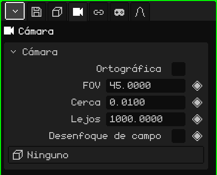

# Cámara

Una **cámara** es un punto de vista puesto en la escena. La **cámara activa** es la que sirve para el juego y para los renders: lo que ella ve es lo que se ve al jugar y lo que sale en la imagen o el video. Este artículo es la referencia de sus propiedades; cómo se agregan y se mueven los objetos está en el tutorial [El Modo Objeto](../tutoriales/modo-objeto.md).

## Las pestañas

| Pestaña | Qué tiene |
|---|---|
| Objeto | Posición, rotación, nombre y visibilidad, igual que en todos los objetos: ver [Malla 3D](objeto-malla.md#la-pestaña-objeto). |
| Cámara | El lente de la cámara: la tarjeta de abajo. |
| Restricciones | Ver [Restricciones](restricciones.md). |
| Scripts | Los scripts Lua del objeto. Ver [Lua en Whisk3D](../lua/README.md). |

## La tarjeta Cámara

| Propiedad | Qué hace |
|---|---|
| Ortográfica | Sin perspectiva: lo lejano no se achica y las líneas paralelas no se juntan. Ver [Perspectiva y ortográfica](../tutoriales/navegacion.md#perspectiva-y-ortográfica). |
| FOV ◆ | El ángulo de visión, en grados (de arriba abajo). Más chico es como un teleobjetivo: entra menos y se ve más de cerca. Más grande es un gran angular: entra más y la perspectiva se exagera. Arranca en 45. |
| Cerca ◆ | La distancia mínima de dibujado: lo que está más cerca de la cámara no se dibuja. Arranca en 0.01. |
| Lejos ◆ | La distancia máxima de dibujado: lo que está más lejos no se dibuja. Arranca en 1000. |
| Desenfoque de campo | Prende el desenfoque: lo que está a la distancia de foco sale nítido y el resto, borroso. Lo dibuja el trazado de rayos; el Postprocesado también puede usar el mismo foco. |
| Apertura (f) | Cuánto desenfoca, como en una cámara de verdad: un número más chico desenfoca más. |
| Distancia de foco ◆ | A cuántos metros enfoca. La línea y la cruz que se dibujan en la cámara marcan dónde. |
| Objeto de foco | Un objeto que el foco sigue solo, esté donde esté. Con un objeto elegido, Distancia de foco desaparece. **Ninguno** vuelve a la distancia a mano. |
| Objetivo | Un objeto al que la cámara activa mira siempre: si el objeto se mueve, la cámara gira para seguirlo. **Ninguno** la deja mirar para donde la rotaste. |

Apertura (f), Distancia de foco y Objeto de foco aparecen con Desenfoque de campo tildado.

### Cuándo tocar Cerca y Lejos

Si una pared o un personaje muy pegado a la cámara se ve cortado, bajá **Cerca**. Si el fondo de un escenario grande desaparece, subí **Lejos**. Conviene no estirar el rango más de lo necesario: con mucha distancia entre Cerca y Lejos, las caras que están muy juntas pueden parpadear, sobre todo en el Nokia N95.

Cerca y Lejos se pueden animar: sirve, por ejemplo, para alejar el límite de dibujado cuando la cámara sube y muestra más escenario.

### Una cámara que sigue a un personaje

Hay dos maneras, según la toma:

- **La cámara se queda en su lugar y gira:** poné el personaje en **Objetivo**. La cámara activa lo mantiene en el centro de la toma aunque corra, como alguien que lo mira pasar.
- **La cámara viaja con él:** dejá Objetivo en Ninguno y agregale una restricción **Child Of** con el personaje de fuente y solo **Posición** tildada. Va con él a la misma distancia y con el mismo ángulo, sin girar cuando él gira (ver [Child Of](restricciones.md#child-of)).

## Elegir la cámara activa

La escena puede tener varias cámaras, pero una sola activa. Para cambiarla:

| | Cómo se elige |
|---|---|
|  PC | Seleccionar la cámara y <kbd>Ctrl</kbd> + <kbd>Num 0</kbd> |
| Menú | Vista → Cámaras → Objeto Activo como Cámara |
| Propiedades | Pestaña Animación → tarjeta **Cámara activa** |

En la tarjeta Cámara activa, el rombo arma **cortes de cámara**: pasar de una cámara a otra en un frame. Ver [Línea de tiempo](linea-de-tiempo.md).

Para mirar por la cámara activa y acomodar la toma navegando, ver [La cámara activa](../tutoriales/navegacion.md#la-cámara-activa) en el tutorial de navegación.
