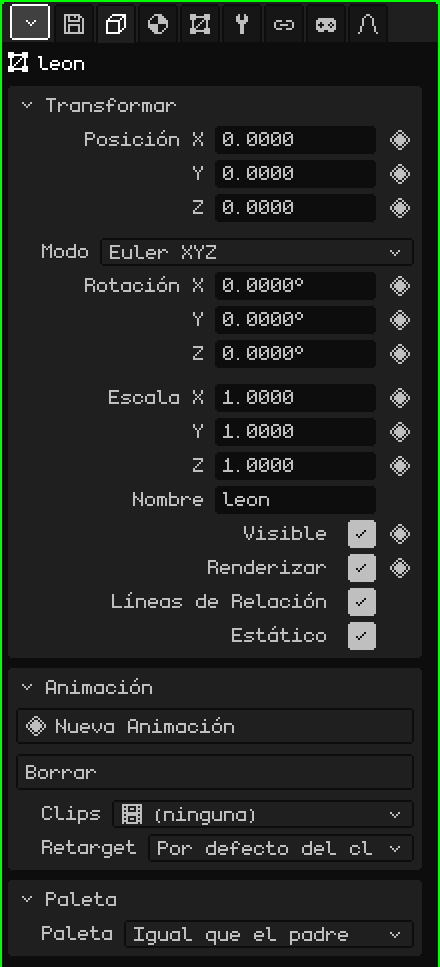
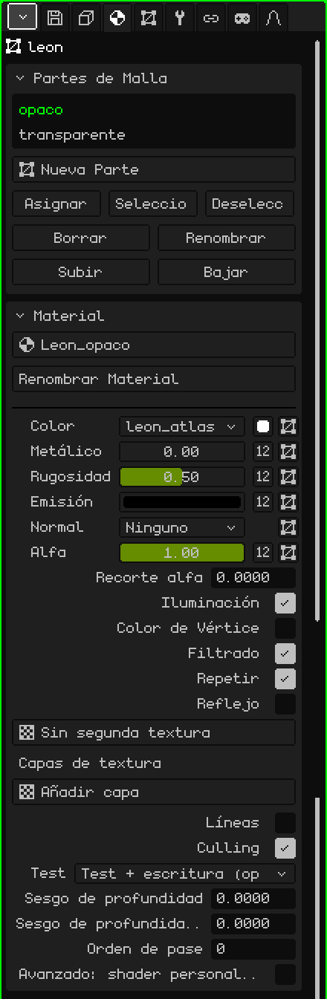
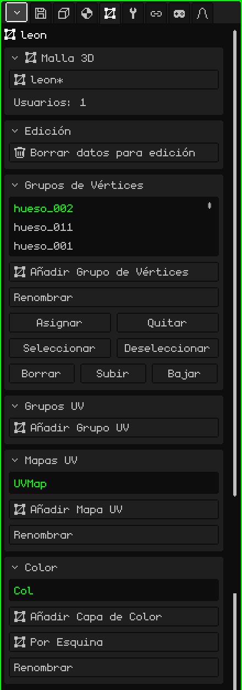
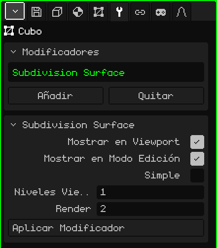

# Malla 3D

Una **malla 3D** es el objeto que tiene forma: está hecha de vértices, aristas y caras, y es lo que se modela, se pinta y se anima. Un cubo, un personaje o un escenario entero son mallas. Este artículo es la referencia de sus propiedades; cómo se crean, se mueven y se emparentan los objetos está en el tutorial [El Modo Objeto](../tutoriales/modo-objeto.md).

## Las pestañas

Con una malla seleccionada, Propiedades muestra estas pestañas, además de Archivo / Render y Animación, que están siempre:

| Pestaña | Qué tiene |
|---|---|
| Objeto | Lo común a todos los objetos: posición, rotación, escala, nombre y visibilidad. |
| Material | Las partes de la malla y el material de cada una. |
| Malla 3D | Los datos de la malla: cuál usa, sus grupos de vértices, sus mapas UV y sus capas de color. |
| Modificadores | Los modificadores, que cambian la forma sin destruirla. |
| Transformar | Solo en Modo Edición: el centro de lo seleccionado, para escribirlo con números. |
| Restricciones | Ver [Restricciones](restricciones.md). |
| Scripts | Los scripts Lua del objeto. Ver [Lua en Whisk3D](../lua/README.md). |

## La pestaña Objeto

Es igual para todos los tipos de objeto: cámaras, luces, esqueletos y sonidos también la tienen.

### Transformar

| Propiedad | Qué hace |
|---|---|
| Posición X, Y, Z ◆ | Dónde está el objeto, en metros. Z es la altura. |
| Modo | Cómo se escribe la rotación: **Euler XYZ** (tres ángulos en grados, el más fácil de leer), **Cuaternión (WXYZ)** o **Ángulo de Eje**. Con los dos últimos aparece **Rotación W**. Cambiar el modo no gira el objeto: solo cambia cómo se muestran los números. |
| Rotación X, Y, Z ◆ | El giro sobre cada eje. |
| Escala X, Y, Z ◆ | El tamaño en cada eje: 1 es el tamaño original, 2 el doble y 0.5 la mitad. |
| Nombre | El nombre del objeto, el mismo que muestra el Outliner. No se puede repetir: si ya existe, se le agrega un número (`.001`). |
| Visible ◆ | Si el objeto se ve. Es el mismo ojo del Outliner. |
| Renderizar ◆ | Si sale en los renders. Destildado, se sigue viendo en la Vista 3D pero no aparece en la imagen ni en el video. |
| Líneas de Relación | La línea que une al objeto con su padre. Sirve apagarla cuando un objeto tiene muchos hijos y las líneas tapan la vista. |
| Estático | Marca que el objeto no se mueve nunca. Adentro de un objeto Culling con el método de grilla, un objeto estático se ubica en su celda una sola vez, en vez de medirlo en cada cuadro. También lo usan la [luz precalculada](#precalcular-iluminación), la [Sonda de luz](objeto-sonda-luz.md) y las [sombras en tiempo real](sombras-tiempo-real.md). |
| Proyectar sombras | Solo en las mallas: la malla tapa la luz del sol en las [sombras en tiempo real](sombras-tiempo-real.md). Viene tildada. |
| Recibir sombras | Solo en las mallas: la malla se oscurece donde algo le tapa el sol. Viene tildada. |
| Rebote de luz | Solo en las mallas, para la [luz precalculada](#precalcular-iluminación) y el render con rayos: la luz que le llega rebota y alumbra lo de alrededor. Destildada, los rayos de luz indirecta le pasan de largo como si no estuviera. Es aparte de **Proyectar sombras**: una malla puede no hacer sombra y que igual le rebote la luz. Viene tildada. |
| Captador de sombras | Solo en las mallas: la malla **solo recibe** sombras. No tapa la luz ni la rebota, y al precalcular su iluminación la textura sale **blanca**, con solo las sombras y la oclusión ambiental que le caen encima (un piso para apoyar un modelo). |

### Animación y Paleta

- **Animación:** las animaciones propias del objeto, como una animación de vértices, y sus clips. Ver [Línea de tiempo](linea-de-tiempo.md).
- **Paleta:** qué paleta de colores usa el objeto. Con **Igual que el padre** (como viene) la hereda; elegir una paleta del proyecto lo repinta a él y a todo lo que cuelga de él.

## La pestaña Material

### Partes de Malla

Una malla puede estar dividida en **partes**, y cada parte tiene su material. Una casa, por ejemplo, puede tener las paredes en una parte y el vidrio de las ventanas en otra.

| Propiedad | Qué hace |
|---|---|
| La lista | Las partes de la malla. La elegida es la que muestra la tarjeta Material de abajo. |
| Nueva Parte | Crea una parte vacía. |
| Asignar | Pasa a la parte elegida las caras seleccionadas en Modo Edición. |
| Seleccionar / Deseleccionar | Selecciona o deselecciona las caras de esa parte. Si hace falta, Seleccionar pasa a Modo Edición para mostrarlas. |
| Borrar / Renombrar | Borra la parte (sus caras pasan a la anterior) o le cambia el nombre. Borrar aparece si hay más de una. |
| Subir / Bajar | Cambian el orden. Las partes se dibujan en ese orden: conviene dejar lo transparente al final. |

### Material

El material decide cómo se ve la parte: su color, su textura y cómo le pega la luz. El material por defecto no se edita: para cambiar algo, primero se crea uno con el selector de arriba (**Nuevo Material**), que también sirve para elegir otro material del proyecto. Las opciones más usadas:

| Propiedad | Qué hace |
|---|---|
| Renombrar Material | Le cambia el nombre al material. |
| Color | La textura de la parte, el cuadradito del **Color Base** y el mapa UV que usa la textura. |
| Metálico, Rugosidad, Emisión, Normal, Alfa | Cada uno puede ser un número o una textura (el botón **Número / textura**). Con la luz **Por píxel** el metálico y la rugosidad se ven en la Vista 3D como en el trazado de rayos: lo metálico pierde el color difuso y su brillo toma el color del material, y lo rugoso abre el brillo (sin el trazado, un metal no refleja la escena: se ve oscuro con su brillo). Alfa es la transparencia: con menos de 1, o con una textura de alfa, el material pasa a ser transparente. El número se arrastra de costado (con el mouse o con el dedo) y un toque lo deja escribir. Mantener apretado (o el click derecho) da **Restablecer**, **Copiar** y **Pegar**, también para el color de la Emisión y el color base. |
| Recorte alfa | Corta lo que tiene alfa bajo, sin mezclar: para rejas, alambrados u hojas. 0 lo apaga. |
| Transmisión, IOR | Vidrio. La **Transmisión** (0 a 1) es cuánto del material es vidrio; el **IOR** (aparece con transmisión) es cuánto dobla la luz: 1 no la dobla, 1.33 es agua, 1.5 vidrio. Al subir la transmisión con el IOR en 1, pasa solo a 1.5. Con el **Trazado de rayos** el vidrio refracta lo de atrás; en la Vista 3D con luz **Por píxel** (OpenGL ES 2.0, Vulkan, la web), en la **Vista Material** y en la **Vista Render**, también se ve lo de atrás corrido por el IOR y borroso según la **Rugosidad**, y refleja más de costado. En una placa chica (la de los Android 2.3) lo que no entra se va sacando solo: primero el reflejo del fondo 360, después el vidrio; la malla se sigue viendo. Sin shaders (OpenGL, el N95) baja la opacidad. |
| Reflejos en pantalla | Con luz **Por píxel**: lo que ya está dibujado se refleja en el material (un piso mojado, un metal pulido), más con poca rugosidad, con el metálico y mirando de costado. En la PC usa también la profundidad de la pantalla: sigue el rayo reflejado hasta lo que toca, así que funciona como un espejo (lo que está arriba de un piso sale dado vuelta, a su distancia). En Android y en la web es una aproximación, porque no puede leer la profundidad. Lo que no está en la pantalla, o queda hacia la cámara, se toma del fondo 360. |
| Iluminación | Si las luces de la escena le pegan. Apagada, el color se ve plano, siempre igual. Si el backend gráfico tiene shaders, aparece **Sombreado**: Por vértice o Por píxel. Con shaders (OpenGL ES 2.0, Vulkan, la web), un material nuevo y el material por defecto arrancan **Por píxel**. |
| Color de Vértice | Usa los colores pintados en la malla (ver [Pintura de vértices](pintura.md#pintura-de-vértices)) en vez del color base. |
| Filtrado / Repetir | Suaviza la textura de cerca (destildado se ven los píxeles) / la repite como un mosaico. |
| Reflejo | Un reflejo del entorno, como cromo. |
| Capas de textura | Hasta cuatro texturas más encima de la primera, cada una con su mapa UV y su mezcla. |
| Líneas / Grosor de línea | Dibuja las aristas de la parte, con el grosor en píxeles. |
| Culling | No dibuja las caras de atrás. |
| Test, Sesgo de profundidad, Orden de pase | Opciones avanzadas de profundidad, para calcomanías y cosas que se apoyan sobre otras. |
| Avanzado: shader personalizado | Un archivo que dibuja el material a medida: ver [Shaders escritos](shaders.md). |

Si el objeto tiene física (Añadir → Física), su tarjeta **Física** aparece también en esta pestaña.

### Precalcular iluminación

Debajo de la tarjeta Material. Guarda en una **textura** la luz que le llega a la malla: la de las lámparas (con las **sombras** de lo que haya en el medio) y la **luz indirecta** (el fondo y lo que rebota). Solo cuentan los objetos tildados como **Estático**. Es lo que se usa para un escenario: la luz se calcula una vez y después no cuesta nada, ni en el N95.

| Propiedad | Qué hace |
|---|---|
| Textura | Dónde se escribe la luz. Una textura del proyecto, o **Nueva textura…**, que pide su tamaño y su nombre. Sin textura no se puede hornear. Mientras calcula no se muestra (igual que **UV**). |
| UV | La capa UV de la malla que dice dónde cae cada cara en la textura. Conviene una capa propia, sin caras encimadas (por ejemplo "IluminacionUV"). |
| Luz indirecta | La luz que rebota: la del fondo y la que rebota en lo que hay alrededor. Apagada, solo las lámparas y sus sombras. |
| Muestras | Cuántos rayos de luz indirecta se tiran por cada píxel. Más muestras, menos granulado, más tiempo. |
| Rebotes | Cuántas veces rebota la luz (de 1 a 8). Con más rebotes las sombras reciben la luz que rebota en lo que las tapa (la sombra de un cubo no queda negra), y se tarda más. |
| Denoiser | Suaviza la luz indirecta para que no quede granulada. Las sombras de las lámparas quedan nítidas igual. |
| Hornear | Calcula la luz. Mientras trabaja, la barra muestra el avance y abajo de la barra está **Cancelar** (la cruz). |

Solo se pisan los píxeles de las caras de la malla en esa UV (y dos de margen alrededor); el resto de la textura queda como estaba. Se puede deshacer con Ctrl+Z.

Al terminar, la textura queda como **capa de textura de luz horneada** (mezcla *Multiply 2x*, con esa UV) en todos los materiales de la malla. Mientras esa capa esté prendida, el material no usa la luz de tiempo real (la luz ya está en la textura y se sumaría dos veces); si sacás o apagás la capa, vuelve la luz de siempre. Si movés una lámpara o un objeto estático, volvé a hornear.

Los objetos **no estáticos** (los que se mueven) no se hornean: toman la luz de una [Sonda de luz](objeto-sonda-luz.md).

Cada objeto decide, en su pestaña **Objeto**, qué hace con la luz al hornear:

- **Proyectar sombras** destildado: no hace sombra en lo que se hornea (pero, si tiene **Rebote de luz**, la luz le sigue rebotando).
- **Recibir sombras** destildado: al hornearlo, la luz de las lámparas le llega entera, sin las sombras de lo que hay en el medio.
- **Rebote de luz** destildado: no suma a la luz indirecta; los rayos que rebotan le pasan de largo.
- **Captador de sombras**: al hornearlo la textura sale blanca, con solo las sombras de las lámparas y la oclusión ambiental (lo que lo tapa alrededor, a menos de un metro). La capa queda con mezcla *Multiply* (no *2x*): donde no le cae nada, el material se ve como es. Para los demás no existe: no tapa ni rebota.

## La pestaña Malla 3D

### Malla 3D

La forma del objeto es un recurso del proyecto, y varios objetos pueden **compartir** la misma malla (eso hace Duplicar vinculado): editar una edita todas.

| Propiedad | Qué hace |
|---|---|
| El selector | La malla que usa el objeto (con un `*` si tiene cambios sin guardar). Desde ahí se elige otra malla del proyecto o **Nueva copia**. |
| Usuarios | Cuántos objetos de la escena usan esta malla. |
| Hacer única | Aparece si la malla está compartida: le da al objeto su propia copia, para editarla sin tocar a los demás. |

Si la malla es de una librería aparece el aviso "Es de una librería (solo lectura): abrí la librería para editarlo", y lo que la cambiaría desaparece del panel.

### Edición

**Borrar datos para edición** sirve para un escenario que no se va a modelar más: le saca a la malla los datos que usa el Modo Edición, así carga más rápido y ocupa menos memoria (importa en el Nokia N95). Mientras tanto no se puede entrar a Modo Edición. **Convertir en malla editable** los vuelve a calcular.

La casilla **Bloquear normales** hace que, en el Modo Edición, al mover vértices las normales de esta malla no se recalculen. Así se conservan las que vinieron con un modelo importado o las que se arreglaron a mano. Viene apagada, y cada malla tiene la suya.

### Grupos de Vértices

Un **grupo de vértices** es una lista de vértices con un peso cada uno. Es lo que usa un [esqueleto](objeto-esqueleto.md) para saber qué vértices mueve cada hueso: el grupo se llama igual que el hueso. Los pesos se pintan con la [Pintura de pesos](pintura.md#pintura-de-pesos).

| Propiedad | Qué hace |
|---|---|
| Añadir Grupo de Vértices / Renombrar | Crea un grupo o le cambia el nombre. |
| Asignar / Quitar | Mete en el grupo (con peso 1) o saca los vértices seleccionados en Modo Edición. |
| Seleccionar / Deseleccionar | Selecciona o deselecciona los vértices del grupo, para ver qué agarra. |
| Borrar / Subir / Bajar | Borra el grupo o lo mueve en la lista. |

**Grupos UV** funciona igual, pero sus pesos son para los esqueletos 2D del [Editor UV](editor-uv.md).

### Mapas UV

Un **mapa UV** dice cómo se apoya la textura sobre la malla. Una malla puede tener varios: por ejemplo, uno para la textura de color y otro para una capa de textura que se repite distinto. Cada textura del material elige cuál usa.

**Añadir Mapa UV** crea uno, **Renombrar** le cambia el nombre, y Borrar, Subir y Bajar aparecen cuando hay más de uno.

### Color

Las **capas de color** guardan los colores pintados en la malla con la Pintura de vértices. **Añadir Capa de Color** crea una; **Modo de Color** alterna entre **Por Vértice** (las caras que comparten un vértice comparten su color) y **Por Esquina** (cada cara puede tener el suyo, para bordes duros). Renombrar, Borrar, Subir y Bajar, como en los mapas UV.

## La pestaña Modificadores

Un **modificador** cambia la malla sin destruirla: se puede apagar, reordenar o borrar cuando se quiera, y la malla original sigue ahí.

La tarjeta **Modificadores** tiene la lista (se aplican en orden, de arriba hacia abajo), **Añadir** (el menú con los tipos), **Quitar** y **Subir / Bajar**. Debajo, la tarjeta del modificador elegido (con su nombre como título) trae **Mostrar en Viewport** (apagado no se calcula), **Mostrar en Modo Edición** (apagado, editar es más rápido y se recalcula al salir), sus propiedades y **Aplicar Modificador**, que lo hornea en la malla y lo saca de la lista.

Cada modificador tiene su artículo:

| Modificador | Para qué sirve |
|---|---|
| [Tornillo](modificador-screw.md) | Gira un perfil alrededor de un eje: tornillos, jarrones, resortes. |
| [Espejo](modificador-espejo.md) | Refleja la malla: se modela una mitad y la otra sale sola. |
| [Array](modificador-array.md) | Copias en fila: escaleras, cercas, cadenas. |
| [Superficie de Subdivisión](modificador-subdivision.md) | Suaviza la malla subdividiéndola. |
| [Booleano](modificador-booleano.md) | Une, intersecta o resta otro objeto. |
| [Culling](modificador-culling.md) | Optimización: no dibuja lo que no se ve desde la cámara. |
| [Esqueleto](modificador-esqueleto.md) | Deforma la malla con un esqueleto. |
