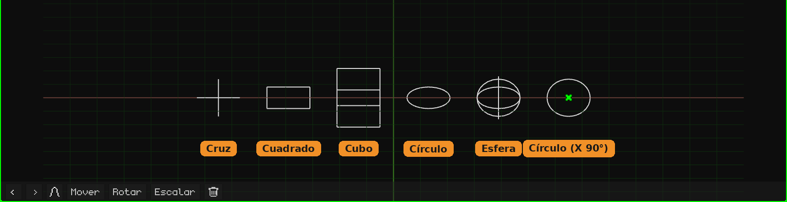

# Vacío

Un **Vacío** es un objeto sin malla: no se ve al renderizar ni en el juego. Sirve como punto de referencia: un pivote para girar o escalar otros objetos que cuelgan de él, un lugar donde apuntar una cámara o una restricción, un control para animar. Se agrega con **Añadir → Vacío**, en el cursor 3D. Cómo se agregan y se mueven los objetos está en el tutorial [El Modo Objeto](../tutoriales/modo-objeto.md).

En la Vista 3D se dibuja con líneas. Un Vacío nuevo es un **círculo acostado en el piso**, fácil de ver y de agarrar. La forma, el tamaño y el giro del dibujo se cambian en su tarjeta. Es **solo cómo se ve**: no cambia el objeto, ni su transformación, ni a sus hijos.

## Las pestañas

| Pestaña | Qué tiene |
|---|---|
| Objeto | Posición, rotación, escala, nombre y visibilidad, igual que en todos los objetos: ver [Malla 3D](objeto-malla.md#la-pestaña-objeto). Escalar el Vacío escala también a sus hijos. |
| Vacío (la cruz) | La tarjeta de abajo. |
| Restricciones | Ver [Restricciones](restricciones.md). |
| Scripts | Los scripts Lua del objeto. Ver [Lua en Whisk3D](../lua/README.md). |

## La tarjeta Vacío

| Propiedad | Qué hace |
|---|---|
| Forma | Cómo se dibuja, cada una con su ícono: **Cruz** (los tres ejes), **Cuadrado**, **Cubo**, **Círculo** o **Esfera** (tres círculos, uno por eje). El cuadrado y el círculo nacen acostados en el piso. En las pantallas chicas (el Nokia N95, la PSP, la 3DS y la Dreamcast) el círculo y la esfera se dibujan con la mitad de líneas: ahí no se nota la diferencia y el teléfono dibuja menos. |
| Tamaño | Lo que mide el dibujo, en metros, de punta a punta. 1 es un metro. |
| Rotación X, Y, Z | Gira el dibujo, en grados. Por ejemplo, el círculo con **X** en 90 queda parado. |

Nada de esto mueve ni gira el objeto: el Vacío sigue en el mismo lugar y sus hijos no se enteran. Se guarda con el proyecto.

## Para qué sirve

- **Un pivote:** un objeto hijo de un Vacío gira y se escala desde el Vacío. Por ejemplo, una pelota emparentada a un Vacío puesto en su punto de abajo se aplasta contra el piso al escalar el Vacío.
- **Ordenar la escena:** varios objetos colgados de un Vacío se mueven juntos moviendo solo el Vacío.
- **Un blanco:** las [restricciones](restricciones.md) pueden apuntar a un Vacío, por ejemplo para que una cámara lo siga mirando.
