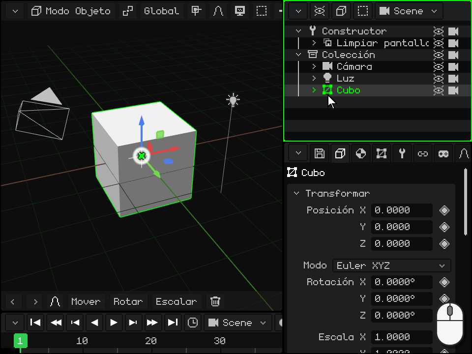
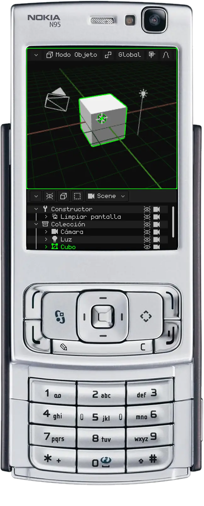
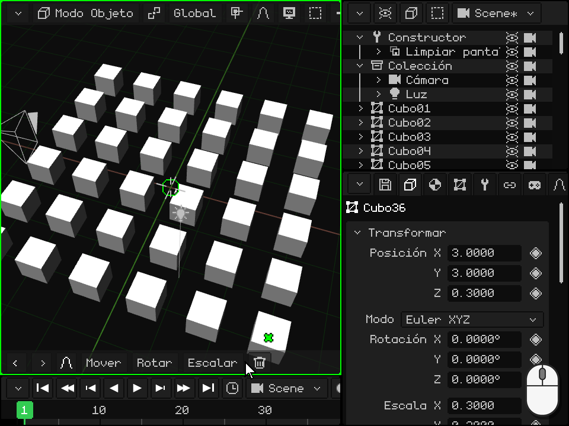

# El Outliner

> [!NOTE]
>  El Nokia N95 soporta mouse y teclado (por Bluetooth). Las partes de esta página sobre el Nokia explican cómo se usa sin mouse ni teclado, solo con las teclas del teléfono.

El **Outliner** es la lista de todo lo que hay en la escena: objetos, cámaras, luces y colecciones. Es uno de los viewports que se vieron en [Los viewports](interfaz.md); en la PC está arriba a la derecha. Desde acá se eligen los objetos, se ocultan, se ordenan, se meten unos adentro de otros y se les cambia el nombre.

Lo que elegís en el Outliner queda elegido también en la Vista 3D, y al revés. El último que elegiste es el **objeto activo**: el que muestra Propiedades.

 **En Android** el Outliner no viene en la pantalla: el lugar queda para la Vista 3D y Propiedades. Para usarlo, convertí un viewport en Outliner (o dividí uno) con el botón de la esquina, como en [Cambiar el tipo](interfaz.md#cambiar-el-tipo). Sin el Outliner también se puede trabajar: los objetos se eligen tocándolos en la Vista 3D, y Propiedades tiene el nombre y las casillas **Visible** y **Renderizar**.

 **En el Nokia N95** el Outliner no viene en la pantalla: entran solo dos viewports. Mientras ordenás la escena, convertí Propiedades en Outliner: con la **soft izquierda** entrás a sus pestañas y con la flecha izquierda llegás al menú del botón de la esquina; ahí elegí Outliner. Para volver, la soft izquierda en el Outliner abre directo ese menú. Con la **tecla verde**  lo hacés el viewport activo: todo lo del N95 que sigue es con el borde verde en el Outliner.

## Lo que muestra cada fila

Cada fila es un objeto. La **flecha** pliega o despliega lo que tiene adentro; el **ícono** dice su tipo (malla, cámara, luz, colección...); después va el **nombre**, en verde si es el activo y en un verde más oscuro si está elegido; y a la derecha, el **ojo** y la **cámara**. Un objeto que está adentro de otro aparece más a la derecha, colgando de él, y una fila tenue es un objeto oculto.

En un proyecto nuevo, arriba está el **Constructor**, una rutina que prepara la pantalla y corre una sola vez, al empezar el juego. Una línea negra lo separa de lo que corre en cada cuadro: primero **Limpiar pantalla** y después la **Colección** con la cámara, la luz y el cubo. Una colección es una carpeta para ordenar.

## Elegir

| | Cómo se elige |
|---|---|
|  PC | Un click en la fila elige solo ese objeto. <kbd>Shift</kbd> + click elige todas las filas desde el activo hasta esa. <kbd>Ctrl</kbd> + click suma o quita una. Con el mouse sobre el Outliner, las flechas arriba y abajo pasan a la fila anterior o a la siguiente. |
|  Pantalla táctil | Un toque en la fila. Con **Shift** o **Ctrl** prendidos en la barra de herramientas de la Vista 3D, el toque hace lo mismo que con el teclado. Arrastrar el dedo desplaza la lista. |
|  Nokia N95 | Las flechas arriba y abajo pasan a la fila anterior o a la siguiente, y la lista se desplaza sola para seguirla. |
| Menú | Seleccionar → Seleccionar todo, Deseleccionar todo o Invertir selección |

## Plegar y desplegar

Cuando un objeto tiene otros adentro, su flecha los muestra o los esconde. Plegar lo que no estás usando deja la lista corta.

| | Cómo se pliega y se despliega |
|---|---|
|  PC | Un click en la flecha. Con el mouse sobre el Outliner, la flecha derecha del teclado despliega el activo y la izquierda lo pliega; si ya estaba plegado, la izquierda sube al de afuera y lo pliega. |
|  Pantalla táctil | Un toque en la flecha. |
|  Nokia N95 | Derecha despliega el activo e izquierda lo pliega; si ya estaba plegado, izquierda sube al de afuera y lo pliega. |

## Ocultar: el ojo y la cámara

- El **ojo** muestra u oculta el objeto en la Vista 3D. Un objeto oculto tampoco sale en el render. Si tiene otros adentro, se ocultan con él y sus filas se ven tenues.
- La **cámara** decide si sale en el **render**. Apagada, el objeto se sigue viendo mientras trabajás, pero no aparece en las imágenes ni en los videos que renderizás.

Tocarlos no cambia lo elegido.

| | El ojo | La cámara |
|---|---|---|
|  PC | Click en el ojo, o <kbd>H</kbd> (con el mouse sobre el Outliner) para el activo | Click en la cámara |
|  Pantalla táctil | Un toque en el ojo | Un toque en la cámara |
|  Nokia N95 | <kbd>2</kbd>, el del activo | <kbd>3</kbd>, la del activo |
| Menú | Elemento → Ocultar/Mostrar (el del activo) | — |

Las dos están también en Propiedades, en la tarjeta Transformar: **Visible** y **Renderizar**. Tienen su rombo, así que se pueden animar: por ejemplo, para que algo aparezca en un momento del video.

## Ordenar y meter un objeto adentro de otro

El orden de la lista se puede cambiar, y un objeto se puede meter **adentro** de otro: pasa a ser su **hijo**, y cuando el padre se mueve, rota o escala, el hijo lo acompaña. Es lo que en [El Modo Objeto](../tutoriales/modo-objeto.md#el-outliner-los-objetos-de-la-escena) se llama **emparentar**. El objeto no se mueve de su lugar en la escena: solo cambia en la lista.

 **Con el mouse:** agarrá la fila y arrastrala. Sobre el borde de arriba o de abajo de otra fila aparece una **línea verde**: al soltar, el objeto queda antes o después de esa fila, a su mismo nivel. Sobre el medio de otra fila, esa fila se resalta: al soltar, el objeto queda **adentro** de ella. Soltado debajo de la última fila, sale de todo lo que lo contenía. Cerca del borde de arriba o de abajo, la lista se desplaza sola, así se llega a cualquier fila de una lista larga.

 **Con el dedo:** mantené el dedo quieto sobre la fila un segundo, hasta que el teléfono vibre: la fila queda agarrada. Después arrastrala y soltala igual que con el mouse. Si la soltás sin moverla, se abre el menú del objeto. Sin esa espera, arrastrar el dedo desplaza la lista.

 **En el Nokia N95:** elegí la fila con las flechas y apretá <kbd>1</kbd>. La fila se pone verde, y ahora las flechas la mueven:

-  **Arriba** y **abajo** la suben o la bajan entre las que están a su mismo nivel.
-  **Derecha** la mete adentro de la que tiene arriba, a su mismo nivel.
-  **Izquierda** la saca del que la contiene: queda después de él, a su nivel.
-  <kbd>1</kbd> otra vez (o <kbd>OK</kbd>) la deja ahí. <kbd>C</kbd> cancela y la devuelve a donde estaba.

 Todo el recorrido se deshace de una vez, con <kbd>C</kbd> + izquierda. Sirve, por ejemplo, para poner una luz antes de los objetos que ilumina.

## Encontrar el activo y encuadrarlo

En una escena grande la lista es larga, y elegir algo en la Vista 3D no la mueve: su fila puede quedar fuera de la vista. Para encontrarla en la lista, o para ver el objeto en la Vista 3D (**encuadrarlo**, como en [Encuadrar lo seleccionado](../tutoriales/navegacion.md#encuadrar-lo-seleccionado)):

| | En el Outliner | En la Vista 3D |
|---|---|---|
|  PC | <kbd>Num .</kbd> con el mouse sobre el Outliner (**Mostrar el activo**): la lista se desplaza hasta que lo elegido queda en el medio. Si está adentro de algo plegado no tiene fila: desplegalo primero. | <kbd>Num .</kbd> con el mouse sobre la Vista 3D |
|  Pantalla táctil | Arrastrá la lista con el dedo | Doble toque con dos dedos sobre la Vista 3D |
|  Nokia N95 | La lista sigue sola a la fila que elegís con las flechas | Un toque del <kbd>0</kbd>, aunque el viewport activo sea el Outliner |
| Menú | — | Vista → Encuadrar Selección, en la barra de la Vista 3D |

## Renombrar

| | Cómo se renombra |
|---|---|
|  PC | Doble click en el nombre, o <kbd>F2</kbd> para el activo: la fila se vuelve un campo de texto. Escribí el nombre nuevo y confirmá con <kbd>Enter</kbd> o con un click afuera; <kbd>Esc</kbd> lo deja como estaba. |
|  Pantalla táctil | Doble toque en el nombre: se abre el teclado de la pantalla. |
|  Nokia N95 | Con la soft izquierda entrás a la barra y con la flecha derecha llegás a Elemento → Renombrar. Escribí con el T9 y confirmá con <kbd>OK</kbd>. |
| Menú | Elemento → Renombrar |

Dos objetos de la misma escena no pueden llamarse igual: si el nombre ya está usado, Whisk3D le agrega un número y te avisa. Si un script nombraba al objeto, se actualiza solo.

## Duplicar y borrar

| | Duplicar | Borrar |
|---|---|---|
|  PC | <kbd>Shift</kbd> + <kbd>D</kbd>; <kbd>Alt</kbd> + <kbd>D</kbd> para Duplicar Vinculado | <kbd>X</kbd> o <kbd>Supr</kbd> |
|  Nokia N95 | Elemento → Duplicar | <kbd>C</kbd> |
| Menú | Elemento → Duplicar o Duplicar Vinculado | Elemento → Borrar |

Desde el Outliner, la copia queda justo encima del original, sin seguir al mouse como en la Vista 3D: movela después. Borrar pide confirmación, y las dos cosas se pueden deshacer.

## La barra de menús del Outliner

| Botón | Qué tiene |
|---|---|
| **Opciones de vista** (el ojo) | Qué se muestra: el Constructor, las demás rutinas, y las columnas del ojo y de la cámara (**Íconos de visibilidad** e **Íconos de render**). |
| **Elemento** (el cubo) | Borrar, Renombrar, Mover, Ocultar/Mostrar, Duplicar, Duplicar Vinculado, Crear prefab y Desempaquetar prefab. |
| **Seleccionar** | Seleccionar todo, Deseleccionar todo e Invertir selección. |
| La escena | Qué escena, juego o prefab del proyecto se está editando ([Escenas, juegos y prefabs](outliner.md#escenas-juegos-y-prefabs)). |

 Un click derecho en una fila la elige y abre el mismo menú ahí, en el puntero.

 Con el dedo, mantené la fila hasta que vibre y soltala sin moverla: se abre el mismo menú.

## La Biblioteca

Los **recursos** del proyecto (mallas, materiales, texturas, animaciones, sonidos, scripts, prefabs...) no están en el Outliner: tienen su propio viewport, la **Biblioteca**, que se elige con el botón de la esquina. Muestra miniaturas en carpetas, dice qué recursos se usan y cuáles no, y un recurso se puede arrastrar a la Vista 3D: una malla crea un objeto, y un material se le pone a lo que queda debajo. Está explicada en [Vista Biblioteca](outliner.md#vista-biblioteca); el resto del Outliner, en su [manual](outliner.md) y en [Atajos](atajos.md#outliner).

## Vista Biblioteca

| Función | Descripción |
|---|---|
| Recursos | Mallas, materiales, texturas, animaciones, prefabs, escenas, sonidos, scripts, [shaders](shaders.md), fuentes y videos, en carpetas. Un material o un shader arrastrado sobre una malla del 3D se ve en la parte bajo el puntero antes de soltarlo. Tilde verde = en uso; cruz roja = huérfano; `*` = sin guardar. |
| Filtro / Lista o cuadrícula | Mostrar un solo tipo; ver miniaturas. |
| Arrastrar un recurso | A una carpeta (lo mueve), a la Vista 3D (malla = objeto nuevo, material o textura = se asigna a lo tocado, prefab = instancia) o a un desplegable de Propiedades. |
| Carpeta nueva / Mover a carpeta | Organizar (las carpetas son solo para ordenar). |
| Duplicar recurso / Seleccionar usuarios / Purgar huérfanos | Copiar, encontrar quién lo usa, borrar lo que nadie usa. |
| Dentro del .w3d / Externo | Desde Propiedades (tarjeta Recurso): mueve el recurso adentro o afuera del proyecto. |

## Escenas, juegos y prefabs

El botón con el nombre de la escena (en el Outliner y en la Vista 3D) lista las escenas, juegos y prefabs del proyecto. Desde ahí se crean nuevos, se elige la escena inicial y se convierte una escena en juego (o al revés).
