# La barra de menús de la Vista 3D

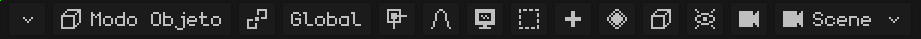

Si la barra de menús no entra completa, se puede desplazar: ver [Cuando no se ven todas las opciones de la barra de menús](interfaz.md#cuando-no-se-ven-todas-las-opciones-de-la-barra-de-menús).

## El modo

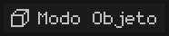 Muestra el modo en el que se está trabajando, y al tocarlo se elige otro. Los modos que aparecen dependen del objeto activo: una malla tiene el Modo Edición y las tres pinturas; un esqueleto, el Modo Edición y el Modo Pose. Con otro tipo de objeto (una luz, una cámara) el botón no aparece, porque el único modo es el Modo Objeto. Cada modo está explicado en [Los modos](vista-3d.md#los-modos).

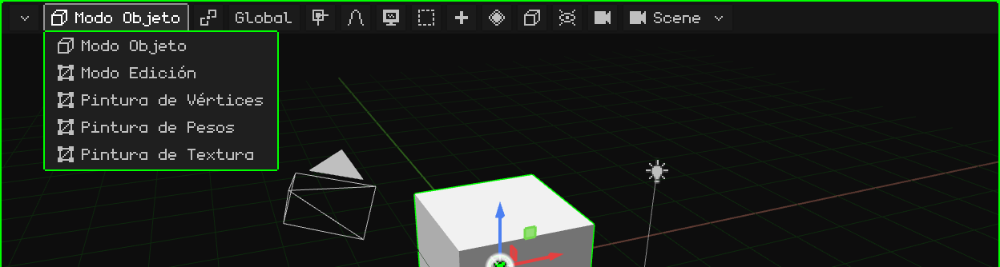

 <kbd>Tab</kbd> pasa del Modo Objeto al Modo Edición y vuelve.  En el N95, <kbd>OK</kbd>.

En el **Modo Edición** de una malla aparece al lado el botón de **Vértice / Arista / Cara**: qué se elige con un click (ver [Modo Edición](modo-edicion.md)).

## El pivote

 El **punto de pivote** es el lugar desde donde ocurre la transformación: alrededor de qué se rota y desde dónde se escala lo elegido. El ícono del botón cambia según el pivote elegido, así se ve de un vistazo cuál está puesto.

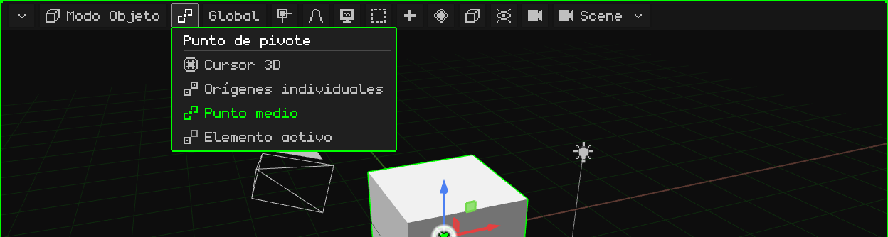

| Pivote | Desde dónde rota y escala |
|---|---|
|  **Cursor 3D** | Desde el cursor 3D. Sirve para girar cosas alrededor de cualquier punto: se pone el cursor ahí (con el [menú Imán](#el-imán)) y se rota. |
|  **Orígenes individuales** | Cada objeto desde su propio origen: giran todos a la vez, cada uno en su lugar. |
|  **Punto medio** | Desde el centro de todo lo elegido. Es el que viene. |
|  **Elemento activo** | Desde el origen del objeto activo (el último elegido): los demás giran a su alrededor. |

Un ejemplo de cada uno, en video, está en el tutorial [El Modo Objeto](../tutoriales/modo-objeto.md#el-punto-de-pivote).

## La orientación

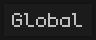 Los ejes que se usan al mover, rotar o escalar en un eje (con <kbd>X</kbd>, <kbd>Y</kbd>, <kbd>Z</kbd>, con el gizmo o con las teclas del N95). El botón muestra la orientación elegida.

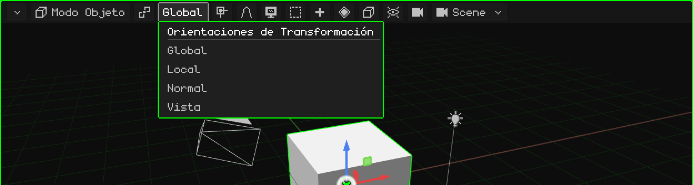

| Orientación | Los ejes |
|---|---|
| **Global** | Los del mundo: siempre iguales, con la Z para arriba. Es la que viene. |
| **Local** | Los del propio objeto: giran con él. Un auto girado avanza en su eje Local. |
| **Normal** | En el Modo Edición: la dirección para la que mira la cara elegida (es la que usa Extruir). |
| **Vista** | Los de la pantalla: X para el costado, Y para arriba. |

 Durante un transform, la segunda letra del eje pasa de Global a Local: <kbd>G</kbd> <kbd>Y</kbd> <kbd>Y</kbd>.

## El imán

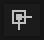 Con el **imán** prendido, lo que se mueve se pega a algo: a los vértices, las aristas o las caras de otros objetos, o a sus centros. El botón se pone verde cuando está prendido.

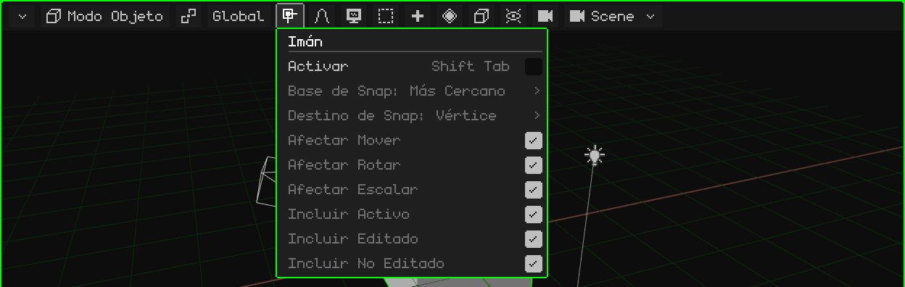

| Opción | Qué hace | Atajo |
|---|---|---|
| Activar | Prende o apaga el imán. | <kbd>Shift+Tab</kbd> |
| Base de Snap | Qué punto de lo que se mueve se pega: el más cercano, el centro, la mediana o el activo. | Menú |
| Destino de Snap | A qué se pega: vértice, arista, cara, sus centros. Con Proyectar en cara / Cara más cercana, los vértices se apoyan sobre otra superficie (para retopología). | Menú |
| Afectar Mover / Rotar / Escalar | En qué operaciones actúa. | Menú |
| Incluir Activo / Editado / No Editado | A qué objetos se puede pegar. | Menú |

El **cursor 3D** se mueve con otro menú, el del imán del cursor: <kbd>Shift</kbd> + <kbd>S</kbd> o menú Objeto → Imán (Cursor a lo seleccionado, Selección a Cursor...). Está explicado en [El Modo Objeto](../tutoriales/modo-objeto.md#el-cursor-3d).

## La edición proporcional

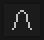 Con la **edición proporcional**, al mover, rotar o escalar algo, lo que está cerca lo acompaña con suavidad: más cuanto más cerca está. Sirve para modelar formas orgánicas (un terreno, una cara) sin mover vértice por vértice. Se pone verde cuando está prendida.

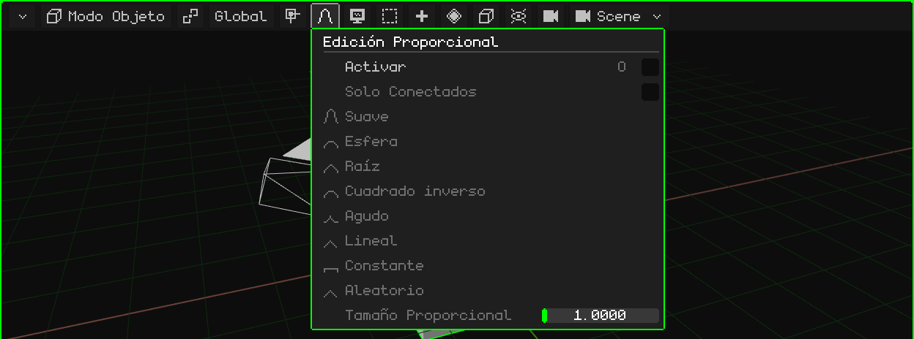

| Opción | Qué hace | Atajo |
|---|---|---|
| Activar | Prende o apaga la edición proporcional. | <kbd>O</kbd> |
| Solo Conectados | Mide la distancia por las aristas: no arrastra piezas sueltas que estén cerca. | Menú |
| La caída | Cómo se reparte la influencia con la distancia: Suave, Esfera, Raíz, Cuadrado inverso, Agudo, Lineal, Constante o Aleatorio. | Menú |
| Tamaño Proporcional | El radio de influencia. Durante el transform se cambia con la rueda o con <kbd>RePág</kbd> / <kbd>AvPág</kbd>. | Menú / rueda |

## Vista

 Todo lo de **navegar**: desde dónde se mira la escena. Cada opción, con su video, está en el tutorial [Navegar en la Vista 3D](../tutoriales/navegacion.md).

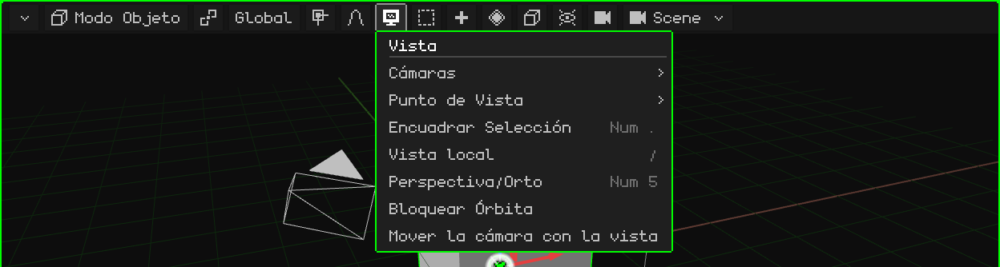

| Opción | Qué hace |  Atajo |
|---|---|---|
| Cámaras | Mirar por la cámara activa, o hacer cámara activa al objeto elegido. | <kbd>Num 0</kbd> / <kbd>Ctrl+Num 0</kbd> |
| Punto de Vista | Frontal, Posterior, Derecha, Izquierda, Superior, Inferior. | <kbd>Num 1</kbd>, <kbd>Num 3</kbd>, <kbd>Num 7</kbd> (con <kbd>Ctrl</kbd>, la opuesta) |
| Encuadrar Selección | Centra la vista en lo elegido y la acerca para que entre justo. | <kbd>Num .</kbd> |
| Vista local | Deja a la vista solo lo elegido, y vuelve. | <kbd>/</kbd> |
| Perspectiva/Orto | Pasa de perspectiva a ortográfica y vuelve. | <kbd>Num 5</kbd> |
| Bloquear Órbita | Lo que orbitaba pasa a desplazar la vista. | — |
| Mover la cámara con la vista | Mirando por la cámara: navegar mueve la cámara. | — |

## Seleccionar

 Elegir de una vez todo, nada, lo contrario de lo que hay, o lo que quede adentro de una caja.

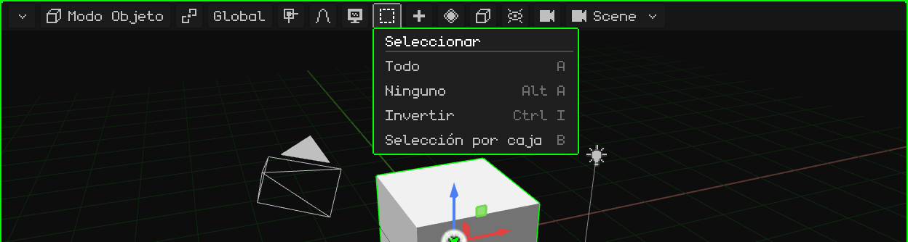

| Opción | Qué hace | Atajo |
|---|---|---|
| Todo | Elige todo. | <kbd>A</kbd> |
| Ninguno | No deja nada elegido. | <kbd>Alt+A</kbd> |
| Invertir | Lo elegido deja de estarlo, y al revés. | <kbd>Ctrl+I</kbd> |
| Selección por caja | Una caja que se arrastra: de izquierda a derecha (verde) elige solo lo que queda entero adentro; de derecha a izquierda (azul) alcanza con rozar. <kbd>Shift</kbd> suma. | <kbd>B</kbd>, o arrastrar en el fondo |

En el Modo Edición suma Seleccionar Vinculado, los loops y los caminos (ver [Modo Edición](modo-edicion.md)).

## Añadir

 Crea objetos nuevos, que aparecen en el cursor 3D y quedan elegidos. Solo está en el Modo Objeto.

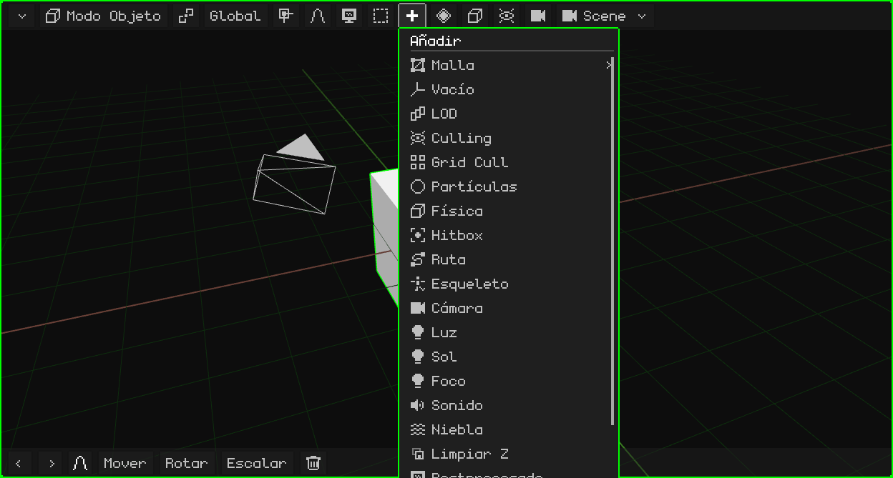

Cada tipo está en [Modo Objeto → Menú Añadir](modo-objeto.md#menú-añadir).  <kbd>Shift</kbd> + <kbd>A</kbd> lo abre donde está el mouse.

En el Modo Edición, en su lugar aparecen **Malla** (las operaciones de modelado, ver [Modo Edición](modo-edicion.md)) y **UV** (desplegar y proyectar las UV, ver [Editor UV](editor-uv.md)). En la Pintura de Textura aparece un **disquete**, que guarda la textura pintada; se pone verde cuando hay pintura sin guardar.

## Animación

 Los **keyframes** de lo elegido: guardar el valor de la posición, la rotación o la escala en el frame actual, para que la animación vaya de un keyframe al otro. Aparece con algo elegido, en el Modo Objeto y en el Modo Pose, y sus opciones dependen de lo elegido.

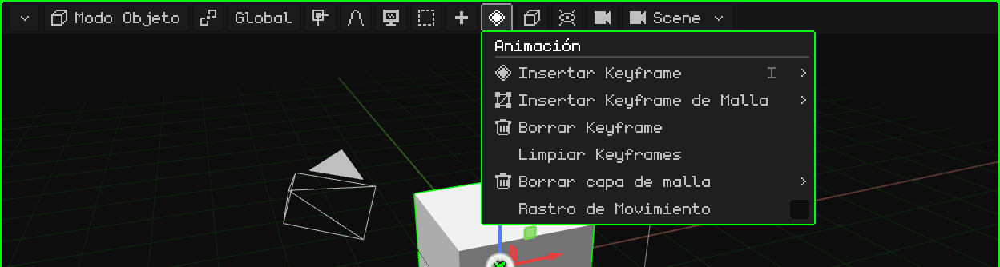

| Opción | Qué hace | Atajo |
|---|---|---|
| Insertar Keyframe | Un menú para elegir qué se guarda: posición, rotación, escala o todo. | <kbd>I</kbd> (<kbd>Shift+I</kbd>: todo sin preguntar) |
| Insertar Keyframe de Malla | Solo con una malla 3D: elige qué se guarda de la animación de la malla, los vértices, las normales o los UV. | Menú |
| Borrar Keyframe | Borra el keyframe del frame actual. | Menú |
| Limpiar Keyframes | Borra toda la animación de lo elegido. | Menú |
| Borrar capa de malla | Solo con una malla 3D: borra entera una capa de la animación de la malla, la de los **vértices**, la de las **normales** (por ejemplo, en un modelo sin iluminación) o la de los **UV**. Queda siempre al menos un keyframe. | Menú |
| Rastro de Movimiento | Dibuja en la vista el camino que recorren los objetos animados. | Menú |

### En el Modo Pose

Posando un esqueleto, el menú trabaja con los keyframes de los huesos elegidos (y del activo):

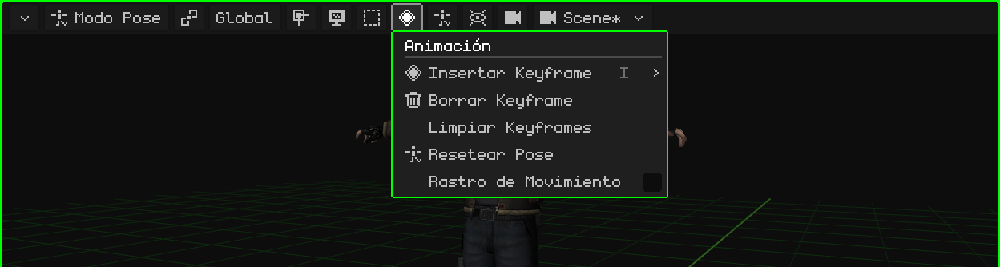

| Opción | Qué hace | Atajo |
|---|---|---|
| Insertar Keyframe | Guarda la pose de los huesos elegidos en el frame actual: posición, rotación, escala o todo. | <kbd>I</kbd> |
| Borrar Keyframe | Borra el keyframe del frame actual de esos huesos. Se deshace con <kbd>Ctrl+Z</kbd>. | Menú |
| Limpiar Keyframes | Borra todos los keyframes de esos huesos en la animación activa. Se deshace con <kbd>Ctrl+Z</kbd>. | Menú |
| Resetear Pose | Los huesos elegidos (o todos, si no hay ninguno elegido) vuelven a la posición, la rotación y la escala que tienen en el Modo Edición. Se deshace con <kbd>Ctrl+Z</kbd>. | Menú |
| Rastro de Movimiento | Dibuja en la vista el camino que recorren los objetos animados. | Menú |

La animación tiene su propio tutorial y su capítulo, [Línea de tiempo](linea-de-tiempo.md).

## Objeto

 Lo que se le puede hacer a lo elegido. Es el mismo menú que se abre con el click derecho en la vista (o, en una pantalla táctil, manteniendo un dedo quieto). Aparece con algo elegido.

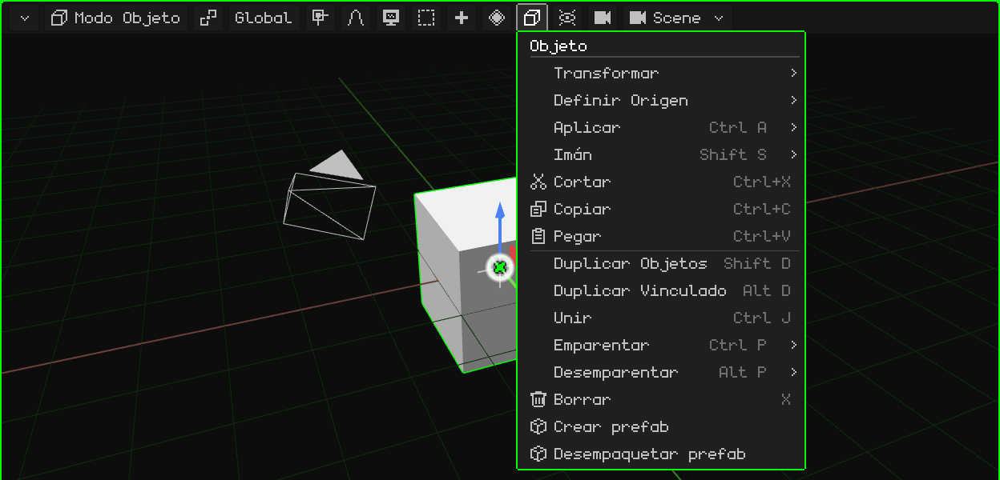

Cada opción está en [Modo Objeto](modo-objeto.md). En el Modo Edición, este botón pasa a ser el menú de lo que se elige (Vértice, Arista o Cara); en el Modo Pose, el de Pose; en la edición de un esqueleto, el de Esqueleto.

## Superposiciones

 Las **superposiciones** son las ayudas que se dibujan encima de la escena para trabajar y que no salen en el render: el piso, los ejes, el gizmo, el cursor 3D. Desde acá se prenden y se apagan, todas juntas o de a una.

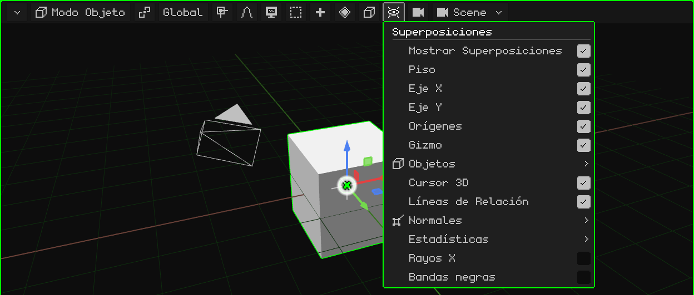

| Opción | Qué hace | Atajo |
|---|---|---|
| Mostrar Superposiciones | Prende o apaga todas las ayudas de una vez. | <kbd>K</kbd> |
| Piso, Eje X, Eje Y, Orígenes, Cursor 3D, Líneas de Relación | Cada ayuda por separado. Las líneas de relación unen cada hijo con su padre. | Menú |
| Gizmo | El gizmo de mover, rotar y escalar. En el Nokia N95 viene apagado. | Menú |
| Objetos | Qué tipos de objeto se dibujan: esqueletos, luces, cámaras, vacíos, partículas, curvas, hitboxes. | Menú |
| Normales | Dibuja las normales de los vértices o de las caras, con su tamaño. | Menú |
| Estadísticas | Los cuadros por segundo, los vértices, las caras, las llamadas de dibujo y los tiempos. | Menú |
| Rayos X | En el Modo Edición, la malla se ve semitransparente y se pueden elegir los elementos de atrás. | Menú |
| Bandas negras | Mirando por una cámara con otra proporción que la pantalla, tapa lo que queda afuera de la toma. | Menú |

## Render

 El **modo de sombreado**: cómo se dibuja la escena en la vista. No cambia el proyecto, solo cómo se ve mientras trabajás.

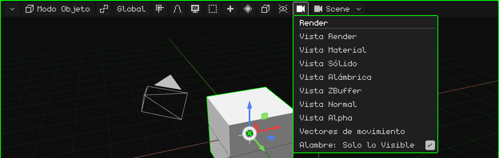

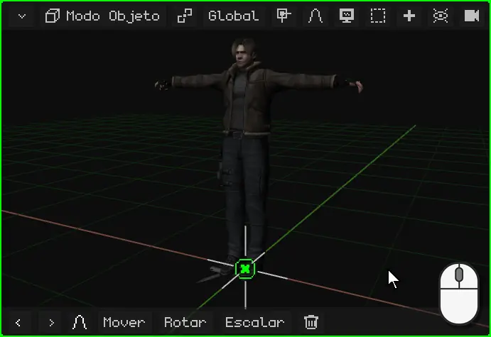

| Modo | Cómo se ve |
|---|---|
| Vista Render | Con las luces de la escena. Con el trazado de rayos prendido, muestra la imagen trazada de a poco. |
| Vista Material | La que viene: los materiales y las texturas con una luz neutra desde la vista, sin depender de las luces de la escena. |
| Vista Sólido | Todo gris, para ver la forma. |
| Vista Alámbrica | Solo las aristas. Con **Alambre: Solo lo Visible**, solo las de lo que se ve de frente. |
| Vista ZBuffer | La profundidad: claro cerca, oscuro lejos. |
| Vista Normal | Las normales, en colores. |
| Vista Alpha | La transparencia, en blanco y negro. |
| Vectores de movimiento | Cuánto se movió cada píxel desde el cuadro anterior (rojo = X, verde = Y). Es la misma imagen que el pase `_vectores` del render. |

 <kbd>Z</kbd> pasa al modo siguiente.  En el N95, el <kbd>6</kbd>.

## La escena

 El nombre de lo que se está editando: una **escena**, un **juego** o un **prefab** del proyecto. Al tocarlo se elige otra, se crea una nueva o se convierte la escena en juego.

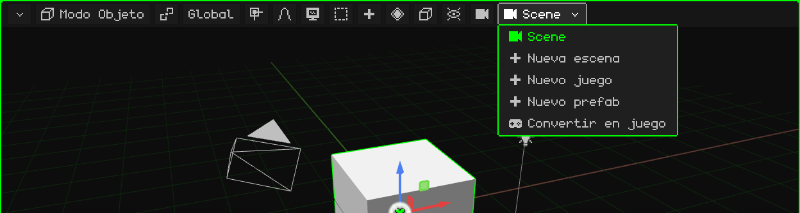

Las escenas, los juegos y los prefabs están en [El proyecto](proyecto.md).
