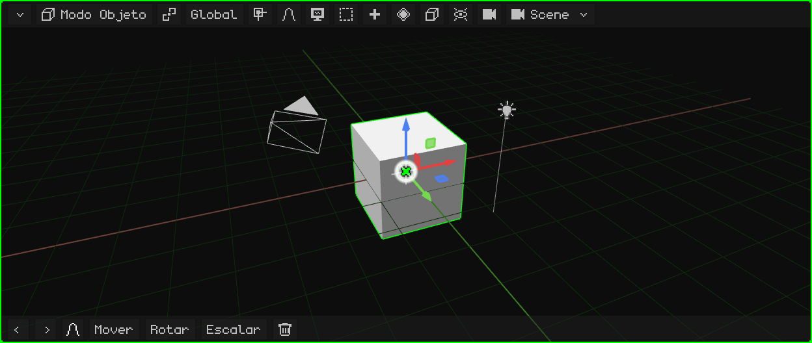
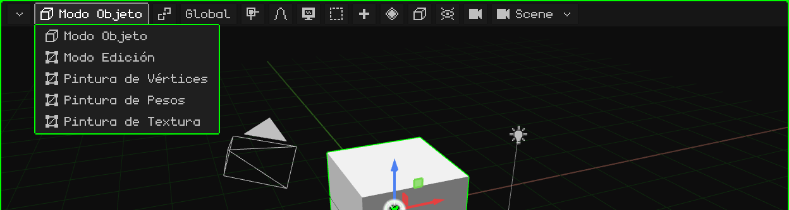
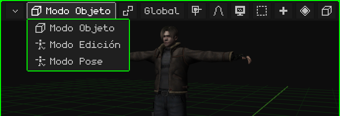
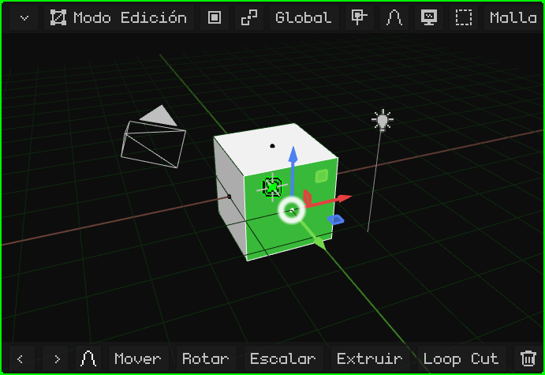
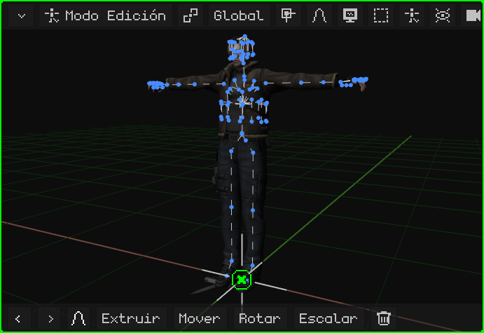
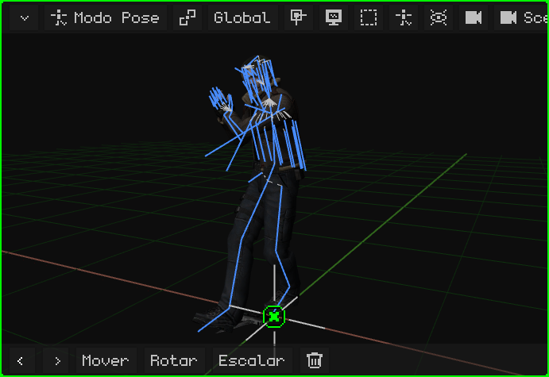
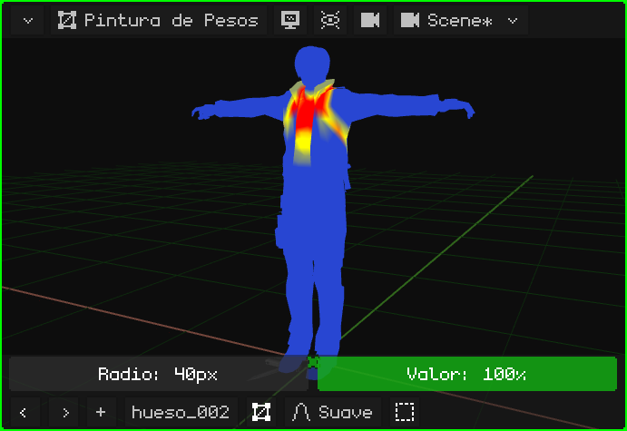
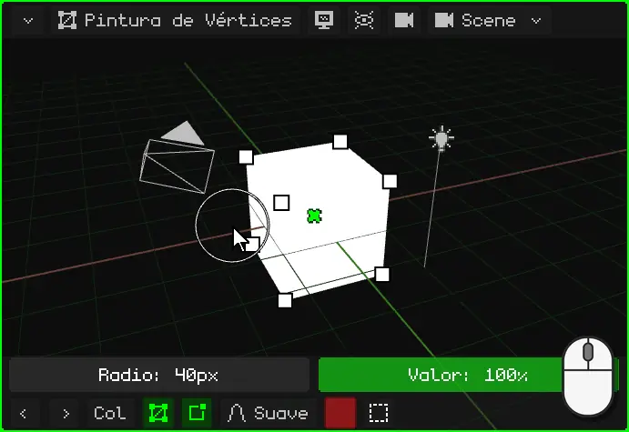
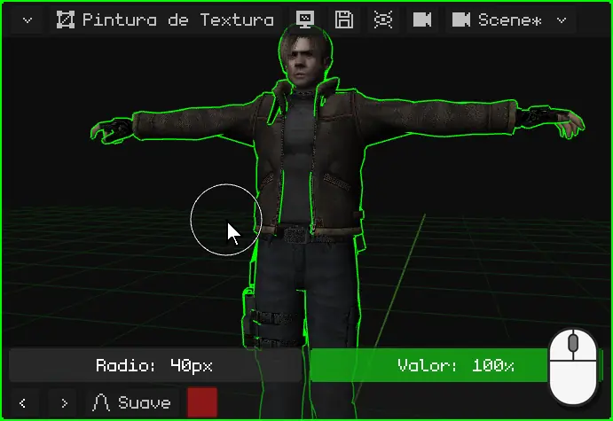
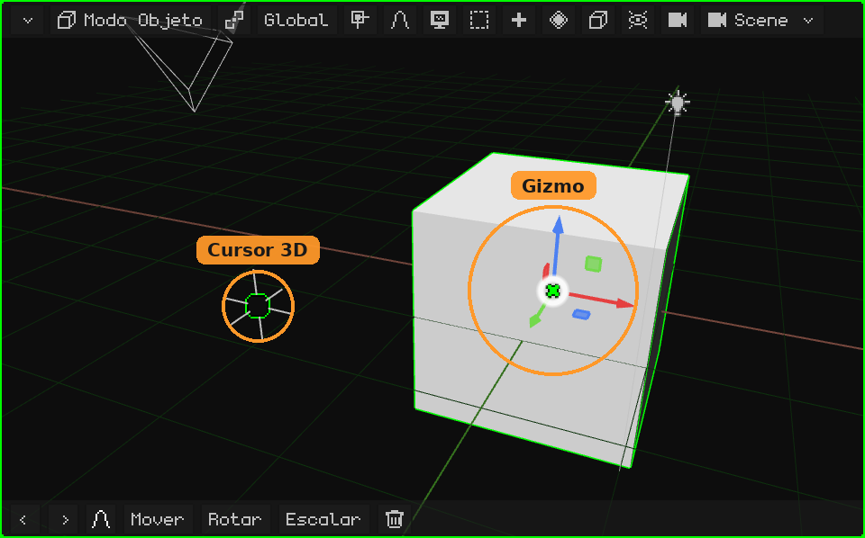

# Vista 3D

La **Vista 3D** es el viewport donde se ve y se edita la escena: ahí se modela, se mueven los objetos, se pinta, se posa y se anima. Como todos los viewports, tiene arriba su **barra de menús** y abajo su **barra de herramientas**.

- **La barra de menús**, botón por botón, con sus menús: [La barra de menús de la Vista 3D](vista-3d-barra.md).
- **Navegar** (orbitar, desplazarse, zoom, las vistas, la cámara): [Navegación en la Vista 3D](navegacion.md) y el tutorial [Navegar en la Vista 3D](../tutoriales/navegacion.md).
- **Mover, rotar y escalar**, el gizmo, el pivote y la orientación: [Mover, rotar y escalar](transformar.md).

## Los modos

La Vista 3D trabaja en distintos **modos**: lo que hacen los clicks, las teclas y los menús depende del modo en el que está. El modo se elige con el primer botón de la barra de menús, que muestra el modo actual, o con <kbd>Tab</kbd> (Objeto ↔ Edición; en el Nokia N95, <kbd>OK</kbd>).

Los modos que se pueden elegir dependen del **objeto activo**. El **Modo Objeto** lo tienen todos. Una malla 3D suma el Modo Edición y las tres pinturas; un esqueleto, el Modo Edición y el Modo Pose. Con cualquier otro objeto (una luz, una cámara, un sonido) el único modo es el Modo Objeto, y el botón no aparece.

| Modo | Qué objetos lo tienen | Para qué sirve |
|---|---|---|
| [Modo Objeto](modo-objeto.md) | Todos | Trabajar con los objetos enteros: crearlos, moverlos, rotarlos, escalarlos, duplicarlos, emparentarlos y borrarlos. |
| [Modo Edición](modo-edicion.md) | Mallas 3D y curvas | Modelar: mover, agregar y borrar los vértices, las aristas y las caras de la malla. |
| [Modo Edición](esqueletos.md#modo-edición-de-esqueleto) | Esqueletos | Armar el esqueleto: crear huesos y acomodarlos en su posición de reposo. |
| [Modo Pose](esqueletos.md#modo-pose) | Esqueletos | Posar los huesos y guardar las poses: así se anima un personaje. |
| [Pintura de Pesos](pintura.md#pintura-de-pesos) | Mallas 3D | Pintar cuánto mueve cada hueso a cada vértice. |
| [Pintura de Vértices](pintura.md#pintura-de-vértices) | Mallas 3D | Pintar colores directamente sobre los vértices. |
| [Pintura de Textura](pintura.md#pintura-de-textura) | Mallas 3D | Pintar sobre la textura, directamente encima del objeto. |

### Modo Objeto

Es el modo en el que arranca Whisk3D, y el único que tienen todos los objetos. Se trabaja con los objetos enteros: se eligen, se mueven, se rotan, se escalan, se agregan y se borran. Ver [Modo Objeto](modo-objeto.md) y el tutorial [El Modo Objeto](../tutoriales/modo-objeto.md).

### Modo Edición de una malla

Se modela la **forma** de la malla: los vértices, las aristas y las caras. En la barra de menús aparece el botón **Vértice / Arista / Cara** (qué se elige con un click) y los menús **Malla** y **UV**. El resto de la escena se sigue viendo, pero no se puede tocar.

### Modo Edición de un esqueleto

Se arma el **esqueleto**: se crean los huesos (extruyéndolos desde la punta de otro), se mueven y se emparentan. Es su posición de **reposo**, la que tiene cuando no está animado.

### Modo Pose

Se **posa** el esqueleto: los huesos se rotan y se mueven sin cambiar el esqueleto en sí, y la malla los sigue. Las poses guardadas en distintos frames son la animación del personaje.

### Pintura de Pesos

Se pinta **cuánto mueve cada hueso a cada parte de la malla**: en rojo lo que el hueso elegido mueve del todo, en azul lo que no mueve. Es lo que hace que, al doblar el brazo, se doble el brazo y no la cintura.

### Pintura de Vértices

Se pintan **colores sobre los vértices** de la malla, sin textura. Sirve para dar color a modelos simples, para sombras pintadas a mano y para efectos en los shaders.

### Pintura de Textura

Se pinta **directamente sobre la textura**, encima del objeto, como sobre un muñeco. Lo pintado se guarda con el disquete que aparece en la barra de menús.

En los modos de pintura, arriba de la barra de herramientas aparece la fila del pincel (el **Radio** y el **Valor**). Ver [Modos de pintura](pintura.md).

## La barra de herramientas

Abajo de la Vista 3D están **Deshacer** y **Rehacer** (las flechas), los **últimos comandos usados** (al empezar, Mover, Rotar, Escalar y Borrar; lo que se usa pasa adelante) y la **edición proporcional**. Mientras se mueve, rota o escala, la barra de herramientas cambia: la tilde verde confirma, la cruz roja cancela, la orientación, y **X**, **Y** y **Z** dejan el movimiento en esos ejes. Ver [Mover, rotar y escalar](transformar.md#barra-de-herramientas).

 En una pantalla táctil suma **Shift** y **Ctrl**, que quedan prendidos (en verde) y hacen de esas teclas, y el botón **Vista** (el monitor), para que en el Modo Edición y en las pinturas el dedo navegue en vez de elegir o pintar.

 En el Nokia N95 viene oculta, para dejarle la pantalla a la escena, y aparece cuando hace falta: en los modos de pintura sale la fila del pincel (el **Radio** y el **Valor**), y mientras se mueve, rota o escala con la edición proporcional prendida, la barra de su radio. Sus botones se usan con el **mouse virtual**: se prende con la tecla de selección derecha, las flechas lo mueven y <kbd>OK</kbd> hace click.

## El gizmo y el cursor 3D

- El **gizmo** son las flechas de colores sobre lo elegido: se agarran para mover, rotar y escalar. Un click sobre el gizmo pasa de un modo al otro. Ver [El gizmo](transformar.md#el-gizmo).
- El **cursor 3D** es el círculo con una cruz: ahí aparece lo que se agrega con Añadir, y puede ser el punto de pivote. Ver [El cursor 3D](../tutoriales/modo-objeto.md#el-cursor-3d).

 En el Nokia N95 el gizmo viene apagado, porque la pantalla es chica y ahí se mueve con las teclas. Se prende en **Superposiciones → Gizmo**, y se agarra con el mouse virtual.
