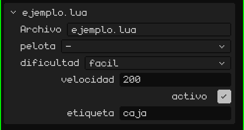
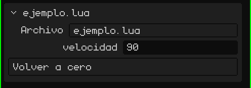

# Un script es un componente de un objeto

En Whisk3D un script siempre pertenece a un **objeto** de la escena (una malla, un vacío, un botón 2D…). Un objeto puede tener varios scripts; cada uno corre por separado, con sus propias variables, en el orden en que aparecen.

Desde el script, `yo()` devuelve el objeto dueño. Para usar *otros* objetos, el script declara una tabla global llamada `propiedades`. El editor la lee y muestra un campo por cada entrada en la tarjeta del script, en el panel de Propiedades:

```lua
propiedades = {
  pelota     = "objeto",                          -- un campo para elegir un objeto de la escena
  dificultad = { "facil", "normal", "dificil" },  -- una lista desplegable (la primera es la de fábrica)
  velocidad  = 200,                               -- un número propio de cada objeto que use el script
  activo     = true,                              -- un sí/no
  etiqueta   = "caja",                            -- un texto
}

function inicio()
  local p   = objeto("pelota")         -- el objeto elegido en el campo "pelota"
  local dif = opcion("dificultad")     -- "facil", "normal" o "dificil"
  local v   = propiedad("velocidad")   -- 200, o lo que se haya puesto en ese objeto
end
```

> [!NOTE]
> Para leer `propiedades`, el editor **ejecuta el archivo** aunque el juego no esté corriendo. Por eso, afuera de las funciones poné solo declaraciones (tablas, constantes, `local`), nunca código que haga cosas.

Así se ve en la tarjeta del script, en Propiedades: un campo por cada propiedad, en el mismo orden que en el código.



Así, el mismo script sirve para muchos objetos con valores distintos: el campo `velocidad` de un enemigo puede valer 200 y el de otro 350.

## Cambiar las propiedades en tiempo real

`propiedad("velocidad")` lee el valor en el momento. Si lo cambiás en Propiedades con el juego andando, el script lo ve en el cuadro siguiente, pero solo si lo vuelve a leer con `propiedad()`. Si lo guardaste en una variable (`local v = propiedad("velocidad")` en `inicio()`), la variable se queda con el valor del principio.

```lua
function actualizar(dt)
  -- se lee en cada cuadro: ve lo que cambies en Propiedades con el juego andando
  mover(yo(), propiedad("velocidad") * dt, 0, 0)
end
```

Leer `propiedad()` en cada cuadro es más lento que usar una variable. No conviene trabajar así en todo el juego: usalo mientras ajustás los valores, y cuando ya estén, guardalos en variables en `inicio()`.

## Botones

Si una propiedad es una **función**, en la tarjeta aparece un **botón**: tocarlo llama a esa función. Para que el botón diga otra cosa que el nombre, poné el texto y la función en una tabla:

```lua
propiedades = {
  velocidad = 90,
  cero = { "Volver a cero", function()
    setRotacion(yo(), 0, 0, 0)
  end },
}
```



Con el juego andando, la función corre en el script que está jugando. Sin el juego, el script se carga solo para esa llamada: así, un botón sirve como un **complemento del editor**, que le hace algo a la escena. Por ejemplo, con `seleccionados()`, los objetos elegidos en el editor:

```lua
propiedades = {
  subir = { "Subir lo elegido", function()
    for _, o in ipairs(seleccionados()) do
      mover(o, 0, 0, 1)   -- un metro para arriba
    end
  end },
}
```

> [!NOTE]
> Lo que hace un botón con el juego parado queda en la escena, como si lo hubieras hecho a mano, y se deshace igual: <kbd>Ctrl</kbd> + <kbd>Z</kbd> deshace de una vez todo lo que hizo el botón. Con el juego andando no se guarda nada en el historial: al tocar **Parar**, todo vuelve a como estaba.

Los scripts no comparten variables entre sí. Para pasarse datos (los puntos, si el jugador ganó…) usan un espacio compartido: `setCompartido("puntos", 10)` escribe y `compartido("puntos")` lee. Guarda números, sí/no y textos, y se vacía al detener el juego.
