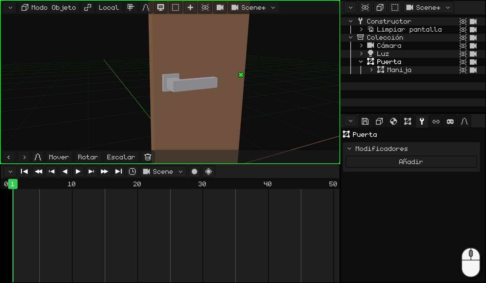
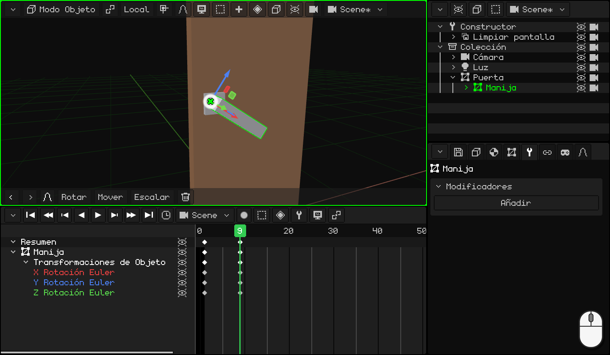
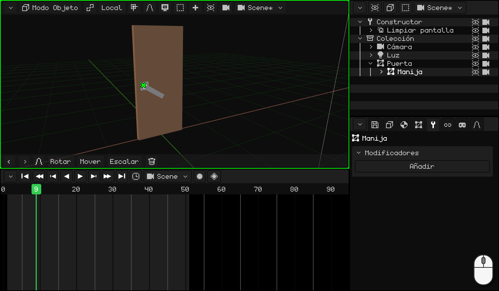
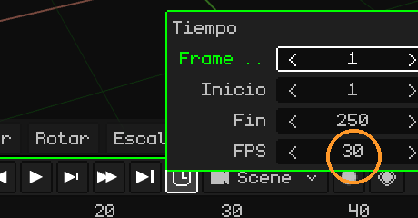
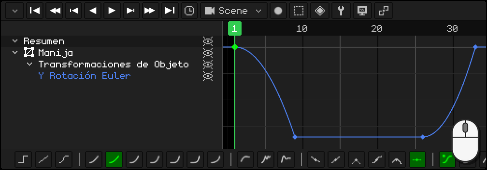
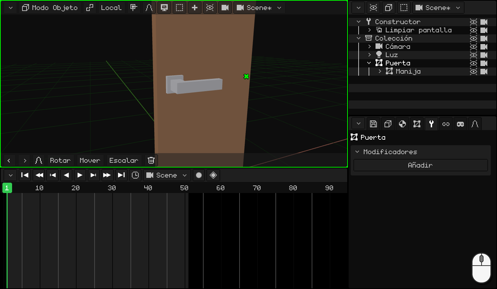

# Animar la puerta

Partimos de la puerta con su picaporte del tutorial anterior, [Modelar el picaporte](modelar-picaporte.md): la puerta tiene el origen en la bisagra, la manija tiene el suyo donde gira y es hija de la puerta. Ahora la vamos a animar como una puerta de verdad: primero se baja el picaporte, recién cuando está abajo la puerta se empieza a abrir, y al final el picaporte vuelve a su lugar.

En el camino vas a aprender a:

- poner **keyframes**: la pose de un objeto en un cuadro;
- **duplicar** keyframes que ya están como los querés;
- ajustar el **tiempo** de la animación y elegir sus **cuadros por segundo**;
- usar el **editor de curvas**: qué es una curva y cómo se cambia con un click y la barra de herramientas.

## 1. El picaporte

Un **keyframe** guarda cómo está un objeto en un cuadro: su posición, su rotación o su escala. Con dos keyframes, el programa calcula todos los cuadros del medio: eso es la animación.

1. Hacé click en la **manija** para elegirla. En la **Línea de tiempo**, andá al cuadro **1**: el picaporte está arriba.
2. Con el mouse sobre la Vista 3D, apretá <kbd>I</kbd> y elegí **Solo Rotación**: en la Línea de tiempo aparece un rombo en el cuadro 1.
3. Andá al cuadro **9** (un click en los números de la Línea de tiempo) y bajá el picaporte: <kbd>R</kbd> <kbd>Y</kbd> `-34` <kbd>Enter</kbd>. Gira alrededor de su origen, el que le pusimos en el tutorial anterior.
4. Otra vez <kbd>I</kbd> → **Solo Rotación**: otro rombo, en el 9.

 En una pantalla táctil: el keyframe se pone con el botón del rombo de la barra de menús de la Vista 3D, **Animación → Insertar Keyframe → Solo Rotación**, y el cuadro se cambia con un toque en los números de la Línea de tiempo. El picaporte se baja con **Rotar** **Y** `-34` en la barra de herramientas, con los números en el teclado de la barra de arriba.

 En el Nokia N95: <kbd>2</kbd> (rotar), <kbd>2</kbd> (el eje Y), el lápiz + `-34` y <kbd>OK</kbd>. El keyframe, con **Animación → Insertar Keyframe → Solo Rotación**.

## 2. Duplicar keyframes

El picaporte tiene que quedarse abajo mientras se abre la puerta y, al final, volver arriba. Esas dos poses ya las tenés: no hace falta volver a girarlo.

1. En la Línea de tiempo, click en el rombo del cuadro **9** (abajo), <kbd>Shift</kbd> + <kbd>D</kbd>, llevá la copia al cuadro **26** y hacé click. Del 9 al 26 el picaporte se queda abajo.
2. Click en el rombo del cuadro **1** (arriba), <kbd>Shift</kbd> + <kbd>D</kbd> y la copia al **33**: el picaporte vuelve arriba.

Mirá el rombo de la copia, no el puntero: sale un cuadro a la derecha del mouse. Mientras la copia pasa por encima de otro keyframe no le pasa nada: solo lo **reemplaza** si la soltás justo encima.

  En táctil y en el N95 (con el mouse virtual), en vez de duplicar se copia y se pega: un toque en el keyframe del cuadro 9 y, en el menú **Key** de la Línea de tiempo (el botón del rombo), **Copiar**; un toque en los números para ir al cuadro 26 y **Key → Pegar**. Lo mismo con el del 1 al 33.

## 3. La puerta

1. Hacé click en la **puerta**, para elegirla sola. Andá al cuadro **11** e <kbd>I</kbd> → **Solo Rotación**: hasta acá la puerta está cerrada. Recién en el 11 se empieza a abrir, cuando el picaporte ya está abajo.
2. Andá al cuadro **26**, abrila: <kbd>R</kbd> <kbd>Z</kbd> `-80` <kbd>Enter</kbd>, y otra vez <kbd>I</kbd> → **Solo Rotación**.

Dale **Play** (<kbd>Espacio</kbd>, o el botón ▶ de la Línea de tiempo): baja el picaporte, se abre la puerta y el picaporte vuelve arriba. Mientras tanto la acompaña, porque es su hijo.

 En una pantalla táctil: **Rotar** **Z** `-80` y **Animación → Insertar Keyframe → Solo Rotación**.

 En el Nokia N95: <kbd>2</kbd>, <kbd>3</kbd> (el eje Z), el lápiz + `-80` y <kbd>OK</kbd>; y **Animación → Insertar Keyframe → Solo Rotación**.

## 4. El tiempo

¿Pasa todo muy rápido, o muy lento? Hay que mover los keyframes:

- <kbd>G</kbd> mueve los keyframes elegidos en el tiempo (por ejemplo, el picaporte que vuelve, del 33 al 36).
- <kbd>S</kbd> los escala: con todos elegidos, `2` hace que la animación dure el doble.

La animación termina en el cuadro **50**: en el **reloj** de la Línea de tiempo, **Fin** `50` <kbd>Enter</kbd>.

### Los cuadros por segundo

El tiempo de una animación se cuenta en **cuadros**, y cuántos cuadros entran en un segundo lo dicen los **FPS** (*frames per second*: cuadros por segundo). Se cambian en el mismo **reloj**, en **FPS**. Cada animación tiene los suyos: la de la escena y cada clip pueden ir a FPS distintos.

Whisk3D arranca en **30**: los 50 cuadros de la puerta duran un segundo y medio largo.

| FPS | Para qué |
|---|---|
| **24** | El cine. Le da a la animación un estilo más cinematográfico y, si la vas a renderizar, son muchos menos cuadros: un minuto a 24 son 1440 cuadros; a 30, 1800. |
| **30** o **60** | Series y videojuegos. |

No hace falta animar a 60. En el juego, el motor calcula solo los cuadros que quedan en el medio: una animación hecha a 30 se ve suave en una pantalla a 60 y ocupa menos memoria.

Elegí los FPS **antes** de animar. Los keyframes se quedan en su cuadro: si después subís los FPS, la animación va más rápido, y si los bajás, más lenta.

## 5. Las curvas

Pasá la Línea de tiempo al **editor de curvas** (**Vista → Curvas**). Ahí cada valor animado es una **curva**: te dice en qué posición, rotación o escala está el objeto en cada momento. Para la izquierda y la derecha es el **tiempo**; para arriba y abajo, el **valor**.

**Solo Rotación** guarda los tres ejes, pero el picaporte y la puerta giran en uno solo: las otras dos curvas son líneas planas que no hacen nada. Borralas: elegí esas filas y <kbd>X</kbd>. Quedan solo las curvas que cambian, y se trabaja más cómodo.

### La forma de la curva

Si la curva es una **línea recta**, el objeto se mueve siempre a la misma velocidad: arranca y frena de golpe. Se siente **robótico**. A veces queremos justamente eso, pero casi nada se mueve así en la vida real: las cosas **aceleran** al arrancar y **frenan** al llegar.

Mirá seis pelotas que van de izquierda a derecha en el **mismo tiempo**, cada una con otra curva. Al lado de cada una está su curva, con un punto que avanza con ella:

| Curva | Cómo se mueve | Para qué |
|---|---|---|
| **Lineal** | Siempre a la misma velocidad. | Una máquina, una cinta transportadora, algo robótico. |
| **Acelera y frena** (al arrancar y al llegar) | Arranca despacio, va rápido en el medio y llega despacio. | Casi todo: una persona que camina, una puerta, una cámara. |
| **Acelera y frena de golpe** (al arrancar) | Arranca despacio y llega a toda velocidad. | Algo que cae y choca, un picaporte que llega al tope. |
| **Sale rápido y se va frenando** (al llegar) | Arranca a toda velocidad y se frena de a poco. | Algo que se arroja, un cajón que se cierra solo. |
| **Rebote** | Llega, rebota contra el final unas veces y se queda. | Algo que cae y pica, una tapa que se cierra. |
| **Elástica** | Se pasa, vuelve y oscila como un resorte hasta quedarse. | Un resorte, una antena, algo que aparece en pantalla con gracia. |

Las curvas hacen que la animación se vea **natural**.

### La barra de herramientas

Con un keyframe o un tramo elegido, la barra de herramientas de la Línea de tiempo cambia su curva con un click:

- **Modo de Interpolación:** **Constante**, **Lineal** y **Bezier**; después las calculadas, de la más suave a la más brusca (**Sinusoidal**, **Cuadrática**, **Cúbica**, **Cuártica**, **Quíntica**, **Exponencial** y **Circular**), y las de efecto (**Retroceso**, **Rebote** y **Elástica**).
- **Tipo de Manija:** cómo se arman las manijas de una curva **Bezier**.
- **Suavizado:** en las calculadas, dónde va el efecto: **Automática**, **Al arrancar**, **Al llegar** o **Al arrancar y al llegar**.

Con el teclado: <kbd>E</kbd> abre el **Modo de Interpolación** y <kbd>Ctrl</kbd> + <kbd>E</kbd>, el **Suavizado**.

### El picaporte: ¡TUK!

Un picaporte de verdad lo bajás, toma velocidad y para de golpe contra el tope: ¡TUK! Al soltarlo, el resorte lo sube y vuelve a parar de golpe arriba. Las dos veces **acelera y frena de golpe**.

1. Con la **manija** elegida, en el editor de curvas, hacé click en la fila de la curva que quedó: la Línea de tiempo la encuadra entera.
2. Hacé click sobre el tramo de la curva que baja, entre el cuadro 1 y el 9: un click en la línea elige ese tramo.
3. En la barra de herramientas, **Cuadrática**. Su suavizado **Automática** es **Al arrancar**: acelera y frena de golpe.
4. Lo mismo con el tramo que vuelve, entre el 26 y el 33.

  En táctil y en el N95: un toque (o el mouse virtual) en el tramo y otro en **Cuadrática**: la barra de herramientas es la misma.

### La puerta

La puerta queda bien con la curva de siempre, **Bezier**: **acelera y frena**. La empujás, toma velocidad y se va frenando hasta quedar abierta. No hace falta cambiarle nada.

En el próximo tutorial, [Hacer picar una pelota](pelota.md), vamos a usar las curvas para darle peso a una pelota, junto con otro principio de la animación: estirar y aplastar.
