# Modelar el picaporte

Partimos de la puerta del tutorial anterior, [Cambiar el origen: una puerta](puerta.md): mide 0,90 × 0,10 × 2 metros y tiene el origen en la bisagra. Le vamos a hacer un picaporte en dos partes: una **placa** pegada a la puerta y una **manija** que gira.

En el camino vas a aprender a:

- duplicar una cara y armar una pieza nueva a partir de ella;
- **separar** una parte de una malla en otro objeto (<kbd>P</kbd>) y volver a **unirla** (<kbd>Ctrl</kbd> + <kbd>J</kbd>);
- darle un **material** distinto a cada parte de una malla;
- usar el modificador **Espejo** para tener el picaporte de los dos lados de la puerta;
- ver con **Rayos X** las caras que nunca se ven, y borrarlas;
- poner el **origen** donde va a girar la manija, con el cursor 3D;
- **emparentar** la manija a la puerta, para que se muevan juntas.

## 1. La placa

1. Con la puerta elegida, entrá al **Modo Edición** (<kbd>Tab</kbd>) y, en el botón **Vértice / Arista / Cara**, elegí **Cara**.
2. Hacé click en la cara grande de adelante de la puerta.
3. **Duplicala:** <kbd>Shift</kbd> + <kbd>D</kbd>. La copia sale pegada al mouse; un click derecho (o <kbd>Esc</kbd>) la deja donde estaba, justo encima de la original.
4. **Achicala** hasta que quede un cuadrado chico. A ojo: <kbd>S</kbd> y mové el mouse; después <kbd>S</kbd> <kbd>Z</kbd> para ajustar solo el alto. Con números: <kbd>S</kbd> `0.15` <kbd>Enter</kbd> y <kbd>S</kbd> <kbd>Z</kbd> `0.45` <kbd>Enter</kbd> dejan un cuadrado de 13,5 cm.
5. **Llevala** al lado contrario de la bisagra, donde va el picaporte: <kbd>G</kbd> <kbd>X</kbd> `-0.31` <kbd>Enter</kbd>.
6. **Extruila** un poquito, para que tenga grosor: <kbd>E</kbd> `0.03` <kbd>Enter</kbd> (3 cm).

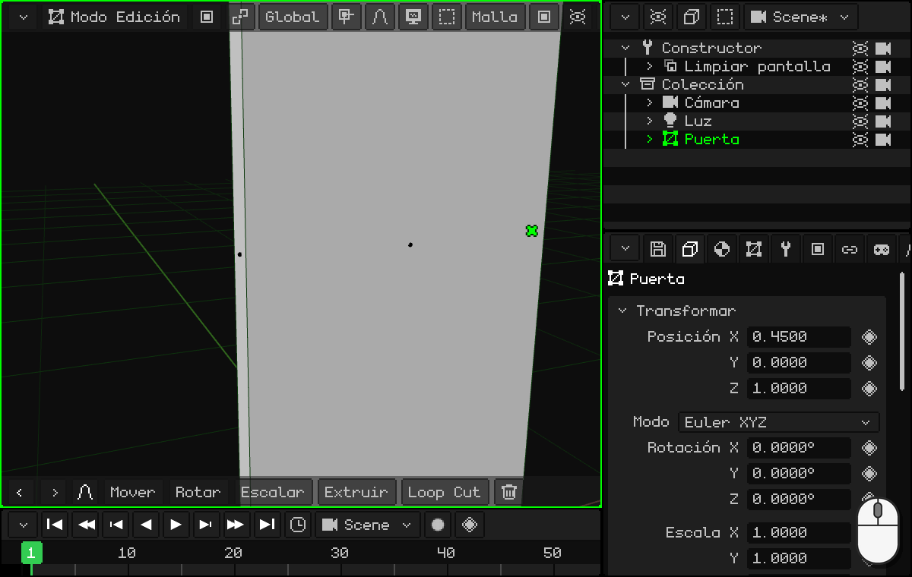

 En una pantalla táctil: un toque en la cara y **Malla → Duplicar** (la copia queda encima). Después **Escalar**, **Mover** y **Extruir** en la barra de herramientas, con los números en el teclado de la barra de arriba, y la tilde.

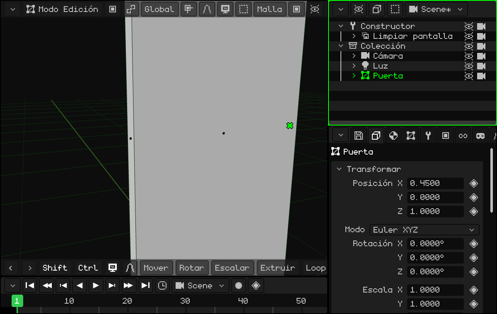

 En el Nokia N95: **Malla → Duplicar** con la soft izquierda; después <kbd>3</kbd> (escalar), <kbd>1</kbd> (mover) y <kbd>7</kbd> (extruir), con el lápiz mantenido para los números y <kbd>OK</kbd>.

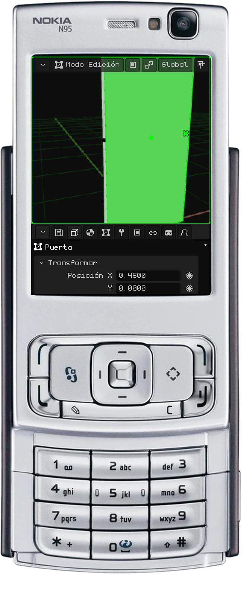

## 2. Separar la placa

La placa todavía es parte de la malla de la puerta. La pasamos a un objeto propio:

1. Con la placa elegida, <kbd>L</kbd> (**Seleccionar Vinculado**) elige toda la pieza: las 6 caras de la placa, sin la puerta.
2. <kbd>P</kbd> (**Separar**): la placa pasa a ser un objeto nuevo, **Puerta.001**. Lo ves en el Outliner.

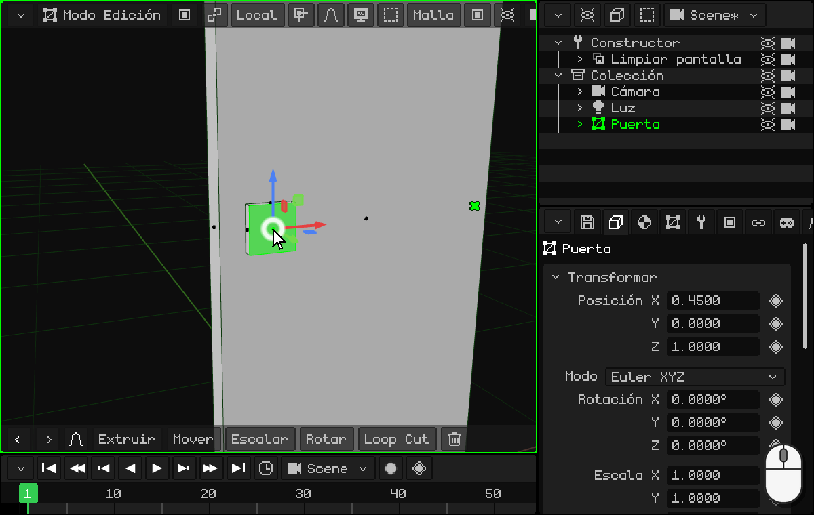

  En táctil y en el N95: **Seleccionar → Seleccionar Vinculado** y un toque en la placa; después **Malla → Separar**.

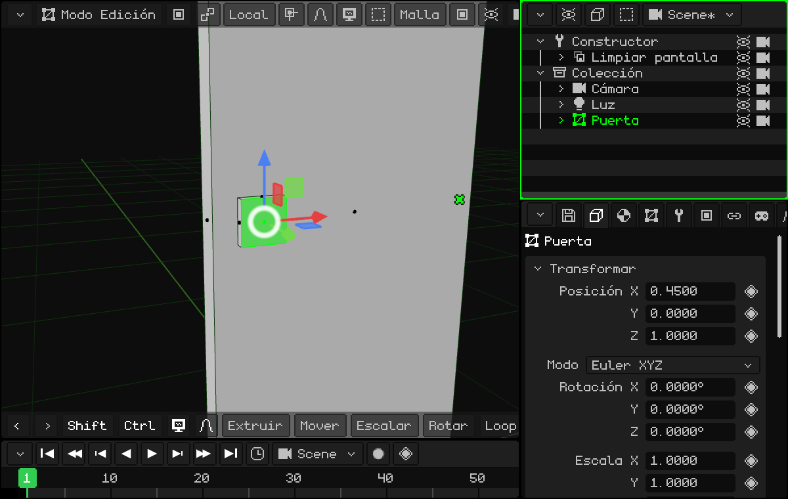

Al separar, no queda nada de la placa en la puerta: ni sus caras ni sus líneas.

## 3. Los materiales: madera y metal

Ahora cada parte puede tener su material. En **Propiedades**, en la pestaña **Material**:

1. Elegí la puerta. En **Renombrar Material** escribí `Madera`, y en **Color** elegí un marrón.
2. Elegí la placa (Puerta.001). Como salió de la puerta, también tiene la Madera: tocá **Nuevo Material**, llamalo `Metal` y dale un gris.

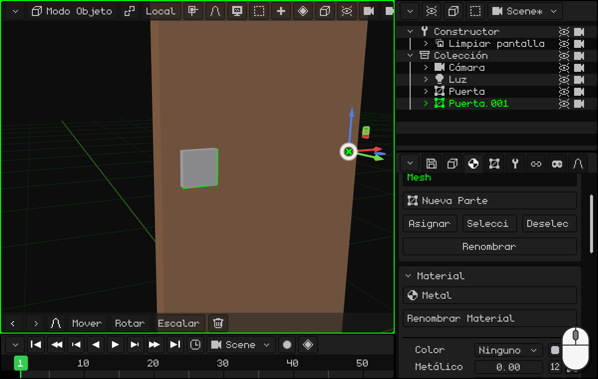

## 4. Del otro lado de la puerta: el Espejo

Un picaporte va de los dos lados. En vez de hacer otra placa, usamos el modificador **Espejo**:

1. Con la placa elegida, en **Propiedades → Modificadores**, agregá **Espejo**.
2. Apagá **Espejo X** y prendé **Espejo Y**: aparece la otra placa, del otro lado de la puerta.

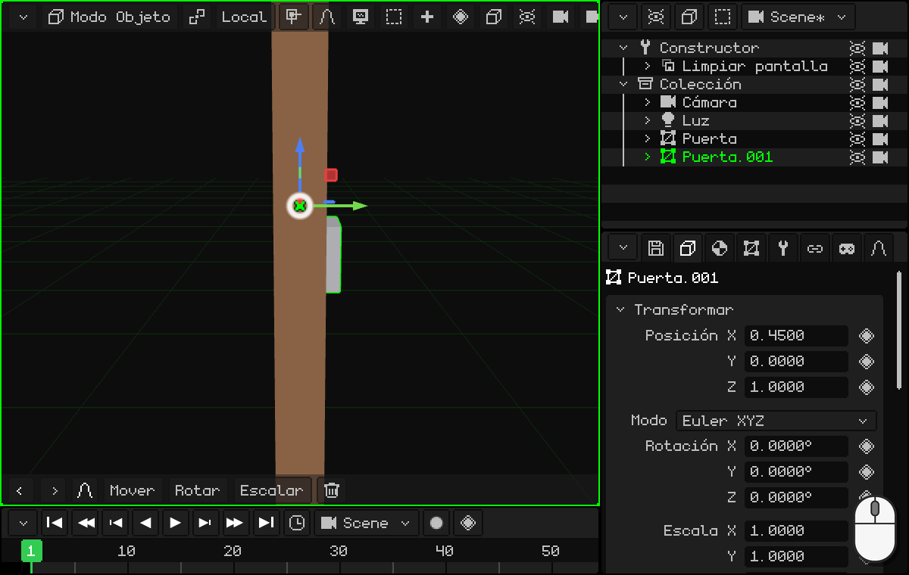

El espejo se hace sobre el **origen** del objeto. La placa salió de la puerta, así que tiene el mismo origen: la bisagra, justo en la mitad del grosor de la puerta. Por eso la copia queda exactamente del otro lado. Ver [Espejo](../editor/modificador-espejo.md).

## 5. La manija

La manija sale de la placa, con el mismo truco:

1. Con la placa elegida, apretá <kbd>/</kbd> en el teclado numérico (**Vista local**): se ve solo la placa, más fácil de trabajar. Entrá al **Modo Edición**.
2. Elegí la cara de adelante de la placa, **duplicala** (<kbd>Shift</kbd> + <kbd>D</kbd> y click derecho) y achicala: <kbd>S</kbd> `0.6` <kbd>Enter</kbd>.
3. **Extruila** hacia afuera: <kbd>E</kbd> `0.08` <kbd>Enter</kbd>. Es el eje de la manija.

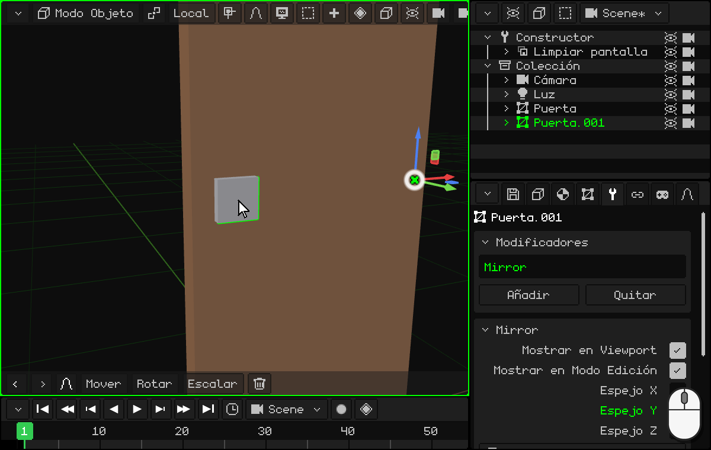
4. Pasá a **Arista** y elegí la arista de afuera del lado del borde de la puerta. Movela hacia afuera: <kbd>G</kbd> <kbd>Y</kbd> `0.05` <kbd>Enter</kbd>. La cara de adelante queda inclinada.
5. Pasá a **Cara** y elegí esa cara inclinada. Extruila **en X**, no en su normal: <kbd>E</kbd>, <kbd>X</kbd>, `0.34` y <kbd>Enter</kbd>. Sale el brazo de la manija.
6. La punta quedó inclinada. Para dejarla derecha, escalala a cero en X: <kbd>S</kbd> <kbd>X</kbd> `0` <kbd>Enter</kbd>. Todos sus vértices quedan a la misma X: la punta queda plana.

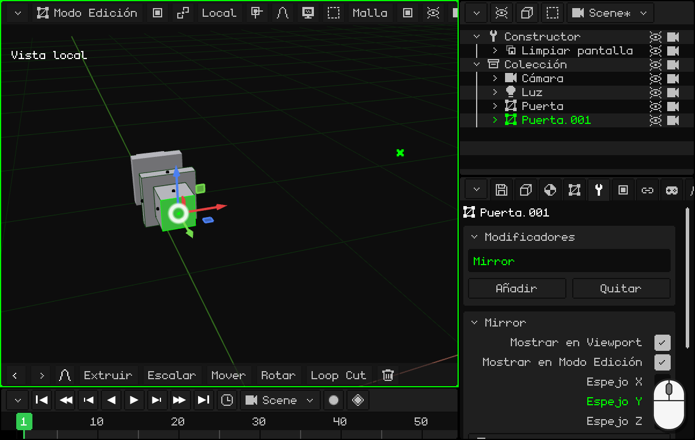
7. <kbd>L</kbd> elige toda la manija y <kbd>P</kbd> la separa: queda en **Puerta.002**. Ponele un nombre: doble click en el Outliner y escribí `Manija`.

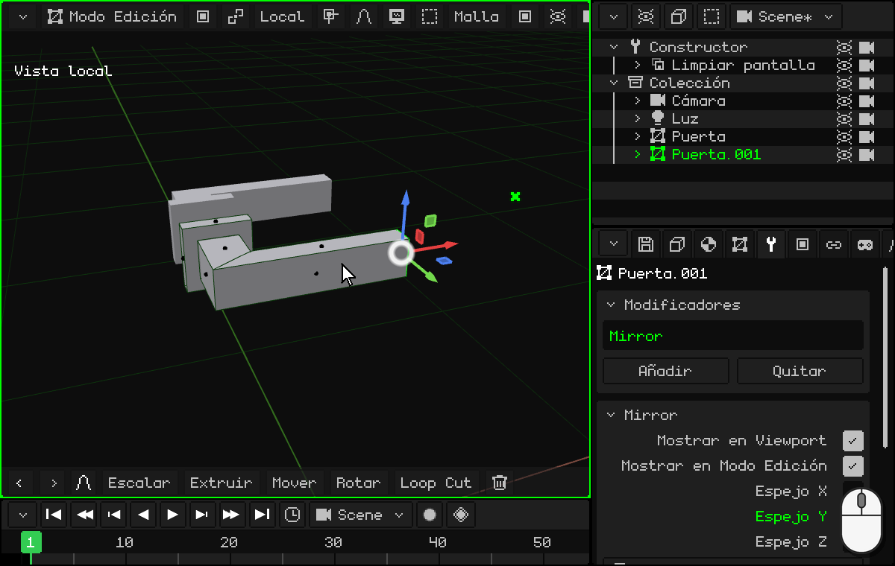

 En una pantalla táctil: un toque en la cara, **Malla → Duplicar**, **Escalar** `0.6` y **Extruir** `0.08`; **Arista**, un toque en la de afuera y **Mover** **Y** `0.05`; **Cara**, un toque en la inclinada, **Extruir** **X** `0.34` y **Escalar** **X** `0`. Para separar, **Seleccionar → Seleccionar Vinculado** y **Malla → Separar**.

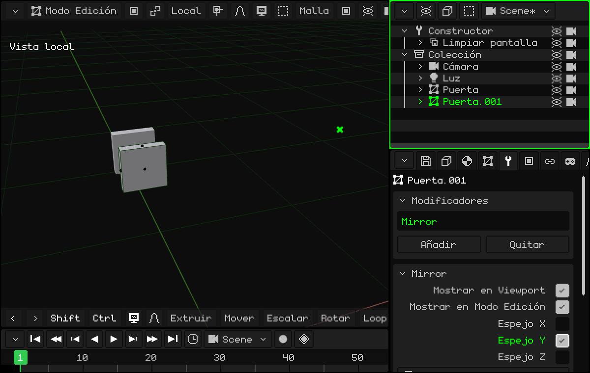

 En el Nokia N95: <kbd>3</kbd> y `0.6`, <kbd>7</kbd> y `0.08`; la arista (con el mouse virtual), <kbd>1</kbd>, <kbd>2</kbd> (el eje Y) y `0.05`; la cara inclinada, <kbd>7</kbd>, <kbd>1</kbd> (el eje X) y `0.34`; <kbd>3</kbd>, <kbd>1</kbd> y `0`.

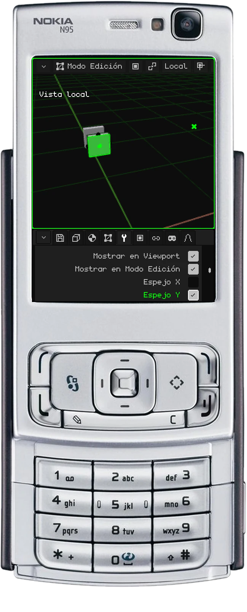

La manija salió de la placa, así que trae su material (Metal) y su modificador Espejo.

## 6. Unir la placa a la puerta

La placa no se mueve sola: es parte de la puerta. La volvemos a unir:

1. Elegí la placa y, en **Modificadores**, tocá **Aplicar Modificador**: el espejo se vuelve geometría de verdad.
2. Elegí la placa, después la puerta con <kbd>Shift</kbd> + click (la puerta queda activa) y <kbd>Ctrl</kbd> + <kbd>J</kbd> (**Unir**). Ahora son una sola malla, con sus dos materiales.

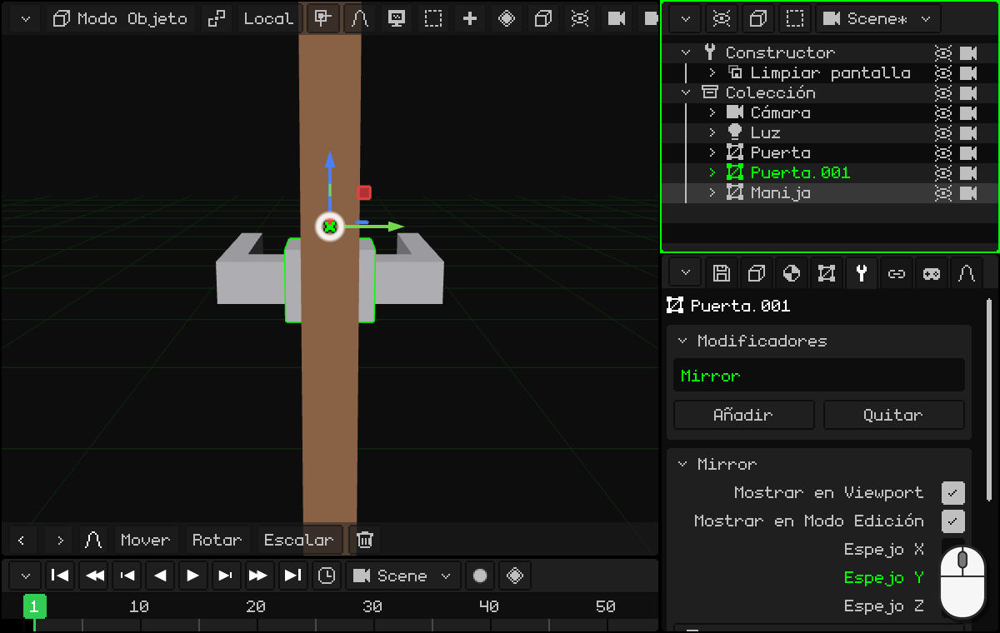

  En táctil y en el N95: **Objeto → Unir**.

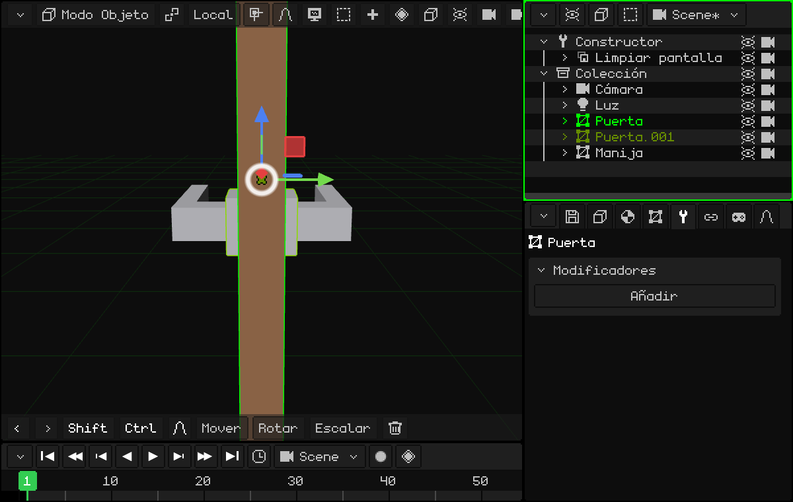

Así se separan y se unen partes de una malla: <kbd>P</kbd> para separar, <kbd>Ctrl</kbd> + <kbd>J</kbd> para unir.

## 7. Las caras que nunca se ven

La placa está apoyada contra la puerta. La cara de atrás de cada placa queda tapada: nunca se va a ver, pero el programa la dibuja igual. Para verla:

1. Elegí la puerta y entrá al **Modo Edición**.
2. En **Superposiciones**, prendé **Rayos X**: la malla se vuelve transparente y se ven las caras de atrás.
3. Elegí la cara de atrás de cada placa (la que toca la puerta) y borralas: <kbd>X</kbd> → **Caras**.

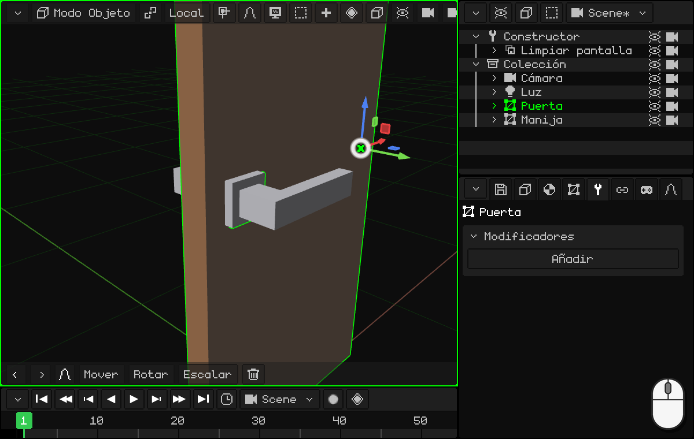

Conviene borrar la geometría que no se ve: son caras que se dibujan para nada. En un modelo chico no se nota, pero en una escena grande, o en un teléfono, es rendimiento que se gana.

## 8. Dónde gira la manija: el origen

La manija tiene que girar sobre su eje, no sobre la bisagra de la puerta.

1. Elegí la manija y aplicá su Espejo (**Modificadores → Aplicar Modificador**).
2. Entrá al **Modo Edición**, con **Rayos X**. Elegí las dos caras de atrás de la manija, las que tocan las placas (una de cada lado).
3. <kbd>Shift</kbd> + <kbd>S</kbd> → **Cursor a lo seleccionado**: el cursor 3D queda en el medio de las dos, justo en el eje de la manija.
4. Esas dos caras tampoco se ven: borralas (<kbd>X</kbd> → **Caras**).
5. Volvé al **Modo Objeto** y llevá el origen al cursor: <kbd>W</kbd> (o click derecho) → **Definir Origen → Origen al Cursor 3D**.

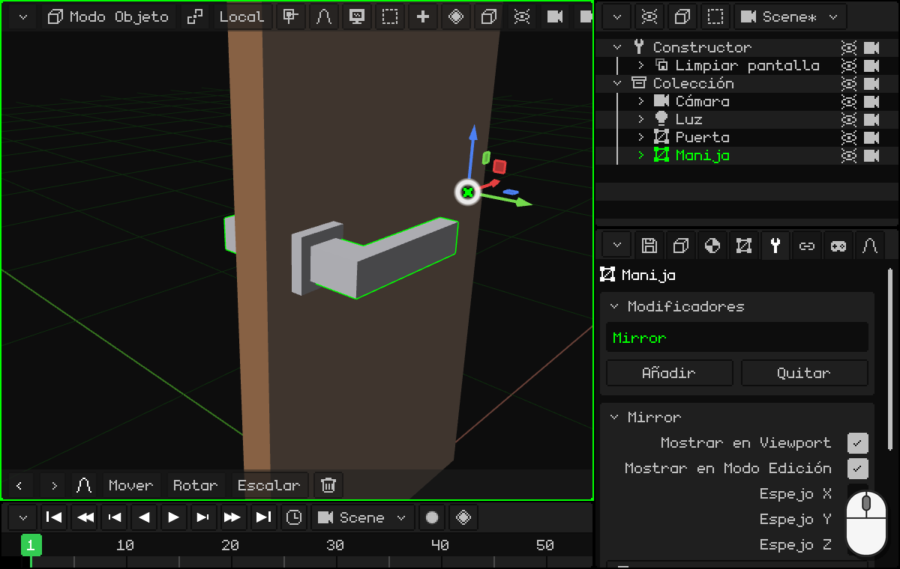

Es lo mismo que hicimos con la bisagra en [Cambiar el origen: una puerta](puerta.md#llevar-el-origen-a-la-bisagra).

## 9. Que la manija acompañe a la puerta

Probá girar la puerta: la manija se queda flotando en el aire. Son dos objetos sueltos. Deshacé el giro (<kbd>Ctrl</kbd> + <kbd>Z</kbd>).

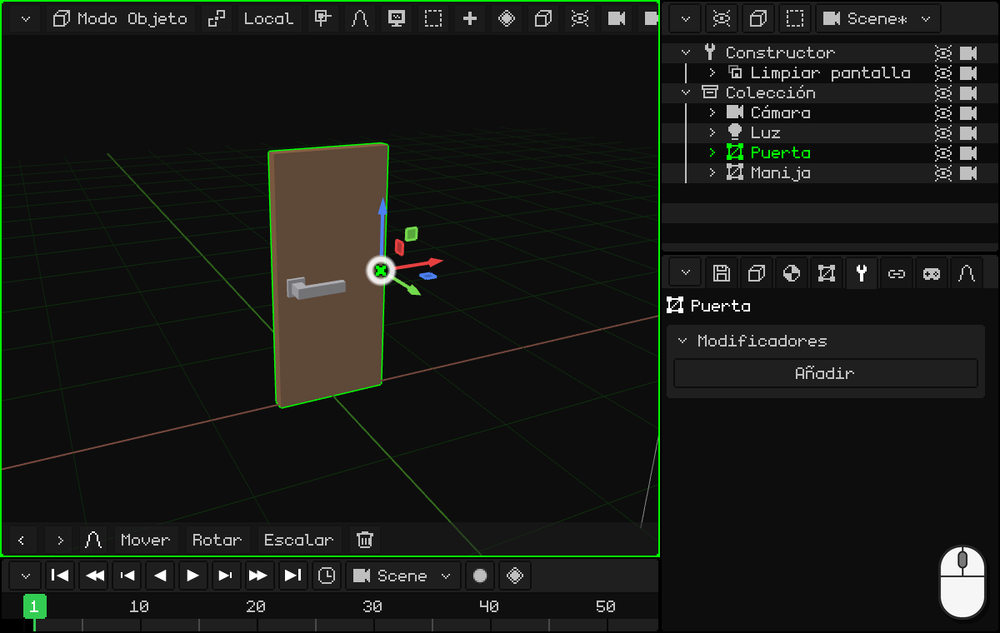

Para que la manija se mueva con la puerta, hay que **emparentarla**: la manija pasa a ser **hija** de la puerta.

1. Elegí la manija y después la puerta con <kbd>Shift</kbd> + click (la puerta, el padre, queda activa).
2. <kbd>Ctrl</kbd> + <kbd>P</kbd> → **Objeto (Mantener Transform.)**. En el Outliner, la manija queda adentro de la puerta.

Elegí solo la puerta (un click en ella) y girala otra vez: ahora la manija la acompaña. Y la manija sigue girando sobre su propio eje, como un picaporte de verdad. Si están elegidas las dos, gira solo la puerta, y la manija la sigue por ser su hija.

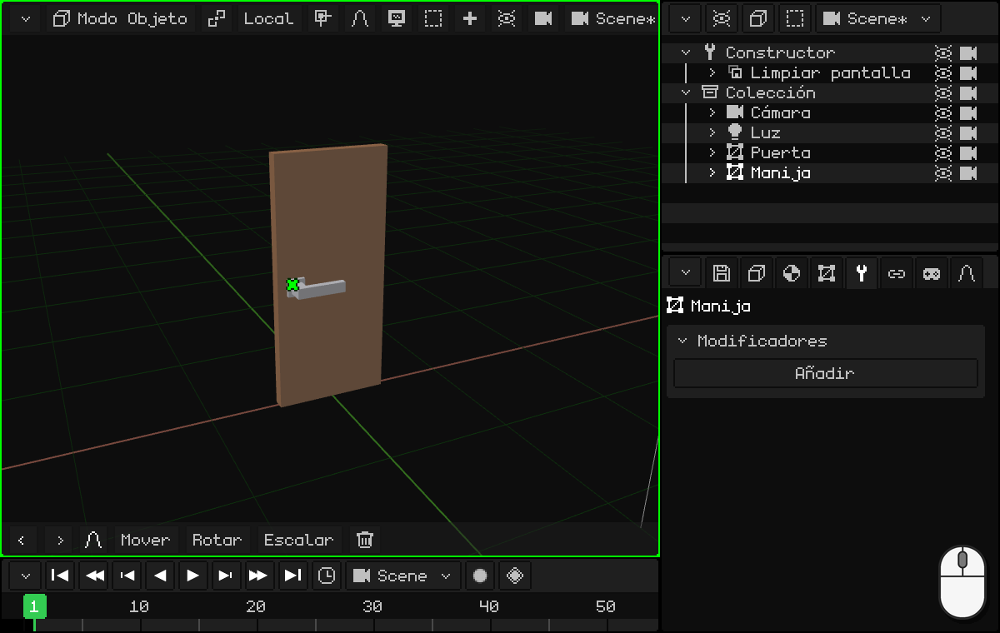

  En táctil y en el N95: **Objeto → Emparentar → Objeto (Mantener Transform.)**.

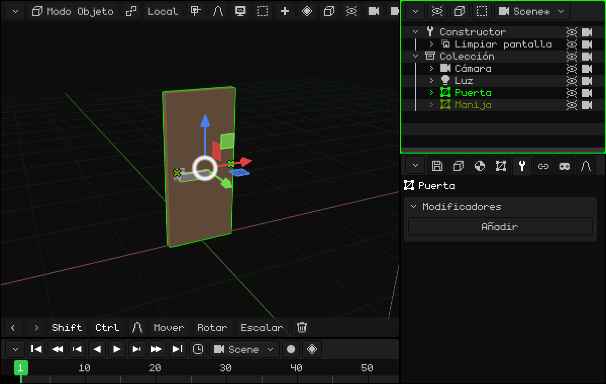

En el próximo tutorial vamos a animar la puerta: [Animar la puerta](animar-puerta.md).
