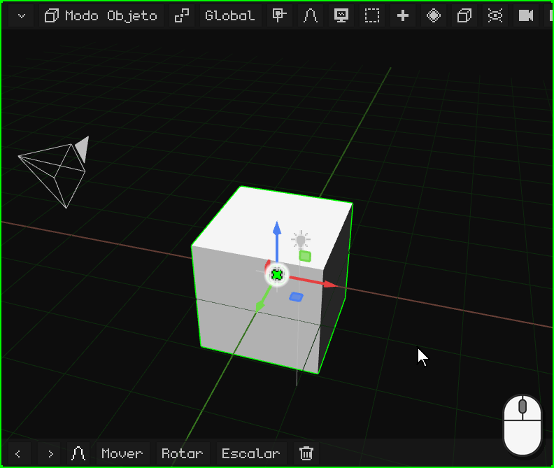
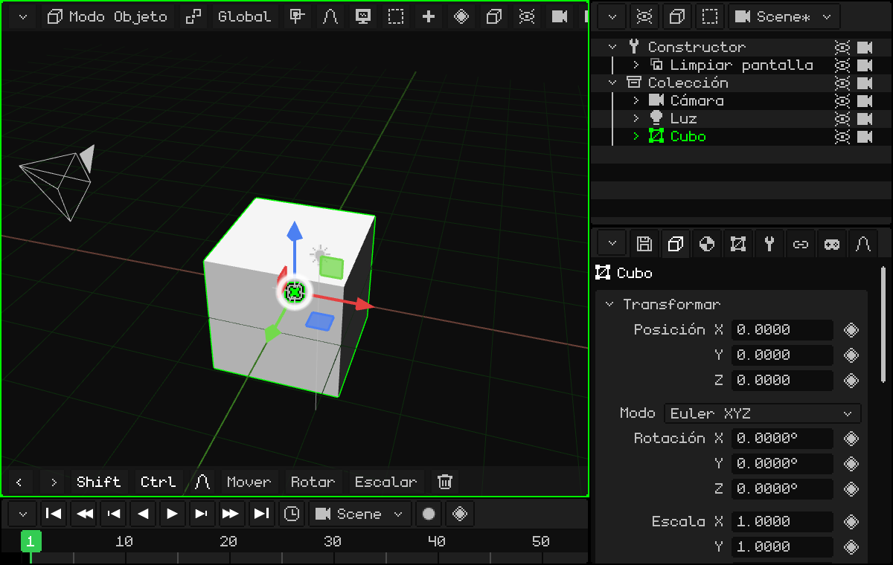
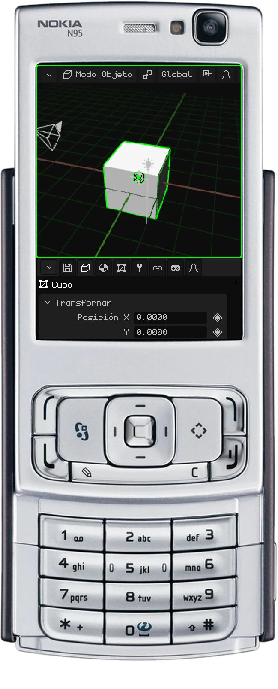
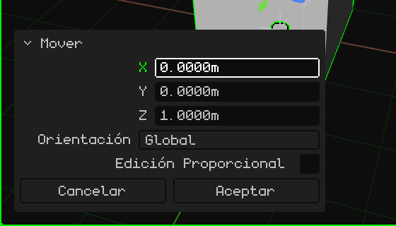
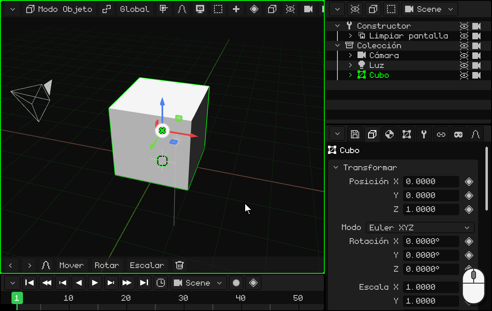
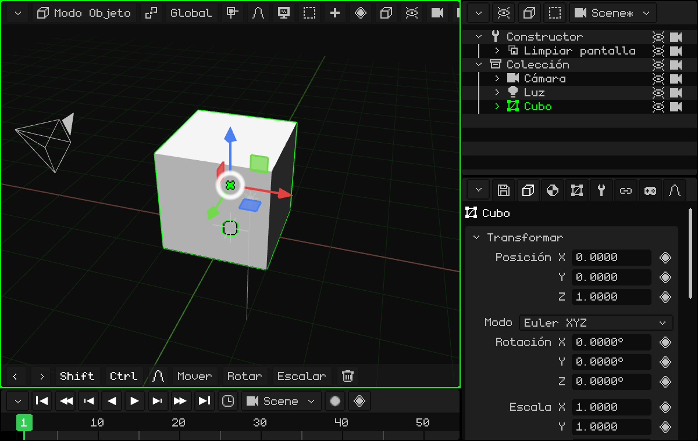
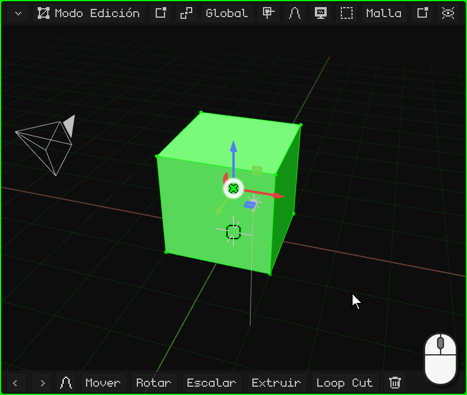
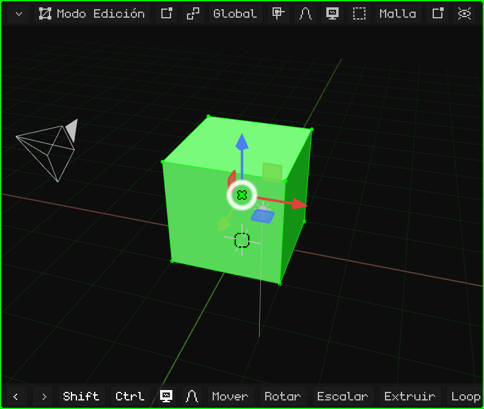
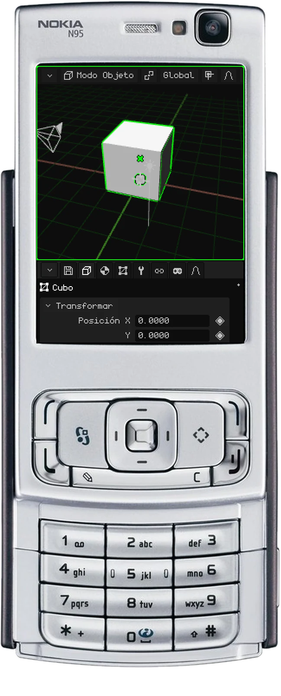
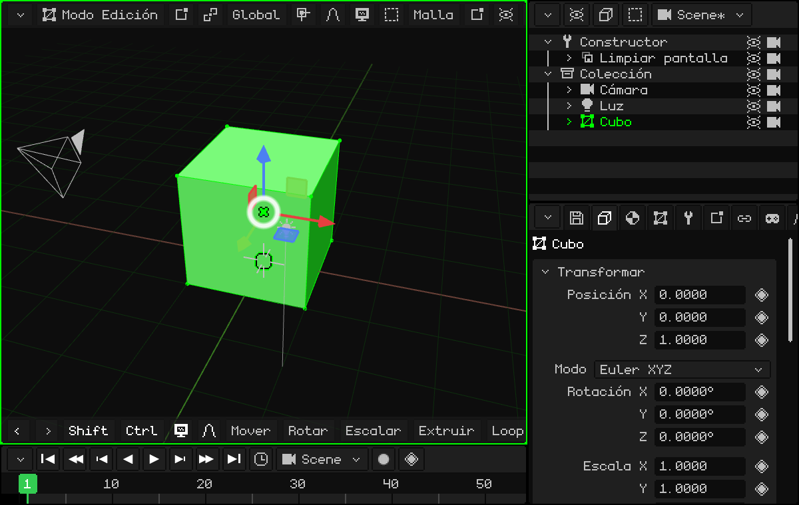

# Modelar una puerta

Vamos a hacer nuestro primer modelo simple: ¡una puerta! Para empezar nos sirve el cubo que viene en la escena, que mide 2 × 2 × 2 metros.

Yo (Dante) uso mucho las puertas para crear espacios: es algo que aprendí estudiando construcción. Las puertas casi siempre miden 2 metros de alto, y una persona (normalmente) mide menos que una puerta. Con una puerta en la escena tenés enseguida la escala de todo lo demás.

## Apoyarla en el piso

El cubo tiene su centro en el piso, así que la mitad queda abajo. Lo subimos 1 metro en el eje Z para que quede apoyado. Con el cubo elegido:

 Apretá <kbd>G</kbd>: el cubo sigue al mouse. Después <kbd>Z</kbd>: queda atado al eje Z (aparece la línea azul). Escribí `1` y apretá <kbd>Enter</kbd>.

 Tocá **Mover** en la barra de herramientas, después **Z**, un toque en la barra de arriba para el teclado numérico, `1`, **OK** y la tilde verde.

 <kbd>1</kbd> (mover), <kbd>3</kbd> (el eje Z), el **lápiz** mantenido y <kbd>1</kbd>, y <kbd>OK</kbd>.

Cómo se escriben los números en cada dispositivo está en [Con números exactos](modo-objeto.md#con-números-exactos).

### Corregir la última operación

Después de mover, rotar o escalar aparece abajo a la izquierda una ficha chica, **Ajustar la última operación**, en lugar de la barra de herramientas. Plegada solo dice qué hiciste (por ejemplo, **Mover**); un toque o un click en su título la despliega:

Cada valor se puede corregir: si en vez de 1 metro querías 1,2, tocás Z, escribís `1.2` y la operación se vuelve a hacer con el valor nuevo. **Aceptar** la cierra y vuelve la barra de herramientas; **Cancelar** deshace la operación.

## Darle forma

Hay dos formas de modelar la puerta.

### La más fácil, que no recomiendo: escalar el objeto

En el Modo Objeto, escalá el cubo en el eje X y en el eje Y hasta que tenga la forma de la puerta. Por ejemplo, <kbd>S</kbd> <kbd>X</kbd> `0.45` <kbd>Enter</kbd> (90 cm de ancho) y <kbd>S</kbd> <kbd>Y</kbd> `0.05` <kbd>Enter</kbd> (10 cm de grueso).

No la recomiendo porque el objeto queda con una escala distinta en cada eje (0,45, 0,05 y 1), y lo ideal es que tenga escala **1** en sus tres ejes (ver [Mejor con la escala en 1](modo-objeto.md#mejor-con-la-escala-en-1)). Si llegás a hacerlo así, **siempre aplicá la transformación**: <kbd>Ctrl</kbd> + <kbd>A</kbd> → **Escalar** (o Objeto → Aplicar → Escalar). La forma no cambia y la escala vuelve a 1.

 En una pantalla táctil: **Escalar**, **X**, la barra de arriba, `0.45` y OK, y lo mismo con **Y** y `0.05`. Después, **Objeto → Aplicar → Escalar**.

### La que recomiendo: el Modo Edición

Con el cubo elegido, entrá al Modo Edición: apretá <kbd>Tab</kbd> o elegí **Modo Edición** en el botón del modo de la Vista 3D. Al entrar, todos los vértices quedan elegidos.

En el Modo Edición se eligen **vértices**, **aristas** y **caras**: eso es lo básico. Y, al igual que en el Modo Objeto, se pueden mover, rotar y escalar (ver [Modo Edición](../editor/modo-edicion.md)).

Con todo elegido, achicá en X y en Y hasta tener la puerta como la querés. En Z no hace falta, ¡porque ya mide 2 metros! Como lo que cambia es la malla y no el objeto, la escala sigue en 1.

**A ojo, con el gizmo:** un click (o un toque) en el centro del gizmo lo pasa a Rotar, y otro a **Escalar**. Agarrá la punta roja (X) y arrastrala hacia el centro hasta el ancho que quieras; después la verde (Y), hasta que quede finita como una puerta.

**Con números:** <kbd>S</kbd>, <kbd>X</kbd>, `0.45`, <kbd>Enter</kbd> y <kbd>S</kbd>, <kbd>Y</kbd>, `0.05`, <kbd>Enter</kbd>.

 En una pantalla táctil: el botón del modo → **Modo Edición**; después **Escalar**, **X**, un toque en la barra de arriba, `0.45`, **OK** y la tilde, y lo mismo con **Y** y `0.05`.

 En el Nokia N95: <kbd>OK</kbd> pasa al Modo Edición. <kbd>3</kbd> (escalar), <kbd>1</kbd> (el eje X), el lápiz mantenido y `0` <kbd>*</kbd> `45` (el <kbd>*</kbd> es el punto), y <kbd>OK</kbd>. Lo mismo con <kbd>2</kbd> (el eje Y) y `0.05`.

## Con medidas exactas

Si en vez de hacerlo a ojo querés, por ejemplo, una puerta de exactamente **90 cm de ancho**: en el botón **Vértice / Arista / Cara** elegí **Cara** y hacé click en uno de los costados. Sabemos que el cubo mide 2 metros, así que tenemos que restarle lo que sobra para que quede en 0,9: hay que correr ese costado **1,1 metros**. <kbd>G</kbd> <kbd>X</kbd> `-1.1` <kbd>Enter</kbd>.

Al movernos, el eje **X** bloquea el movimiento en un solo eje, para que el cubo no se deforme:

-  Con la tecla <kbd>X</kbd>.
-  Con un toque en **X** en la barra de herramientas. El `-1.1` se escribe con el teclado numérico, tocando la barra de arriba.
-  Con <kbd>1</kbd> mientras se mueve. El número se escribe con el lápiz mantenido: <kbd>#</kbd> le cambia el signo y <kbd>*</kbd> es el punto. La cara se elige con el mouse virtual (la tecla de selección derecha, las flechas y <kbd>OK</kbd>).

Para el grosor, con todo elegido, <kbd>S</kbd> <kbd>Y</kbd> `0.05` <kbd>Enter</kbd>, como antes.

¡Y ya tenemos nuestro primer modelo 3D! Felicitaciones.

En el próximo tutorial vamos a hacer que la puerta se abra desde la bisagra: [Cambiar el origen: una puerta](puerta.md).
