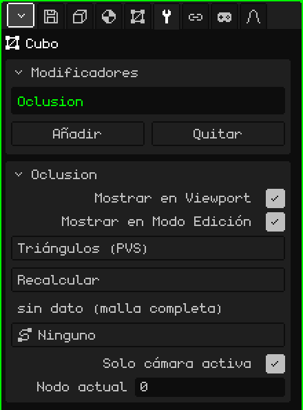

# Culling

El modificador **Culling** dibuja solo los triángulos de la malla que se ven desde la zona donde está la cámara. Usa listas de visibilidad calculadas de antemano, una por zona, como hacían los juegos de PlayStation 1 (un **PVS**, *conjunto potencialmente visible*). Sirve para escenarios grandes: de un nivel entero, solo se dibuja lo que se ve desde el pasillo donde estás.

 Está pensado para el Nokia N95, donde cada triángulo que no se dibuja es velocidad que se gana. Cambiar de zona casi no cuesta: las listas se arman una sola vez y, al pasar de una zona a otra, solo cambia cuál se usa. No hay ningún cálculo por cuadro.



## Cómo se agrega

1. Elegí la malla del escenario.
2. En Propiedades, abrí la pestaña **Modificadores** (el ícono de la llave).
3. Tocá **Añadir** y elegí **Culling**.

En la lista aparece con su nombre interno, **Oclusion**, y debajo se abre la tarjeta con sus parámetros. No toca la malla: solo elige qué triángulos dibujar, así que la malla sigue entera y editable. Por eso no tiene Aplicar Modificador.

No hay que confundirlo con el objeto **Culling** del menú Añadir de la Vista 3D, que trabaja con objetos enteros y no con los triángulos de una malla.

## De dónde salen los datos

El modificador no calcula qué se ve: lo lee de un archivo que acompaña al modelo. Para una malla importada de `nivel.obj`, busca `nivel.pvs.json` en la misma carpeta:

```json
{ "sectores": 2, "tris": [[0, 1], [2, 3]] }
```

`sectores` es cuántas zonas hay, y `tris` tiene, para cada zona, los triángulos que se dibujan, numerados desde 0 en el orden de las caras del `.obj`. Lo normal es que venga del juego original o de una herramienta aparte. Cada zona es un **nodo**: el nodo 1 es la primera lista, y el nodo 0 dibuja la malla completa.

## Parámetros

| Parámetro | Qué hace |
|---|---|
| Mostrar en Viewport | Apagado, se dibuja la malla completa. |
| Mostrar en Modo Edición | No cambia nada: en el Modo Edición la malla se dibuja siempre completa. |
| Método | **Triángulos (PVS)** usa las listas del `.pvs.json`. **BSP (pendiente)** aparece en gris: todavía no se puede elegir. |
| Recalcular | Vuelve a leer el `.pvs.json`, por ejemplo después de regenerarlo. Avisa "PVS recalculado" o, si no lo encuentra, "PVS: falta <modelo>.pvs.json junto al .obj de origen". |
| (línea de estado) | Debajo de Recalcular: "4 nodos \| nodo activo: 2", "sin dato (malla completa)" si no hay archivo, o "sidecar sin cargar (Recalcular)". |
| Ruta | Una ruta de la escena (**Añadir → Ruta**), por ejemplo el riel por donde va la cámara. Cada nodo de la ruta es una zona, y el motor elige solo el nodo más cercano al ojo. En **Ninguno**, la zona se pone a mano o desde un script. |
| Solo cámara activa | Prendido (por defecto), manda la cámara activa mientras la escena se reproduce; en pausa no se elige nada solo y el nodo se pone a mano. Apagado, manda la vista del viewport: podés volar libre por el escenario y ver cómo aparecen y desaparecen los triángulos. |
| Ramas | Solo aparece si la ruta tiene más de una rama, por ejemplo el camino principal y uno de bonus. Elige qué ramas cuentan para buscar el nodo más cercano; cada rama prendida se ve en verde. El botón dice, por ejemplo, "Ramas: 3 (todas)" o "Ramas: 2/3". |
| Nodo actual | La zona que se está dibujando; 0 = la malla completa. Se puede cambiar a mano para revisar cada zona. Cuando la Ruta elige el nodo sola, el motor lo pisa. |

Desde un script, `setSector(objeto, n)` cambia el nodo activo (0 = la malla completa). Ver [Partículas, niebla y visibilidad](../lua/api-particulas-niebla.md).

## Lo que conviene saber

- Mientras la malla está en el Modo Edición se dibuja completa, para que puedas editar todo.
- Si en la lista hay otro modificador prendido que genera geometría ([Espejo](modificador-espejo.md), [Array](modificador-array.md), [Superficie de Subdivisión](modificador-subdivision.md)…), el Culling no se usa y se dibuja todo: los números de triángulo del `.pvs.json` son los de la malla original.
- Las listas nombran los triángulos por su número. Si editás la malla y agregás o borrás caras, los números cambian y las listas pueden quedar apuntando a otros triángulos: el Culling es para escenarios terminados, no para los que todavía se están modelando.

Volver a [Malla 3D](objeto-malla.md)
