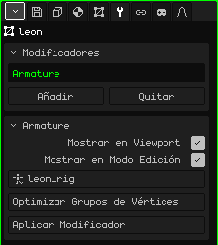

# Esqueleto

El modificador **Esqueleto** hace que la malla siga a los huesos de un esqueleto: cuando posás o animás el esqueleto, la malla se dobla con él. Es lo que convierte un modelo quieto en un personaje que camina, salta o saluda.

## Cómo se agrega

1. Elegí la malla.
2. En Propiedades, abrí la pestaña **Modificadores** (el ícono de la llave).
3. Tocá **Añadir** y elegí **Esqueleto**.

En la lista aparece con su nombre interno, **Armature**, y debajo se abre la tarjeta con sus parámetros. Como todos los modificadores, no destruye la malla: la pose de reposo sigue intacta. Se puede apagar, sacar con **Quitar** u hornear con **Aplicar Modificador**.

Al importar un FBX o un glTF con esqueleto, el modificador ya viene puesto y apuntando a su esqueleto.

## Parámetros

| Parámetro | Qué hace |
|---|---|
| Mostrar en Viewport | Apagado, la malla no se deforma: queda en su pose de reposo. |
| Mostrar en Modo Edición | Apagado, mientras editás los vértices la malla queda en reposo, sin deformar. |
| Objetivo | El esqueleto que la mueve. La lista muestra solo los esqueletos de la escena. En **Ninguno**, no se deforma. |
| Optimizar Grupos de Vértices | Deja a cada vértice con un solo hueso, el que más lo movía, con el peso completo. Pide confirmación porque los pesos intermedios se pierden. |
| Aplicar Modificador | Hornea en la malla la pose del cuadro actual y saca el modificador: la malla queda congelada en esa pose. El esqueleto no se toca. Se puede deshacer. |

## Cómo sabe la malla qué hueso la mueve

Con los **grupos de vértices**. Cada grupo lleva el **mismo nombre que un hueso** y dice qué vértices mueve ese hueso y cuánto: el **peso**, de 0 (nada) a 1 (todo). Un vértice puede estar en varios grupos; en un codo, mitad en el brazo y mitad en el antebrazo, para que se doble suave.

Los grupos están en la pestaña **Malla 3D**, tarjeta **Grupos de Vértices**:

| Botón | Qué hace |
|---|---|
| Añadir Grupo de Vértices / Renombrar | Crea un grupo y le pone nombre. Tiene que ser igual al del hueso, letra por letra. |
| Asignar / Quitar | En el Modo Edición, mete en el grupo los vértices seleccionados (con peso 1) o los saca. |
| Seleccionar / Deseleccionar | Muestra qué vértices tiene el grupo. |

Para los pesos finos, como las transiciones de hombros y rodillas, usá la [Pintura de Pesos](../editor/pintura.md#pintura-de-pesos): pinta el peso del grupo elegido, de azul (nada) a rojo (todo).

## Paso a paso

1. Armá el esqueleto (**Añadir → Esqueleto**) y acomodá los huesos adentro del modelo (ver [Esqueletos](../editor/esqueletos.md)).
2. Agregale a la malla el modificador **Esqueleto** y en **Objetivo** elegí el esqueleto.
3. Creá un grupo por hueso, con su mismo nombre, y asigná o pintá los pesos.
4. Elegí el esqueleto, pasá al **Modo Pose** y mové un hueso: la malla lo sigue.

## Lo que conviene saber

- El lugar del Esqueleto en la lista no cambia nada: no se calcula junto con los demás, sino que deforma la malla en cada cuadro, al dibujarla.
- Deforma la malla original. Si hay otros modificadores prendidos que generan geometría ([Espejo](modificador-espejo.md), [Array](modificador-array.md), [Superficie de Subdivisión](modificador-subdivision.md), [Tornillo](modificador-screw.md), [Booleano](modificador-booleano.md)), lo que se ve es la malla generada, que no sigue a los huesos. Aplicalos antes de animar.
- Aplicar uno de esos modificadores (salvo el Espejo) vacía la lista entera, y el Esqueleto también se va. Los grupos de vértices quedan: volvé a agregar el Esqueleto y elegí otra vez el Objetivo.

 En el Nokia N95, deformar la malla en cada cuadro cuesta, y más cuantos más huesos influyen en cada vértice. **Optimizar Grupos de Vértices** deja uno solo por vértice y el skinning va mucho más rápido; a cambio, las articulaciones se doblan más duras. Hacelo al final, cuando los pesos ya estén listos.

Volver a [Malla 3D](objeto-malla.md)
