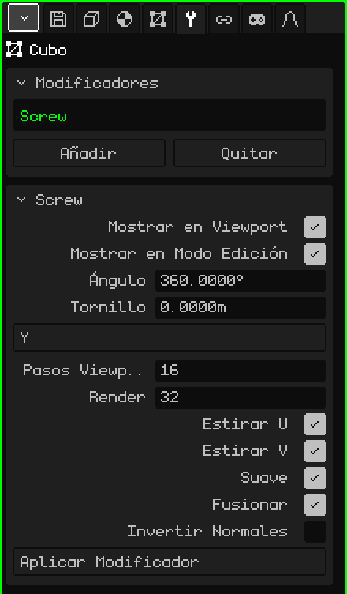

# Tornillo

El modificador **Tornillo** (*Screw*, en inglés) hace girar un perfil alrededor de un eje y arma la superficie que deja al girar, como un torno. Dibujás media silueta de un jarrón, una copa o una botella, y el Tornillo la convierte en el objeto entero. Si además el perfil sube mientras gira, sale una rosca o un resorte.

## Cómo se agrega

1. Elegí la malla con el perfil.
2. En Propiedades, abrí la pestaña **Modificadores** (el ícono de la llave).
3. Tocá **Añadir** y elegí **Tornillo**.

En la lista aparece con su nombre interno, **Screw**, y debajo se abre la tarjeta con sus parámetros. Como todos los modificadores, no destruye la malla: el perfil sigue ahí y lo podés editar mientras ves el resultado. Se puede apagar, cambiar de lugar con **Subir** y **Bajar**, sacar con **Quitar** u hornear con **Aplicar Modificador**.

## El perfil

El perfil es una línea: vértices unidos por aristas, sin caras. El eje del giro pasa por el **origen** de la malla, así que la distancia de cada vértice al origen es el radio del objeto en esa altura. Una forma de dibujarlo:

1. **Añadir → Malla → Vértice** crea un vértice suelto en el origen y entra directo al Modo Edición.
2. Mirá desde el frente (ver [Navegar en la Vista 3D](navegacion.md#las-vistas-de-frente-de-costado-y-de-arriba)).
3. Con **Extruir Vértices** (menú Malla → Vértice) sacá el vértice siguiente hacia el costado para hacer el fondo, y después hacia arriba para la pared, punto por punto.

Los vértices que quedan sobre el eje cierran el objeto: el primero, en el origen, es el centro del fondo del jarrón.

## Parámetros

| Parámetro | Qué hace |
|---|---|
| Mostrar en Viewport | Apagado, no se gira: se ve solo el perfil, ni en la vista ni al renderizar. |
| Mostrar en Modo Edición | Apagado, mientras editás el perfil se ve solo la línea. |
| Ángulo | Cuántos grados gira el perfil, del primer paso al último (por defecto 360, la vuelta entera). Con 180 sale medio objeto. Un valor negativo gira para el otro lado. Puede pasar de 360: con 1080 da tres vueltas. |
| Tornillo | Cuántos metros sube el perfil a lo largo del eje, del principio al final del giro. En 0 es un torno (jarrón, copa, botella); con otro valor, una rosca o un resorte. |
| Eje | Alrededor de qué eje gira: X, Y o Z. Por defecto es **Y**, la vertical: un perfil dibujado en la vista frontal sale parado, como un jarrón sobre la mesa. |
| Pasos Viewport | Cuántas copias del perfil se hacen a lo largo del giro en la vista, de 2 a 512 (por defecto 16). Más pasos, más redondo y más pesado. |
| Render | Los pasos que se usan al **Renderizar Imagen** o **Renderizar Animación** (por defecto 32). |
| Estirar U | Arma las coordenadas UV alrededor del giro, para que una textura envuelva el objeto como una etiqueta. |
| Estirar V | Arma las coordenadas UV a lo largo del perfil, de arriba abajo. Con los dos apagados no hay UV. |
| Suave | Sombreado suave en la superficie que se genera: se ve redonda y no facetada. Viene prendido. |
| Fusionar | Suelda los vértices que caen en el mismo lugar: los del perfil que tocan el eje (el fondo, la boca de una botella cerrada) y la costura donde se cierra la vuelta. Viene prendido. |
| Invertir Normales | Da vuelta hacia dónde miran las caras. Usalo si el objeto se ve al revés, oscuro o como visto desde adentro. |
| Aplicar Modificador | Hornea el resultado en la malla con los **Pasos Viewport**. Ver la nota de abajo. |

La vuelta se cierra sola, sin costura, solo con el Ángulo en 360 y el Tornillo en 0. Con otro ángulo, o con el perfil subiendo, el principio y el final quedan abiertos.

## Ejemplos

- **Un jarrón:** el perfil de media silueta, Ángulo 360, Tornillo 0 y entre 16 y 32 pasos.
- **Una rosca:** un perfil corto alejado del eje, Ángulo 1080 y Tornillo en 3: tres vueltas que suben un metro cada una. Subí los pasos para que la espiral no quede quebrada.

 En el Nokia N95 cada paso es una copia más del perfil para dibujar. Usá pocos Pasos Viewport mientras modelás y dejá los altos para Render.

> [!NOTE]
> Aplicar Modificador en el Tornillo hornea **todos** los modificadores de la lista que estén prendidos, no solo este, y deja la lista vacía: también se van los que estaban apagados y los que no generan geometría, como un [Esqueleto](modificador-esqueleto.md). Se puede deshacer.

Volver a [Malla 3D](objeto-malla.md)
