# El Modo Objeto

En el **Modo Objeto** se trabaja con los objetos enteros: se eligen, se mueven, se rotan, se escalan, se agregan, se borran y se meten unos adentro de otros. Es el modo en el que arranca Whisk3D, y lo dice el botón de arriba a la izquierda de la Vista 3D. Para cambiar la forma de una malla (sus vértices, aristas y caras) está el Modo Edición, que tiene su propio tutorial.

## Qué es un objeto

Todo lo que hay en la escena es un **objeto**: el cubo con que arranca un proyecto, la cámara, la luz, un personaje. Cada objeto tiene:

- un **nombre**, que se ve en el Outliner;
- su **transformación**: dónde está (posición), cómo está girado (rotación) y qué tamaño tiene (escala);
- **propiedades**, que dependen de su tipo: una luz tiene color e intensidad, una cámara tiene su lente, una malla tiene su material.

Hay objetos de muchos tipos, pero todos se eligen, se mueven, se rotan y se escalan de la misma forma.

## Elegir un objeto

| | Cómo se elige |
|---|---|
|  PC | Un click sobre el objeto. <kbd>Shift</kbd> + click suma o quita otro. Un click en el vacío no deja nada elegido. |
|  Pantalla táctil | Un toque sobre el objeto. Con **Shift** prendido en la barra de abajo de la Vista 3D, cada toque suma o quita otro. |
|  Nokia N95 | La tecla del **lápiz** pasa de un objeto al siguiente. Con el lápiz y las flechas se suma, se quita, se elige todo o nada. |

Lo elegido se ve con un borde, y el último que elegiste es el **objeto activo**: el que muestra Propiedades.

### Elegir varios con una caja

 Arrastrá el mouse con el click primario sobre la Vista 3D, empezando en el fondo: se dibuja una **caja** y, al soltar, quedan elegidos los objetos que agarró. También se arma con <kbd>B</kbd>.

 En una pantalla táctil, arrastrar un dedo orbita la vista: la caja se pide en el menú **Seleccionar → Selección por caja**, y después se arrastra el dedo.

El sentido del arrastre cambia lo que se elige, y la caja lo avisa con su color:

| Arrastre | Color de la caja | Qué elige |
|---|---|---|
| De izquierda a derecha | Verde | Solo lo que queda **entero adentro** de la caja. |
| De derecha a izquierda | Azul | Todo lo que la caja **toca**, aunque sea apenas. |

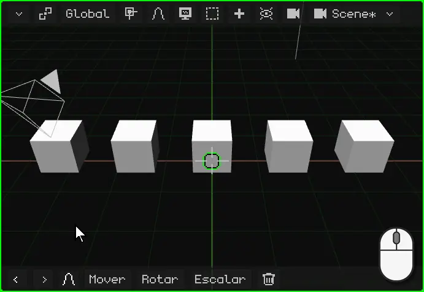

## El menú contextual

Como en cualquier programa, el **menú contextual** tiene a mano lo que se puede hacer con lo elegido. En el Modo Objeto es el menú **Objeto**, que se abre donde está el puntero:

| | Cómo se abre |
|---|---|
|  PC | Click derecho sobre la Vista 3D |
|  Pantalla táctil | Mantener un dedo quieto sobre la Vista 3D, medio segundo |
|  Nokia N95 | La soft izquierda abre la barra de menús; ahí, el menú Objeto |

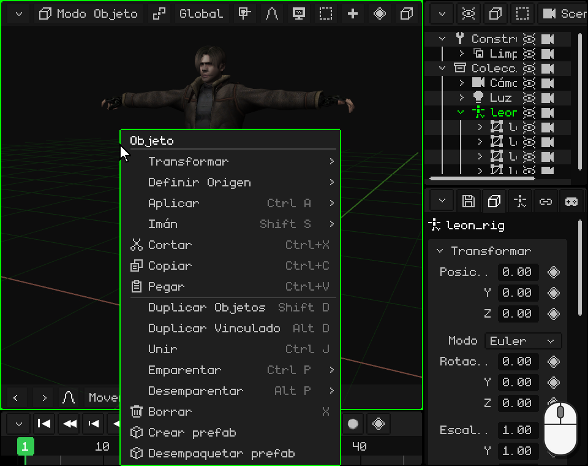

 Con Leon elegido, un dedo quieto sobre la Vista 3D: al medio segundo el teléfono vibra y se abre el menú. Al levantar el dedo no se elige nada: la opción se toca después.

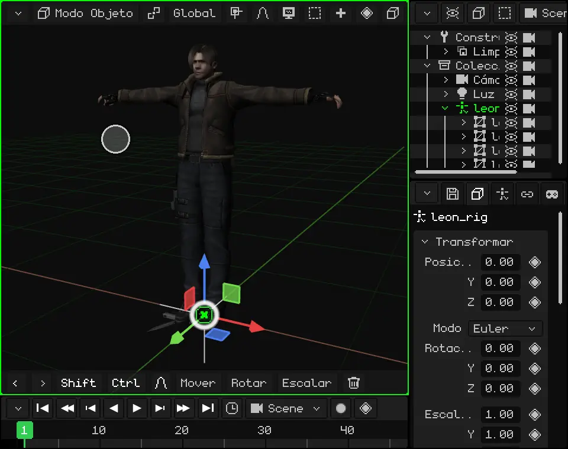

| Opción | Qué hace |  Atajo |
|---|---|---|
| **Cortar** | Guarda lo elegido para pegarlo después y lo saca de la escena. | <kbd>Ctrl</kbd> + <kbd>X</kbd> |
| **Copiar** | Guarda una copia de lo elegido, con sus hijos, para pegarla después: en esta escena, en otro proyecto o en otra ventana de Whisk3D abierta. | <kbd>Ctrl</kbd> + <kbd>C</kbd> |
| **Pegar** | Pone en la escena lo último que se copió o cortó, en el mismo lugar, y lo deja elegido. | <kbd>Ctrl</kbd> + <kbd>V</kbd> |
| **Duplicar Objetos** | Hace una copia de lo elegido, independiente del original, y la deja agarrada para que la muevas: un click (o <kbd>OK</kbd>) la deja donde está. | <kbd>Shift</kbd> + <kbd>D</kbd> |
| **Duplicar Vinculado** | Como Duplicar, pero la copia **comparte la malla** con el original: si cambiás la forma de una, cambian las dos. La posición, la rotación y la escala son de cada una. Sirve para muchas cosas iguales, como los árboles de un bosque o las sillas de un salón: se editan todas de una vez y ocupan menos memoria. | <kbd>Alt</kbd> + <kbd>D</kbd> |
| **Borrar** | Borra lo elegido. Pide confirmación. | <kbd>X</kbd> o <kbd>Supr</kbd> |

Las demás opciones del menú se ven en este mismo tutorial: Transformar (mover, rotar y escalar), [Definir Origen y el Imán](#desde-dónde-se-mueve-se-rota-y-se-escala), [Aplicar](#mejor-con-la-escala-en-1), [Emparentar y Desemparentar](#el-outliner-los-objetos-de-la-escena). **Unir** junta varias mallas en una sola, y los **prefabs** (objetos armados para reusar) tienen su propio tutorial.

## Mover, rotar y escalar

Las tres operaciones básicas de un objeto son **mover**, **rotar** y **escalar**. Cada una se puede hacer con el gizmo, con el teclado o, en una pantalla táctil, con los comandos de la barra de abajo. Si algo sale mal, **Deshacer** (<kbd>Ctrl</kbd> + <kbd>Z</kbd> en la PC) lo vuelve atrás.

### El gizmo

El **gizmo** son las flechas de colores que aparecen sobre el objeto elegido. Cada color es un eje: **rojo** es X, **verde** es Y y **azul** es Z, el de arriba.

El gizmo tiene tres modos, uno para cada operación. **Un click sobre el gizmo, sin arrastrar, pasa al siguiente**: de Mover a Rotar, de Rotar a Escalar y de Escalar otra vez a Mover.

 Un click con el mouse sobre el gizmo cambia de modo.

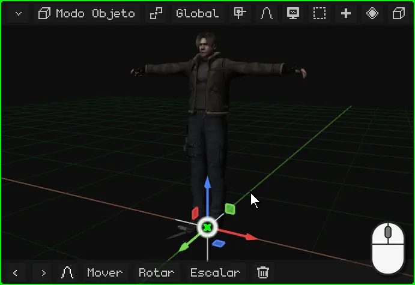

 Un toque sobre el gizmo cambia de modo.

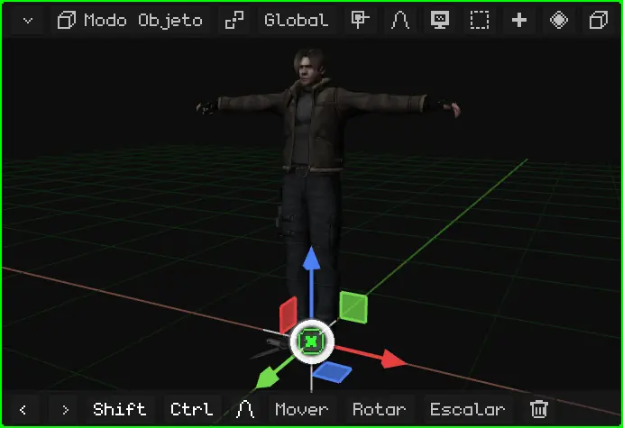

Para usarlo, se agarra una parte del gizmo y se arrastra. Al soltar, queda hecho.

| Modo | Qué se agarra | Qué hace |
|---|---|---|
| Mover | Una flecha | Mueve solo en ese eje. |
| Mover | Un cuadradito | Mueve en un plano: el cuadradito azul mueve en X e Y, sin cambiar la altura. |
| Mover | El círculo del centro | Mueve libre, siguiendo al puntero. |
| Rotar | Un semicírculo de color | Gira alrededor de ese eje. |
| Rotar | El anillo blanco | Gira de frente a la vista. |
| Escalar | Una punta cuadrada | Estira o achica en ese eje. |
| Escalar | El círculo del centro | Agranda o achica parejo, en los tres ejes. |

 Con el mouse: click en una parte del gizmo y arrastrar.

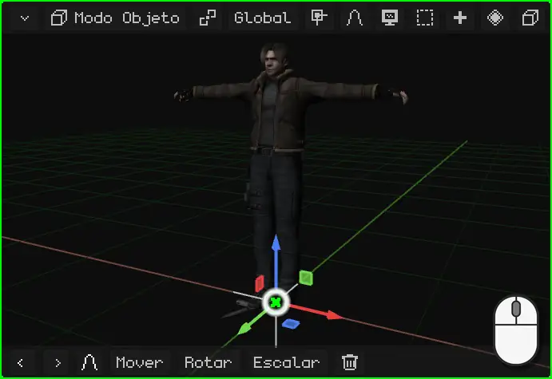

 Con el dedo: apoyarlo en una parte del gizmo y arrastrar. Si lo apoyás en el fondo, orbitás la vista.

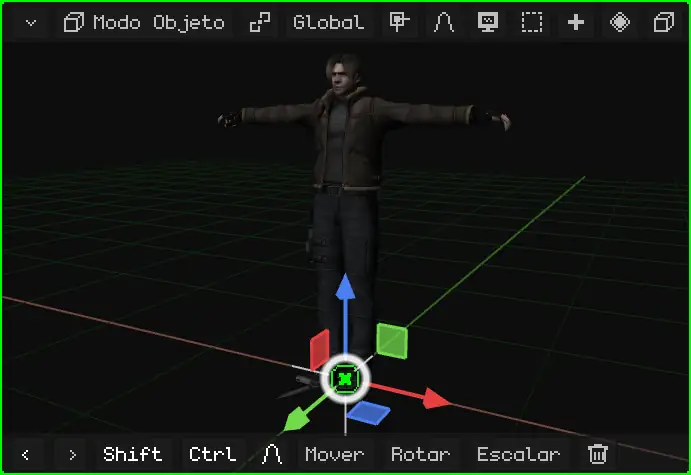

 En el Nokia N95 el gizmo viene apagado: se mueve, se rota y se escala con las teclas, como se explica abajo. Se puede prender en Superposiciones → Gizmo, para usarlo con un mouse Bluetooth.

### Con el teclado o los comandos

Con el teclado no hace falta apuntarle a nada: se aprieta la tecla y el objeto sigue al mouse (o a las flechas, en el teléfono) hasta que confirmás.

| | Mover | Rotar | Escalar | Solo en un eje | Confirmar | Cancelar |
|---|---|---|---|---|---|---|
|  PC | <kbd>G</kbd> | <kbd>R</kbd> | <kbd>S</kbd> | <kbd>X</kbd> / <kbd>Y</kbd> / <kbd>Z</kbd> | Click o <kbd>Enter</kbd> | <kbd>Esc</kbd> o click derecho |
|  Nokia N95 | <kbd>1</kbd> | <kbd>2</kbd> | <kbd>3</kbd> | <kbd>1</kbd> / <kbd>2</kbd> / <kbd>3</kbd> | <kbd>OK</kbd> (el centro del pad) | <kbd>C</kbd> |

 Apretás <kbd>G</kbd> y movés el mouse: el objeto lo sigue. Si apretás <kbd>X</kbd>, solo se mueve en X; otra <kbd>X</kbd> cambia de Global a Local. Lo mismo al rotar: <kbd>R</kbd> y después <kbd>Z</kbd> gira sobre el eje Z, el vertical; sin eje, gira de frente a la vista. También podés escribir un número: <kbd>G</kbd>, <kbd>X</kbd>, <kbd>2</kbd> y <kbd>Enter</kbd> lo corren 2 metros en X.

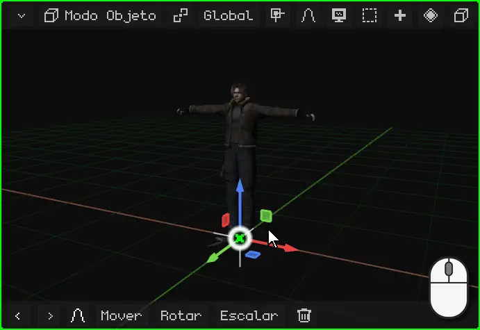

 En el Nokia N95: <kbd>1</kbd> para mover, <kbd>2</kbd> para rotar y <kbd>3</kbd> para escalar, y las **flechas** hacen el movimiento. Mientras dura, <kbd>1</kbd>, <kbd>2</kbd> y <kbd>3</kbd> ya no cambian de operación: eligen el eje X, Y o Z. Por ejemplo, <kbd>2</kbd> y después <kbd>3</kbd> gira sobre el eje Z, el vertical. <kbd>OK</kbd> confirma y <kbd>C</kbd> cancela.

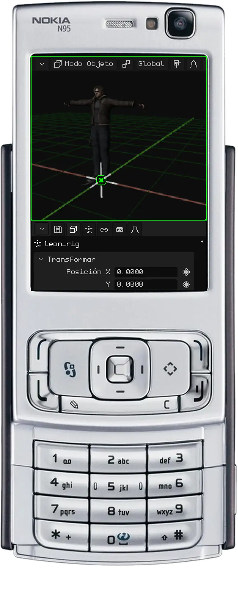

 **En una pantalla táctil**, sin teclado, se puede usar el gizmo, como se vio arriba, o los **comandos** de la barra de abajo de la Vista 3D. Tocás **Mover**, **Rotar** o **Escalar** y arrastrás el dedo en cualquier parte de la vista: el objeto sigue al dedo. La barra cambia: la **tilde verde** confirma, la **cruz roja** cancela, y los botones **X**, **Y** y **Z** dejan el movimiento en esos ejes.

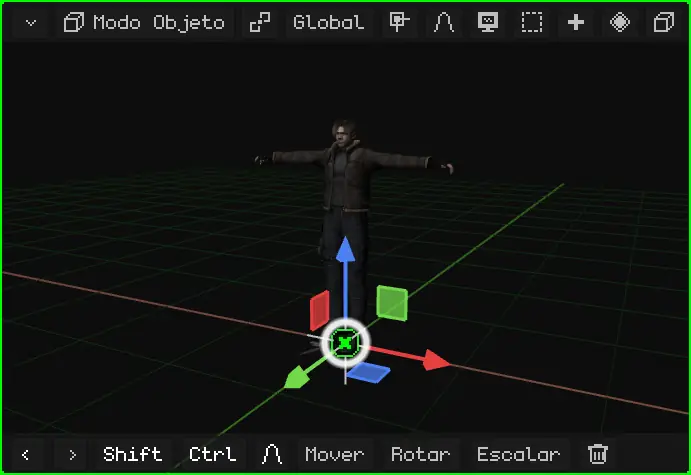

Mientras dura la operación, la barra de arriba de la Vista 3D muestra lo que se está haciendo, con los números exactos.

Todos los atajos del Modo Objeto están en el manual: [Mover, rotar y escalar](../editor/transformar.md) y [Modo Objeto](../editor/modo-objeto.md).

### La barra de abajo: los últimos comandos

  En la barra de abajo de la Vista 3D están Deshacer y Rehacer (las flechas), y después **los últimos comandos que usaste**, con el último adelante. Al empezar son Mover, Rotar, Escalar y Borrar. Si escalás un objeto, Escalar pasa al frente: lo que más usás queda siempre a mano.

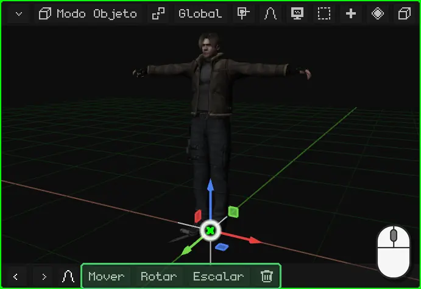

 En el Nokia N95 esta barra viene apagada: ahí todo se hace con las teclas del teléfono.

## Desde dónde se mueve, se rota y se escala

### El origen

Cada objeto tiene un **origen**: el punto desde donde sale el gizmo. Es el punto desde el que se transforma: el objeto gira alrededor de su origen y se agranda o se achica desde él. La **posición** que muestra Propiedades es la de su origen.

En las primitivas, el origen está en el centro. En un modelo importado está donde lo dejó el programa en que se hizo: en Leon, a sus pies.

### El cursor 3D

El **cursor 3D** es el círculo con una cruz de la Vista 3D. Al empezar está en el centro del mundo. Sirve para dos cosas:

- todo lo que se agrega con **Añadir** aparece ahí;
- puede ser el centro desde el que se rota y se escala, como se ve en [El punto de pivote](#el-punto-de-pivote).

El cursor 3D se mueve con el menú **Imán**, que también lleva los objetos hasta el cursor:

| | Cómo se abre el menú Imán |
|---|---|
|  PC | <kbd>Shift</kbd> + <kbd>S</kbd> |
| Menú | Objeto → Imán (en el Modo Edición, Malla → Imán) |

| Opción | Qué hace |
|---|---|
| Cursor a lo seleccionado | Lleva el cursor 3D al centro de lo elegido. En el Modo Edición, al centro de los vértices, aristas o caras elegidas. |
| Cursor al activo | Lleva el cursor 3D al origen del objeto activo. |
| Cursor al origen del mundo | Lo devuelve al centro del mundo. |
| Cursor a la cuadrícula | Lo lleva al punto de la cuadrícula más cercano. |
| Selección a Cursor | Lleva lo elegido hasta el cursor 3D. |
| Selección al cursor (mantener desfase) | Igual, pero con varios objetos mantiene la distancia entre ellos: el grupo llega entero. |
| Selección al activo | Lleva lo elegido hasta el objeto activo. |
| Selección a la cuadrícula | Pega cada objeto elegido al punto de la cuadrícula más cercano. |

Por ejemplo, para poner una caja en la mano de alguien, o un objeto justo donde está otro: elegís el de destino, **Cursor a lo seleccionado**; después elegís el que querés llevar y **Selección a Cursor**.

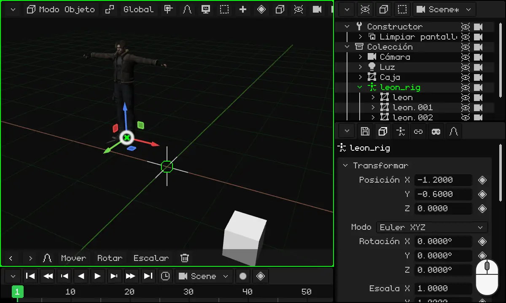

### El punto de pivote

El **punto de pivote** es el centro desde el que se rota y se escala lo elegido. Se elige con el botón del pivote de la barra de la Vista 3D, a la izquierda de **Global** (su ícono cambia según el pivote elegido):

| Pivote | Desde dónde rota y escala |
|---|---|
| **Punto medio** | Desde el centro de todo lo elegido. Es el que viene. Con un solo objeto, es su origen. |
| **Elemento activo** | Desde el origen del objeto activo (el último que elegiste): los demás giran a su alrededor. |
| **Orígenes individuales** | Cada objeto desde su propio origen: giran todos a la vez, cada uno en su lugar. |
| **Cursor 3D** | Desde el cursor 3D. |

Con **Cursor 3D** se puede rotar cualquier cosa alrededor de cualquier punto: ponés el cursor ahí (con el menú Imán) y rotás. Sirve para acomodar sillas alrededor de una mesa, las agujas de un reloj o lo que tenga que girar alrededor de algo.

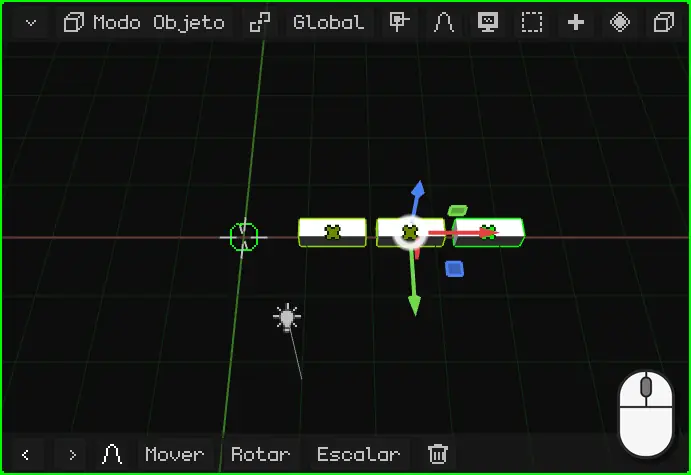

### Global y Local

Cuando movés, rotás o escalás en un eje, ese eje puede ser el del **mundo** o el del **objeto**. Se elige con el botón **Global** de la barra de la Vista 3D:

| Orientación | Los ejes |
|---|---|
| **Global** | Los del mundo: siempre iguales, con la Z para arriba. Es la que viene. |
| **Local** | Los del propio objeto, que giran con él. |
| **Vista** | Los de la pantalla: X para el costado, Y para arriba. |
| **Normal** | En el Modo Edición, la dirección para la que mira la cara elegida. |

La diferencia se ve cuando el objeto está girado. Por ejemplo, Leon rotado 40°: en **Global**, su eje Y es el del mundo y se mueve en diagonal respecto de para dónde mira; en **Local**, el eje Y gira con él y camina derecho hacia adelante. Lo mismo un auto que dobló en una esquina: para que avance, se mueve en su eje Local.

 Con el teclado, la segunda letra del eje cambia de Global a Local: <kbd>G</kbd> <kbd>Y</kbd> mueve en la Y del mundo y <kbd>G</kbd> <kbd>Y</kbd> <kbd>Y</kbd>, en la Y del objeto. En el Nokia N95, lo mismo con <kbd>2</kbd> <kbd>2</kbd> mientras se mueve.

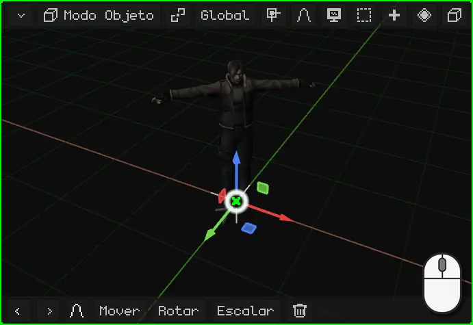

### Cambiar el origen: una puerta

El origen de una malla 3D se puede cambiar de lugar sin mover la malla, con **Objeto → Definir Origen**:

| Opción | Qué hace |
|---|---|
| **Origen a Geometría** | Lleva el origen al centro de la malla. |
| **Origen al Cursor 3D** | Lleva el origen a donde está el cursor 3D. |
| **Geometría al Origen** | Al revés: deja el origen y mueve la malla hasta que su centro quede en él. |

El ejemplo típico es una **puerta**. Una caja con forma de puerta tiene el origen en el centro, y al rotarla gira sobre sí misma, como una puerta giratoria. Para que se abra desde la bisagra:

1. Entrá al Modo Edición (<kbd>Tab</kbd> en la PC, <kbd>OK</kbd> en el N95) y elegí la cara angosta del lado de la bisagra.
2. Menú Imán → **Cursor a lo seleccionado**: el cursor 3D queda sobre la bisagra.
3. Volvé al Modo Objeto y elegí **Objeto → Definir Origen → Origen al Cursor 3D**.

Ahora, al rotarla en Z, la puerta se abre desde la bisagra.

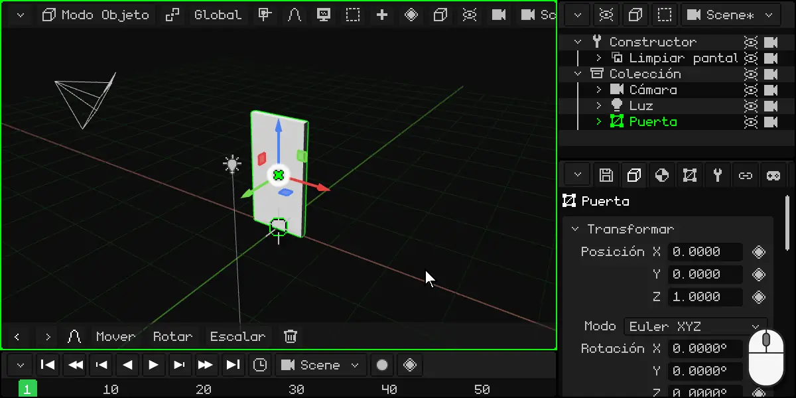

## Las propiedades

Las **propiedades** del objeto activo están en el viewport de Propiedades. La pestaña **Objeto** (la del cubo) es igual para todos los objetos: arriba está la tarjeta **Transformar**, con la posición, la rotación y la escala. Se pueden escribir los números a mano: un click (o un toque) en el número y se tipea. Mover el objeto en la Vista 3D cambia estos números, y cambiar los números lo mueve.

Las otras pestañas dependen del tipo de objeto: una luz tiene la pestaña de la luz, una malla tiene la del material y la de los modificadores.

### El rombo: lo que se puede animar

Al lado de muchas propiedades hay un **rombo**. El rombo quiere decir que esa propiedad **se puede animar**: un click en el rombo guarda su valor en el frame actual (un *keyframe*), y otro click en el rombo verde lo saca. Con varios keyframes, la propiedad cambia sola con el tiempo.

El color del rombo dice cómo está la propiedad: **gris**, todavía no está animada; **verde** iluminado, ya está animada y tiene un keyframe en este frame; **verde tenue**, está animada, pero no tiene keyframe en este frame.

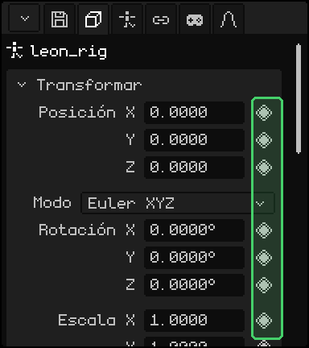

La animación tiene su propio tutorial más adelante.

### Mejor con la escala en 1

Un consejo: **dejá la escala de los objetos en 1**. Agrandar o achicar un objeto con Escalar es cómodo, pero un objeto escalado puede traer problemas después: los hijos heredan la escala y se deforman al rotar, y las físicas, los choques y algunos modificadores pueden calcular mal.

Si escalaste un objeto, **aplicá la escala**: el tamaño que tiene pasa a ser su tamaño real y la escala vuelve a 1, sin que cambie lo que se ve.

| | Cómo se aplica la escala |
|---|---|
|  PC | <kbd>Ctrl</kbd> + <kbd>A</kbd> → Escalar |
| Menú | Objeto → Aplicar → Escalar |

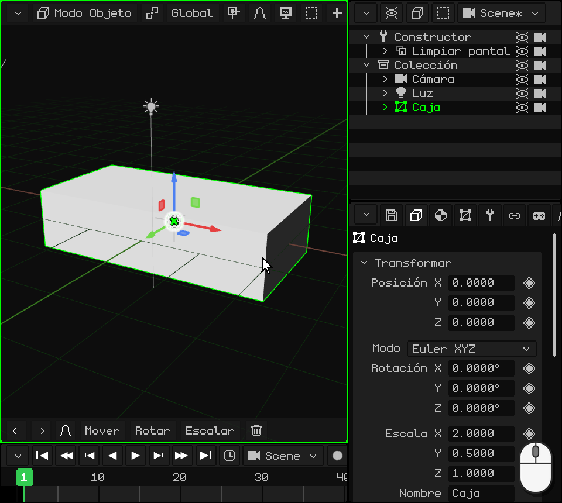

En el mismo menú, **Posición** y **Rotación** hacen lo mismo con la posición y la rotación, y **Todas las Transformaciones** aplica las tres.

## El Outliner: los objetos de la escena

El **Outliner** es la lista de todos los objetos de la escena. Un click (o un toque) en una fila elige ese objeto, igual que en la Vista 3D. En la PC está arriba a la derecha.

Un objeto puede estar **adentro de otro**: se ve más corrido a la derecha, colgando de él. El de afuera es el **padre** y el de adentro es el **hijo**. El hijo **hereda las transformaciones** del padre: si movés, rotás o escalás al padre, el hijo lo acompaña. El hijo se puede seguir moviendo solo, pero siempre relativo al padre.

Leon es un ejemplo: sus mallas, las cuatro partes que se ven, son hijas de su esqueleto, `leon_rig`. Mover el esqueleto mueve a Leon entero.

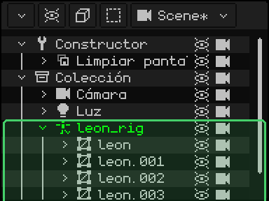

Meter un objeto adentro de otro se llama **emparentar**:

| | Cómo se emparenta |
|---|---|
|  PC | En el Outliner, arrastrar la fila del hijo y soltarla encima de la del padre. O elegir el hijo, después el padre (con <kbd>Shift</kbd>) y <kbd>Ctrl</kbd> + <kbd>P</kbd>. |
|  Pantalla táctil | Elegir el hijo; prender **Shift** en la barra de abajo y tocar el padre; después, menú Objeto → Emparentar. |
|  Nokia N95 | Con el Outliner activo y el hijo elegido: <kbd>1</kbd>, la flecha **derecha** lo mete adentro del de arriba y la **izquierda** lo saca; <kbd>1</kbd> otra vez confirma. |
| Menú | Objeto → Emparentar; para sacarlo, Objeto → Desemparentar |

 En el video, una caja se arrastra en el Outliner hasta `leon_rig`: pasa a ser su hija, y al mover a Leon la caja lo acompaña.

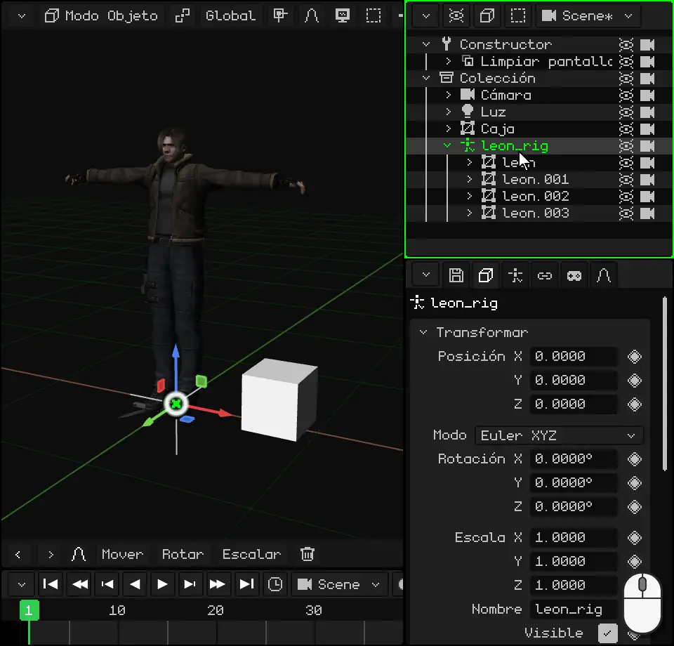

## Los tipos de objetos

Todos los objetos se agregan desde el menú **Añadir** (el botón **+** de la barra de la Vista 3D, o <kbd>Shift</kbd> + <kbd>A</kbd> en la PC). Lo nuevo aparece en el cursor 3D y queda elegido.

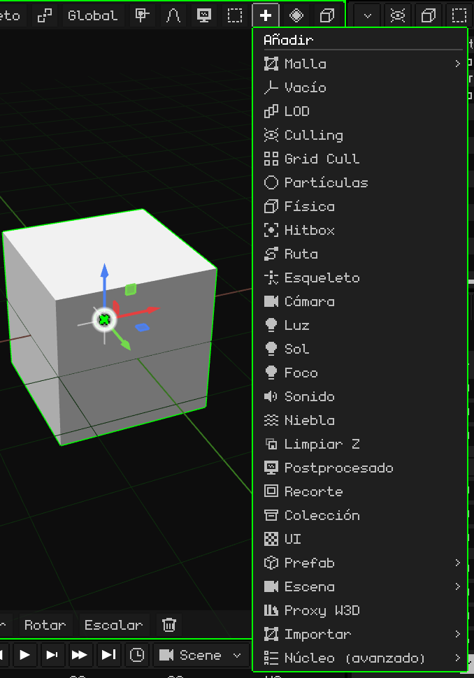

Los básicos son estos:

| Objeto | Qué es |
|---|---|
| [Malla 3D](objeto-malla.md) | Un modelo 3D: un personaje, una casa, una piedra. Está hecho de vértices, aristas y caras, y se ve con su material y sus texturas. Las primitivas de Añadir → Malla (cubo, esfera, cilindro...) son mallas para empezar a modelar. |
| [Cámara](objeto-camara.md) | El punto de vista del juego y de los renders. Lo que ve la cámara activa es lo que se ve al jugar y lo que sale en una imagen o un video. |
| [Luz](objeto-luz.md) | Ilumina la escena. Hay tres tipos: Puntual (una lamparita), Sol (luz de día, con rayos paralelos) y Foco (un cono, como una linterna). |
| [Esqueleto](objeto-esqueleto.md) | Una cadena de huesos que mueve una malla, para animar personajes. Leon tiene uno: cuando el esqueleto camina, la malla lo sigue. |
| [Sonido](objeto-sonido.md) | Un sonido puesto en la escena. Puede sonar de fondo, como una música, o desde donde está el objeto. |
| Vacío | Un objeto sin forma: un punto en la escena. Sirve de padre para agrupar otros o como referencia. |
| Colección | Una carpeta para ordenar los objetos en el Outliner. |

Hay más: rutas, niebla, partículas, hitbox para los choques, interfaces 2D para los juegos y objetos para optimizar. Y en el futuro se van a ir agregando muchos más. Este tutorial habla de los objetos en general; cada uno tiene su artículo, donde se explican sus propiedades una por una.

## Lo que tienen todos los objetos

Además de su transformación y de sus propiedades, cualquier objeto puede tener:

- **Scripts** de Lua, que le dan comportamiento en el juego: que se mueva solo, que responda a las teclas, que choque. Se ven más adelante.
- **Animaciones**: cualquier propiedad con rombo se puede animar. Tienen su propio tutorial.
- **Restricciones**: reglas que lo atan a otro objeto, como copiar su posición o mirar siempre a la cámara. Se explican en [Restricciones](restricciones.md).

Algunos tipos tienen además cosas propias. Las mallas 3D, por ejemplo, tienen **modificadores**, que cambian la forma sin destruirla: reflejarla como en un espejo, repetirla, suavizarla. Están en [Malla 3D](objeto-malla.md).

## Importar modelos 3D

Además de modelar en Whisk3D, se pueden traer modelos hechos en otros programas. Los formatos que entran son:

| Formato | Qué trae |
|---|---|
| **GLB** y **glTF** | La malla, los materiales y las texturas, el esqueleto y las animaciones. Es el formato más completo: Leon viene en un .glb. |
| **OBJ** | La malla, los materiales y las texturas (con su .mtl). Sin esqueleto ni animaciones. |
| **FBX** | La malla, los materiales, el esqueleto y las animaciones. |
| **STL** | Solo la forma: los triángulos, sin materiales ni colores. Es el formato de la impresión 3D y de los programas de CAD. |

Se importan desde **Añadir → Importar**, eligiendo el formato y después el archivo.

 En la PC también se puede arrastrar el archivo desde la carpeta y soltarlo sobre la Vista 3D.

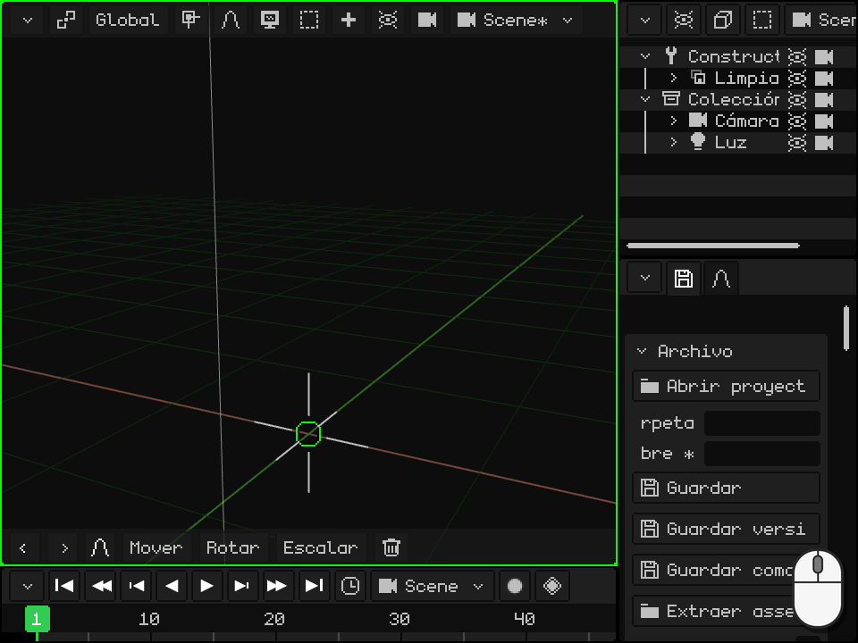

Un modelo con esqueleto entra como un **esqueleto con las mallas adentro**: el esqueleto es el padre y las mallas, sus hijas, como se vio en el [Outliner](#el-outliner-los-objetos-de-la-escena). Las animaciones quedan guardadas en el esqueleto, listas para usar.

Para llevar un modelo a otro programa o a una impresora 3D está el camino inverso: Propiedades → la pestaña del disquete → **Exportar**, con OBJ, glTF, GLB o STL.
